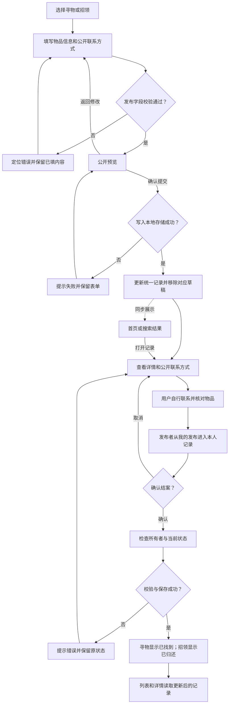
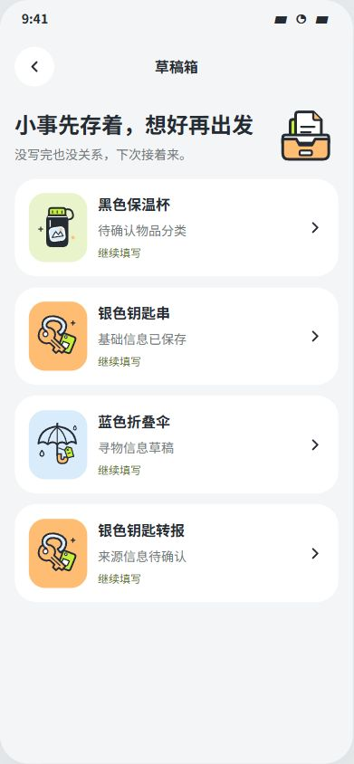
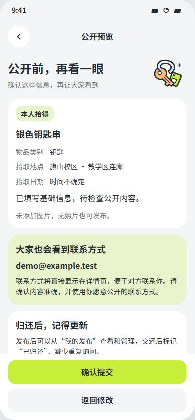
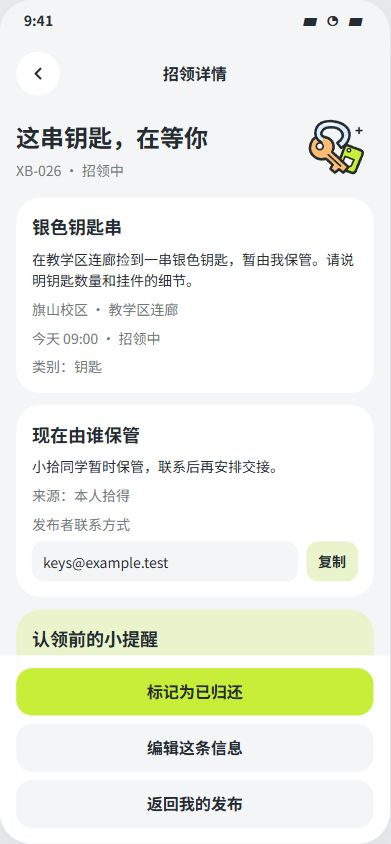

# 软件工程第四次作业

| 项目 | 内容 |
| ---- | ---- |
| 这个作业属于哪个课程 | [https://edu.cnblogs.com/campus/fzu/202601SofwareEngineering](https://edu.cnblogs.com/campus/fzu/202601SofwareEngineering) |
| 这个作业要求在哪里 | [https://edu.cnblogs.com/campus/fzu/202601SofwareEngineering/homework/16743](https://edu.cnblogs.com/campus/fzu/202601SofwareEngineering/homework/16743) |
| 这个作业的目标 | 通过完善与实现原型掌握结对编程 |
| 学号 | 052403137，182400320 |
| 结对成员博客 | [cnblogs/155TuT](https://www.cnblogs.com/155TuT)，[cnblogs/mukyng](https://www.cnblogs.com/mukyng) |
| 项目地址 | [052403137-182400320](https://github.com/155TuT/052403137-182400320) |
| 技术选型 | React + Vite |
| Release | [拾伴 v1.0.0](https://github.com/155TuT/052403137-182400320/releases/tag/homework) |

## 0x00 对第三次作业的反思

### 对自己做的好的地方的思考

我觉得上一次做得比较好的是我们的思考没有停在功能清单上。[第三次作业](../../task3/ans/hoemwork.md)中，我们从第一版的发布、搜索和详情，继续追问信息从哪里来、拾物者是否方便保管、浏览者为什么愿意提供线索。因此第二版加入短表单、可选图片、来源说明和协助反馈，并保留建议错误时人工修改、继续发布的入口。这些考虑让功能有了对应的使用情境，也提醒着我：方便用户，要落实到少填什么、哪里可以退出、失败后怎样继续。

我们也尝试把联系之后的事情讲清楚。[PRD](../../task3/ans/prd.md)区分发布者、持有人、认领者和服务点，写出待确认、已核实完成与本人自报找回的区别，再把进展放回“我的事项”。服务点接收并不证明归还，单方确认也不算作核实找回。虽然这些仍是设计，但至少让我们开始考虑谁负责推进、谁来确认结果，而不是把点击“联系”当作流程结束。

另一个收获是真正体会到了原型设计的优劣，我们愿意回到原型中查问题。[交付记录](../../task3/ans/assets/prototype/delivery.md)保留了历史点击走查，[后续流程检查](re.md)又记录了保存草稿后返回、提交后回退、重复搜索和筛选条件丢失等问题及修复，其中 8 条关键路径都有实际的点击记录。把连线检查与点击结果分开记录，比只展示页面更能说明问题；同时明确静态状态页的限制，也能避免把原型演示写成已经完成的程序能力。

### 做的不够好的地方的反思

1. **范围还是铺得太开。** 我们虽然在 PRD 中划分了阶段，也排除了地图和完整即时聊天，但仍展开了服务点、审核、奖励与申诉等原型不必要考虑的方面，导致原型最终有 116 个手机画板。考虑完整产品有价值，却不能代替两个人在本次作业中的取舍。这次应先把发布、浏览或搜索、查看详情、联系发布者和更新状态做扎实，再按时间与必要性决定扩展功能。

2. **需求缺少真实用户反馈。** 上次博客写了“调研”，但现有材料主要是题目、公开资料、我们自己的讨论和设计推演，没有具体的用户访谈或试用反馈记录。短表单是否真的省事、核验是否过重、服务点是否愿意承接，目前都还是假设。后续应请真正丢过或捡过物品的同学独立完成任务，记录卡住的位置和原因；涉及校内运营的安排，还要向实际负责人确认。没有这些证据，就不能声称提高了找回率或缩短了寻物时间。

3. **复杂流程掩盖了最基本的状态维护。** 我们设计了核验和交接，但本次要求的“由发布者标记已找到或已归还”还需要在实现与博客中直接说明：发布者从“我的发布”进入本人记录并更新状态，其他用户在列表和详情看到相同结果。本人自报与核实归还的区别可以保留，却不能让简单结案依赖尚未接入的服务点或审核人员。后续要验证操作权限、更新后的展示，以及重新打开记录时能否读到最新状态。

4. **交互验证仍然不够完整。** `re.md` 的全量连线覆盖证明节点和目标有记录，8 条点击路径只证明对应场景走通，并不代表全部分支可用。预置关键词与有限筛选组合，也没有验证自由输入、真实提交和跨页面状态持久化。进入程序实现后，还要检查必填信息缺失、搜索无结果、重复提交、取消后返回等情况，并记录实际结果；流程图可解析、原型能跳转和程序功能通过测试的不同情况需要分别说明。

## 0x01 PSP

| PSP2.1 | Personal Software Process Stages | 预估耗时（分钟） | 实际耗时（分钟） |
| ---- | ---- | ---- | ---- |
| Planning | 计划（小计） | 30 | 60 |
| Estimate | 估计这个任务需要多少时间 | 30 | 60 |
| Development | 开发（小计） | 900 | 1190 |
| Analysis | 需求分析（包括学习新技术） | 75 | 60 |
| Design Spec | 生成设计文档 | 45 | 60 |
| Design Review | 设计复审 | 30 | 10 |
| Coding Standard | 代码规范（为目前的开发制定合适的规范） | 15 | 10 |
| Design | 具体设计 | 75 | 300 |
| Coding | 具体编码 | 420 | 600 |
| Code Review | 代码复审 | 60 | 30 |
| Test | 测试（自我测试，修改代码，提交修改） | 180 | 120 |
| Reporting | 报告（小计） | 150 | 95 |
| Test Report | 测试报告 | 90 | 30 |
| Size Measurement | 计算工作量 | 15 | 5 |
| Postmortem & Process Improvement Plan | 事后总结，并提出过程改进计划 | 45 | 60 |
| 合计 | | 1080 | 1345 |

## 0x02 实现

### 从原型到程序

这次我们把“拾伴”的实现重点收回到题目要求的基本流程：发布寻物或招领信息，浏览、搜索并查看详情，通过公开联系方式自行联系，最后由发布者更新状态。[原型复盘](re.md)中暴露的草稿返回、重复搜索和条件丢失问题，也成为程序设计时需要处理的具体问题。

程序使用 **React + Vite**。React 负责根据当前记录更新页面，Vite 负责开发预览和打包。首页、搜索和“我的发布”共用 `App.jsx` 中的数据；详情只保存当前记录的编号，每次从同一份记录中读取内容。因此，发布或结案后，各入口可以显示一致的结果，不需要分别修改几个页面的文案。

### 核心流程



发布前检查名称、类别、校区、区域和联系方式，日期可留空，但不能填写无效日期或未来日期；图片是可选项。新记录获得独立编号和发布者信息，编辑本人尚未完成的记录则沿用原编号，不额外增加一条发布。搜索直接读取当前记录，将关键词与名称、描述、类别、区域等信息匹配，新发布的内容也能查到。

状态维护放在详情页：发布者从“我的”中的“我发布的”进入记录，点击“标记为已找到”或“标记为已归还”，确认后才保存。其他用户没有修改入口，数据层还会再次检查所有者。这里的结案表示发布者更新了信息，不代表服务点确认或双方完成核验。

### 关键代码：保存成功后再更新界面

`src/App.jsx` 将发布、草稿和结案的持久化收在同一个 `commit` 函数中：

```jsx
function commit(next) {
  if (initial.error)
    throw new Error('原有本地数据读取失败，已停止覆盖。请换用可用的浏览器存储后重试。');
  const saved = saveState(localStorage, next);
  dataRef.current = saved;
  setData(saved);
  return saved;
}
```

这个顺序很重要。`saveState` 会检查数据结构并写入存储，成功后才返回保存结果；若存储空间不足或访问被阻止，它会抛出错误，后面的界面更新不会执行。编辑页保留填写内容并提示失败，详情页也不会提前变成“已归还”。原有数据读取失败时，则停止覆盖，避免用初始示例替换已有内容。

结案也不只靠隐藏按钮限制。`src/model.js` 中的 `completeItem` 先检查记录和操作者，再处理重复请求，以下为其中的校验部分：

```javascript
const item = items.find((record) => record.id === id);
if (!item) throw new Error('这条信息不存在或已被移除。');
if (!actorId || item.ownerId !== actorId) throw new Error('只有发布者本人可以更新这条信息。');
if (item.status === 'completed') return items.slice();
if (item.status !== 'active') throw new Error('这条信息当前不能结案。');
```

通过检查后，函数返回更新后的记录数组，设置完成时间，并按寻物或招领生成“已找到”或“已归还”文案。已完成记录再次结案不会重复改写完成时间。这里演示的是业务规则；当前用户是固定的“小拾同学”，本地检查不能替代真实系统的服务端权限控制。

### 目录与运行方法

```text
052403137-182400320/
├─ index.html             # Vite 开发入口
├─ package.json           # 依赖与运行命令
├─ vite.config.js         # 相对资源路径、单页打包与 web 输出配置
├─ src/
│  ├─ main.jsx            # React 入口
│  ├─ App.jsx             # 页面导航、统一记录与保存
│  ├─ Editor.jsx          # 发布表单、图片、草稿与公开预览
│  ├─ Search.jsx          # 关键词输入、结果与空态
│  ├─ Detail.jsx          # 详情、联系方式与结案确认
│  ├─ Activity.jsx        # 本机认领、协助记录与帮助说明
│  ├─ model.js            # 校验、搜索、状态规则与存储
│  ├─ seed.js             # 虚构示例与初始草稿
│  ├─ ui.jsx              # 通用界面组件
│  └─ *.css               # 页面样式
├─ public/assets/         # SVG、字体与字体许可证
├─ tests/model.test.js    # 数据与业务规则的单元测试
├─ docs/implementation.md # 实现范围及已有验证记录
└─ web/                   # 构建产物，包含 index.html 和 assets/
```

测试人员下载项目后，保留完整的 `web/` 文件夹（已打包为[压缩文件](https://github.com/155TuT/052403137-182400320/releases/tag/homework)），用 Google Chrome 打开 `web/index.html`。根目录的 `index.html` 是开发入口，不能与构建后的文件混淆。现有验证记录使用的是本地开发服务和 `vite preview`，直接以 `file://` 打开的效果尚未单独验收。

需要开发或通过本地服务运行时，安装 Node.js 22.12.0 或更新版本，在项目根目录执行：

```powershell
npm install
npm run dev
```

使用 Chrome 打开终端输出的地址。首次安装依赖需要联网；修改代码后，按下面的顺序重新构建并预览交付版本：

```powershell
npm run build
npm run preview
```

开始体验时，可以查看初始的蓝伞、水杯和钥匙记录；银色钥匙串属于当前演示用户，可用于练习编辑和结案。发布一条自己的记录后，再搜索该名称、查看详情并更新状态，即可走完基本流程。数据只在当前浏览器、当前打开地址下保存，开发地址、预览地址与直接打开文件之间不会自动共享。

## 0x03 特点

我们把附加设计放在填写、查找和联系时容易中断的地方。

### 草稿与公开预览：允许没写完，也允许再检查一次

捡到东西时不一定方便立即填写所有信息，因此表单允许在必填项未补全时**手动保存草稿**。草稿独立存放，不进入公开列表；从“我的”的草稿箱继续填写时，会恢复已有内容。再次保存沿用同一草稿编号，成功发布后移除对应草稿，避免草稿箱里留下一份已经发布的旧内容。

`src/model.js` 的 `upsertDraft` 根据编号决定替换还是新增，关键部分如下；`updated` 是合并旧内容与本次输入、校验图片后得到的草稿：

```javascript
return previous
  ? drafts.map((record) => (record.id === id ? updated : record))
  : [updated, ...drafts];
```

公开预览则让用户在提交前看清物品信息和联系方式，发现不妥可以返回修改。日期不确定可留空、照片不是必填，也让发布不必依赖一份完全齐备的材料。下图展示从钥匙草稿恢复内容后进入公开预览的效果：

| 草稿箱 | 公开预览 |
| --- | --- |
|  |  |

### 筛选与条件保留：少重复输入，也能从空结果继续找

除了关键词，程序还提供校区选择，以及“雨伞·图书馆·近 7 天”“钥匙·教学区·今天”“水杯·食堂·近 7 天”等筛选组合。当前界面采用这些预设组合，尚未提供所有条件的自由组合。

实现时，输入框内容 `query`、已提交的关键词 `submitted` 和筛选条件 `filter` 分别保存在 `App.jsx` 中，结果由当前记录派生。进入详情再返回、按同样关键词重新搜索，都继续使用原有条件；没有结果时，页面提供修改关键词、放宽筛选和发布寻物的入口。筛选浮层先修改临时选项，点击“查看结果”才应用，直接关闭不会误改原条件。

这也回应了[原型复盘](re.md)中的筛选丢失问题。本次打开钥匙结果、应用“钥匙·教学区·今天”、进入详情再返回，关键词和筛选仍然保留。界面中的四个快捷词仅用于填入搜索框，不代表已经实现真实的搜索历史。


### 联系方式复制：把操作结果说准确

详情直接展示发布者愿意公开的联系方式，并提供复制按钮，减少在两个应用之间反复抄写的步骤。`src/Detail.jsx` 中的实现会等待剪贴板写入成功；如果浏览器不支持或阻止复制，就选中文字，让用户手动复制：

```jsx
async function copyContact() {
  if (!contact) return;
  try {
    if (!navigator.clipboard?.writeText) throw new Error('Clipboard unavailable');
    await navigator.clipboard.writeText(contact);
    setCopyMessage('联系方式已复制');
    onNotify?.('联系方式已复制');
  } catch {
    selectContact();
    setCopyMessage('未能自动复制，已选中联系方式，请手动复制。');
  }
}
```

我们希望“复制成功”对应实际结果，失败后也有可继续操作的办法。这里提供的是联系信息与复制便利，实际联系和物品核对仍由用户自行完成。下图为当前演示用户发布的钥匙记录，所以同时显示编辑与结案入口。



## 0x04 测试与issue

这次从测试中整理出 issue，我开始体会到结对开发对问题描述的要求：自己发现了异常，还需要让队友能够复现，知道它影响什么，以及修到什么程度才算完成。仓库中的问题涉及多标签页保存、联系方式校验、草稿状态、分类展示和日期文案等，其中不少都发生在主流程已经能够跑通之后。这也回应了前面原型复盘中的不足：单次操作成功，还需要继续检查操作之间的状态变化。

### 从代码分支和使用顺序构造测试

项目使用 Node.js 自带的 `node:test` 与 `node:assert/strict`，在 `tests/*.test.js` 中用 `test` 描述场景、用断言检查实际结果，执行 `npm test` 即可统一运行。我的理解是，写一个用例应先确定输入和预期，再调用被测函数；遇到失败，要回到业务规则判断实现或预期哪里有问题。

例如，[日期测试](https://github.com/155TuT/052403137-182400320/blob/main/tests/dateLabel.test.js)中有下面这段用例。`item` 用来构造基础物品记录，`now` 是固定的测试时间，`formatDateLabel` 是被测的日期文案函数：

```javascript
test('missing or malformed eventDate keeps an explicit unknown prompt', () => {
  assert.equal(formatDateLabel(item({ eventDate: '' }), { now }), '时间不确定');
  assert.equal(formatDateLabel(item({ eventDate: undefined }), { now }), '时间不确定');
  assert.equal(formatDateLabel(item({ eventDate: 'not-a-date' }), { now }), '时间不确定');
});
```

空字符串、缺少字段和非法日期分别对应不同的输入情况；固定时钟还可以检查跨日、跨月和跨年的展示，不需要修改系统时间。这让我对白盒测试有了更具体的理解：沿着校验、状态判断和保存失败等分支设计数据，检查每个分支是否符合预期。联系方式要同时考虑合法输入、纯符号和长度边界；草稿要考虑新建、编辑原记录以及原记录结案后的情况；并发保存则要区分两页修改不同记录和同一记录。测试数据需要对应可能出错的条件，也要检查失败后原内容是否仍然保留。

### 把 issue 写成双方可以核对的约定

[issue #1](https://github.com/155TuT/052403137-182400320/issues/1)让我觉得，复现步骤本身就在帮助分析问题。同一地址打开 A、B 两页，A 发布记录，B 不刷新就保存草稿，再检查 A 的记录是否消失，这比一句“本地存储有问题”明确得多。它把影响限定在本地多标签页，并提出同一记录冲突时保留未提交内容的要求，后续 review 就有了可以逐项核对的依据。

[issue #2](https://github.com/155TuT/052403137-182400320/issues/2)中的 `-------` 则是一个很小但有效的反例：输入长度符合原规则，却没有任何可用于联系的数字。问题还涉及发布与认领表单重复维护校验，因此验收也需要检查规则是否共用。写到这一步，我才更清楚地意识到，一个 issue 应当交代问题、复现方式、代码依据和验收标准；建议可以讨论，但用户应得到什么结果需要说清楚。这样的记录能减少队友反复询问上下文，也方便后来的人理解修改原因。

同时，测试记录需要说明证据的范围。[issue #8](https://github.com/155TuT/052403137-182400320/issues/8)记录了约 7.42 MiB 的字体资源和引用方式，也明确尚未做冷缓存耗时对比；[标签交互验收](https://github.com/155TuT/052403137-182400320/blob/main/docs/record-tabs.md)则把 Chrome 中的键盘操作与数据层单元测试分开。这提醒我，报告中“测过了”应当有具体对象和方法：函数断言通过、浏览器操作通过、性能测量完成，各自能够支持的结论不同。

## 0x05 修复与交付

截至 **2026 年 10 月 10 日**，仓库的 8 个 issue 中有 6 个已关闭、2 个仍开放；PR #10～#15 已合并。对应关系如下：

| 问题 | 修复记录 | 当前状态 |
| ---- | ---- | ---- |
| [#1 多标签页保存冲突](https://github.com/155TuT/052403137-182400320/issues/1) | [PR #12](https://github.com/155TuT/052403137-182400320/pull/12)，整合时补齐编辑快照与保存保护 | 已关闭 |
| [#2 联系方式校验](https://github.com/155TuT/052403137-182400320/issues/2) | [PR #13](https://github.com/155TuT/052403137-182400320/pull/13)，补充边界测试 | 已关闭 |
| [#3 失效编辑草稿](https://github.com/155TuT/052403137-182400320/issues/3) | [PR #14](https://github.com/155TuT/052403137-182400320/pull/14)，整合时补齐只读查看与丢弃确认 | 已关闭 |
| [#4 分类插画与展示](https://github.com/155TuT/052403137-182400320/issues/4) | [PR #10](https://github.com/155TuT/052403137-182400320/pull/10) | 已关闭 |
| [#6 标签选中态与键盘导航](https://github.com/155TuT/052403137-182400320/issues/6) | [PR #15](https://github.com/155TuT/052403137-182400320/pull/15) | 已关闭 |
| [#7 跨日时间文案](https://github.com/155TuT/052403137-182400320/issues/7) | [PR #9](https://github.com/155TuT/052403137-182400320/pull/9) 审查后关闭，后续由 [PR #11](https://github.com/155TuT/052403137-182400320/pull/11) 合并修复 | 已关闭 |
| [#5 独立组合筛选](https://github.com/155TuT/052403137-182400320/issues/5) | 尚无已合并的对应修复 PR | 仍开放 |
| [#8 字体加载优化](https://github.com/155TuT/052403137-182400320/issues/8) | 尚无已合并的对应修复 PR | 仍开放 |

### Review 需要给出可以复查的理由

在 [PR #9 的审查](https://github.com/155TuT/052403137-182400320/pull/9#pullrequestreview-5468364574)中，统一日期计算的方向是合理的，但实际运行时，40 项测试中有 1 项失败：实现返回的文案与测试预期相差一个空格；更直接影响交付的是，源码修改后没有更新 `web/index.html`，使用交付目录仍会遇到旧问题。这次正式提交了 Request changes，后续修正在 PR #11 中合并。这个过程让我意识到，review 的结论需要由代码位置、失败用例和影响范围支撑，才能让对方知道为什么需要修改、如何验证修改已经完成。

同一次审查还指出，迁移测试直接使用新版本的初始记录，而该记录已经带有迁移后才需要的字段，即使迁移没有正确执行，断言也可能通过。后续用例显式移除了旧数据中不存在的 `eventTime`，再检查迁移和第二天的展示。这比单纯增加测试数量更值得我学习：测试本身也需要被审查，要确认它确实有能力发现要防止的问题。

### 按验收标准检查，才能发现修复中的遗漏

[PR #12 的 review 记录](https://github.com/155TuT/052403137-182400320/pull/12#issuecomment-6086645055)说明，增加版本号和监听其他标签页更新后，已经打开的旧表单仍可能覆盖同一记录的新内容。整合时继续保留编辑开始时的记录快照，把读取、校验与写入放进同一个跨标签页锁中，并在冲突后保留输入、提供另存草稿的入口。我从中体会到，审查一个修复，需要继续推演原来的失败场景：版本号更新了，用户手里的表单是否也仍然有效？拒绝保存之后，用户又能怎样继续？

[PR #14](https://github.com/155TuT/052403137-182400320/pull/14#issuecomment-6086652649)也有类似的遗漏：最初有了失效草稿的丢弃入口，但 issue 还要求用户能够查看保留内容。后续补上只读详情、独立确认和保存失败时保留内容的处理，才把这条流程交代完整。把一个问题拆成独立 PR，能让这些遗漏更容易被发现；审查时回到 issue 的验收标准，也能避免只看新增了哪些代码，就过早判断需求已经完成。

### 把协作记录和交付结果一起做好

这次流程仍有需要改进的地方。PR #12～#14 的 issue 关联由后续评论补充，review 结论主要记在普通评论中，部分遗漏由我在本地整合时通过 [补充提交 `2d8c09c`](https://github.com/155TuT/052403137-182400320/commit/2d8c09ca050a6bd36b5239f071cb36ceeddb161b)修正，再回到 PR 说明结果。这样保留了原有提交和修改依据，但没有完整留下“提出意见—作者逐项回应—正式复审批准”的过程。下一次我希望从创建 PR 时就关联 issue，写清改动范围和验证结果；发现问题后尽量在同一个 PR 中完成回应、补交和复审，让队友也能参与理解修复，看清每次修改的依据。

独立组合筛选和字体优化仍保留在开放 issue 中，后续还需要实现与验证。这次我对规范开源协作的体会，更多落在这些具体记录上：问题为什么提出，修复经过了什么检查，哪些工作已经完成，哪些仍需继续。把这些事情写清楚，队友和后来的维护者才能据此接着做；这也是我以后使用 issue、PR 和 review 时希望坚持的习惯。

## 0x06 互评

本次我的结对伙伴是林叶鑫，虽然在组队之前没有接触过，但是他的态度很严谨，计划和沟通时很顺畅，分配任务后任务完成的速度和质量也很高；不过他之前没有学习过github流程，我review后的他的pr因与main分支出现冲突（我又合并了一个pr导致文件变更），他没有变基后继续修改，而是直接关闭了pr重新提了一个，这个习惯不太好，需要改进。
