# 拾伴原型复盘与流程记录

本文整理已保存的 Figma 流程快照与修复记录，供回顾第三次作业和确定本次实现范围时参考。节点来自[修复后快照](assets/re/figma-flow-after.json)，采集时间：2026-10-02T05:54:37.779Z（UTC）。共 116 个手机画板、559 个可见控制动作；从首页 `16:8524` 可达 114 个画板。这里的统计对应该次快照，不代表当前线上文件状态。

这是免费版 Figma 的静态示例：预置关键词、有限筛选组合与独立状态页；不代表自由输入、动态查询、跨分支状态持久化、真实提交或后端幂等已实现。

阅读顺序：[流程修复](#流程修复) → [主流程扫读](#主流程扫读) → [全量分图索引](#全量分图索引)。复盘结论见 [homework.md 的 0x00](homework.md#0x00-对第三次作业的反思)，原需求设计见 [task3 PRD](../../task3/ans/prd.md)。

<!-- FIX_NOTES_BEGIN -->
## 流程修复

2026-10-02 在 Chrome 中对[拾伴 Figma 原型](https://www.figma.com/design/JTLCFQJNsz3Ip4U7KElBEj?node-id=0-1)进行流程检查，修正后重新导出节点。以下记录对应这次原型修订；[修复前快照](assets/re/figma-flow-before.json)、[修复后快照](assets/re/figma-flow-after.json)及[42 项动作修订与水杯候选复查](assets/re/figma-flow-repair.json)保留了修改依据。

### 问题与处理

| 检查项 | 原有问题 | Figma 中的修复 |
| --- | --- | --- |
| 保存草稿后返回 | 草稿箱→表单→保存→新草稿箱，返回再次打开已保存的表单 | 4 个保存动作改为 SWAP；草稿箱左上角明确“我的”，直接退出到我的 |
| 返回修改与回执互看 | 返回修改或回原回执使用 NAVIGATE，追加了一份旧页面 | 钥匙、寻物预览的返回修改，以及两条协助记录返回回执改为 BACK；水杯候选有多个入口，继续编辑保留明确跳转到表单 |
| 提交完成后回退 | 发布、转报、认领、关联线索和复核提交仍保留原提交步骤 | 提交替换为 SWAP；共享完成状态与消息页设置明确的“我的”出口，水杯完成页返回发布列表 |
| 取消预约 | 取消后通过 BACK 可以重新打开已取消预约 | 两条取消动作改为 SWAP 到核验通过；该页明确返回我的 |
| 同条件重复搜索 | 结果→查询中→相同结果，每次 NAVIGATE 留下一份旧结果，返回看似无效 | 10 个重搜动作改为 SWAP；首次从已输入页搜索仍为 NAVIGATE |
| 筛选和无匹配重搜 | 共用查询页会丢弃筛选，或把无匹配状态恢复成宽泛结果 | 新增 6 个保留既定条件的查询状态，0.5 参数的自动跳转只回对应结果 |
| 提交结果不确定 | “返回预览”进入的预览执行 BACK，会回到异常确认而非编辑表单 | 已确认未收到时直接 SWAP 到钥匙基础信息，按钮改为“重新检查资料” |
| 自动跳转 | 需要区分正常查询跳转与自动循环 | 修复前 4 条、修复后 10 条 AFTER_TIMEOUT；自动动作图均无环，保留查询中→对应结果的单向 SWAP |

### 关键路径走查

[Chrome 点击记录](assets/re/figma-browser-validation.json)保存了 2026-10-02 实际走查的 8 条路径，均到达预期终点。此结果只覆盖列出的路径，不代表全部画板和所有输入组合均已验收。

| 实际点击路径 | 修复后终点 |
| --- | --- |
| 草稿箱→钥匙草稿→保存→左上“我的” | 我的 `16:8778` |
| 我的→发布浮层→钥匙表单→返回 | 原入口背景“我的” `16:8778` |
| 钥匙草稿→预览→返回修改→顶部返回 | 草稿箱 `35:17730`，不会重新打开预览 |
| 钥匙草稿→预览→确认提交→左上“我的” | 我的 `16:8778`，不会重开确认提交 |
| 雨伞输入→首次查询→结果重搜→返回 | 已输入 `35:13593`，一次返回即可离开结果 |
| 雨伞查询→图书馆筛选→应用→重搜 | 筛选结果 `35:13904`，仍为 1 条结果且显示已筛选 |
| 雨伞查询→钥匙筛选→无匹配→重搜 | 无匹配 `35:13631`，不会清除条件恢复宽泛结果 |
| 水杯草稿→公开预览→再看看候选→继续编辑 | 水杯表单 `16:9544`，不会因入口不同而回到预览 |

走查截图：[草稿箱出口](assets/re/draft-exit-proof.png)、[草稿返回](assets/re/draft-return-fixed.png)、[筛选后重搜](assets/re/filter-requery-fixed.png)、[水杯继续编辑](assets/re/cup-edit-fixed.png)。截图用于查看当时的页面状态，完整点击路径以表格和原始记录为准。

### 验证范围与后续实现

静态快照内，116 个画板与 559 个可见动作已进入全量分图；从首页可达 114 个画板，另 2 个旧搜索画板作为历史记录保留。[覆盖对照](assets/re/figma-flow-coverage.json)记录控件与图中边的对应关系；举报回执的 SCROLL_TO 目标由[子节点记录](assets/re/figma-flow-details.json)补充。

显式继续编辑、补证、修改预约、重新授权和查看记录属于用户主动往返，不能把图中的环一概判为死循环。主图与 28 张分图描述的是原型导航；实际程序还需验证任意输入、数据保存、重复提交、取消后的状态和跨分支读取最新状态。原型中的成功页面不能作为这些功能已实现的证明。
<!-- FIX_NOTES_END -->

## 流程图阅读说明

每条边标注实际控制名称与动作类型。NAVIGATE 进入目标；SWAP 替换当前状态；OVERLAY 打开覆盖层。BACK 使用动态历史节点；CLOSE 使用打开该层的动态背景；SCROLL_TO 单列页内目标。AFTER_TIMEOUT 括号中的数值保留原始参数，不推断精确时长。

浅灰虚线框为其他分图中的真实画板。用户主动更换关键词、调整筛选、补充材料及查看记录形成的流程环予以保留；自动跳转环另行机器检查。隐藏控制不绘为当前可点击动作，完整隐藏定义保存在覆盖记录中。

## 主流程扫读

下图精选首页浏览、发布、草稿和消息交接的真实控制边，省略其余状态与分支；完整状态及全部可见动作见后续分图。此图不重复计入机器覆盖。

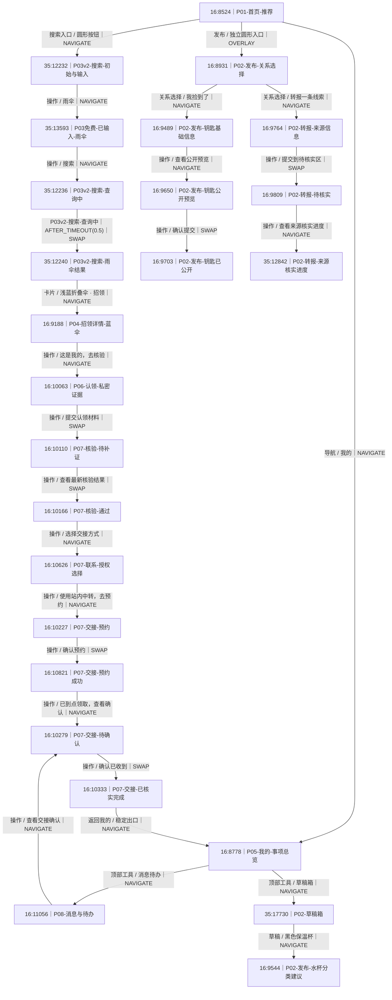

## 全量分图索引

| 分图 | 本组画板 | 可见动作 | 合并后边数 |
| --- | ---: | ---: | ---: |
| [首页的推荐、筛选及校区空态](#flow-main-home) | 5 | 31 | 30 |
| [我的事项总览与消息已读状态](#flow-main-mine) | 2 | 32 | 28 |
| [发布关系选择浮层](#flow-main-publish) | 1 | 7 | 6 |
| [草稿箱与校区下拉](#flow-main-tools) | 2 | 8 | 8 |
| [物品详情与候选比较入口](#flow-details) | 7 | 24 | 20 |
| [钥匙招领：基础信息、预览与公开](#flow-publish-key) | 3 | 10 | 8 |
| [水杯招领：分类、候选、预览与公开](#flow-publish-cup) | 4 | 17 | 16 |
| [寻物发布：基础信息与预览](#flow-publish-lost) | 2 | 7 | 6 |
| [转报：来源信息、待核实与来源进度](#flow-publish-transfer) | 4 | 12 | 9 |
| [认领核验、线索与举报入口](#flow-claim) | 6 | 21 | 20 |
| [联系授权、预约与交接确认](#flow-contact-handoff) | 7 | 26 | 26 |
| [服务点信息、接收与关闭状态](#flow-service) | 5 | 15 | 13 |
| [事项列表、消息、感谢与自报找回](#flow-mine) | 6 | 27 | 20 |
| [值班、贡献复核与申诉](#flow-operations) | 3 | 11 | 11 |
| [提交异常、访客权限与走查目录](#flow-exceptions) | 3 | 20 | 19 |
| [举报和协助回执、协助记录](#flow-receipts) | 7 | 20 | 11 |
| [搜索主页与未覆盖校区](#flow-search-home) | 2 | 8 | 8 |
| [雨伞：输入、查询、结果与空态](#flow-search-u) | 7 | 33 | 32 |
| [钥匙：输入、查询、结果与空态](#flow-search-k) | 7 | 32 | 31 |
| [保温杯：输入、查询、结果与空态](#flow-search-c) | 7 | 32 | 31 |
| [耳机：输入、查询与空态](#flow-search-e) | 3 | 16 | 15 |
| [物品名称输入浮层](#flow-search-input) | 1 | 7 | 6 |
| [首页的四种筛选草稿状态](#flow-filter-home) | 4 | 27 | 20 |
| [雨伞搜索的四种筛选草稿状态](#flow-filter-u) | 4 | 27 | 20 |
| [钥匙搜索的四种筛选草稿状态](#flow-filter-k) | 4 | 27 | 20 |
| [保温杯搜索的四种筛选草稿状态](#flow-filter-c) | 4 | 27 | 20 |
| [耳机搜索的四种筛选草稿状态](#flow-filter-e) | 4 | 27 | 20 |
| [历史保留：旧搜索画板](#flow-history) | 2 | 8 | 8 |

<a id="flow-main-home"></a>

<details>
<summary>首页的推荐、筛选及校区空态｜5 个画板｜31 个可见动作</summary>

```mermaid
flowchart TD
  f16N8524["16:8524｜P01-首页-推荐"]
  f35N13988["35:13988｜P01免费-首页-雨伞筛选"]
  f35N14185["35:14185｜P01免费-首页-钥匙筛选"]
  f35N14382["35:14382｜P01免费-首页-水杯筛选"]
  f35N14579["35:14579｜P01免费-首页-铜盘空态"]
  f35N12257["35:12257｜覆盖层-校区下拉｜外部目标：草稿箱与校区下拉"]:::external
  f35N12232["35:12232｜P03v2-搜索-初始与输入｜外部目标：搜索主页与未覆盖校区"]:::external
  f35N12258["35:12258｜覆盖层-筛选草稿｜外部目标：首页的四种筛选草稿状态"]:::external
  f16N9188["16:9188｜P04-招领详情-蓝伞｜外部目标：物品详情与候选比较入口"]:::external
  f16N9394["16:9394｜P04-寻物详情-黑色保温杯｜外部目标：物品详情与候选比较入口"]:::external
  f16N9440["16:9440｜P04-招领详情-银色钥匙｜外部目标：物品详情与候选比较入口"]:::external
  f16N8778["16:8778｜P05-我的-事项总览｜外部目标：我的事项总览与消息已读状态"]:::external
  f16N8931["16:8931｜P02-发布-关系选择｜外部目标：发布关系选择浮层"]:::external
  f35N14806["35:14806｜覆盖层免费-筛选-home-u｜外部目标：首页的四种筛选草稿状态"]:::external
  f35N14809["35:14809｜覆盖层免费-筛选-home-k｜外部目标：首页的四种筛选草稿状态"]:::external
  f35N14812["35:14812｜覆盖层免费-筛选-home-c｜外部目标：首页的四种筛选草稿状态"]:::external
  f35N14776["35:14776｜P03免费-搜索-铜盘未覆盖｜外部目标：搜索主页与未覆盖校区"]:::external
  f16N8524 -->|"校区选择 / 下拉按钮｜OVERLAY"| f35N12257
  f16N8524 -->|"搜索入口 / 圆形按钮｜NAVIGATE"| f35N12232
  f16N8524 -->|"筛选入口 / 44px 点击区｜OVERLAY"| f35N12258
  f16N8524 -->|"物品卡 / 浅蓝折叠伞｜NAVIGATE"| f16N9188
  f16N8524 -->|"物品卡 / 黑色保温杯｜NAVIGATE"| f16N9394
  f16N8524 -->|"物品卡 / 银色钥匙串｜NAVIGATE"| f16N9440
  f16N8524 -->|"导航 / 我的｜NAVIGATE"| f16N8778
  f16N8524 -->|"发布 / 独立圆形入口｜OVERLAY"| f16N8931
  f35N13988 -->|"校区选择 / 下拉按钮｜OVERLAY"| f35N12257
  f35N13988 -->|"搜索入口 / 圆形按钮｜NAVIGATE"| f35N12232
  f35N13988 -->|"筛选入口 / 44px 点击区｜OVERLAY"| f35N14806
  f35N13988 -->|"物品卡 / 浅蓝折叠伞｜NAVIGATE"| f16N9188
  f35N13988 -->|"导航 / 首页｜NAVIGATE"| f16N8524
  f35N13988 -->|"导航 / 我的｜NAVIGATE"| f16N8778
  f35N14185 -->|"校区选择 / 下拉按钮｜OVERLAY"| f35N12257
  f35N14185 -->|"搜索入口 / 圆形按钮｜NAVIGATE"| f35N12232
  f35N14185 -->|"筛选入口 / 44px 点击区｜OVERLAY"| f35N14809
  f35N14185 -->|"物品卡 / 银色钥匙串｜NAVIGATE"| f16N9440
  f35N14185 -->|"导航 / 首页｜NAVIGATE"| f16N8524
  f35N14185 -->|"导航 / 我的｜NAVIGATE"| f16N8778
  f35N14382 -->|"校区选择 / 下拉按钮｜OVERLAY"| f35N12257
  f35N14382 -->|"搜索入口 / 圆形按钮｜NAVIGATE"| f35N12232
  f35N14382 -->|"筛选入口 / 44px 点击区｜OVERLAY"| f35N14812
  f35N14382 -->|"物品卡 / 黑色保温杯｜NAVIGATE"| f16N9394
  f35N14382 -->|"导航 / 首页｜NAVIGATE"| f16N8524
  f35N14382 -->|"导航 / 我的｜NAVIGATE"| f16N8778
  f35N14579 -->|"校区选择 / 下拉按钮；筛选入口 / 44px 点击区｜OVERLAY"| f35N12257
  f35N14579 -->|"搜索入口 / 圆形按钮｜NAVIGATE"| f35N14776
  f35N14579 -->|"导航 / 首页｜NAVIGATE"| f16N8524
  f35N14579 -->|"导航 / 我的｜NAVIGATE"| f16N8778
  classDef external fill:#eef3f8,stroke:#64748b,stroke-dasharray:4 3
  classDef history fill:#fff4d9,stroke:#b58119
  classDef background fill:#f0f7ec,stroke:#658951
  classDef scroll fill:#f7edff,stroke:#9366ad
  classDef url fill:#eaf9fa,stroke:#46838c
```

</details>

<a id="flow-main-mine"></a>

<details>
<summary>我的事项总览与消息已读状态｜2 个画板｜32 个可见动作</summary>

```mermaid
flowchart TD
  f16N8778["16:8778｜P05-我的-事项总览"]
  f35N13229["35:13229｜P05-我的-消息已读状态"]
  f35N17730["35:17730｜P02-草稿箱｜外部目标：草稿箱与校区下拉"]:::external
  f35N12644["35:12644｜P05-我的-协助记录｜外部目标：举报和协助回执、协助记录"]:::external
  f16N11056["16:11056｜P08-消息与待办｜外部目标：事项列表、消息、感谢与自报找回"]:::external
  f16N10110["16:10110｜P07-核验-待补证｜外部目标：认领核验、线索与举报入口"]:::external
  f35N12963["35:12963｜P05-我的-发布列表｜外部目标：事项列表、消息、感谢与自报找回"]:::external
  f35N13029["35:13029｜P05-我的-认领列表｜外部目标：事项列表、消息、感谢与自报找回"]:::external
  f16N10714["16:10714｜P09-服务点-钥匙已接收｜外部目标：服务点信息、接收与关闭状态"]:::external
  f16N11008["16:11008｜P05-事项-本人自报找回｜外部目标：事项列表、消息、感谢与自报找回"]:::external
  f16N11155["16:11155｜P05-贡献-复核与奖励｜外部目标：值班、贡献复核与申诉"]:::external
  f16N10626["16:10626｜P07-联系-授权选择｜外部目标：联系授权、预约与交接确认"]:::external
  f16N11104["16:11104｜O01-值班-任务队列｜外部目标：值班、贡献复核与申诉"]:::external
  f16N11365["16:11365｜00-原型走查目录｜外部目标：提交异常、访客权限与走查目录"]:::external
  f16N8524["16:8524｜P01-首页-推荐｜外部目标：首页的推荐、筛选及校区空态"]:::external
  f16N8931["16:8931｜P02-发布-关系选择｜外部目标：发布关系选择浮层"]:::external
  f16N8778 -->|"顶部工具 / 草稿箱｜NAVIGATE"| f35N17730
  f16N8778 -->|"顶部工具 / 帮助记录；标签 / 我协助的｜NAVIGATE"| f35N12644
  f16N8778 -->|"顶部工具 / 消息待办｜NAVIGATE"| f16N11056
  f16N8778 -->|"卡片 / 现在轮到你啦；卡片 / 蓝色折叠伞｜NAVIGATE"| f16N10110
  f16N8778 -->|"标签 / 我发布的｜NAVIGATE"| f35N12963
  f16N8778 -->|"标签 / 我认领的｜NAVIGATE"| f35N13029
  f16N8778 -->|"卡片 / 银色钥匙串｜NAVIGATE"| f16N10714
  f16N8778 -->|"操作 / 线下已找回？更新事项｜NAVIGATE"| f16N11008
  f16N8778 -->|"操作 / 贡献与活动进度｜NAVIGATE"| f16N11155
  f16N8778 -->|"操作 / 联系授权与隐私｜NAVIGATE"| f16N10626
  f16N8778 -->|"操作 / 值班工作台 · 角色演示｜NAVIGATE"| f16N11104
  f16N8778 -->|"操作 / 原型走查入口｜NAVIGATE"| f16N11365
  f16N8778 -->|"导航 / 首页｜NAVIGATE"| f16N8524
  f16N8778 -->|"发布 / 独立圆形入口｜OVERLAY"| f16N8931
  f35N13229 -->|"顶部工具 / 草稿箱｜NAVIGATE"| f35N17730
  f35N13229 -->|"顶部工具 / 帮助记录；标签 / 我协助的｜NAVIGATE"| f35N12644
  f35N13229 -->|"顶部工具 / 消息待办｜NAVIGATE"| f16N11056
  f35N13229 -->|"卡片 / 现在轮到你啦；卡片 / 蓝色折叠伞｜NAVIGATE"| f16N10110
  f35N13229 -->|"标签 / 我发布的｜NAVIGATE"| f35N12963
  f35N13229 -->|"标签 / 我认领的｜NAVIGATE"| f35N13029
  f35N13229 -->|"卡片 / 银色钥匙串｜NAVIGATE"| f16N10714
  f35N13229 -->|"操作 / 线下已找回？更新事项｜NAVIGATE"| f16N11008
  f35N13229 -->|"操作 / 贡献与活动进度｜NAVIGATE"| f16N11155
  f35N13229 -->|"操作 / 联系授权与隐私｜NAVIGATE"| f16N10626
  f35N13229 -->|"操作 / 值班工作台 · 角色演示｜NAVIGATE"| f16N11104
  f35N13229 -->|"操作 / 原型走查入口｜NAVIGATE"| f16N11365
  f35N13229 -->|"导航 / 首页｜NAVIGATE"| f16N8524
  f35N13229 -->|"发布 / 独立圆形入口｜OVERLAY"| f16N8931
  classDef external fill:#eef3f8,stroke:#64748b,stroke-dasharray:4 3
  classDef history fill:#fff4d9,stroke:#b58119
  classDef background fill:#f0f7ec,stroke:#658951
  classDef scroll fill:#f7edff,stroke:#9366ad
  classDef url fill:#eaf9fa,stroke:#46838c
```

</details>

<a id="flow-main-publish"></a>

<details>
<summary>发布关系选择浮层｜1 个画板｜7 个可见动作</summary>

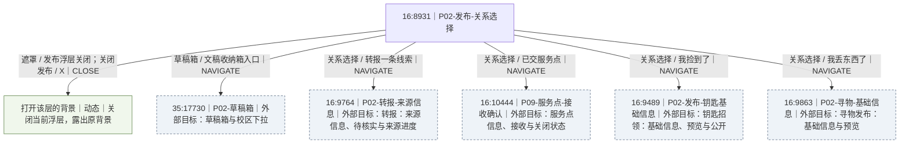

</details>

<a id="flow-main-tools"></a>

<details>
<summary>草稿箱与校区下拉｜2 个画板｜8 个可见动作</summary>

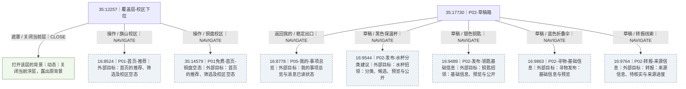

</details>

<a id="flow-details"></a>

<details>
<summary>物品详情与候选比较入口｜7 个画板｜24 个可见动作</summary>

```mermaid
flowchart TD
  f16N9188["16:9188｜P04-招领详情-蓝伞"]
  f16N9239["16:9239｜P04-招领详情-另一候选"]
  f16N9286["16:9286｜P04-详情-已核实完成"]
  f16N9345["16:9345｜P04-寻物详情-本人管理"]
  f16N9394["16:9394｜P04-寻物详情-黑色保温杯"]
  f16N9440["16:9440｜P04-招领详情-银色钥匙"]
  f35N13091["35:13091｜P04-寻物详情-黑色旅行杯"]
  h16N9188["动态历史｜上一页面｜由当前导航历史决定"]:::history
  f16N10063["16:10063｜P06-认领-私密证据｜外部目标：认领核验、线索与举报入口"]:::external
  f16N10581["16:10581｜P06-协助-提供线索｜外部目标：认领核验、线索与举报入口"]:::external
  f16N11322["16:11322｜E04-身份-访客认领｜外部目标：提交异常、访客权限与走查目录"]:::external
  h16N9239["动态历史｜上一页面｜由当前导航历史决定"]:::history
  f16N11207["16:11207｜O02-复核-申诉与处理｜外部目标：值班、贡献复核与申诉"]:::external
  h16N9286["动态历史｜上一页面｜由当前导航历史决定"]:::history
  f35N12232["35:12232｜P03v2-搜索-初始与输入｜外部目标：搜索主页与未覆盖校区"]:::external
  f16N8778["16:8778｜P05-我的-事项总览｜外部目标：我的事项总览与消息已读状态"]:::external
  f35N13593["35:13593｜P03免费-已输入-雨伞｜外部目标：雨伞：输入、查询、结果与空态"]:::external
  f16N9863["16:9863｜P02-寻物-基础信息｜外部目标：寻物发布：基础信息与预览"]:::external
  f16N11008["16:11008｜P05-事项-本人自报找回｜外部目标：事项列表、消息、感谢与自报找回"]:::external
  h16N9394["动态历史｜上一页面｜由当前导航历史决定"]:::history
  f16N10670["16:10670｜P06-水杯-关联候选线索｜外部目标：认领核验、线索与举报入口"]:::external
  h16N9440["动态历史｜上一页面｜由当前导航历史决定"]:::history
  f16N10714["16:10714｜P09-服务点-钥匙已接收｜外部目标：服务点信息、接收与关闭状态"]:::external
  f35N12476["35:12476｜P06-协助-银色钥匙线索｜外部目标：举报和协助回执、协助记录"]:::external
  h35N13091["动态历史｜上一页面｜由当前导航历史决定"]:::history
  f16N9544["16:9544｜P02-发布-水杯分类建议｜外部目标：水杯招领：分类、候选、预览与公开"]:::external
  f16N9188 -->|"返回 / 上一页｜BACK"| h16N9188
  f16N9188 -->|"操作 / 这是我的，去核验｜NAVIGATE"| f16N10063
  f16N9188 -->|"操作 / 提供一条线索｜NAVIGATE"| f16N10581
  f16N9188 -->|"操作 / 访客申请认领｜NAVIGATE"| f16N11322
  f16N9239 -->|"返回 / 上一页；操作 / 返回原搜索｜BACK"| h16N9239
  f16N9239 -->|"操作 / 申请复核｜NAVIGATE"| f16N11207
  f16N9286 -->|"返回 / 上一页｜BACK"| h16N9286
  f16N9286 -->|"操作 / 继续查找｜NAVIGATE"| f35N12232
  f16N9286 -->|"操作 / 查看我的事项｜NAVIGATE"| f16N8778
  f16N9345 -->|"返回我的 / 稳定出口｜NAVIGATE"| f16N8778
  f16N9345 -->|"操作 / 查看相似招领｜NAVIGATE"| f35N13593
  f16N9345 -->|"操作 / 修改我的信息｜NAVIGATE"| f16N9863
  f16N9345 -->|"操作 / 我在线下找回了｜NAVIGATE"| f16N11008
  f16N9394 -->|"返回 / 上一页；操作 / 返回上一页｜BACK"| h16N9394
  f16N9394 -->|"操作 / 我捡到相似水杯｜NAVIGATE"| f16N10670
  f16N9440 -->|"返回 / 上一页；操作 / 返回上一页｜BACK"| h16N9440
  f16N9440 -->|"操作 / 查看接收与到点核验｜NAVIGATE"| f16N10714
  f16N9440 -->|"操作 / 我见过，提供线索｜NAVIGATE"| f35N12476
  f35N13091 -->|"返回 / 上一页；操作 / 返回候选比较｜BACK"| h35N13091
  f35N13091 -->|"操作 / 继续编辑水杯草稿｜NAVIGATE"| f16N9544
  classDef external fill:#eef3f8,stroke:#64748b,stroke-dasharray:4 3
  classDef history fill:#fff4d9,stroke:#b58119
  classDef background fill:#f0f7ec,stroke:#658951
  classDef scroll fill:#f7edff,stroke:#9366ad
  classDef url fill:#eaf9fa,stroke:#46838c
```

</details>

<a id="flow-publish-key"></a>

<details>
<summary>钥匙招领：基础信息、预览与公开｜3 个画板｜10 个可见动作</summary>

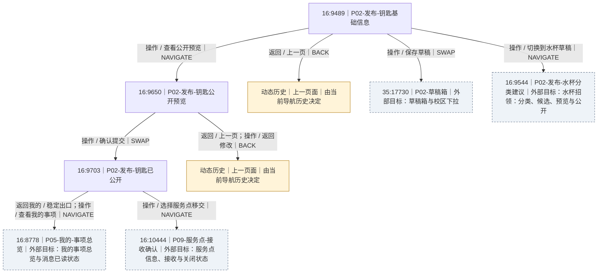

</details>

<a id="flow-publish-cup"></a>

<details>
<summary>水杯招领：分类、候选、预览与公开｜4 个画板｜17 个可见动作</summary>

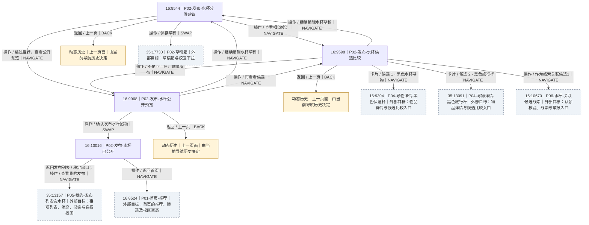

</details>

<a id="flow-publish-lost"></a>

<details>
<summary>寻物发布：基础信息与预览｜2 个画板｜7 个可见动作</summary>

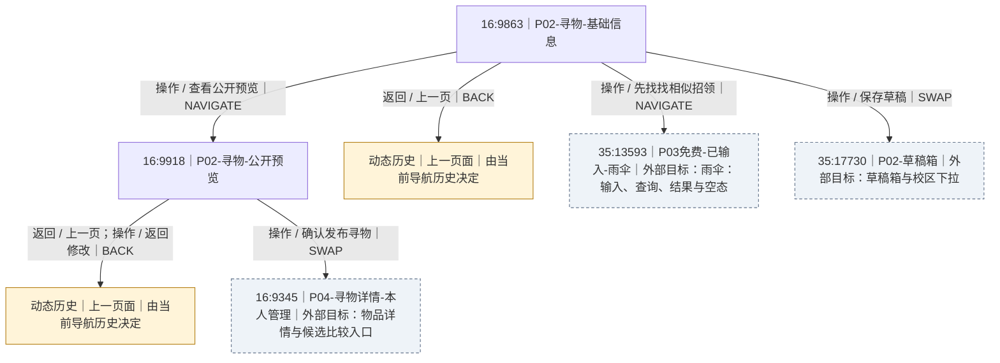

</details>

<a id="flow-publish-transfer"></a>

<details>
<summary>转报：来源信息、待核实与来源进度｜4 个画板｜12 个可见动作</summary>

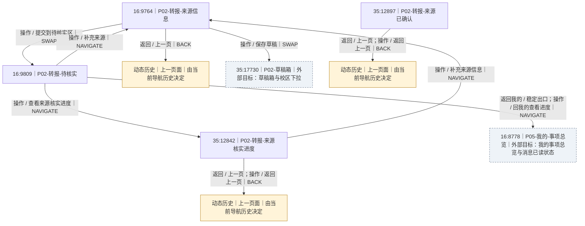

</details>

<a id="flow-claim"></a>

<details>
<summary>认领核验、线索与举报入口｜6 个画板｜21 个可见动作</summary>

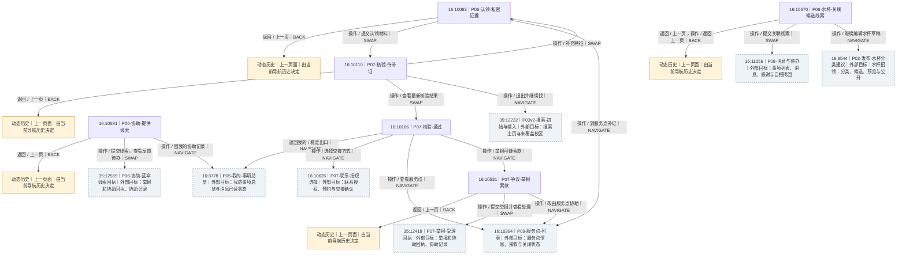

</details>

<a id="flow-contact-handoff"></a>

<details>
<summary>联系授权、预约与交接确认｜7 个画板｜26 个可见动作</summary>

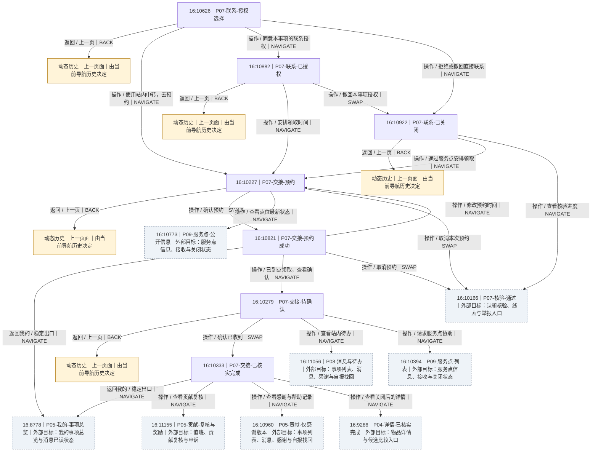

</details>

<a id="flow-service"></a>

<details>
<summary>服务点信息、接收与关闭状态｜5 个画板｜15 个可见动作</summary>

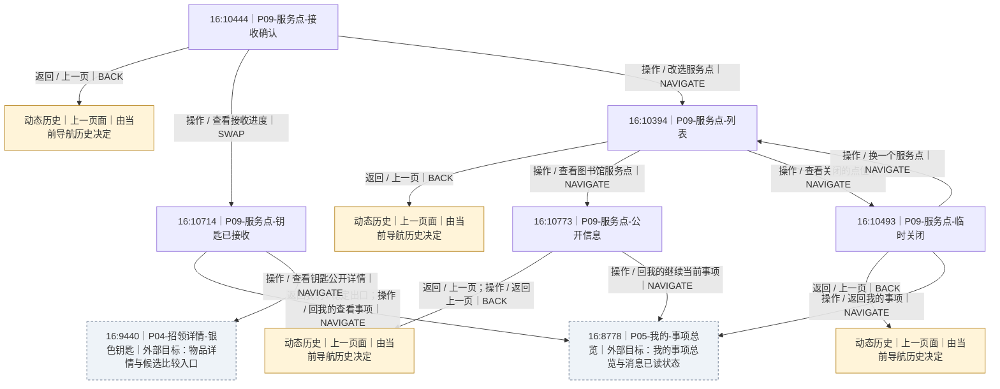

</details>

<a id="flow-mine"></a>

<details>
<summary>事项列表、消息、感谢与自报找回｜6 个画板｜27 个可见动作</summary>

```mermaid
flowchart TD
  f16N10960["16:10960｜P05-贡献-仅感谢版本"]
  f16N11008["16:11008｜P05-事项-本人自报找回"]
  f16N11056["16:11056｜P08-消息与待办"]
  f35N12963["35:12963｜P05-我的-发布列表"]
  f35N13029["35:13029｜P05-我的-认领列表"]
  f35N13157["35:13157｜P05-我的-发布列表含水杯"]
  h16N10960["动态历史｜上一页面｜由当前导航历史决定"]:::history
  f16N8778["16:8778｜P05-我的-事项总览｜外部目标：我的事项总览与消息已读状态"]:::external
  f16N8524["16:8524｜P01-首页-推荐｜外部目标：首页的推荐、筛选及校区空态"]:::external
  h16N11008["动态历史｜上一页面｜由当前导航历史决定"]:::history
  f16N10110["16:10110｜P07-核验-待补证｜外部目标：认领核验、线索与举报入口"]:::external
  f16N10279["16:10279｜P07-交接-待确认｜外部目标：联系授权、预约与交接确认"]:::external
  f16N9286["16:9286｜P04-详情-已核实完成｜外部目标：物品详情与候选比较入口"]:::external
  f35N13229["35:13229｜P05-我的-消息已读状态｜外部目标：我的事项总览与消息已读状态"]:::external
  h35N12963["动态历史｜上一页面｜由当前导航历史决定"]:::history
  f16N10714["16:10714｜P09-服务点-钥匙已接收｜外部目标：服务点信息、接收与关闭状态"]:::external
  f16N9345["16:9345｜P04-寻物详情-本人管理｜外部目标：物品详情与候选比较入口"]:::external
  h35N13029["动态历史｜上一页面｜由当前导航历史决定"]:::history
  f16N10016["16:10016｜P02-发布-水杯已公开｜外部目标：水杯招领：分类、候选、预览与公开"]:::external
  f16N10960 -->|"返回 / 上一页｜BACK"| h16N10960
  f16N10960 -->|"操作 / 回我的查看记录｜NAVIGATE"| f16N8778
  f16N10960 -->|"操作 / 继续看看校园信息｜NAVIGATE"| f16N8524
  f16N11008 -->|"返回 / 上一页｜BACK"| h16N11008
  f16N11008 -->|"操作 / 回我的查看自报记录｜NAVIGATE"| f16N8778
  f16N11008 -->|"操作 / 查看关联待办｜NAVIGATE"| f16N11056
  f16N11056 -->|"返回我的 / 稳定出口｜NAVIGATE"| f16N8778
  f16N11056 -->|"操作 / 处理蓝伞补证｜NAVIGATE"| f16N10110
  f16N11056 -->|"操作 / 查看交接确认｜NAVIGATE"| f16N10279
  f16N11056 -->|"操作 / 查看已完成事项｜NAVIGATE"| f16N9286
  f16N11056 -->|"操作 / 消息已读，查看我的｜SWAP"| f35N13229
  f35N12963 -->|"返回 / 上一页；操作 / 返回上一页｜BACK"| h35N12963
  f35N12963 -->|"卡片 / 银色钥匙串；操作 / 查看钥匙接收记录｜NAVIGATE"| f16N10714
  f35N12963 -->|"卡片 / 蓝色折叠伞；操作 / 查看我的蓝伞寻物｜NAVIGATE"| f16N9345
  f35N13029 -->|"返回 / 上一页；操作 / 返回上一页｜BACK"| h35N13029
  f35N13029 -->|"卡片 / 浅蓝色折叠伞；操作 / 继续蓝伞核验｜NAVIGATE"| f16N10110
  f35N13157 -->|"返回我的 / 稳定出口；操作 / 返回我的｜NAVIGATE"| f16N8778
  f35N13157 -->|"卡片 / 黑色保温杯；操作 / 查看水杯发布记录｜NAVIGATE"| f16N10016
  f35N13157 -->|"卡片 / 银色钥匙串｜NAVIGATE"| f16N10714
  f35N13157 -->|"卡片 / 蓝色折叠伞｜NAVIGATE"| f16N9345
  classDef external fill:#eef3f8,stroke:#64748b,stroke-dasharray:4 3
  classDef history fill:#fff4d9,stroke:#b58119
  classDef background fill:#f0f7ec,stroke:#658951
  classDef scroll fill:#f7edff,stroke:#9366ad
  classDef url fill:#eaf9fa,stroke:#46838c
```

</details>

<a id="flow-operations"></a>

<details>
<summary>值班、贡献复核与申诉｜3 个画板｜11 个可见动作</summary>

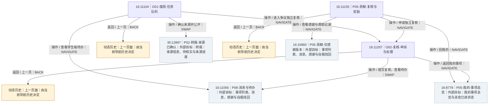

</details>

<a id="flow-exceptions"></a>

<details>
<summary>提交异常、访客权限与走查目录｜3 个画板｜20 个可见动作</summary>

```mermaid
flowchart TD
  f16N11270["16:11270｜P02-提交-结果确认中"]
  f16N11322["16:11322｜E04-身份-访客认领"]
  f16N11365["16:11365｜00-原型走查目录"]
  h16N11270["动态历史｜上一页面｜由当前导航历史决定"]:::history
  f16N9703["16:9703｜P02-发布-钥匙已公开｜外部目标：钥匙招领：基础信息、预览与公开"]:::external
  f16N9489["16:9489｜P02-发布-钥匙基础信息｜外部目标：钥匙招领：基础信息、预览与公开"]:::external
  h16N11322["动态历史｜上一页面｜由当前导航历史决定"]:::history
  f16N10063["16:10063｜P06-认领-私密证据｜外部目标：认领核验、线索与举报入口"]:::external
  f16N10394["16:10394｜P09-服务点-列表｜外部目标：服务点信息、接收与关闭状态"]:::external
  h16N11365["动态历史｜上一页面｜由当前导航历史决定"]:::history
  f35N12232["35:12232｜P03v2-搜索-初始与输入｜外部目标：搜索主页与未覆盖校区"]:::external
  f16N9764["16:9764｜P02-转报-来源信息｜外部目标：转报：来源信息、待核实与来源进度"]:::external
  f16N9544["16:9544｜P02-发布-水杯分类建议｜外部目标：水杯招领：分类、候选、预览与公开"]:::external
  f16N10531["16:10531｜P07-争议-举报索款｜外部目标：认领核验、线索与举报入口"]:::external
  f16N10279["16:10279｜P07-交接-待确认｜外部目标：联系授权、预约与交接确认"]:::external
  f16N10960["16:10960｜P05-贡献-仅感谢版本｜外部目标：事项列表、消息、感谢与自报找回"]:::external
  f16N8524["16:8524｜P01-首页-推荐｜外部目标：首页的推荐、筛选及校区空态"]:::external
  f16N8778["16:8778｜P05-我的-事项总览｜外部目标：我的事项总览与消息已读状态"]:::external
  f16N8931["16:8931｜P02-发布-关系选择｜外部目标：发布关系选择浮层"]:::external
  f16N11270 -->|"返回 / 上一页｜BACK"| h16N11270
  f16N11270 -->|"操作 / 查询本次提交结果｜SWAP"| f16N9703
  f16N11270 -->|"操作 / 已确认未收到，重新检查资料｜SWAP"| f16N9489
  f16N11322 -->|"返回 / 上一页；操作 / 取消并继续浏览｜BACK"| h16N11322
  f16N11322 -->|"操作 / 验证并继续认领｜NAVIGATE"| f16N10063
  f16N11322 -->|"操作 / 无权限，查看服务点帮助｜NAVIGATE"| f16N10394
  f16N11365 -->|"返回 / 上一页｜BACK"| h16N11365
  f16N11365 -->|"操作 / D01 找到蓝伞｜NAVIGATE"| f35N12232
  f16N11365 -->|"操作 / D02 无图钥匙与移交｜NAVIGATE"| f16N9489
  f16N11365 -->|"操作 / D03 转报核实｜NAVIGATE"| f16N9764
  f16N11365 -->|"操作 / D04 分类与候选｜NAVIGATE"| f16N9544
  f16N11365 -->|"操作 / D05 索款与争议｜NAVIGATE"| f16N10531
  f16N11365 -->|"操作 / D06 双方确认与贡献｜NAVIGATE"| f16N10279
  f16N11365 -->|"操作 / D07 无激励感谢｜NAVIGATE"| f16N10960
  f16N11365 -->|"操作 / D08 访客与旧链接｜NAVIGATE"| f16N11322
  f16N11365 -->|"操作 / D09 超时与异常｜NAVIGATE"| f16N11270
  f16N11365 -->|"导航 / 首页｜NAVIGATE"| f16N8524
  f16N11365 -->|"导航 / 我的｜NAVIGATE"| f16N8778
  f16N11365 -->|"发布 / 独立圆形入口｜OVERLAY"| f16N8931
  classDef external fill:#eef3f8,stroke:#64748b,stroke-dasharray:4 3
  classDef history fill:#fff4d9,stroke:#b58119
  classDef background fill:#f0f7ec,stroke:#658951
  classDef scroll fill:#f7edff,stroke:#9366ad
  classDef url fill:#eaf9fa,stroke:#46838c
```

</details>

<a id="flow-receipts"></a>

<details>
<summary>举报和协助回执、协助记录｜7 个画板｜20 个可见动作</summary>

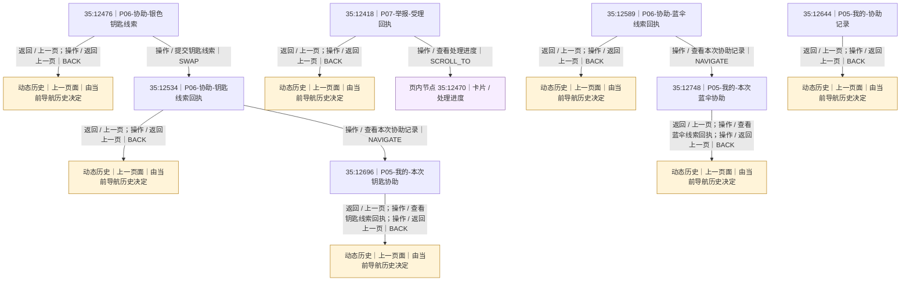

</details>

<a id="flow-search-home"></a>

<details>
<summary>搜索主页与未覆盖校区｜2 个画板｜8 个可见动作</summary>

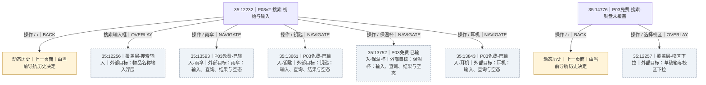

</details>

<a id="flow-search-u"></a>

<details>
<summary>雨伞：输入、查询、结果与空态｜7 个画板｜33 个可见动作</summary>

```mermaid
flowchart TD
  f35N12236["35:12236｜P03v2-搜索-查询中"]
  f35N12240["35:12240｜P03v2-搜索-雨伞结果"]
  f35N13593["35:13593｜P03免费-已输入-雨伞"]
  f35N13631["35:13631｜P03免费-无匹配-雨伞"]
  f35N13904["35:13904｜P03免费-雨伞-图书馆筛选"]
  f69N1752["69:1752｜P03免费-查询中-保留条件-雨伞-图书馆筛选"]
  f69N1833["69:1833｜P03免费-查询中-保留条件-雨伞-条件无匹配"]
  h35N12236["动态历史｜上一页面｜由当前导航历史决定"]:::history
  h35N12240["动态历史｜上一页面｜由当前导航历史决定"]:::history
  f35N12256["35:12256｜覆盖层-搜索输入｜外部目标：物品名称输入浮层"]:::external
  f35N12232["35:12232｜P03v2-搜索-初始与输入｜外部目标：搜索主页与未覆盖校区"]:::external
  f35N14815["35:14815｜覆盖层免费-筛选-u-all｜外部目标：雨伞搜索的四种筛选草稿状态"]:::external
  f16N9188["16:9188｜P04-招领详情-蓝伞｜外部目标：物品详情与候选比较入口"]:::external
  f16N9239["16:9239｜P04-招领详情-另一候选｜外部目标：物品详情与候选比较入口"]:::external
  h35N13593["动态历史｜上一页面｜由当前导航历史决定"]:::history
  f35N13661["35:13661｜P03免费-已输入-钥匙｜外部目标：钥匙：输入、查询、结果与空态"]:::external
  f35N13752["35:13752｜P03免费-已输入-保温杯｜外部目标：保温杯：输入、查询、结果与空态"]:::external
  f35N13843["35:13843｜P03免费-已输入-耳机｜外部目标：耳机：输入、查询与空态"]:::external
  h35N13631["动态历史｜上一页面｜由当前导航历史决定"]:::history
  f16N8931["16:8931｜P02-发布-关系选择｜外部目标：发布关系选择浮层"]:::external
  h35N13904["动态历史｜上一页面｜由当前导航历史决定"]:::history
  f35N14818["35:14818｜覆盖层免费-筛选-u-u｜外部目标：雨伞搜索的四种筛选草稿状态"]:::external
  h69N1752["动态历史｜上一页面｜由当前导航历史决定"]:::history
  h69N1833["动态历史｜上一页面｜由当前导航历史决定"]:::history
  f35N12236 -->|"P03v2-搜索-查询中｜AFTER_TIMEOUT(0.5)｜SWAP"| f35N12240
  f35N12236 -->|"操作 / ‹｜BACK"| h35N12236
  f35N12240 -->|"操作 / ‹｜BACK"| h35N12240
  f35N12240 -->|"搜索输入框｜OVERLAY"| f35N12256
  f35N12240 -->|"操作 / ×｜SWAP"| f35N12232
  f35N12240 -->|"操作 / 搜索｜SWAP"| f35N12236
  f35N12240 -->|"操作 / 筛选｜OVERLAY"| f35N14815
  f35N12240 -->|"卡片 / 浅蓝折叠伞 · 招领｜NAVIGATE"| f16N9188
  f35N12240 -->|"卡片 / 蓝色长柄伞 · 招领｜NAVIGATE"| f16N9239
  f35N13593 -->|"操作 / ‹｜BACK"| h35N13593
  f35N13593 -->|"搜索输入框｜OVERLAY"| f35N12256
  f35N13593 -->|"操作 / ×｜SWAP"| f35N12232
  f35N13593 -->|"操作 / 搜索｜NAVIGATE"| f35N12236
  f35N13593 -->|"操作 / 钥匙｜NAVIGATE"| f35N13661
  f35N13593 -->|"操作 / 保温杯｜NAVIGATE"| f35N13752
  f35N13593 -->|"操作 / 耳机｜NAVIGATE"| f35N13843
  f35N13631 -->|"操作 / ‹｜BACK"| h35N13631
  f35N13631 -->|"搜索输入框；操作 / 修改关键词｜OVERLAY"| f35N12256
  f35N13631 -->|"操作 / ×｜SWAP"| f35N12232
  f35N13631 -->|"操作 / 搜索｜SWAP"| f69N1833
  f35N13631 -->|"操作 / 放宽筛选条件｜OVERLAY"| f35N14815
  f35N13631 -->|"操作 / 新建寻物信息｜OVERLAY"| f16N8931
  f35N13904 -->|"操作 / ‹｜BACK"| h35N13904
  f35N13904 -->|"搜索输入框｜OVERLAY"| f35N12256
  f35N13904 -->|"操作 / ×｜SWAP"| f35N12232
  f35N13904 -->|"操作 / 搜索｜SWAP"| f69N1752
  f35N13904 -->|"操作 / 筛选｜OVERLAY"| f35N14818
  f35N13904 -->|"卡片 / 浅蓝折叠伞 · 招领｜NAVIGATE"| f16N9188
  f69N1752 -->|"P03免费-查询中-保留条件-雨伞-图书馆筛选｜AFTER_TIMEOUT(0.5)｜SWAP"| f35N13904
  f69N1752 -->|"操作 / ‹｜BACK"| h69N1752
  f69N1833 -->|"P03免费-查询中-保留条件-雨伞-条件无匹配｜AFTER_TIMEOUT(0.5)｜SWAP"| f35N13631
  f69N1833 -->|"操作 / ‹｜BACK"| h69N1833
  classDef external fill:#eef3f8,stroke:#64748b,stroke-dasharray:4 3
  classDef history fill:#fff4d9,stroke:#b58119
  classDef background fill:#f0f7ec,stroke:#658951
  classDef scroll fill:#f7edff,stroke:#9366ad
  classDef url fill:#eaf9fa,stroke:#46838c
```

</details>

<a id="flow-search-k"></a>

<details>
<summary>钥匙：输入、查询、结果与空态｜7 个画板｜32 个可见动作</summary>

```mermaid
flowchart TD
  f35N12244["35:12244｜P03v2-搜索-钥匙结果"]
  f35N13661["35:13661｜P03免费-已输入-钥匙"]
  f35N13699["35:13699｜P03免费-查询中-钥匙"]
  f35N13722["35:13722｜P03免费-无匹配-钥匙"]
  f35N13934["35:13934｜P03免费-钥匙-教学区筛选"]
  f69N1779["69:1779｜P03免费-查询中-保留条件-钥匙-教学区筛选"]
  f69N1860["69:1860｜P03免费-查询中-保留条件-钥匙-条件无匹配"]
  h35N12244["动态历史｜上一页面｜由当前导航历史决定"]:::history
  f35N12256["35:12256｜覆盖层-搜索输入｜外部目标：物品名称输入浮层"]:::external
  f35N12232["35:12232｜P03v2-搜索-初始与输入｜外部目标：搜索主页与未覆盖校区"]:::external
  f35N14827["35:14827｜覆盖层免费-筛选-k-all｜外部目标：钥匙搜索的四种筛选草稿状态"]:::external
  f16N9440["16:9440｜P04-招领详情-银色钥匙｜外部目标：物品详情与候选比较入口"]:::external
  h35N13661["动态历史｜上一页面｜由当前导航历史决定"]:::history
  f35N13593["35:13593｜P03免费-已输入-雨伞｜外部目标：雨伞：输入、查询、结果与空态"]:::external
  f35N13752["35:13752｜P03免费-已输入-保温杯｜外部目标：保温杯：输入、查询、结果与空态"]:::external
  f35N13843["35:13843｜P03免费-已输入-耳机｜外部目标：耳机：输入、查询与空态"]:::external
  h35N13699["动态历史｜上一页面｜由当前导航历史决定"]:::history
  h35N13722["动态历史｜上一页面｜由当前导航历史决定"]:::history
  f16N8931["16:8931｜P02-发布-关系选择｜外部目标：发布关系选择浮层"]:::external
  h35N13934["动态历史｜上一页面｜由当前导航历史决定"]:::history
  f35N14833["35:14833｜覆盖层免费-筛选-k-k｜外部目标：钥匙搜索的四种筛选草稿状态"]:::external
  h69N1779["动态历史｜上一页面｜由当前导航历史决定"]:::history
  h69N1860["动态历史｜上一页面｜由当前导航历史决定"]:::history
  f35N12244 -->|"操作 / ‹｜BACK"| h35N12244
  f35N12244 -->|"搜索输入框｜OVERLAY"| f35N12256
  f35N12244 -->|"操作 / ×｜SWAP"| f35N12232
  f35N12244 -->|"操作 / 搜索｜SWAP"| f35N13699
  f35N12244 -->|"操作 / 筛选｜OVERLAY"| f35N14827
  f35N12244 -->|"卡片 / 一串银色钥匙 · 招领｜NAVIGATE"| f16N9440
  f35N13661 -->|"操作 / ‹｜BACK"| h35N13661
  f35N13661 -->|"搜索输入框｜OVERLAY"| f35N12256
  f35N13661 -->|"操作 / ×｜SWAP"| f35N12232
  f35N13661 -->|"操作 / 搜索｜NAVIGATE"| f35N13699
  f35N13661 -->|"操作 / 雨伞｜NAVIGATE"| f35N13593
  f35N13661 -->|"操作 / 保温杯｜NAVIGATE"| f35N13752
  f35N13661 -->|"操作 / 耳机｜NAVIGATE"| f35N13843
  f35N13699 -->|"P03免费-查询中-钥匙｜AFTER_TIMEOUT(0.5)｜SWAP"| f35N12244
  f35N13699 -->|"操作 / ‹｜BACK"| h35N13699
  f35N13722 -->|"操作 / ‹｜BACK"| h35N13722
  f35N13722 -->|"搜索输入框；操作 / 修改关键词｜OVERLAY"| f35N12256
  f35N13722 -->|"操作 / ×｜SWAP"| f35N12232
  f35N13722 -->|"操作 / 搜索｜SWAP"| f69N1860
  f35N13722 -->|"操作 / 放宽筛选条件｜OVERLAY"| f35N14827
  f35N13722 -->|"操作 / 新建寻物信息｜OVERLAY"| f16N8931
  f35N13934 -->|"操作 / ‹｜BACK"| h35N13934
  f35N13934 -->|"搜索输入框｜OVERLAY"| f35N12256
  f35N13934 -->|"操作 / ×｜SWAP"| f35N12232
  f35N13934 -->|"操作 / 搜索｜SWAP"| f69N1779
  f35N13934 -->|"操作 / 筛选｜OVERLAY"| f35N14833
  f35N13934 -->|"卡片 / 一串银色钥匙 · 招领｜NAVIGATE"| f16N9440
  f69N1779 -->|"P03免费-查询中-保留条件-钥匙-教学区筛选｜AFTER_TIMEOUT(0.5)｜SWAP"| f35N13934
  f69N1779 -->|"操作 / ‹｜BACK"| h69N1779
  f69N1860 -->|"P03免费-查询中-保留条件-钥匙-条件无匹配｜AFTER_TIMEOUT(0.5)｜SWAP"| f35N13722
  f69N1860 -->|"操作 / ‹｜BACK"| h69N1860
  classDef external fill:#eef3f8,stroke:#64748b,stroke-dasharray:4 3
  classDef history fill:#fff4d9,stroke:#b58119
  classDef background fill:#f0f7ec,stroke:#658951
  classDef scroll fill:#f7edff,stroke:#9366ad
  classDef url fill:#eaf9fa,stroke:#46838c
```

</details>

<a id="flow-search-c"></a>

<details>
<summary>保温杯：输入、查询、结果与空态｜7 个画板｜32 个可见动作</summary>

```mermaid
flowchart TD
  f35N12248["35:12248｜P03v2-搜索-水杯结果"]
  f35N13752["35:13752｜P03免费-已输入-保温杯"]
  f35N13790["35:13790｜P03免费-查询中-保温杯"]
  f35N13813["35:13813｜P03免费-无匹配-保温杯"]
  f35N13961["35:13961｜P03免费-水杯-食堂筛选"]
  f69N1806["69:1806｜P03免费-查询中-保留条件-水杯-食堂筛选"]
  f69N1887["69:1887｜P03免费-查询中-保留条件-保温杯-条件无匹配"]
  h35N12248["动态历史｜上一页面｜由当前导航历史决定"]:::history
  f35N12256["35:12256｜覆盖层-搜索输入｜外部目标：物品名称输入浮层"]:::external
  f35N12232["35:12232｜P03v2-搜索-初始与输入｜外部目标：搜索主页与未覆盖校区"]:::external
  f35N14839["35:14839｜覆盖层免费-筛选-c-all｜外部目标：保温杯搜索的四种筛选草稿状态"]:::external
  f16N9394["16:9394｜P04-寻物详情-黑色保温杯｜外部目标：物品详情与候选比较入口"]:::external
  h35N13752["动态历史｜上一页面｜由当前导航历史决定"]:::history
  f35N13593["35:13593｜P03免费-已输入-雨伞｜外部目标：雨伞：输入、查询、结果与空态"]:::external
  f35N13661["35:13661｜P03免费-已输入-钥匙｜外部目标：钥匙：输入、查询、结果与空态"]:::external
  f35N13843["35:13843｜P03免费-已输入-耳机｜外部目标：耳机：输入、查询与空态"]:::external
  h35N13790["动态历史｜上一页面｜由当前导航历史决定"]:::history
  h35N13813["动态历史｜上一页面｜由当前导航历史决定"]:::history
  f16N8931["16:8931｜P02-发布-关系选择｜外部目标：发布关系选择浮层"]:::external
  h35N13961["动态历史｜上一页面｜由当前导航历史决定"]:::history
  f35N14848["35:14848｜覆盖层免费-筛选-c-c｜外部目标：保温杯搜索的四种筛选草稿状态"]:::external
  h69N1806["动态历史｜上一页面｜由当前导航历史决定"]:::history
  h69N1887["动态历史｜上一页面｜由当前导航历史决定"]:::history
  f35N12248 -->|"操作 / ‹｜BACK"| h35N12248
  f35N12248 -->|"搜索输入框｜OVERLAY"| f35N12256
  f35N12248 -->|"操作 / ×｜SWAP"| f35N12232
  f35N12248 -->|"操作 / 搜索｜SWAP"| f35N13790
  f35N12248 -->|"操作 / 筛选｜OVERLAY"| f35N14839
  f35N12248 -->|"卡片 / 黑色保温杯 · 寻物｜NAVIGATE"| f16N9394
  f35N13752 -->|"操作 / ‹｜BACK"| h35N13752
  f35N13752 -->|"搜索输入框｜OVERLAY"| f35N12256
  f35N13752 -->|"操作 / ×｜SWAP"| f35N12232
  f35N13752 -->|"操作 / 搜索｜NAVIGATE"| f35N13790
  f35N13752 -->|"操作 / 雨伞｜NAVIGATE"| f35N13593
  f35N13752 -->|"操作 / 钥匙｜NAVIGATE"| f35N13661
  f35N13752 -->|"操作 / 耳机｜NAVIGATE"| f35N13843
  f35N13790 -->|"P03免费-查询中-保温杯｜AFTER_TIMEOUT(0.5)｜SWAP"| f35N12248
  f35N13790 -->|"操作 / ‹｜BACK"| h35N13790
  f35N13813 -->|"操作 / ‹｜BACK"| h35N13813
  f35N13813 -->|"搜索输入框；操作 / 修改关键词｜OVERLAY"| f35N12256
  f35N13813 -->|"操作 / ×｜SWAP"| f35N12232
  f35N13813 -->|"操作 / 搜索｜SWAP"| f69N1887
  f35N13813 -->|"操作 / 放宽筛选条件｜OVERLAY"| f35N14839
  f35N13813 -->|"操作 / 新建寻物信息｜OVERLAY"| f16N8931
  f35N13961 -->|"操作 / ‹｜BACK"| h35N13961
  f35N13961 -->|"搜索输入框｜OVERLAY"| f35N12256
  f35N13961 -->|"操作 / ×｜SWAP"| f35N12232
  f35N13961 -->|"操作 / 搜索｜SWAP"| f69N1806
  f35N13961 -->|"操作 / 筛选｜OVERLAY"| f35N14848
  f35N13961 -->|"卡片 / 黑色保温杯 · 寻物｜NAVIGATE"| f16N9394
  f69N1806 -->|"P03免费-查询中-保留条件-水杯-食堂筛选｜AFTER_TIMEOUT(0.5)｜SWAP"| f35N13961
  f69N1806 -->|"操作 / ‹｜BACK"| h69N1806
  f69N1887 -->|"P03免费-查询中-保留条件-保温杯-条件无匹配｜AFTER_TIMEOUT(0.5)｜SWAP"| f35N13813
  f69N1887 -->|"操作 / ‹｜BACK"| h69N1887
  classDef external fill:#eef3f8,stroke:#64748b,stroke-dasharray:4 3
  classDef history fill:#fff4d9,stroke:#b58119
  classDef background fill:#f0f7ec,stroke:#658951
  classDef scroll fill:#f7edff,stroke:#9366ad
  classDef url fill:#eaf9fa,stroke:#46838c
```

</details>

<a id="flow-search-e"></a>

<details>
<summary>耳机：输入、查询与空态｜3 个画板｜16 个可见动作</summary>

```mermaid
flowchart TD
  f35N12252["35:12252｜P03v2-搜索-无匹配"]
  f35N13843["35:13843｜P03免费-已输入-耳机"]
  f35N13881["35:13881｜P03免费-查询中-耳机"]
  h35N12252["动态历史｜上一页面｜由当前导航历史决定"]:::history
  f35N12256["35:12256｜覆盖层-搜索输入｜外部目标：物品名称输入浮层"]:::external
  f35N12232["35:12232｜P03v2-搜索-初始与输入｜外部目标：搜索主页与未覆盖校区"]:::external
  f35N14851["35:14851｜覆盖层免费-筛选-e-all｜外部目标：耳机搜索的四种筛选草稿状态"]:::external
  f16N8931["16:8931｜P02-发布-关系选择｜外部目标：发布关系选择浮层"]:::external
  h35N13843["动态历史｜上一页面｜由当前导航历史决定"]:::history
  f35N13593["35:13593｜P03免费-已输入-雨伞｜外部目标：雨伞：输入、查询、结果与空态"]:::external
  f35N13661["35:13661｜P03免费-已输入-钥匙｜外部目标：钥匙：输入、查询、结果与空态"]:::external
  f35N13752["35:13752｜P03免费-已输入-保温杯｜外部目标：保温杯：输入、查询、结果与空态"]:::external
  h35N13881["动态历史｜上一页面｜由当前导航历史决定"]:::history
  f35N12252 -->|"操作 / ‹｜BACK"| h35N12252
  f35N12252 -->|"搜索输入框；操作 / 修改关键词｜OVERLAY"| f35N12256
  f35N12252 -->|"操作 / ×｜SWAP"| f35N12232
  f35N12252 -->|"操作 / 搜索｜SWAP"| f35N13881
  f35N12252 -->|"操作 / 放宽筛选条件｜OVERLAY"| f35N14851
  f35N12252 -->|"操作 / 新建寻物信息｜OVERLAY"| f16N8931
  f35N13843 -->|"操作 / ‹｜BACK"| h35N13843
  f35N13843 -->|"搜索输入框｜OVERLAY"| f35N12256
  f35N13843 -->|"操作 / ×｜SWAP"| f35N12232
  f35N13843 -->|"操作 / 搜索｜NAVIGATE"| f35N13881
  f35N13843 -->|"操作 / 雨伞｜NAVIGATE"| f35N13593
  f35N13843 -->|"操作 / 钥匙｜NAVIGATE"| f35N13661
  f35N13843 -->|"操作 / 保温杯｜NAVIGATE"| f35N13752
  f35N13881 -->|"P03免费-查询中-耳机｜AFTER_TIMEOUT(0.5)｜SWAP"| f35N12252
  f35N13881 -->|"操作 / ‹｜BACK"| h35N13881
  classDef external fill:#eef3f8,stroke:#64748b,stroke-dasharray:4 3
  classDef history fill:#fff4d9,stroke:#b58119
  classDef background fill:#f0f7ec,stroke:#658951
  classDef scroll fill:#f7edff,stroke:#9366ad
  classDef url fill:#eaf9fa,stroke:#46838c
```

</details>

<a id="flow-search-input"></a>

<details>
<summary>物品名称输入浮层｜1 个画板｜7 个可见动作</summary>

```mermaid
flowchart TD
  f35N12256["35:12256｜覆盖层-搜索输入"]
  b35N12256["打开该层的背景｜动态｜关闭当前浮层，露出原背景"]:::background
  f35N13593["35:13593｜P03免费-已输入-雨伞｜外部目标：雨伞：输入、查询、结果与空态"]:::external
  f35N13661["35:13661｜P03免费-已输入-钥匙｜外部目标：钥匙：输入、查询、结果与空态"]:::external
  f35N13752["35:13752｜P03免费-已输入-保温杯｜外部目标：保温杯：输入、查询、结果与空态"]:::external
  f35N13843["35:13843｜P03免费-已输入-耳机｜外部目标：耳机：输入、查询与空态"]:::external
  f35N12232["35:12232｜P03v2-搜索-初始与输入｜外部目标：搜索主页与未覆盖校区"]:::external
  f35N12256 -->|"遮罩 / 关闭当前层；操作 / ×｜CLOSE"| b35N12256
  f35N12256 -->|"操作 / 雨伞｜NAVIGATE"| f35N13593
  f35N12256 -->|"操作 / 钥匙｜NAVIGATE"| f35N13661
  f35N12256 -->|"操作 / 保温杯｜NAVIGATE"| f35N13752
  f35N12256 -->|"操作 / 耳机｜NAVIGATE"| f35N13843
  f35N12256 -->|"操作 / 清空输入｜NAVIGATE"| f35N12232
  classDef external fill:#eef3f8,stroke:#64748b,stroke-dasharray:4 3
  classDef history fill:#fff4d9,stroke:#b58119
  classDef background fill:#f0f7ec,stroke:#658951
  classDef scroll fill:#f7edff,stroke:#9366ad
  classDef url fill:#eaf9fa,stroke:#46838c
```

</details>

<a id="flow-filter-home"></a>

<details>
<summary>首页的四种筛选草稿状态｜4 个画板｜27 个可见动作</summary>

```mermaid
flowchart TD
  f35N12258["35:12258｜覆盖层-筛选草稿"]
  f35N14806["35:14806｜覆盖层免费-筛选-home-u"]
  f35N14809["35:14809｜覆盖层免费-筛选-home-k"]
  f35N14812["35:14812｜覆盖层免费-筛选-home-c"]
  b35N12258["打开该层的背景｜动态｜关闭当前浮层，露出原背景"]:::background
  f16N8524["16:8524｜P01-首页-推荐｜外部目标：首页的推荐、筛选及校区空态"]:::external
  b35N14806["打开该层的背景｜动态｜关闭当前浮层，露出原背景"]:::background
  f35N13988["35:13988｜P01免费-首页-雨伞筛选｜外部目标：首页的推荐、筛选及校区空态"]:::external
  b35N14809["打开该层的背景｜动态｜关闭当前浮层，露出原背景"]:::background
  f35N14185["35:14185｜P01免费-首页-钥匙筛选｜外部目标：首页的推荐、筛选及校区空态"]:::external
  b35N14812["打开该层的背景｜动态｜关闭当前浮层，露出原背景"]:::background
  f35N14382["35:14382｜P01免费-首页-水杯筛选｜外部目标：首页的推荐、筛选及校区空态"]:::external
  f35N12258 -->|"遮罩 / 关闭当前层；操作 / 关闭｜CLOSE"| b35N12258
  f35N12258 -->|"操作 / 雨伞 · 图书馆 · 近7天｜SWAP"| f35N14806
  f35N12258 -->|"操作 / 钥匙 · 教学区 · 今天｜SWAP"| f35N14809
  f35N12258 -->|"操作 / 水杯 · 食堂 · 近7天｜SWAP"| f35N14812
  f35N12258 -->|"操作 / 应用筛选｜NAVIGATE"| f16N8524
  f35N14806 -->|"遮罩 / 关闭当前层；操作 / 关闭｜CLOSE"| b35N14806
  f35N14806 -->|"操作 / 全部校园信息；操作 / 重置｜SWAP"| f35N12258
  f35N14806 -->|"操作 / 钥匙 · 教学区 · 今天｜SWAP"| f35N14809
  f35N14806 -->|"操作 / 水杯 · 食堂 · 近7天｜SWAP"| f35N14812
  f35N14806 -->|"操作 / 应用筛选｜NAVIGATE"| f35N13988
  f35N14809 -->|"遮罩 / 关闭当前层；操作 / 关闭｜CLOSE"| b35N14809
  f35N14809 -->|"操作 / 全部校园信息；操作 / 重置｜SWAP"| f35N12258
  f35N14809 -->|"操作 / 雨伞 · 图书馆 · 近7天｜SWAP"| f35N14806
  f35N14809 -->|"操作 / 水杯 · 食堂 · 近7天｜SWAP"| f35N14812
  f35N14809 -->|"操作 / 应用筛选｜NAVIGATE"| f35N14185
  f35N14812 -->|"遮罩 / 关闭当前层；操作 / 关闭｜CLOSE"| b35N14812
  f35N14812 -->|"操作 / 全部校园信息；操作 / 重置｜SWAP"| f35N12258
  f35N14812 -->|"操作 / 雨伞 · 图书馆 · 近7天｜SWAP"| f35N14806
  f35N14812 -->|"操作 / 钥匙 · 教学区 · 今天｜SWAP"| f35N14809
  f35N14812 -->|"操作 / 应用筛选｜NAVIGATE"| f35N14382
  classDef external fill:#eef3f8,stroke:#64748b,stroke-dasharray:4 3
  classDef history fill:#fff4d9,stroke:#b58119
  classDef background fill:#f0f7ec,stroke:#658951
  classDef scroll fill:#f7edff,stroke:#9366ad
  classDef url fill:#eaf9fa,stroke:#46838c
```

</details>

<a id="flow-filter-u"></a>

<details>
<summary>雨伞搜索的四种筛选草稿状态｜4 个画板｜27 个可见动作</summary>

```mermaid
flowchart TD
  f35N14815["35:14815｜覆盖层免费-筛选-u-all"]
  f35N14818["35:14818｜覆盖层免费-筛选-u-u"]
  f35N14821["35:14821｜覆盖层免费-筛选-u-k"]
  f35N14824["35:14824｜覆盖层免费-筛选-u-c"]
  b35N14815["打开该层的背景｜动态｜关闭当前浮层，露出原背景"]:::background
  f35N12240["35:12240｜P03v2-搜索-雨伞结果｜外部目标：雨伞：输入、查询、结果与空态"]:::external
  b35N14818["打开该层的背景｜动态｜关闭当前浮层，露出原背景"]:::background
  f35N13904["35:13904｜P03免费-雨伞-图书馆筛选｜外部目标：雨伞：输入、查询、结果与空态"]:::external
  b35N14821["打开该层的背景｜动态｜关闭当前浮层，露出原背景"]:::background
  f35N13631["35:13631｜P03免费-无匹配-雨伞｜外部目标：雨伞：输入、查询、结果与空态"]:::external
  b35N14824["打开该层的背景｜动态｜关闭当前浮层，露出原背景"]:::background
  f35N14815 -->|"遮罩 / 关闭当前层；操作 / 关闭｜CLOSE"| b35N14815
  f35N14815 -->|"操作 / 雨伞 · 图书馆 · 近7天｜SWAP"| f35N14818
  f35N14815 -->|"操作 / 钥匙 · 教学区 · 今天｜SWAP"| f35N14821
  f35N14815 -->|"操作 / 水杯 · 食堂 · 近7天｜SWAP"| f35N14824
  f35N14815 -->|"操作 / 应用筛选｜NAVIGATE"| f35N12240
  f35N14818 -->|"遮罩 / 关闭当前层；操作 / 关闭｜CLOSE"| b35N14818
  f35N14818 -->|"操作 / 全部校园信息；操作 / 重置｜SWAP"| f35N14815
  f35N14818 -->|"操作 / 钥匙 · 教学区 · 今天｜SWAP"| f35N14821
  f35N14818 -->|"操作 / 水杯 · 食堂 · 近7天｜SWAP"| f35N14824
  f35N14818 -->|"操作 / 应用筛选｜NAVIGATE"| f35N13904
  f35N14821 -->|"遮罩 / 关闭当前层；操作 / 关闭｜CLOSE"| b35N14821
  f35N14821 -->|"操作 / 全部校园信息；操作 / 重置｜SWAP"| f35N14815
  f35N14821 -->|"操作 / 雨伞 · 图书馆 · 近7天｜SWAP"| f35N14818
  f35N14821 -->|"操作 / 水杯 · 食堂 · 近7天｜SWAP"| f35N14824
  f35N14821 -->|"操作 / 应用筛选｜NAVIGATE"| f35N13631
  f35N14824 -->|"遮罩 / 关闭当前层；操作 / 关闭｜CLOSE"| b35N14824
  f35N14824 -->|"操作 / 全部校园信息；操作 / 重置｜SWAP"| f35N14815
  f35N14824 -->|"操作 / 雨伞 · 图书馆 · 近7天｜SWAP"| f35N14818
  f35N14824 -->|"操作 / 钥匙 · 教学区 · 今天｜SWAP"| f35N14821
  f35N14824 -->|"操作 / 应用筛选｜NAVIGATE"| f35N13631
  classDef external fill:#eef3f8,stroke:#64748b,stroke-dasharray:4 3
  classDef history fill:#fff4d9,stroke:#b58119
  classDef background fill:#f0f7ec,stroke:#658951
  classDef scroll fill:#f7edff,stroke:#9366ad
  classDef url fill:#eaf9fa,stroke:#46838c
```

</details>

<a id="flow-filter-k"></a>

<details>
<summary>钥匙搜索的四种筛选草稿状态｜4 个画板｜27 个可见动作</summary>

```mermaid
flowchart TD
  f35N14827["35:14827｜覆盖层免费-筛选-k-all"]
  f35N14830["35:14830｜覆盖层免费-筛选-k-u"]
  f35N14833["35:14833｜覆盖层免费-筛选-k-k"]
  f35N14836["35:14836｜覆盖层免费-筛选-k-c"]
  b35N14827["打开该层的背景｜动态｜关闭当前浮层，露出原背景"]:::background
  f35N12244["35:12244｜P03v2-搜索-钥匙结果｜外部目标：钥匙：输入、查询、结果与空态"]:::external
  b35N14830["打开该层的背景｜动态｜关闭当前浮层，露出原背景"]:::background
  f35N13722["35:13722｜P03免费-无匹配-钥匙｜外部目标：钥匙：输入、查询、结果与空态"]:::external
  b35N14833["打开该层的背景｜动态｜关闭当前浮层，露出原背景"]:::background
  f35N13934["35:13934｜P03免费-钥匙-教学区筛选｜外部目标：钥匙：输入、查询、结果与空态"]:::external
  b35N14836["打开该层的背景｜动态｜关闭当前浮层，露出原背景"]:::background
  f35N14827 -->|"遮罩 / 关闭当前层；操作 / 关闭｜CLOSE"| b35N14827
  f35N14827 -->|"操作 / 雨伞 · 图书馆 · 近7天｜SWAP"| f35N14830
  f35N14827 -->|"操作 / 钥匙 · 教学区 · 今天｜SWAP"| f35N14833
  f35N14827 -->|"操作 / 水杯 · 食堂 · 近7天｜SWAP"| f35N14836
  f35N14827 -->|"操作 / 应用筛选｜NAVIGATE"| f35N12244
  f35N14830 -->|"遮罩 / 关闭当前层；操作 / 关闭｜CLOSE"| b35N14830
  f35N14830 -->|"操作 / 全部校园信息；操作 / 重置｜SWAP"| f35N14827
  f35N14830 -->|"操作 / 钥匙 · 教学区 · 今天｜SWAP"| f35N14833
  f35N14830 -->|"操作 / 水杯 · 食堂 · 近7天｜SWAP"| f35N14836
  f35N14830 -->|"操作 / 应用筛选｜NAVIGATE"| f35N13722
  f35N14833 -->|"遮罩 / 关闭当前层；操作 / 关闭｜CLOSE"| b35N14833
  f35N14833 -->|"操作 / 全部校园信息；操作 / 重置｜SWAP"| f35N14827
  f35N14833 -->|"操作 / 雨伞 · 图书馆 · 近7天｜SWAP"| f35N14830
  f35N14833 -->|"操作 / 水杯 · 食堂 · 近7天｜SWAP"| f35N14836
  f35N14833 -->|"操作 / 应用筛选｜NAVIGATE"| f35N13934
  f35N14836 -->|"遮罩 / 关闭当前层；操作 / 关闭｜CLOSE"| b35N14836
  f35N14836 -->|"操作 / 全部校园信息；操作 / 重置｜SWAP"| f35N14827
  f35N14836 -->|"操作 / 雨伞 · 图书馆 · 近7天｜SWAP"| f35N14830
  f35N14836 -->|"操作 / 钥匙 · 教学区 · 今天｜SWAP"| f35N14833
  f35N14836 -->|"操作 / 应用筛选｜NAVIGATE"| f35N13722
  classDef external fill:#eef3f8,stroke:#64748b,stroke-dasharray:4 3
  classDef history fill:#fff4d9,stroke:#b58119
  classDef background fill:#f0f7ec,stroke:#658951
  classDef scroll fill:#f7edff,stroke:#9366ad
  classDef url fill:#eaf9fa,stroke:#46838c
```

</details>

<a id="flow-filter-c"></a>

<details>
<summary>保温杯搜索的四种筛选草稿状态｜4 个画板｜27 个可见动作</summary>

```mermaid
flowchart TD
  f35N14839["35:14839｜覆盖层免费-筛选-c-all"]
  f35N14842["35:14842｜覆盖层免费-筛选-c-u"]
  f35N14845["35:14845｜覆盖层免费-筛选-c-k"]
  f35N14848["35:14848｜覆盖层免费-筛选-c-c"]
  b35N14839["打开该层的背景｜动态｜关闭当前浮层，露出原背景"]:::background
  f35N12248["35:12248｜P03v2-搜索-水杯结果｜外部目标：保温杯：输入、查询、结果与空态"]:::external
  b35N14842["打开该层的背景｜动态｜关闭当前浮层，露出原背景"]:::background
  f35N13813["35:13813｜P03免费-无匹配-保温杯｜外部目标：保温杯：输入、查询、结果与空态"]:::external
  b35N14845["打开该层的背景｜动态｜关闭当前浮层，露出原背景"]:::background
  b35N14848["打开该层的背景｜动态｜关闭当前浮层，露出原背景"]:::background
  f35N13961["35:13961｜P03免费-水杯-食堂筛选｜外部目标：保温杯：输入、查询、结果与空态"]:::external
  f35N14839 -->|"遮罩 / 关闭当前层；操作 / 关闭｜CLOSE"| b35N14839
  f35N14839 -->|"操作 / 雨伞 · 图书馆 · 近7天｜SWAP"| f35N14842
  f35N14839 -->|"操作 / 钥匙 · 教学区 · 今天｜SWAP"| f35N14845
  f35N14839 -->|"操作 / 水杯 · 食堂 · 近7天｜SWAP"| f35N14848
  f35N14839 -->|"操作 / 应用筛选｜NAVIGATE"| f35N12248
  f35N14842 -->|"遮罩 / 关闭当前层；操作 / 关闭｜CLOSE"| b35N14842
  f35N14842 -->|"操作 / 全部校园信息；操作 / 重置｜SWAP"| f35N14839
  f35N14842 -->|"操作 / 钥匙 · 教学区 · 今天｜SWAP"| f35N14845
  f35N14842 -->|"操作 / 水杯 · 食堂 · 近7天｜SWAP"| f35N14848
  f35N14842 -->|"操作 / 应用筛选｜NAVIGATE"| f35N13813
  f35N14845 -->|"遮罩 / 关闭当前层；操作 / 关闭｜CLOSE"| b35N14845
  f35N14845 -->|"操作 / 全部校园信息；操作 / 重置｜SWAP"| f35N14839
  f35N14845 -->|"操作 / 雨伞 · 图书馆 · 近7天｜SWAP"| f35N14842
  f35N14845 -->|"操作 / 水杯 · 食堂 · 近7天｜SWAP"| f35N14848
  f35N14845 -->|"操作 / 应用筛选｜NAVIGATE"| f35N13813
  f35N14848 -->|"遮罩 / 关闭当前层；操作 / 关闭｜CLOSE"| b35N14848
  f35N14848 -->|"操作 / 全部校园信息；操作 / 重置｜SWAP"| f35N14839
  f35N14848 -->|"操作 / 雨伞 · 图书馆 · 近7天｜SWAP"| f35N14842
  f35N14848 -->|"操作 / 钥匙 · 教学区 · 今天｜SWAP"| f35N14845
  f35N14848 -->|"操作 / 应用筛选｜NAVIGATE"| f35N13961
  classDef external fill:#eef3f8,stroke:#64748b,stroke-dasharray:4 3
  classDef history fill:#fff4d9,stroke:#b58119
  classDef background fill:#f0f7ec,stroke:#658951
  classDef scroll fill:#f7edff,stroke:#9366ad
  classDef url fill:#eaf9fa,stroke:#46838c
```

</details>

<a id="flow-filter-e"></a>

<details>
<summary>耳机搜索的四种筛选草稿状态｜4 个画板｜27 个可见动作</summary>

```mermaid
flowchart TD
  f35N14851["35:14851｜覆盖层免费-筛选-e-all"]
  f35N14854["35:14854｜覆盖层免费-筛选-e-u"]
  f35N14857["35:14857｜覆盖层免费-筛选-e-k"]
  f35N14860["35:14860｜覆盖层免费-筛选-e-c"]
  b35N14851["打开该层的背景｜动态｜关闭当前浮层，露出原背景"]:::background
  f35N12252["35:12252｜P03v2-搜索-无匹配｜外部目标：耳机：输入、查询与空态"]:::external
  b35N14854["打开该层的背景｜动态｜关闭当前浮层，露出原背景"]:::background
  b35N14857["打开该层的背景｜动态｜关闭当前浮层，露出原背景"]:::background
  b35N14860["打开该层的背景｜动态｜关闭当前浮层，露出原背景"]:::background
  f35N14851 -->|"遮罩 / 关闭当前层；操作 / 关闭｜CLOSE"| b35N14851
  f35N14851 -->|"操作 / 雨伞 · 图书馆 · 近7天｜SWAP"| f35N14854
  f35N14851 -->|"操作 / 钥匙 · 教学区 · 今天｜SWAP"| f35N14857
  f35N14851 -->|"操作 / 水杯 · 食堂 · 近7天｜SWAP"| f35N14860
  f35N14851 -->|"操作 / 应用筛选｜NAVIGATE"| f35N12252
  f35N14854 -->|"遮罩 / 关闭当前层；操作 / 关闭｜CLOSE"| b35N14854
  f35N14854 -->|"操作 / 全部校园信息；操作 / 重置｜SWAP"| f35N14851
  f35N14854 -->|"操作 / 钥匙 · 教学区 · 今天｜SWAP"| f35N14857
  f35N14854 -->|"操作 / 水杯 · 食堂 · 近7天｜SWAP"| f35N14860
  f35N14854 -->|"操作 / 应用筛选｜NAVIGATE"| f35N12252
  f35N14857 -->|"遮罩 / 关闭当前层；操作 / 关闭｜CLOSE"| b35N14857
  f35N14857 -->|"操作 / 全部校园信息；操作 / 重置｜SWAP"| f35N14851
  f35N14857 -->|"操作 / 雨伞 · 图书馆 · 近7天｜SWAP"| f35N14854
  f35N14857 -->|"操作 / 水杯 · 食堂 · 近7天｜SWAP"| f35N14860
  f35N14857 -->|"操作 / 应用筛选｜NAVIGATE"| f35N12252
  f35N14860 -->|"遮罩 / 关闭当前层；操作 / 关闭｜CLOSE"| b35N14860
  f35N14860 -->|"操作 / 全部校园信息；操作 / 重置｜SWAP"| f35N14851
  f35N14860 -->|"操作 / 雨伞 · 图书馆 · 近7天｜SWAP"| f35N14854
  f35N14860 -->|"操作 / 钥匙 · 教学区 · 今天｜SWAP"| f35N14857
  f35N14860 -->|"操作 / 应用筛选｜NAVIGATE"| f35N12252
  classDef external fill:#eef3f8,stroke:#64748b,stroke-dasharray:4 3
  classDef history fill:#fff4d9,stroke:#b58119
  classDef background fill:#f0f7ec,stroke:#658951
  classDef scroll fill:#f7edff,stroke:#9366ad
  classDef url fill:#eaf9fa,stroke:#46838c
```

</details>

<a id="flow-history"></a>

<details>
<summary>历史保留：旧搜索画板｜2 个画板｜8 个可见动作</summary>

以下两个旧搜索画板保留在 Figma 中，从当前首页不可达。此处如实列出其现有控制，不将它们计为当前搜索入口的可达分支。

```mermaid
flowchart TD
  f16N9094["16:9094｜P03-搜索-相似雨伞｜从首页不可达"]
  f16N9144["16:9144｜P03-搜索-无结果｜从首页不可达"]
  h16N9094["动态历史｜上一页面｜由当前导航历史决定"]:::history
  f16N9188["16:9188｜P04-招领详情-蓝伞｜外部目标：物品详情与候选比较入口"]:::external
  f16N9239["16:9239｜P04-招领详情-另一候选｜外部目标：物品详情与候选比较入口"]:::external
  f35N12232["35:12232｜P03v2-搜索-初始与输入｜外部目标：搜索主页与未覆盖校区"]:::external
  h16N9144["动态历史｜上一页面｜由当前导航历史决定"]:::history
  f16N11056["16:11056｜P08-消息与待办｜外部目标：事项列表、消息、感谢与自报找回"]:::external
  f16N9863["16:9863｜P02-寻物-基础信息｜外部目标：寻物发布：基础信息与预览"]:::external
  f16N9094 -->|"返回 / 上一页｜BACK"| h16N9094
  f16N9094 -->|"操作 / 查看候选 A｜NAVIGATE"| f16N9188
  f16N9094 -->|"操作 / 比较候选 B｜NAVIGATE"| f16N9239
  f16N9094 -->|"操作 / 没有合适的，继续找｜NAVIGATE"| f35N12232
  f16N9144 -->|"返回 / 上一页｜BACK"| h16N9144
  f16N9144 -->|"操作 / 放宽条件再找｜NAVIGATE"| f35N12232
  f16N9144 -->|"操作 / 订阅后查看消息｜NAVIGATE"| f16N11056
  f16N9144 -->|"操作 / 按这些条件发布寻物｜NAVIGATE"| f16N9863
  classDef external fill:#eef3f8,stroke:#64748b,stroke-dasharray:4 3
  classDef history fill:#fff4d9,stroke:#b58119
  classDef background fill:#f0f7ec,stroke:#658951
  classDef scroll fill:#f7edff,stroke:#9366ad
  classDef url fill:#eaf9fa,stroke:#46838c
```

</details>

## 画板索引

<details>
<summary>展开全部 116 个画板及其分组</summary>

| 节点 ID | 实际名称 | 所属分图 | 从首页可达 |
| --- | --- | --- | --- |
| 16:8524 | P01-首页-推荐 | 首页的推荐、筛选及校区空态 | 是 |
| 16:8778 | P05-我的-事项总览 | 我的事项总览与消息已读状态 | 是 |
| 16:8931 | P02-发布-关系选择 | 发布关系选择浮层 | 是 |
| 16:9094 | P03-搜索-相似雨伞 | 历史保留：旧搜索画板 | 否；保留画板 |
| 16:9144 | P03-搜索-无结果 | 历史保留：旧搜索画板 | 否；保留画板 |
| 16:9188 | P04-招领详情-蓝伞 | 物品详情与候选比较入口 | 是 |
| 16:9239 | P04-招领详情-另一候选 | 物品详情与候选比较入口 | 是 |
| 16:9286 | P04-详情-已核实完成 | 物品详情与候选比较入口 | 是 |
| 16:9345 | P04-寻物详情-本人管理 | 物品详情与候选比较入口 | 是 |
| 16:9394 | P04-寻物详情-黑色保温杯 | 物品详情与候选比较入口 | 是 |
| 16:9440 | P04-招领详情-银色钥匙 | 物品详情与候选比较入口 | 是 |
| 16:9489 | P02-发布-钥匙基础信息 | 钥匙招领：基础信息、预览与公开 | 是 |
| 16:9544 | P02-发布-水杯分类建议 | 水杯招领：分类、候选、预览与公开 | 是 |
| 16:9598 | P02-发布-水杯候选比较 | 水杯招领：分类、候选、预览与公开 | 是 |
| 16:9650 | P02-发布-钥匙公开预览 | 钥匙招领：基础信息、预览与公开 | 是 |
| 16:9703 | P02-发布-钥匙已公开 | 钥匙招领：基础信息、预览与公开 | 是 |
| 16:9764 | P02-转报-来源信息 | 转报：来源信息、待核实与来源进度 | 是 |
| 16:9809 | P02-转报-待核实 | 转报：来源信息、待核实与来源进度 | 是 |
| 16:9863 | P02-寻物-基础信息 | 寻物发布：基础信息与预览 | 是 |
| 16:9918 | P02-寻物-公开预览 | 寻物发布：基础信息与预览 | 是 |
| 16:9968 | P02-发布-水杯公开预览 | 水杯招领：分类、候选、预览与公开 | 是 |
| 16:10016 | P02-发布-水杯已公开 | 水杯招领：分类、候选、预览与公开 | 是 |
| 16:10063 | P06-认领-私密证据 | 认领核验、线索与举报入口 | 是 |
| 16:10110 | P07-核验-待补证 | 认领核验、线索与举报入口 | 是 |
| 16:10166 | P07-核验-通过 | 认领核验、线索与举报入口 | 是 |
| 16:10227 | P07-交接-预约 | 联系授权、预约与交接确认 | 是 |
| 16:10279 | P07-交接-待确认 | 联系授权、预约与交接确认 | 是 |
| 16:10333 | P07-交接-已核实完成 | 联系授权、预约与交接确认 | 是 |
| 16:10394 | P09-服务点-列表 | 服务点信息、接收与关闭状态 | 是 |
| 16:10444 | P09-服务点-接收确认 | 服务点信息、接收与关闭状态 | 是 |
| 16:10493 | P09-服务点-临时关闭 | 服务点信息、接收与关闭状态 | 是 |
| 16:10531 | P07-争议-举报索款 | 认领核验、线索与举报入口 | 是 |
| 16:10581 | P06-协助-提供线索 | 认领核验、线索与举报入口 | 是 |
| 16:10626 | P07-联系-授权选择 | 联系授权、预约与交接确认 | 是 |
| 16:10670 | P06-水杯-关联候选线索 | 认领核验、线索与举报入口 | 是 |
| 16:10714 | P09-服务点-钥匙已接收 | 服务点信息、接收与关闭状态 | 是 |
| 16:10773 | P09-服务点-公开信息 | 服务点信息、接收与关闭状态 | 是 |
| 16:10821 | P07-交接-预约成功 | 联系授权、预约与交接确认 | 是 |
| 16:10882 | P07-联系-已授权 | 联系授权、预约与交接确认 | 是 |
| 16:10922 | P07-联系-已关闭 | 联系授权、预约与交接确认 | 是 |
| 16:10960 | P05-贡献-仅感谢版本 | 事项列表、消息、感谢与自报找回 | 是 |
| 16:11008 | P05-事项-本人自报找回 | 事项列表、消息、感谢与自报找回 | 是 |
| 16:11056 | P08-消息与待办 | 事项列表、消息、感谢与自报找回 | 是 |
| 16:11104 | O01-值班-任务队列 | 值班、贡献复核与申诉 | 是 |
| 16:11155 | P05-贡献-复核与奖励 | 值班、贡献复核与申诉 | 是 |
| 16:11207 | O02-复核-申诉与处理 | 值班、贡献复核与申诉 | 是 |
| 16:11270 | P02-提交-结果确认中 | 提交异常、访客权限与走查目录 | 是 |
| 16:11322 | E04-身份-访客认领 | 提交异常、访客权限与走查目录 | 是 |
| 16:11365 | 00-原型走查目录 | 提交异常、访客权限与走查目录 | 是 |
| 35:12232 | P03v2-搜索-初始与输入 | 搜索主页与未覆盖校区 | 是 |
| 35:12236 | P03v2-搜索-查询中 | 雨伞：输入、查询、结果与空态 | 是 |
| 35:12240 | P03v2-搜索-雨伞结果 | 雨伞：输入、查询、结果与空态 | 是 |
| 35:12244 | P03v2-搜索-钥匙结果 | 钥匙：输入、查询、结果与空态 | 是 |
| 35:12248 | P03v2-搜索-水杯结果 | 保温杯：输入、查询、结果与空态 | 是 |
| 35:12252 | P03v2-搜索-无匹配 | 耳机：输入、查询与空态 | 是 |
| 35:12256 | 覆盖层-搜索输入 | 物品名称输入浮层 | 是 |
| 35:12257 | 覆盖层-校区下拉 | 草稿箱与校区下拉 | 是 |
| 35:12258 | 覆盖层-筛选草稿 | 首页的四种筛选草稿状态 | 是 |
| 35:13593 | P03免费-已输入-雨伞 | 雨伞：输入、查询、结果与空态 | 是 |
| 35:13631 | P03免费-无匹配-雨伞 | 雨伞：输入、查询、结果与空态 | 是 |
| 35:13661 | P03免费-已输入-钥匙 | 钥匙：输入、查询、结果与空态 | 是 |
| 35:13699 | P03免费-查询中-钥匙 | 钥匙：输入、查询、结果与空态 | 是 |
| 35:13722 | P03免费-无匹配-钥匙 | 钥匙：输入、查询、结果与空态 | 是 |
| 35:13752 | P03免费-已输入-保温杯 | 保温杯：输入、查询、结果与空态 | 是 |
| 35:13790 | P03免费-查询中-保温杯 | 保温杯：输入、查询、结果与空态 | 是 |
| 35:13813 | P03免费-无匹配-保温杯 | 保温杯：输入、查询、结果与空态 | 是 |
| 35:13843 | P03免费-已输入-耳机 | 耳机：输入、查询与空态 | 是 |
| 35:13881 | P03免费-查询中-耳机 | 耳机：输入、查询与空态 | 是 |
| 35:13904 | P03免费-雨伞-图书馆筛选 | 雨伞：输入、查询、结果与空态 | 是 |
| 35:13934 | P03免费-钥匙-教学区筛选 | 钥匙：输入、查询、结果与空态 | 是 |
| 35:13961 | P03免费-水杯-食堂筛选 | 保温杯：输入、查询、结果与空态 | 是 |
| 35:13988 | P01免费-首页-雨伞筛选 | 首页的推荐、筛选及校区空态 | 是 |
| 35:14185 | P01免费-首页-钥匙筛选 | 首页的推荐、筛选及校区空态 | 是 |
| 35:14382 | P01免费-首页-水杯筛选 | 首页的推荐、筛选及校区空态 | 是 |
| 35:14579 | P01免费-首页-铜盘空态 | 首页的推荐、筛选及校区空态 | 是 |
| 35:14776 | P03免费-搜索-铜盘未覆盖 | 搜索主页与未覆盖校区 | 是 |
| 35:14806 | 覆盖层免费-筛选-home-u | 首页的四种筛选草稿状态 | 是 |
| 35:14809 | 覆盖层免费-筛选-home-k | 首页的四种筛选草稿状态 | 是 |
| 35:14812 | 覆盖层免费-筛选-home-c | 首页的四种筛选草稿状态 | 是 |
| 35:14815 | 覆盖层免费-筛选-u-all | 雨伞搜索的四种筛选草稿状态 | 是 |
| 35:14818 | 覆盖层免费-筛选-u-u | 雨伞搜索的四种筛选草稿状态 | 是 |
| 35:14821 | 覆盖层免费-筛选-u-k | 雨伞搜索的四种筛选草稿状态 | 是 |
| 35:14824 | 覆盖层免费-筛选-u-c | 雨伞搜索的四种筛选草稿状态 | 是 |
| 35:14827 | 覆盖层免费-筛选-k-all | 钥匙搜索的四种筛选草稿状态 | 是 |
| 35:14830 | 覆盖层免费-筛选-k-u | 钥匙搜索的四种筛选草稿状态 | 是 |
| 35:14833 | 覆盖层免费-筛选-k-k | 钥匙搜索的四种筛选草稿状态 | 是 |
| 35:14836 | 覆盖层免费-筛选-k-c | 钥匙搜索的四种筛选草稿状态 | 是 |
| 35:14839 | 覆盖层免费-筛选-c-all | 保温杯搜索的四种筛选草稿状态 | 是 |
| 35:14842 | 覆盖层免费-筛选-c-u | 保温杯搜索的四种筛选草稿状态 | 是 |
| 35:14845 | 覆盖层免费-筛选-c-k | 保温杯搜索的四种筛选草稿状态 | 是 |
| 35:14848 | 覆盖层免费-筛选-c-c | 保温杯搜索的四种筛选草稿状态 | 是 |
| 35:14851 | 覆盖层免费-筛选-e-all | 耳机搜索的四种筛选草稿状态 | 是 |
| 35:14854 | 覆盖层免费-筛选-e-u | 耳机搜索的四种筛选草稿状态 | 是 |
| 35:14857 | 覆盖层免费-筛选-e-k | 耳机搜索的四种筛选草稿状态 | 是 |
| 35:14860 | 覆盖层免费-筛选-e-c | 耳机搜索的四种筛选草稿状态 | 是 |
| 35:12418 | P07-举报-受理回执 | 举报和协助回执、协助记录 | 是 |
| 35:12476 | P06-协助-银色钥匙线索 | 举报和协助回执、协助记录 | 是 |
| 35:12534 | P06-协助-钥匙线索回执 | 举报和协助回执、协助记录 | 是 |
| 35:12589 | P06-协助-蓝伞线索回执 | 举报和协助回执、协助记录 | 是 |
| 35:12644 | P05-我的-协助记录 | 举报和协助回执、协助记录 | 是 |
| 35:12696 | P05-我的-本次钥匙协助 | 举报和协助回执、协助记录 | 是 |
| 35:12748 | P05-我的-本次蓝伞协助 | 举报和协助回执、协助记录 | 是 |
| 35:12842 | P02-转报-来源核实进度 | 转报：来源信息、待核实与来源进度 | 是 |
| 35:12897 | P02-转报-来源已确认 | 转报：来源信息、待核实与来源进度 | 是 |
| 35:12963 | P05-我的-发布列表 | 事项列表、消息、感谢与自报找回 | 是 |
| 35:13029 | P05-我的-认领列表 | 事项列表、消息、感谢与自报找回 | 是 |
| 35:13091 | P04-寻物详情-黑色旅行杯 | 物品详情与候选比较入口 | 是 |
| 35:13157 | P05-我的-发布列表含水杯 | 事项列表、消息、感谢与自报找回 | 是 |
| 35:13229 | P05-我的-消息已读状态 | 我的事项总览与消息已读状态 | 是 |
| 35:17730 | P02-草稿箱 | 草稿箱与校区下拉 | 是 |
| 69:1752 | P03免费-查询中-保留条件-雨伞-图书馆筛选 | 雨伞：输入、查询、结果与空态 | 是 |
| 69:1779 | P03免费-查询中-保留条件-钥匙-教学区筛选 | 钥匙：输入、查询、结果与空态 | 是 |
| 69:1806 | P03免费-查询中-保留条件-水杯-食堂筛选 | 保温杯：输入、查询、结果与空态 | 是 |
| 69:1833 | P03免费-查询中-保留条件-雨伞-条件无匹配 | 雨伞：输入、查询、结果与空态 | 是 |
| 69:1860 | P03免费-查询中-保留条件-钥匙-条件无匹配 | 钥匙：输入、查询、结果与空态 | 是 |
| 69:1887 | P03免费-查询中-保留条件-保温杯-条件无匹配 | 保温杯：输入、查询、结果与空态 | 是 |

</details>

## 静态覆盖范围

快照内所有 116 个画板均有所属分图；所有 559 个可见动作均由控制 ID 和动作序号对应到图中边，遗漏 0，缺失页面导航目标 0，AFTER_TIMEOUT 自动环 0。

完整边—控制 ID 对照、隐藏动作与目标检查记录见 [覆盖记录](assets/re/figma-flow-coverage.json)。此记录证明静态节点及边的覆盖，不等同于所有流程已逐条点击，也不证明真实业务提交幂等。

SCROLL_TO 的页内目标已由[子节点记录](assets/re/figma-flow-details.json)确认名称与所属页面，作为页内节点绘制。

## 资源与维护

相关资源统一存放在 [assets/re](assets/re)。保留完整快照、修订记录、覆盖对照、实际点击记录、截图与原始修复脚本；删除已并入完整快照的导出分片及一次性的 Mermaid 校验脚本、逐图通过日志。

修复说明维护在 [flow-audit-notes.md](assets/re/flow-audit-notes.md)；[生成脚本](assets/re/build-flow-doc.cjs)读取该说明和快照，生成本文及覆盖对照，避免手工修改后被下一次生成覆盖。

在仓库根目录执行：

```powershell
node homework/pair/task4/ans/assets/re/build-flow-doc.cjs --dry-run
node homework/pair/task4/ans/assets/re/build-flow-doc.cjs
```

第一条仅检查现有快照，第二条重新生成文档。两条命令均不连接或修改 Figma。

历史操作脚本：[节点导出](assets/re/export-figma-flow.js)、[流程修复](assets/re/repair-figma-flow.js)、[水杯候选返回修正](assets/re/correct-cup-edit.js)、[出口文字排版](assets/re/polish-flow-exits.js)。这些脚本供追溯当时的处理，不属于本次 Web 程序实现。
