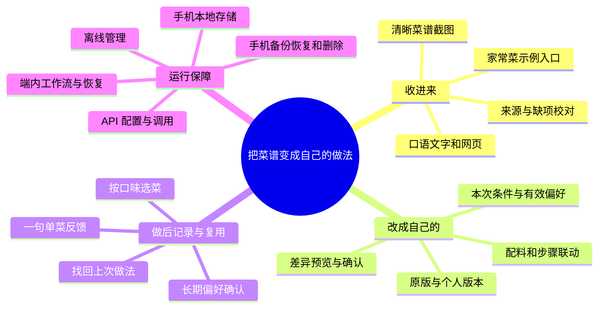
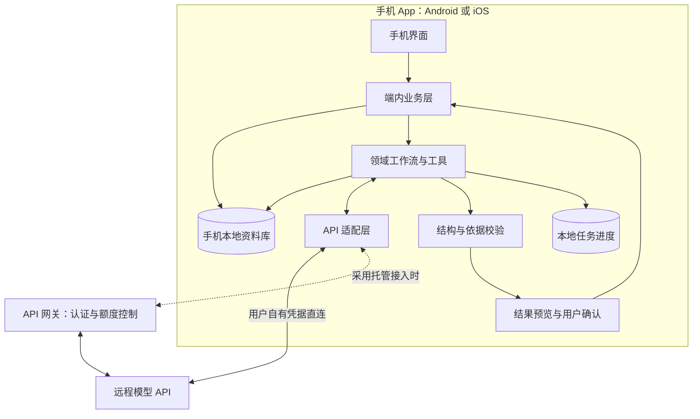
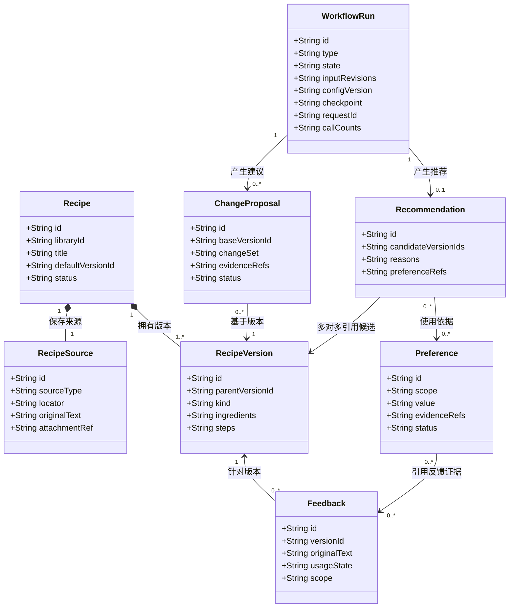

# 个性化本地菜单管理服务 · 产品需求文档

| 文档信息 | 内容 |
| --- | --- |
| 所属团队 | 你所热爱的就是软件工程 |
| 版本与日期 | v0.3 · 2026-10-25 |
| 文档状态 | 需求评审稿，作为首期开发、演示和验收的共同依据 |
| 需求来源 | [作业要求](../task-requirement.md)、[产品调研](research.md)、[团队定位记录](assets/research/qq-chat-2026-10-19.md)、[答辩反馈与项目反思](reply.md)中的“课上老师对大家答辩的反馈”和“对自己项目的反思” |
| 编写参考 | [GB/T 9385—2008《计算机软件需求规格说明规范》](https://openstd.samr.gov.cn/bzgk/std/newGbInfo?hcno=2790825C43AD0B69E3C38C140BFFCFE6)；[pm-skills：create-prd](https://github.com/phuryn/pm-skills/blob/07b34f64ee828df08953f505b7f747aef85ae7c6/pm-execution/skills/create-prd/SKILL.md)、[test-scenarios](https://github.com/phuryn/pm-skills/blob/07b34f64ee828df08953f505b7f747aef85ae7c6/pm-execution/skills/test-scenarios/SKILL.md) |

本文按“服务谁—遇到什么问题—为什么发生—产品如何解决—结课如何验证”组织需求。截至本版，证据来自团队讨论、答辩反馈和公开产品资料，真实用户访谈与同任务实测待完成。文中的验收门槛是团队拟定的交付标准，效果指标是待验证目标。

## 迭代记录

| 版本 | 日期 | 变更内容 | 依据与状态 |
| --- | --- | --- | --- |
| v0.1 | 2026-10-23 | 建立个人菜谱库、领域工作流、偏好与版本规则；明确本地使用、两端访问、在线演示和验收范围 | 基于 10 月 19 日更新的调研，供团队评审 |
| v0.2 | 2026-10-23 | 调整为移动端独立完成核心功能，手机本地存储、运行工作流并调用 API；PC 作为可选扩展；同步调整架构与验收，保留双平台原生和跨平台方案待选 | 基于移动端产品定位调整，开发方案待调研后选择 |
| v0.3 | 2026-10-25 | 收拢到做饭新手的“收集—改成自己的做法—记录—复做”；明确竞品基线、输入成本和持续使用价值；加入清晰截图导入，区分结课必达项与效果目标 | 依据答辩反馈和项目反思，补充真实用户验证与结课验收方案 |

后续涉及功能范围、数据保存规则和验收标准的调整，应在本表记录原因及影响，并同步修改对应需求编号。

## 一、产品定位：做更懂你的菜谱小助手

**帮助刚开始独立做饭、仍需参照菜谱的人，把找到的菜谱整理成适合自己的做法，并在下一次做饭时用上自己的经验。**

产品主线是：**收进来 → 改成自己的做法 → 做后记一句 → 下次直接复用。** 推荐帮助用户找到入口，分类、版本和偏好服务于这条主线。结课时要演示的是同一份菜谱经过两次使用后发生了什么变化。

用户第一次使用，是为了把零散材料变成看得懂、能核对的做法；再次使用，是为了找回上次怎么改、为什么改。长期积累的是个人菜谱、口味和做饭经历。对应的产品承诺是“少整理一次，少重复解释一次，下次更容易做出适合自己的版本”。

产品采用手机 App，**移动端独立完成核心功能，本地存储、运行工作流并调用 API**。Android 与 iOS 是目标平台；双平台原生开发与跨平台开发在调研后选型。PC、大规模内容采集和家庭协作按后续需求扩展，首期以手机上的完整使用过程验收。

## 二、目标用户与需求证据

### 2.1 优先服务谁

| 用户 | 具体处境与任务 | 首期关系 |
| --- | --- | --- |
| 刚开始独立生活、做饭经验较少的人 | 从图文、聊天或短视频中找做法；依赖步骤获得把握，遇到口味或份量变化时需要帮助 | 核心用户，重点验证收集、调整和复做 |
| 家庭中偶尔做饭的人 | 希望照着可靠步骤完成一道菜，并留下适合家人的改法 | 次要用户，使用同一套核心流程 |
| 想记录家常做法的长辈或熟练做饭者 | 把口述经验、手写记录传给家人 | 内容贡献者；首期由一名手机使用者整理，语音采集与家庭共享后续评估 |

首轮招募至少 8 位真实参与者，其中至少 6 位符合核心用户条件、2 位是家庭中偶尔做饭的人。入组依据是近一个月参照菜谱做过菜，并能展示一次实际使用的材料、收藏或修改记录。年龄与职业用于描述样本，招募以行为为准。

### 2.2 如何补齐真实需求

请参与者用自己现有的方法还原“找到菜谱—准备做—改动—下次找回”的过程。记录材料来自哪里、哪一步花时间、为何需要改、第一次做后是否愿意再尝试，以及再次使用时重新输入了什么。保留匿名原话、获准使用的材料、操作时间和替代工具，单列团队解释。

访谈后形成“行为证据—问题原因—对应需求”的记录，优先实现反复出现且影响任务完成的问题。竞品的存在说明该类产品已有供给，具体人群的困难、频率和使用意愿由这轮调查确认。第 2.1 节是招募定义，当前访谈完成状态为待开展。

## 三、现有方案、痛点与原因

### 3.1 竞品已经解决了什么

以下官方页面于 2026-10-25 复核。功能说明用于确定比较基线，中文材料的导入质量、调整效果与操作成本通过同任务实测判断。

| 现有方案 | 已披露能力或限制 | 本项目需要比较的部分 |
| --- | --- | --- |
| [Recipe Keeper](https://www.recipekeeperonline.com/) | 网页、照片和手写记录识别，个人编辑、分类、份量换算与离线查看 | 从中文原始材料到可用菜谱，用户要补多少字段、改多少内容 |
| [ReciMe 导入说明](https://www.recime.app/help/en/articles/14773584-why-didn-t-my-recipe-import-correctly) | 优先读取视频说明文字，再尝试音频和原网页；登录内容、评论内步骤和一帖多菜存在限制，可改用截图或文字 | 导入受限后是否容易接着整理，来源、缺项和修正是否清楚 |
| [Samsung Food+](https://support.samsungfood.com/hc/en-us/articles/32709269852052-What-s-Included-in-Your-Samsung-Food-Subscription) | 提供图片菜谱扫描、按偏好调整菜谱、个性化计划等订阅功能 | 调整后能否方便地核对、保存个人版本，并在下次使用反馈 |
| [Paprika 3](https://www.paprikaapp.com/windows/) | 提供个人备注、编辑、分类检索、份量调整、本地保存和离线查看 | 本地管理作为基础能力，比较反馈与偏好复用的操作成本；此处能力限于所引版本 |

竞品已覆盖导入、管理和部分个性化能力。本项目的差异化假设落在**中文材料的校对成本，以及“调整—反馈—再次使用”是否连贯省事**。对竞品长期记忆、版本追踪等能力，测试报告按实际版本逐项记录支持情况与操作步骤。完整历史调研见[来源索引](assets/research/recipe-research-sources.md)。

### 3.2 从问题追到原因

下表是由项目反思提出、等待用户材料验证的问题链。公开资料支持的导入限制见上表，其余原因先作为访谈与原型测试假设。

| 用户卡在哪里 | 需要核实的原因 | 产品对应处理 | 如何验证 |
| --- | --- | --- | --- |
| 收藏了做法，准备做时仍要重新抄写、拼凑 | 来源分散在截图、口述文字和链接中，关键用量或步骤缺失 | 多种材料汇入同一校对流程，保留原文与缺项 | 导入到保存的时间、补填次数、关键字段错误 |
| 想少辣、换材料或改人数，却拿不准该怎么改 | 通用菜谱与个人情况有差距，新手难以判断配料和步骤的关联 | 结合已确认口味和本次要求生成成组改动，逐项比较后保存 | 调整依据、配料与步骤一致性、用户纠正及试做反馈 |
| 做完觉得偏咸，隔一段时间又忘了上次怎么改 | 体验停留在记忆、备注或聊天里，与具体做法脱节 | 一句反馈关联当次版本，下次打开时带回经验 | 能否找回正确版本，重复说明次数，反馈是否用对范围 |
| 每次推荐都要重新解释自己 | 长期偏好、本次要求和单菜经验缺少明确区分，输入被反复收集 | 复用已确认偏好，本次只补变化；建议卡片可直接开始 | 两轮使用中的输入量、完成率与偏好误用 |

“第一次不合口味会降低继续尝试的意愿”来自项目反思，访谈和真实试做将检查这一因果关系。首期首先保证整理、调整和复用过程可用，适口性由用户实际做菜后的反馈判断。

## 四、产品亮点与持续使用价值

### 4.1 三个用户能感受到的亮点

1. **把收集变轻。** 粘贴一段口语记录、一个受支持链接，或选择一张清晰菜谱截图，得到带来源和缺项的草稿。用户在原文旁完成校对。
2. **把做法变成自己的。** 依据口味和本次要求，联动调整配料与步骤，展示改动原因，保留原版和个人版本。
3. **让上次经验进入下次使用。** 做后记一句，系统区分单菜经验和长期偏好；再次打开、调整或选菜时带回适用信息，用户随时纠正。

本地存储、免费基础管理与开源交付是产品采用原则：资料可导出、偏好可查看和撤销，项目代码与领域规则可检查。联网模型的费用、测试额度和数据发送范围单独说明。这些原则共同支持用户长期保留自己的记录。

### 4.2 使用软件能省下哪些步骤

通用模型可以理解菜谱并给出建议。本产品把建议接到用户持续使用的资料库上：系统读取已选版本和有效偏好，生成可比较的改动，确认后保存，并在下一次带回相关反馈。用户因此少做查找上下文、重新说明和手工整理结果的工作。

模型承担语义理解，软件承担来源管理、状态保存、范围判断、版本比较、确定计算和可靠写入。结课分别比较领域定制的结果质量与完整产品的使用成本，具体方法见第 7.8 节。底层可复用合适的模型、SDK 和工具，技术选型以任务完成、维护成本和手机运行条件为依据。

熟练之后，用户仍可用它保存家常版本和做饭经历。偏好积累是否带来持续使用、家庭记录是否带来情感价值，作为后续跟踪问题；课程通过两轮使用检验经验能否被正确复用。

## 五、用一条完整任务组织体验

以下是设计案例，实际测试采用参与者自己的材料。用户刚开始独立做饭，保存了一张番茄炒蛋截图，希望按两人份做得少甜一点。做完记下“这次偏咸，下次少放酱油”，几天后再次打开这道菜。

| 阶段 | 用户的最少操作 | 软件完成的工作 | 可见结果 |
| --- | --- | --- | --- |
| 开始 | 选择导入材料，或打开内置家常菜 | 提供带来源的基础做法；空库有可直接浏览的入口 | 一份可读、可校对的菜谱 |
| 收进来 | 查看缺项并确认 | 识别配料与步骤，定位原文，保存来源 | 原始做法和个人库条目 |
| 改成自己的 | 点“少甜一点”“改人数”等入口，按需补一句 | 读取有效偏好与所选版本，生成配料和步骤差异 | 带原因的调整预览，确认后成为个人版本 |
| 做后记一句 | 标记做过并保存反馈 | 关联当次版本，提出适用范围 | 单菜记录；长期偏好经确认生效 |
| 下次复用 | 再次打开菜谱或点“按我的口味推荐” | 找回默认版本、上次反馈与有效偏好，本次只补变化 | 可追溯的做法或 1—3 个候选 |

首页通过示例菜谱、快捷条件和最近使用记录提供入口。用户声明的已有食材用于本次筛选；长期偏好从已确认记录读取。时间、心情和完整食材清单均按需补充。冷启动使用至少 5 份团队自写或获准使用的家常菜，用户选择后加入个人库。

## 六、课程范围与结课判定

### 6.1 首期交付范围

结课交付一个能在 Android、iOS 上独立运行的手机 App，围绕第五节的两轮使用完成 F01—F10。输入覆盖手工／口语文字、清晰菜谱截图和规定范围的网页；输出落实为可校对菜谱、个人版本、反馈和可纠正偏好。手机持有资料与任务状态，联网 API 提供模型能力。

语音文件转写、短视频链接直接解析、更多图片类型和全网内容检索进入后续输入扩展；家庭多账号、社交传播、自动库存、手环与厨房设备另行评估。结课采用自写或授权基础菜谱解决冷启动，内容来源范围在第 7.3 节固定。

### 6.2 结课必达项

| 编号 | 结课门槛 | 检查材料 |
| --- | --- | --- |
| C01 真实需求 | 完成至少 8 位符合第 2.1 节定义的用户访谈；每人至少一条真实行为记录，形成问题原因与功能取舍 | 匿名样本说明、原话与获准材料、需求调整记录；结论可支持或推翻原假设 |
| C02 手机闭环 | Android、iOS 各至少一台真机完成第五节任务；第 7.9 节 A01—A26 全部通过，发布阻断项为 0 | 版本与设备记录、逐项结果、核心流程录屏 |
| C03 领域任务质量 | B1 在冻结的 30 个任务上各运行 3 次，至少 27 个任务三次均满足要求；B1 全部运行中的关键错误为 0 | B0／B1 原始输出、双人核对记录、任务完成率和失败案例 |
| C04 数据与运行 | N01—N08 达标，离线管理、进程中断恢复、偏好撤销、跨系统备份恢复均可复现 | 真机异常记录、数据关系核对、性能与请求日志 |
| C05 可检查交付 | 在线入口可访问，提供两平台安装／测试方式、可用测试接入、样例和说明；开源代码含许可证、构建说明及领域配置 | 发布版本、访问地址、测试方式、代码与文档链接 |
| C06 使用与比较证据 | 至少 8 人参加两轮试用并留下成功或失败记录，间隔至少 24 小时；至少 4 人提交一次真实试做反馈；完成第 7.8 节两类对照 | 操作记录、耗时与输入量、试做反馈、达到和未达到的效果目标 |

每项按通过／未通过记录，附证据位置。C01—C06 全部通过，才记为本版交付完成；任一项未达标，记录缺口、原因和修复结果。结课日期按课程后续通知执行，本表作为团队验收承诺。

### 6.3 效果目标单独报告

| 目标 | 预设判定 |
| --- | --- |
| G1 领域定制有增益 | B1 人工纠正次数中位数较同模型 B0 降低至少 20%，任务完成率不低于 B0 |
| G2 手机操作足够轻 | 8 人中至少 6 人同时达到：独立完成两轮任务，首次进入至保存一份可用菜谱 ≤5 分钟，第二轮找回上次版本和反馈 ≤1 分钟 |
| G3 经验复用减少负担 | 第二轮任务中，重复输入的既有信息条目中位数较用户原有方法降低至少 30%，操作时间中位数降低至少 20%，完成率不低于原有方法 |

这些目标用于判断亮点是否成立。每项报告达成／未达成、参与人数、失败原因与成本；比较基线为 0 时报告绝对差值。完成试验但效果未达目标时，保留交付结果，并按证据收缩效果表述、调整后续方向。

## 七、需求方案

### 7.1 项目功能结构

首期按 P0 实现 F01—F10（见下文“功能需求”部分）。示例菜谱服务于开始体验和课程演示；排餐等扩展见第八节。

### 7.2 页面与交互

主导航采用“菜谱库、推荐、我的偏好、设置”。菜谱库首页突出“收进来”和“继续上次”，导入入口常驻；调整、版本和反馈围绕同一道菜展开。待校对、待确认、连接失败与保存成功均显示明确状态。

| 页面 | 主要信息与动作 | 手机交互 |
| --- | --- | --- |
| 菜谱库 | 搜索、分类、最近使用、导入、自写录入和示例列表 | 常用入口便于单手触达，支持文字、链接和截图 |
| 导入校对 | 原始资料、结构化字段、缺项、来源位置、保存草稿 | 按字段展开对应原文，逐项校对并保存进度 |
| 菜谱详情 | 当前版本、配料、步骤、来源、历史版本、调整与反馈 | 按配料和步骤展示前后差异，在详情中完成比较与采纳 |
| 推荐 | 快捷条件、候选、理由、使用的偏好、需核对项 | 可直接按有效偏好开始；默认展示 1—3 个候选，按需补充本次变化 |
| 我的偏好 | 有效偏好、待确认候选、证据、范围、修改与撤销 | 先展示判断与范围，展开后查看依据并纠正 |
| 设置与任务记录 | 当前资料库、API 配置、数据导出恢复、任务进度与失败原因 | 手机内完成连接测试、文件选择、备份恢复和任务续接 |

空库提供“导入菜谱”“自己写一道”和“浏览示例”。用户可先使用手工管理，再配置智能功能。至少 5 份示例随 App 提供，由团队自写或取得使用授权，标注来源并由用户选择加入个人库。

### 7.3 功能需求

#### F01：建立手机资料库与配置 API

首次打开 App 时创建手机本地资料库，用户即可录入、检索和整理菜谱。设置页显示资料库名称、存储用量、最近备份时间与 API 连接状态，区分资料库可用状态和智能服务连接状态。

课程试用提供已配置服务地址的示例接入与测试额度，用户在手机内取得或填写受限测试凭据即可体验。用户自有 API 配置作为设置入口，填写服务、模型和认证信息。M0 冻结支持的服务及凭据发放方式；采用团队共享密钥时通过托管网关接入。

测试连接采用示例输入，返回连接结果、能力检查和失败原因。接口应支持结构化结果、所选截图识别路径及端内工具调用的往返过程，工作流调度和工具执行都在 App 内完成。首次使用耗时分别记录安装、接入和业务操作。

正式运行前展示服务提供方与本次发送的资料范围。用户自有凭据由手机系统安全存储机制保护，界面显示脱敏值；采用团队共享凭据时，由托管网关保存，App 使用受限访问凭据。网关承担认证、额度控制和请求转发，任务状态与资料库由手机维护。更换接入配置后，已保存资料继续可用。

#### F02：导入、校对与保存来源

手机内支持以下输入，统一进入“草稿—校对—保存”流程。复杂输入的首期目标是减少重新抄写，识别质量通过冻结样本验收。

| 输入 | 首期范围 | 保存与失败处理 |
| --- | --- | --- |
| 手工与粘贴文字 | 最多 10,000 字符，包含聊天或口述转写后的文字 | 保留原话，将省略、模糊用量和缺失步骤标为待核对 |
| 菜谱截图 | 单张 JPEG／PNG、最多 5 MiB；清晰可读、以一道菜为主的中文印刷文字 | 原图保存在手机内，识别结果关联图中位置；模糊、裁切或多菜内容提示分开处理，保留原图和草稿 |
| 受支持网页 | 公开静态 HTML，含单个 Schema.org Recipe JSON-LD 对象，响应最多 2 MiB | 手机获取并保留链接与快照；登录或结构不支持时提供文字／截图入口 |

截图识别采用多模态模型或 OCR 配合模型整理，M0 以真机原型选择一条路径。所发送的图片先告知用户，并纳入任务数据范围。系统分享、语音文件与短视频直接解析按第 8.3 节扩展。

导入后生成草稿，展示标题、配料、步骤、份量、时间、原始资料和缺项。字段区分“来源内容”“用户补充”“模型建议”，关键字段能够定位到文字片段或原图区域。网页元数据与可见原文冲突时列出差异，由用户校对。

只有标题时可以保存待补充草稿；用户确认配料与步骤后转为已入库。用量、份量和时间缺失可保持“未知”，并标记资料完整度。“适量”“一把”等保留原始表达。重复链接或相同内容给出已有条目，用户可以打开已有菜谱或另存。

草稿、原图和校对进度保存在手机本地。离线时可先保存文字、图片和链接，联网后继续获取或识别；识别失败时可对照来源手工补充。原始资料保留为来源快照，之后编辑产生个人版本。

#### F03：检索、分类与维护个人版本

用户可按名称、配料、标签和来源关键词搜索，并组合分类筛选。普通检索由本地程序完成。草稿与已入库菜谱分别显示；资料不完整的条目带缺项标记。

菜谱内容修改后新增版本，保留修改说明、时间和前一版本。用户可比较配料与步骤差异，并指定日常查看的默认版本。恢复旧做法通过将旧版本设为默认完成，后续版本仍可查阅。分类和标签属于菜谱的管理信息，可直接编辑。

App 关闭重开或手机重启后，菜谱、分类、标签、版本和默认版本保持一致。搜索结果进入具体菜谱时显示当前默认版本，历史反馈继续指向当时使用的版本。

#### F04：记录、分析与确认偏好

用户可以直接填写喜欢的口味、明确避开的食材和本次要求。点击保存即构成对直接输入的确认。长期偏好和本次条件使用独立字段。

偏好设置按需填写。已有有效偏好在推荐和调整中直接读取，界面提供本次使用依据及修改入口；当次条件通过快捷选项或一句话补充。

用户主动发起分析时，选择可读取的菜谱与反馈范围。Agent 输出“判断、依据、适用范围、冲突或疑点”，生成待确认候选。用户可以确认、修改后确认或忽略。只有收藏记录时，结果先描述收藏特征；长期偏好经用户确认后生效。

每条偏好记录类型、范围、证据、确认时间和有效状态。范围包含“当前请求”“某道菜”“长期个人偏好”。同一范围内发生冲突时展示两条依据，由用户选择或修正。

撤销后立即使偏好退出后续分析、检索和推荐。用户忽略或撤销的候选，在依据没有变化时保持原决定。已有推荐保留历史记录，并标记对应依据已失效；再次请求时重新读取有效偏好。

#### F05：从个人库推荐菜谱

用户可直接点击“按我的口味推荐”，默认检索个人库并读取有效偏好；也可点选“少辣”“换个做法”等快捷条件，按需补充已有食材、人数或时间。空库时先展示基础菜谱和导入入口，用户选择示例后再推荐。手机端业务层先检索、检查明确限制，再通过模型 API 解释排序。每个候选显示版本、依据、适合本次请求的原因和需核对项。

推荐默认提供 1—3 个候选，数量以实际可用资料为准。候选来自用户选择的资料范围；示例库只有在用户选择该范围时参与。候选不足时说明缺少哪些信息，提供补充条件或浏览个人库入口。

明确的食材限制优先于口味偏好。本次口味要求可覆盖长期口味倾向；与明确限制冲突时先请用户澄清。时间或配料信息未知的菜谱进入“需核对”区域，补齐信息后再判断是否满足条件。

“最近没做过”依据用户明确记录的做饭历史判断，缺少记录时显示“暂无做饭记录”。推荐记录保存所用版本和偏好依据；用户可以查看、纠正理由，也可以直接放弃本次结果。

#### F06：调整一道菜并比较版本

用户在详情中点选改口味、换材料或调整份量，按需补一句要求。系统读取选中版本、适用偏好、单菜反馈和本次条件，返回配料变化、步骤变化、原因及待核对事项。涉及材料替换时，检查使用该材料的相关步骤。疾病饮食与医学营养问题提示寻求专业指导；首期按用户明确声明的食材限制筛选。

确定的份量计算交给程序。例如原份量为 2 人、某配料 200 克，调整为 3 人时得到 300 克；“盐适量”仍保留原表达。只有单位与基准明确的数量参与换算，分数个数、未知份量和烹调时间单独提示用户核对。

用户可保留原版、保存为个人版本，或选择仅本次试做。试做也保存一个可追溯版本供反馈引用，默认版本保持原选择。采纳时校验建议所基于的版本和偏好状态；若已变化，展示冲突并要求重新比较。建议里的配料调整与步骤变化作为同一组保存。

#### F07：记录使用反馈并复用经验

反馈入口关联具体版本，提供“做过了”、口味快捷标签和一句话记录；详细改动可稍后补充。用户保存后即可结束本次操作。保存、浏览和选择菜谱分别记录为对应动作，做饭历史以用户主动标记为准。

“这道菜下次少放酱油”先归入单菜反馈；“今天想清淡一点”用于本次请求；可长期复用的口味判断进入偏好候选，由用户确认。后续查看或调整这道菜时展示相关反馈，推荐读取当前有效的长期偏好和明确使用记录。

用户可以编辑或删除反馈。删除作为唯一依据的反馈后，由它推导出的偏好转为待复核；仍有独立有效依据的记录保留，并更新证据列表。用户直接填写的偏好具有自身确认记录。

#### F08：导出、恢复与删除数据

用户通过手机系统文件入口导出或选择备份文件。备份使用 ZIP 包，内含带格式版本号的 JSON、来源图片及附件校验信息，保存菜谱、版本、标签、反馈、偏好与对象关系。密钥、访问凭据和临时模型上下文分别管理，备份包含业务资料。

首期通过新建空资料库恢复，Android 与 iOS 使用同一备份格式。恢复前校验格式、引用关系、数量与附件完整性，限定解包路径和大小，展示预览；用户确认后整批写入，成功后切换资料库，失败时回滚。导入的有效长期偏好先标为待复核，确认后启用。取消文件选择、文件损坏或空间不足时，保留原资料库并给出处理入口。

设置页提供备份入口与最近成功时间。卸载应用、清除应用数据或设备损坏会影响本地资料，用户可将备份保存到应用之外的位置，在手机内完成恢复。备份完成状态以文件成功写出为准。

删除菜谱时展示将移除的来源、版本、反馈及受影响的偏好，确认后清理对应内容、检索条目与缓存。其他记录的引用显示“资料已删除”，历史运行日志同步移除相关原文与个人内容。整库删除清理该资料库及其衍生数据。用户自行导出的备份由用户管理，删除提示中说明这一范围。

#### F09：离线使用与本地状态一致性

资料库以手机本地已提交的数据为准。离线时，用户可查看来源和版本、搜索、手工录入、编辑、分类、记录反馈、管理偏好，以及用本机文件导出恢复。已保存的推荐和调整结果仍可查看，采纳时继续校验当前版本与依据。

网页获取和模型调用需要联网。网络中断时，保留输入与已生成内容，显示任务所处阶段；联网后由用户选择继续或重试。普通录入、编辑和检索直接操作本地数据，操作结果以本地事务提交为准。

同一 App 的页面、任务和待确认建议共享一套资料版本。提交时携带对象修订号；旧页面或旧建议发生冲突时，保留输入并展示最新内容。切换页面后读取当前状态，草稿按已保存进度恢复。

#### F10：任务状态、取消与失败恢复

工作流记录排队、运行、已暂停、等待补充、待确认、已完成、已取消、失败或结果过期。阶段进度、输入版本、草稿、请求标识和取消状态保存在手机本地，用户可查看已有结果并选择补充、继续、重试或取消。

切换应用、锁屏或系统终止进程时，以最近成功保存的检查点恢复。回到 App 后核对任务与请求状态，再继续未完成步骤。后台持续执行能力按目标系统实测，核心流程以“保存进度—重新打开—继续处理”验收。远程请求结果暂时无法确认时，先标明状态；接口支持查询则尝试取回结果，否则由用户决定是否重新调用，并提示可能重复计费。

初始运行上限为每次任务 3 次远程模型／识别调用、8 次领域工具调用、120 秒累计执行时间，等待用户输入与任务暂停的时间另计。恢复沿用原任务的调用计数和预算；重新调用计入次数。上限在设置和任务记录中可见，测试前冻结。达到上限后返回已有结果与原因。

模型超时、结构错误、工具失败和用户取消均在草稿阶段结束；正式菜谱、版本和长期偏好通过用户确认后的本地事务写入。重复点击确认或重试同一保存请求，使用同一操作标识返回原结果。任务取消状态在 App 重开后继续生效，迟到结果按取消记录丢弃。

### 7.4 领域知识、工具与工作流

#### 领域知识来源

| 资料或规则 | 工作流中的用途 | 首期整理方式 |
| --- | --- | --- |
| 用户导入的文字、截图、菜谱版本和反馈 | 提取字段、引用原做法、解释候选和调整建议 | 保存来源、文字片段或图片区域、版本与确认状态 |
| [Schema.org Recipe](https://schema.org/Recipe) | 参照菜名、配料、步骤、份量与时间字段 | 冻结首期使用字段及内部结构，保留原始表达 |
| 团队整理的食材别名与单位表 | 支持检索、同名识别、明确单位的换算 | 每条规则注明依据及适用条件，测试成员复核；生熟、干湿等状态分别保留 |
| 口味与反馈标注示例 | 区分菜谱特征、单菜评价、临时条件和长期偏好 | 使用自写示例与获准访谈材料，标注来源和适用范围 |
| [SHARE 研究](https://aclanthology.org/2022.emnlp-main.761/)及调研中原料与步骤关联资料 | 设计材料变化后的步骤检查项 | 将其作为检查方法参考，实际建议通过来源核对和用户反馈验证 |

领域资料按版本维护。新增别名、替换或用量规则需要可核查依据；当前资料无法支持的判断保留未知项。明确食材限制用于已知成分筛查，包装配料与加工条件仍需用户核对。

#### 软件、Agent 与用户的分工

| 工作流 | 输入与触发 | Agent 处理 | 程序处理与确认结果 |
| --- | --- | --- | --- |
| 导入整理 | 用户提交文字、截图或网页 | 识别文字、理解口语表述、识别缺项和提出分类 | 保存原始材料、校验字段和位置；用户校对后入库 |
| 偏好分析 | 用户选择材料并请求分析 | 提出有依据的候选、解释冲突 | 读取获准范围、关联证据；用户决定是否成为有效偏好 |
| 个性化推荐 | 本次条件与所选资料范围 | 解释候选、识别需要补充的条件 | 检索与限制过滤；保存推荐依据，用户选择菜谱 |
| 单菜调整 | 具体版本与调整意图 | 提出相关配料和步骤变化 | 执行明确换算、检查关联、生成差异；用户确认后新增版本 |
| 反馈整理 | 版本与用户反馈 | 建议反馈的适用范围 | 保存原话和关联；长期偏好另经确认 |

首期由 App 内的领域 Agent 工作流完成这些任务：手机程序决定可用资料、工具权限、数值计算、任务状态与写入，模型通过 API 提供语义判断和解释。模型提出工具调用时，App 校验参数并执行获准的端内工具，再将必要结果交给下一步。工作流与动态选路的区分参考 [Building effective agents](https://www.anthropic.com/research/building-effective-agents)，实际采用方式记录在测试报告中。

#### 工具与接入约定

| 工具 | 最小输入 | 输出与权限 |
| --- | --- | --- |
| `search_recipes` | 检索范围、关键词、筛选条件 | 本资料库内的候选 ID、版本和摘要 |
| `read_recipe` | 菜谱与版本 ID | 配料、步骤、来源片段和缺项 |
| `read_preferences` | 本次任务与作用范围 | 有效偏好及证据引用 |
| `read_feedback` | 菜谱／版本 ID | 用户明确保存的反馈与使用记录 |
| `check_constraints` | 候选与明确限制 | 满足、冲突、未知三类结果及原因 |
| `scale_portions` | 原份量、目标份量、确定数量 | 换算结果、原始表达和保留项 |
| `compare_versions` | 基准版本与建议内容 | 配料及步骤差异、关联冲突 |

读取工具由手机端业务层绑定当前资料库和获准数据范围。工具结果附对象 ID 与修订号；模型输出的引用应指向本次实际读取的资料。API 返回的结构化草稿、依据和待确认项由 App 校验，用户确认后通过端内业务接口事务保存。

首期接入清单须固定一个服务、接口协议和运行环境，并提供手机上“测试连接—读取本地示例—调用 API—执行领域工具—产生建议—确认写回—再次读取”的实测记录。CLI、MCP 或其他 Agent 适配在这条路径稳定后再评估。

### 7.5 系统架构与运行方式

| 层次 | 职责 | 实现约束 |
| --- | --- | --- |
| 移动端前端 | 展示菜谱、原文、差异、偏好证据和任务状态；收集确认与修改 | 手机内覆盖全部核心操作，保存结果以本地提交为准 |
| 端内业务层 | 资料范围检查、字段校验、版本检查、原子写入和数据管理 | 所有写入经过同一套业务规则，界面通过端内接口调用 |
| 端内工作流与工具 | 组织任务、检索资料、执行计算、调用模型、控制预算和恢复进度 | 任务绑定输入版本、领域资料版本和接入配置，检查点保存在本地 |
| API 适配层 | 转换消息、工具调用与结构化输出，处理连接及模型错误 | 用户凭据使用系统安全存储；每次发送当前任务需要的资料 |
| 手机本地存储 | 保存文字与图片来源、菜谱、标签、版本、反馈、偏好与任务进度 | 数据与附件写入应用私有空间，元数据和文件引用保持一致，可备份恢复 |
| 云端模型与可选网关 | 模型执行推理；网关按接入方案承担认证、额度控制和请求转发 | 团队共享密钥保存在网关，资料库与工作流状态由手机持有 |
| 在线发布与演示 | 提供安装或测试入口、样例任务、版本和服务状态 | 示例资料单独标识；辅助演示配合真机记录供课程检查 |

课程中的前端设计对应移动端界面，业务逻辑与数据管理在手机内实现；采用托管接入时，云端后端承担网关职责。

#### 移动端开发方案待选

以下两种方案均保留，待调研和原型验证后选择。当前 PRD 固定产品行为与数据规则，框架、语言及最低系统版本在 M0 决定。

| 候选方案 | 实现方式 | 重点调研与验证 |
| --- | --- | --- |
| 双平台原生开发 | Android、iOS 分别开发客户端，共用需求、数据格式、领域规则与 API 约定 | 两端实现和维护工作量，行为一致性，系统存储、凭据管理、文件访问与生命周期处理 |
| 跨平台开发 | 使用跨平台方案共享界面或业务代码，按需要接入平台能力 | 框架与插件成熟度，端内工作流、数据库事务和迁移、系统安全存储、文件导入导出及后台恢复 |

两种方案用同一条最小流程比较：手机选择截图并保存菜谱 → 调用 API 并执行端内工具 → 确认新版本 → 关闭重开 → 连同附件导出恢复。在 Android、iOS 真机上记录能力缺口、操作耗时、开发成本与维护成本，并核查构建环境、签名和测试分发条件。团队根据结果选型，补充决策依据与排期。

#### 端内业务接口与远程 API

下表描述端内调用的输入、结果和错误语义，具体模块名称由选定方案确定。远程 API 仅承接模型请求及所选接入方式的认证与额度控制。

| 接口组 | 界面或工作流提交 | 端内业务层返回与关键检查 |
| --- | --- | --- |
| 资料导入 | 来源类型、文字／图片／URL | 草稿、来源片段或区域、缺项；检查体积与支持范围 |
| 菜谱与版本 | 查询条件，或内容、基准修订号、操作标识 | 列表／新版本；校验权限、重复操作和版本冲突 |
| 偏好与反馈 | 原话、范围、证据 ID、确认／撤销动作 | 当前状态及受影响记录；校验依据有效性 |
| 工作流任务 | 任务类型、资料范围、具体版本和本次条件 | 任务 ID、阶段、结构化结果、依据、耗时与可用成本信息 |
| 采纳建议 | 任务 ID、建议 ID、基准版本和用户决定 | 新版本或冲突；核对所用偏好是否仍有效 |
| 导出与恢复 | 当前资料库或备份文件及确认动作 | 导出包、校验预览、恢复结果 |

错误统一包含原因、用户可执行的下一步和可重试状态。权限错误、版本冲突、输入不支持、上游失败与超时分别显示；前端保留用户已填写内容。

#### 移动端运行与课程演示

发布入口提供 Android、iOS 的安装或测试方式、版本、样例与使用说明。测试者在手机上建立自己的资料库，完成 API 配置和全流程操作；各设备使用各自的本地数据。API 请求使用加密连接，网关如采用测试凭据，应提供发放、额度限制与撤销方式。

课程访问地址指向可持续访问的发布或演示入口，并列出实际可用的服务与必要测试方式。辅助网页演示使用示例数据，双平台安装、持久化、离线和任务恢复由真机记录验收。云端模型或网关可独立托管，个人资料与任务进度继续保存在手机。

### 7.6 领域类图与状态规则

以下为领域对象类图，用于统一业务含义，具体数据库表可按实现调整。

这些领域对象及任务检查点保存在手机本地。菜谱的第一个版本可为待补充草稿。用户直接填写的偏好以自身确认事件作为证据；分析候选可以引用多个反馈和来源片段。所有业务对象归属具体资料库，引用校验同时检查归属与有效状态。

| 对象 | 状态与转换 | 保持的规则 |
| --- | --- | --- |
| 菜谱 | 草稿 → 校对后入库 → 用户删除 | 资料完整度单独记录，原始快照与个人版本可区分 |
| 偏好 | 候选 → 确认／忽略；有效 → 修改／撤销／待复核 | 推荐只读取当前有效项；证据变化同步影响状态 |
| 调整建议 | 待确认 → 采纳／放弃／过期 | 采纳只执行一次，内容和所用依据共同校验 |
| 工作流 | 排队 → 运行 → 暂停／等待补充／待确认／失败／取消；暂停后可继续，确认后完成 | 从已保存检查点恢复，沿用调用预算；失败和取消保留已有正式数据 |
| 版本 | 创建后保留，切换默认版本或随菜谱删除 | 反馈与历史推荐始终引用具体版本 |

已读资料被删除、修订或相关偏好被撤销后，尚未采纳的结果标为过期，重新运行或重新校对后再保存。删除请求优先清理个人内容；仅保留必要的无内容操作标识，用于防止旧请求重复写入。

### 7.7 非功能需求

| 编号 | 要求 | 验证口径 |
| --- | --- | --- |
| N01 可用性 | 手机独立完成核心流程；离线或模型不可用时继续本地管理 | 飞行模式下完成查看、录入、搜索、编辑、反馈、偏好管理和导出恢复；联网后继续智能任务 |
| N02 性能 | 在冻结的验收环境与 500 份菜谱、1,000 个版本规模下，本地普通查询和保存的 P95 响应时间 ≤1 秒 | Android、iOS 各选至少一台目标真机，分别执行 100 次查询及保存；记录机型、系统、数据量与网络条件，模型耗时单列 |
| N03 数据可靠性 | 本地写入具备原子性、重复请求可识别、版本冲突可恢复；草稿与任务进度持久保存 | 注入进程终止、存储空间不足与重复提交，重开后核对数据与附件关系、数量、检查点和剩余预算 |
| N04 权限与隐私 | 本地数据保存在应用私有空间，用户凭据受系统安全存储保护；文字与图片发送范围按任务授权 | 检查实际请求、导出包和日志；安装包中的团队共享密钥数量为 0；采用网关时验证访问凭据的范围与撤销 |
| N05 输入与工具安全 | 外部菜谱作为资料处理，工具权限由手机端业务层固定 | 测试含诱导指令的菜谱与越界对象 ID；网页抓取校验地址及重定向，拒绝访问本机、私网和云元数据地址 |
| N06 界面适配 | Android 360 dp、iOS 375 pt 宽度下核心操作完整；主要触控目标分别至少 48×48 dp、44×44 pt；状态配有文字说明 | 真机检查单手操作、原文校对、差异查看、字体放大、安全区域、软键盘遮挡和内容溢出 |
| N07 可观察性 | 本地记录任务类型、资料版本、工具调用、检查点、请求标识、耗时、模型标识与确认结果 | 按任务 ID 还原处理阶段；凭据脱敏；费用缺少上游数据时标为未知或估算，并说明口径 |
| N08 可维护性 | 移动端使用说明、备份格式、领域规则、提示词和适配配置均有版本 | 在新手机上按说明安装、配置、恢复样例并完成领域任务；开发构建与发布说明另行提供 |

领域任务日志默认在手机内保存对象引用、状态和必要诊断信息。完整菜谱与反馈保存在本地资料库，调试副本按用户选择开启，并随相关数据删除一起清理。接入说明列出远程服务实际接收的字段与数据处理规则，采用网关时默认仅记录请求标识、状态和用量。

### 7.8 领域定制与软件使用成本的对照

#### 对照一：领域定制改善了什么

| 组别 | 配置 | 检验目标 |
| --- | --- | --- |
| B0 通用模型 | 相同模型、任务描述、等价来源、偏好和限制事实，采用普通问答 | 得到通用模型的即时结果基线 |
| B1 领域工作流 | 与 B0 使用相同事实，增加领域提示、结构、检索、规则和工具 | 检验领域定制对结果质量和人工纠正的影响 |

每组固定模型版本、可用事实、任务目标、输入输出预算、最多调用次数和停止条件。图片任务使用同一原图与等价识别能力，领域检索获得的候选和偏好也以等价形式提供给 B0。记录差异来自领域提示、工具还是流程，判断是否达到 G1。

各组交付等价的草稿、理由或差异，统一由评审人员判定。保存与跨次复用的收益放到下一项软件对照中测量。

#### 对照二：完整软件省下了什么

至少 8 位目标用户分别使用本项目和自己的现有方法，完成“第一轮收集、调整、记录，第二轮找回、继续使用”。两轮间隔至少 24 小时，使用难度相近的两份材料；平衡先后顺序，保留各工具已有的历史与记忆功能，记录实际设置。讲解采用同一份任务说明，成员代做的步骤计为未独立完成。

记录完成情况、操作时间、补填次数、重复输入的既有信息条目、接入成本与放弃原因。一个偏好、一个既有用量或一条上次反馈各计为一个信息条目，按两轮任务之间的重复输入统计。G3 比较双方均完成任务的配对样本中位数，并报告配对人数；全部 8 人计入完成率，失败和耗时单列。G2 从首次进入 App 开始计时，首份可用菜谱需具有可核对的配料和步骤。

另选一款能实际使用、功能最接近的成熟菜谱产品，用相同中文材料完成导入、调整、再次使用三个案例。M0 从第 3.1 节产品中选择并冻结版本、地区、付费层级和设置；记录导入限制、人工补救、版本查找与偏好复用步骤。当前方法若本来就是该产品，可以合并记录。这组实测用于解释具体差异，结论限定到所测案例。

通用模型对照用于回答语义处理的增益，用户与成熟产品对照用于回答软件操作的增益。后续若采用通用 Agent 加等价领域模块，也沿用这些任务比较状态管理、使用成本和部署条件。

#### 样本与判定

冻结 30 个验收任务：导入 10 个（口语／普通文字 4 个、截图 4 个、网页 2 个）、偏好及反馈 8 个、推荐 6 个、调整 6 个。覆盖正常、缺失或歧义、冲突及失败情形，至少 10 个任务源自获准使用的访谈材料，其余由团队编写。开发样本与验收样本分开；两名成员预先核对来源、关键字段和允许结果，分歧先处理再测试。

每个任务运行 3 次，以人工修正前的输出判断完成情况。三次均满足预设条件，该任务计为完成；全部关键错误纳入统计。对有效输入，完成指产出符合要求的结果；对预设受限输入，完成指正确保留材料并引导回退，两类结果分别报告。交错运行，人工评分时隐藏组别，报告每组 30 个任务、90 次运行的结果。

人工纠正以“使结果符合要求所需的一次字段、依据、范围或步骤修改”为单位，并分别计时。先取每个任务三次运行的中位数，再比较两组在配对任务上的中位数。无法通过纠正完成的任务记为失败，单列其数量与耗时；纠正指标同时报告纳入比较的配对数。

关键错误包含：把来源未给出的确定用量标作原文；把已知冲突候选表述为满足限制；把收藏直接保存成有效偏好；未经确认写入长期偏好；引用已撤销或已删除依据；采纳建议时覆盖来源或写入错误版本。

报告同时给出完成率、关键字段遗漏、无依据新增、偏好范围错误、理由一致性、纠正次数、重复输入量、处理时间及调用成本。无法完成的任务按失败计入分母。推荐是否有用由用户实际选择和反馈补充，代码校验负责字段、约束、版本和写入规则。

#### 三个代表性对照案例

| 案例 | 统一输入与任务 | 定制后期望检查点 |
| --- | --- | --- |
| D01 缺少用量的导入 | 分别以文字和清晰截图提供“番茄 2 个、鸡蛋 3 个、盐适量”，步骤为“番茄切块、鸡蛋打散，炒蛋盛出，炒番茄后合炒”；份量与时间缺失 | 保留数量和步骤，将份量与时间标为未知；能定位原文或原图；比较校对时间与纠正次数 |
| D02 收藏与口味判断 | 两道辣菜收藏记录、一条“替朋友收藏”的备注，以及用户确认的酸甜偏好；请求分析并推荐 | 收藏特征与本人偏好分开，推荐理由引用酸甜偏好及实际候选 |
| D03 调整后复用 | 2 人份菜谱含某配料 200 克、盐适量；请求改为 3 人份并记录单菜反馈，之后撤销一项长期偏好 | 确定数量变为 300 克，盐保留原表达；反馈关联新版本，下次推荐使用更新后的有效偏好 |

答辩与最终报告围绕第五节的两轮使用，展示真实材料、原有做法、产品操作、结果差异和测量记录。B1 日志记录本地读取、工具执行、API 往返与确认写入。至少 4 位参与者补充真实试做后的适口性、改动和再次使用意愿，单列主观评价与程序正确性。

### 7.9 功能验收场景

以下场景由资料库所有者在 Android、iOS 真机上分别操作；服务故障等异常通过测试环境注入。验收记录保存机型、系统与应用版本、接入服务、样本、步骤、结果和证据位置，注明各步在手机内或远程 API 执行。

| 编号／需求 | 起始条件 | 操作 | 预期结果 |
| --- | --- | --- | --- |
| A01／F01、F03 | 新安装 App，关闭网络，API 未配置 | 首次进入首页，手工录入一份菜谱并搜索，浏览内置示例 | 本地资料库可用，能录入和查找；API 配置有独立入口 |
| A02／F01、N04 | 可用测试服务及一组错误凭据 | 在手机内分别测试连接，保存有效配置后重开 App；检查已采用接入方式的凭据保存 | 有效配置可再次使用，失败原因明确；用户凭据受系统安全存储保护，共享密钥由网关管理 |
| A03／F02 | D01 菜谱文字 | 导入，查看来源与缺项，确认保存 | 原始表达完整，未知项可见；模型建议和原文分别标记 |
| A04／F02 | 一个支持网页、一个受限网页及同源重复输入 | 依次导入、尝试重复导入 | 支持样例得到可校对草稿；失败保留链接并可改用文字；重复项可打开已有记录 |
| A05／F03 | 菜谱含两个个人版本 | 搜索、修改分类和标签、切换默认版本，重开 App 并重启手机 | 检索和分类有效，标签、版本及默认选择持久保存，来源快照一致 |
| A06／F04 | D02 材料 | 分析口味，确认一条候选、忽略另一条 | 候选显示依据，只有确认项成为有效偏好；朋友的口味与本人分开 |
| A07／F04、F07 | 单菜反馈、本次要求和长期偏好同时存在 | 保存“今天清淡”，再发起新请求 | 临时条件只影响原请求，单菜反馈仍关联指定菜谱 |
| A08／F05 | 候选中含符合、冲突和信息未知的菜谱 | 带明确食材限制和时间要求推荐 | 正式候选满足可核验条件；冲突被过滤，未知项进入需核对区域 |
| A09／F05 | 空库，或筛选后无候选 | 请求推荐 | 显示无匹配及补充入口；若选用示例，明确示例来源 |
| A10／F05、F07 | 一道菜仅被浏览，另一道有做饭记录 | 请求“最近没做过”，展开理由 | 使用记录可核对，缺少记录的菜谱显示未知情况 |
| A11／F06 | D03 原始版本 | 预览 3 人份，采纳为新版本；重复点击确认 | 确定数量正确、语义用量保留，只有一个新版本，原版可查 |
| A12／F06、F07 | 一个调整建议 | 选择仅本次试做，保存反馈 | 试做版本可追溯，默认版本保持原选择，反馈指向试做版本 |
| A13／F04、F06 | 待采纳建议使用了一项有效偏好 | 撤销该偏好，再尝试采纳和重新推荐 | 原建议过期；重新运行与推荐采用撤销后的状态 |
| A14／F07、F08 | 一条偏好仅由某反馈推导 | 删除反馈，检查偏好及后续推荐 | 派生偏好转为待复核，失效证据退出推荐和分析 |
| A15／F08 | 含来源图片、标签、版本、反馈和偏好的资料库 | 手机导出后在另一平台恢复；再测试缺失附件、越界解包路径、损坏文件或取消选择 | 两平台均可读写同一格式，图片与数据关系完整，偏好待复核；异常时原库保持完整，备份包含业务资料 |
| A16／F08、N04 | 菜谱被反馈、推荐和索引引用 | 删除菜谱，再检索、查看日志并运行推荐 | 个人内容及衍生索引清理，相关引用显示删除状态，后续任务停止使用这些资料 |
| A17／F09 | 一份编辑草稿或待采纳建议基于旧修订号 | 在其他页面更新同一菜谱，再提交旧内容 | 提交得到冲突，输入保留；页面读取最新版本，重新确认后才保存 |
| A18／F09、F10 | 智能任务已有本地检查点，API 请求处理中 | 分别切换应用、锁屏、断网和终止进程后重开，选择继续 | 读取已保存进度和预算；未确认的请求状态可见，重复调用由用户决定；已完成步骤和保存操作可识别 |
| A19／F10、N01、N03 | 配置超时、非法结构、工具失败和取消任务 | 分别运行，重试或取消；取消后重开 App 并注入迟到结果 | 正式数据保持一致，失败可解释；取消状态持久保存，迟到结果被丢弃，手工管理可继续 |
| A20／N04、N05 | 越出任务授权范围的对象 ID、含诱导指令的菜谱及私网 URL；采用网关时准备已撤销凭据 | 尝试越界读取、诱导工具调用、抓取受限地址；检查出站字段和已撤销凭据 | 工具与数据访问限定在授权范围；抓取返回拒绝原因，出站内容符合声明，已撤销凭据失效 |
| A21／F01—F10、N01 | 手机已安装 App，备有可用 API 凭据，PC 及局域网服务均关闭 | 仅用手机完成配置、导入、标签整理、偏好确认、推荐、版本调整、反馈与备份恢复 | 全部核心流程可完成；数据与工具操作在手机执行，模型调用经 API 完成 |
| A22／F03、F04、F07—F10、N01 | 手机已有菜谱、历史推荐和待确认建议 | 开启飞行模式，检索编辑、记录反馈、撤销偏好、用本机文件导出恢复并尝试智能任务；联网后继续 | 本地管理与历史结果可用，失效建议被识别；联网任务保存进度并提示网络状态，恢复后按用户操作继续 |
| A23／F02、F08、F10、N03 | 有可用资料库、编辑草稿和待保存结果 | 在保存、导出及恢复时分别注入空间不足或中断，再重开 App | 原库事务完整，恢复已有草稿和进度；导出完成提示与文件实际状态一致，失败原因及处理入口明确 |
| A24／F02、F08、N04 | 一张清晰中文菜谱截图及模糊、裁切、多菜、超限样例 | 手机选择图片、识别校对、保存并备份；异常样例尝试回退 | 有效内容可定位原图，缺项与建议分开；异常时保留材料并说明处理方式；图片发送范围可查看 |
| A25／F01、F05 | 空库及至少 5 份内置家常菜；另有已确认偏好的个人库 | 空库直接浏览并选用示例；在已有库点击推荐，只补一项本次条件 | 空库可开始使用；已有偏好自动读取，本次条件按需填写，候选注明资料范围与依据 |
| A26／F04、F06、F07、F09 | 同一道菜已有原版、个人版和“这次偏咸，下次少放酱油”的单菜反馈 | 保存反馈并重开 App，下一轮找回菜谱、请求调整，再检查其他菜 | 找到当次版本与原话；调整引用该反馈，其他菜继续按自己的有效依据处理；用户可纠正或删除记录 |

**发布阻断项：** 核心操作依赖 PC 或局域网服务；本地数据或来源图片丢失、越出授权范围访问；覆盖原始资料；重复写入；未经确认生效的长期偏好；撤销或删除后仍使用失效依据；已知限制冲突被当作满足；取消、失败或进程中断留下半写入状态。出现任一项，修复并复测相关流程后进入发布。持续集成检查与真机验收分别记录。

### 7.10 关键假设与待决问题

| 问题 | 最小验证 | 决策条件 | 负责方向 |
| --- | --- | --- | --- |
| 所选用户是否反复遇到这些困难 | 按第 2.1 节招募至少 8 人，观察真实收集、调整和复做 | 依据行为频率与影响调整优先级；原有方法已满足的部分保留为基线 | 产品 |
| 截图和口语整理是否减少抄写 | 使用真实中文材料比较识别、校对与手工录入 | 按字段错误、校对时间和成本冻结首期支持范围 | 算法、前端、测试 |
| 接入哪一种 API 服务与认证方式 | 手机使用候选接口完成读取、工具处理、确认写回及再次读取，比较自有凭据与托管接入成本 | 能按约定返回结构，成本可记录；冻结首期服务、默认接入方式和凭据规则 | 后端、算法 |
| 双平台原生开发还是跨平台开发 | 按第 7.5 节比较同一最小流程，验证存储、API、凭据、文件访问与生命周期 | 调研后依据真机结果、团队能力和维护成本选择，记录取舍与排期 | 前端、后端、测试 |
| 手机独立使用是否顺手 | 新用户在手机上完成首次保存、接入、校对、版本比较与备份恢复 | 检查 G2；根据失败步骤简化交互、安装和接入说明 | 产品、设计、测试 |
| 偏好分析是否节省劳动 | 用带冲突与撤销的样本测试，再观察用户确认和纠正 | 若分析增加负担，优先使用用户直接填写与明确反馈，压缩推断范围 | 产品、算法 |
| 记录能否让下一次使用更轻松 | 两轮任务的配对比较，补充至少 4 人的真实试做反馈 | 检查 G3，按放弃原因、适口性和重复输入调整规则与交互 | 产品、测试 |
| 运行环境和发布成本如何固定 | 记录目标系统版本、框架与数据库、API 服务、调用预算、构建签名和测试分发条件；采用网关时补充托管费用 | 两个平台均有可复现的构建与测试方式，课程期间持续提供可用入口 | 各开发方向 |

## 八、发布与后续迭代

### 8.1 阶段安排

以下按需求基线确认后的相对时间暂估，M0 完成开发方案选型和工作量评估后，再结合课程最终验收日期调整。

| 阶段 | 预计时间 | 交付与退出条件 |
| --- | --- | --- |
| M0：调研选型与接入验证 | 前 3 个工作日开始，第 1 周完成需求与选型基线 | 招募并完成首轮访谈，记录原有方法；比较两种开发方案，验证截图、手机存储、API 与附件恢复；冻结首期服务、竞品对照和开源许可证 |
| M1：完成可用资料库 | 第 1 周剩余时间至第 2 周前半 | F01—F03、F08、F09 可用，用户能收进一份真实材料、校对、保存和找回；冻结 30 个验收任务 |
| M2：完成个性化闭环 | 第 2 周后半至第 3 周 | F04—F07、F10 可用，同一份菜谱的调整、反馈与再次使用连通；启动两轮试用与真实试做 |
| M3：验证与发布 | 第 4 周 | 完成模型和软件对照、双平台验收及修复；逐项填写 C01—C06 和 G1—G3，发布实际版本与证据 |

原型评审后按需求编号拆分任务，记录负责人、工作量估计与依赖。接入和持久化先于推荐效果优化；关键数据规则通过后，再扩大材料范围。

### 8.2 首期发布清单

1. 可访问的发布入口、Android 与 iOS 安装／测试方式、实际版本、可用示例接入及额度说明。
2. 开源代码、与依赖兼容的许可证、构建与发布说明、领域规则和提示词版本；测试数据采用自写或获准材料。
3. 手机使用说明、至少 5 份基础菜谱和冻结的 30 个任务，覆盖截图、文字与网页输入。
4. C01—C06 检查表、A01—A26 双平台记录、G1—G3 实测结果、B0／B1 输出、成熟产品案例、两轮试用与真实试做反馈。
5. 更新后的 PRD、项目标志、图示、核心流程原型，以及数据处理、已知问题和失败案例说明。

### 8.3 范围与扩展顺序

| 优先级 | 内容 | 进入条件 |
| --- | --- | --- |
| P0：结课交付 | 手机端“收集—调整—反馈—复用”、文字／截图／规定网页输入、本地管理与恢复、测试接入和开源发布 | 通过 C01—C06，报告 G1—G3；双平台开发方案在 M0 选择 |
| P1：改善收集与使用 | 系统分享、语音文件、短视频链接、更多图片和网页类型、批量整理 | 核心稳定，访谈与失败案例显示需要，逐项补充来源条件和验收样本 |
| P2：可选 PC 与跨设备扩展 | PC 端批量整理、大屏查看、按需同步与冲突处理 | 手机核心流程稳定，用户需求得到验证后单独评审；扩展保持手机独立使用能力 |
| P2：扩展用餐与家庭记录 | 一餐／周计划、购物清单、厨房步骤模式、家庭口味档案、做法传承与分享 | 两轮复用得到验证后，研究持续使用需求，分别评审权限、状态和验收成本 |
| 后续研究 | 厨房显示、按钮、传感器与厨电接口 | 单独验证接口、授权、联动价值和失联处理 |

### 8.4 课程要求对照

| 要求 | 文档对应内容 |
| --- | --- |
| 迭代记录、介绍、调研、目标用户与场景 | 迭代记录表、第一至六节 |
| 项目标志、思维导图、类图 | 思维导图与类图见 7.1、7.6；项目标志随第 8.2 节设计材料提交 |
| 功能描述及前后端设计 | 7.2—7.7；移动端界面、端内业务与存储、API 适配及可选云端网关 |
| 领域知识来源、Agent 任务、定制方式及用户操作关系 | 7.3—7.5 |
| 代表性领域任务、定制效果和结课验收 | 第六节的 C01—C06、G1—G3；7.8—7.9 的对照与功能场景 |
| 可实现的范围、上线地址和必要测试方式 | 7.10、第八节；实际地址与测试证据在发布时补入 |

调研与公开资料继续由[来源索引](assets/research/recipe-research-sources.md)维护。后续访谈、接入原型和对照实验应保留原始记录，并在迭代记录中说明它们如何改变需求。

### 8.5 协作与需求维护

以下沿用[团队现有分工](homework.md)，围绕本版主线分配职责。

| 协作方向 | 成员 | 对应职责 |
| --- | --- | --- |
| 产品 | 王智壹、林金晶 | 招募访谈、问题原因、范围取舍与结课口径 |
| 设计 | 马晨曦 | 项目标志、两轮使用原型、轻量输入与校对交互 |
| 前端 | 陈柏睿、陈柯男 | 手机界面、截图选择、差异展示与系统交互 |
| 后端 | 郑嘉文、陈飞扬、周恪玄 | 端内存储与业务、版本规则、API 适配与网关 |
| 算法 | 张洋 | 领域资料、输入整理、偏好与调整策略、B0／B1 对照 |
| 测试 | 林叶鑫、李宗欣 | 冻结样本、竞品案例、双平台验收、试用与成本记录 |

产品与测试共同冻结验收样本和门槛，开发成员据此确认依赖与工作量。范围或标准变化记入迭代表，说明证据、原因和影响；结课报告保留对应版本的原始结果。

## 附录：术语

| 术语 | 本文含义 |
| --- | --- |
| 菜谱／个人菜谱库 | 一道菜的来源、配料与步骤；用户选入的菜谱及个人记录集合 |
| 原始资料 | 用户提交的文字、图片或网页快照，保留来源与取得时间 |
| 个人版本 | 用户编辑或采纳建议后的做法，关联原菜谱和前一版本 |
| 偏好候选／有效偏好 | 等待用户确认的口味判断；已由用户保存或确认、按范围生效的偏好 |
| 领域工作流 | 在手机内组织资料读取、模型调用、工具执行、确认和恢复的任务流程 |
| 单菜反馈 | 针对某道菜及具体版本的实际体验与改动 |
