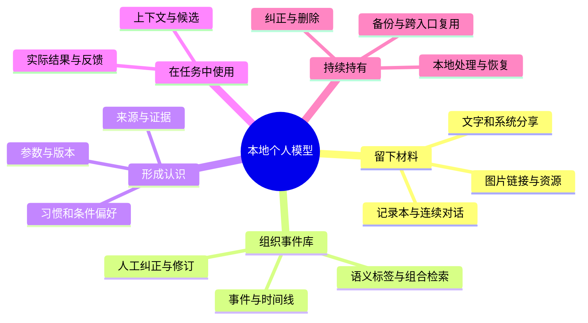
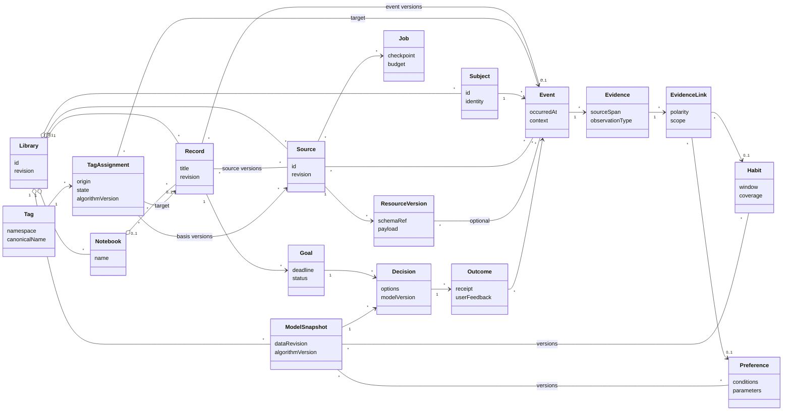
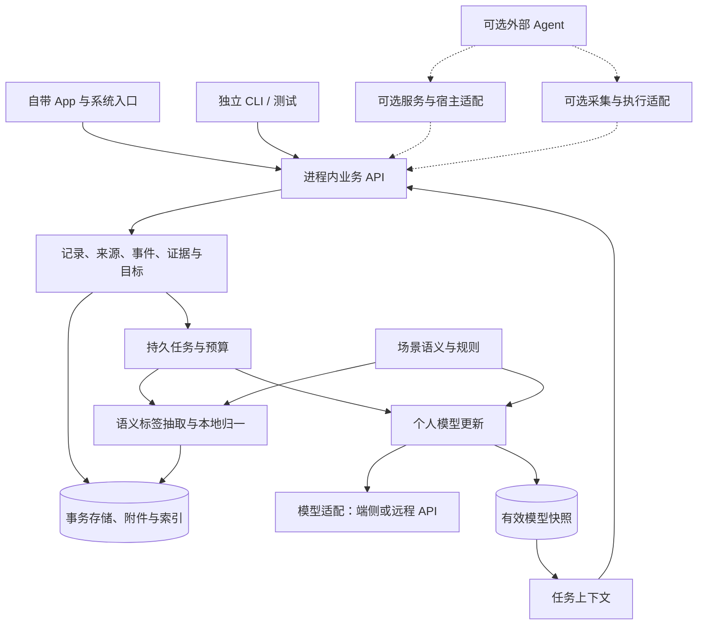

# 个人记忆与偏好服务 · 产品需求文档

| 文档信息 | 内容 |
| --- | --- |
| 所属团队 | 你所热爱的就是软件工程 |
| 版本与日期 | v1.3 · 2026-11-09 |
| 状态 | 需求评审稿；数值为设计目标，实际完成以验收证据为准 |
| 思路来源 | [微信反思草稿及补充审阅](recipe/assets/research/wechat-draft-2026-11-06.md)，承接后续关于通用个人模型与实现借鉴的澄清 |
| 配套依据 | [产品与技术调研](research.md) · [课程要求](../task-requirement.md) |
| 规范参考 | [GB/T 9385—2008《计算机软件需求规格说明规范》](https://openstd.samr.gov.cn/bzgk/std/newGbInfo?hcno=2790825C43AD0B69E3C38C140BFFCFE6) |

## 迭代记录

历史提交稿保留在 [recipe/prd.md](recipe/prd.md)

| 版本 | 日期 | 调整 |
| --- | --- | --- |
| v1.0 | 2026-11-07 | 建立个人偏好记忆循环，以饮食验证体验 |
| v1.1 | 2026-11-08 | 将数据与机制扩展为通用个人模型，加入习惯、目标和场景协议 |
| v1.2 | 2026-11-08 | 确定自带 App 与本地核心的形态，精简结构；补充跨工具与识屏借鉴，端侧全流程、MCP 和宿主适配分别验证 |
| v1.3 | 2026-11-09 | 首页改为对话与记录，记录库统一时间线与事项，记忆管理进入设置；明确 Agent 与本地算法生成语义标签，补充事件库组织、触发与纠正验收 |

## 一、产品主线与使用方式

### 1.1 产品定义

**从用户留下的生活材料中持续形成习惯与偏好模型，让下一次帮助少问重复问题、更符合当时情境，并能随反馈纠正。**

核心循环为：

**留下材料 → 整理事件、语义标签与证据 → 更新个人模型 → 在事项中使用 → 回收实际反馈。**

**首期形态是自带手机 App＋本地业务核心＋模型适配层。** 用户在应用和系统入口中记录、查看与纠正；核心在获准执行时处理，随时保存进度。前后端在代码和契约上分离，手机内通过模块调用协作。

交互采用记事本结构：记录聚合原文、附件、对话与相关事件，需要持续跟进时关联目标成为事项。Agent 结合本地算法生成可纠正的语义标签，使本地存储形成可按时间、人物、标签与状态检索的事件数据库。“Agent 标签”描述内容的语义，标签生成与个人偏好建模分别保留依据。

个人资料、习惯统计和偏好参数由本地核心维护。语言／视觉推理可接端侧模型或远程 API：远程模式标明发送范围与处理位置，完整端内模式另做断网验证。独立 CLI 用于测试与复用，MCP／HTTP 服务在扩展宿主上验证；长期服务部署到用户自管主机。

个人状态分为四类：

| 状态 | 含义 | 例子 |
| --- | --- | --- |
| 事实与经历 | 有来源、时间和主体的表达或观察 | 这次换乘花了 20 分钟 |
| 习惯 | 在已观察范围内反复出现的行为 | 工作日多在晚间学习 |
| 条件偏好 | 特定情境下的倾向与取舍 | 赶时间时愿意加钱减少换乘 |
| 当前目标 | 有期限、状态与执行责任方的要求 | 周五前买票，降到目标价时提醒 |

“内化”体现为规则、统计或参数的更新，并在后续任务中产生可检查的影响。通用语言／视觉模型理解材料，个人模型保存持续更新的用户状态。

### 1.2 用户、场景与价值

| 用户 | 任务 | 产品价值 |
| --- | --- | --- |
| 反复处理生活选择的人 | 选餐、通勤、购物、学习或运动安排 | 少解释旧背景，使用真实经验 |
| 为家庭或共同活动作安排的人 | 同时考虑不同人物与条件 | 认识归属清楚，条件可调整 |
| 已有个人 Agent 的人 | 换入口继续使用和更新认识 | 经验随用户复用 |
| 自部署与集成使用者 | 配置、维护和迁移服务 | 数据与接口可持有、可检查 |

饮食做深入体验验证，出行、消费、学习／工作、作息／运动检验通用性。菜谱、行程、报价和学习资料都是可选资源，事件可以独立保存。用户与竞品证据见 [research 第二、五节](research.md)。

例如，用户记下“加班晚间做饭太累，洗锅尤其麻烦”。系统保存经历与条件评价，后续逐步形成相应认识；下一次加班时调用这些依据，用户的实际选择与反馈再更新模型。这套流程同样用于出行投入或学习安排。

### 1.3 页面与交互

| 入口 | 主要任务 |
| --- | --- |
| 对话与记录：首页 | 打开即可输入，选择对话或记录模式后提交；继续原记录中的事项，补充材料与反馈 |
| 记录库 | 默认时间线；按记录本、语义标签、人物、时间、进行中或待回应筛选；打开统一记录详情 |
| 设置 | 智能与连接、记录与记忆、外观、数据与关于分组；开关与选项就地操作，复杂配置进入详情 |

首页顶栏保留记录库和设置入口，底部承载输入。记录本、标签与状态是同一内容库的组织和筛选方式；记录内维护正文、材料、对话、相关事件、目标与结果。完整入口矩阵见[信息架构](information-architecture.md)。

空库可以直接记录、在设置填写偏好或使用独立示例库。示例含至少 5 条饮食经历、3 个候选资源及其他四类场景的边界案例。回答旁提供依据和纠正，完整记忆管理位于“设置 → 记忆与偏好”。普通整理进度附在原记录上，需要回应时再显示提示。

界面统一显示“已保存、正在整理、等待条件、需要核对、已更新”。模型缺失、空间不足和权限变化给出原因与可执行操作，保留已输入内容。

### 1.4 项目标志与思维导图

项目名称为 **PebblePile · 叠石**。三块错位叠放的河石表达材料、认识与持续更新，俯视与侧视结合，保留自然轮廓和层间重叠。矢量标志与应用图标见 [assets](../assets/README.md)。界面保留用户原话，技术详情放在诊断页。

## 二、范围与功能需求

首期交付 **F01—F13**：双平台 App、本地资料与个人模型、可恢复处理、选定模型接入、场景协议、系统入口、CLI 与备份。F14 为适配验证；完整端侧推理通过 A29 后列入支持能力，外部 MCP／HTTP、Android 默认助理和宿主插件按 A35—A36 验证。实际订票支付、持续盯价、自动同步与复杂潜在表示后续扩展。

### F01：建立资料库与准备模型

首次打开创建本地库，文字保存、编辑、检索和明确设置即可使用。模型适配层支持端侧运行时或配置的服务 API；设置显示位置、版本、准备状态、费用与可用条件。M0 用同一中文任务确定首期路径和支持设备，完整端侧能力按 A29 单列。

断网时继续管理已有资料，需推理的任务保留待处理状态。采用远程 API 的版本明确标为“本地存储与个人状态＋远程推理”；称为“纯端内”的路径覆盖全部所需推理。

本地基础功能免费，代码与数据格式开放。远程服务作为可选配置，列出发送范围、提供方、费用与模型许可。

### F02：自然记录与资源导入

| 输入 | 首期范围 | 处理 |
| --- | --- | --- |
| 文字 | 单条最多 10,000 字符 | 原话先保存，按需分段和补充缺项 |
| 截图 | JPEG／PNG，单张最多 5 MiB，以中文印刷文字为主 | 保存图片，OCR 片段定位到原图 |
| 链接 | 公开静态 HTML，响应最多 2 MiB；普通文本及已注册 JSON-LD | 保存 URL 与内容快照；受限内容由用户分享文字／图片 |
| 系统分享 | Android 接收文字、链接、受支持图片；iOS 经快捷指令／应用入口交接 | 临时资源先取得持久副本或持续读取能力 |

来源、附件和任务引用提交成功后返回“已保存”。重复来源可定位已有记录；另一次真实经历可以单独建立事件。超限给出重选路径，保存失败显示实际状态。

第一条内容建立记录，后续对话和附件关联同一记录；记录本可稍后指定。顶栏下方用“对话／记录”页面级分段选择，切换保留草稿和记录上下文。记录模式先完成本地保存，是否继续抽取与打标签按自动整理设置执行；对话模式在保存后继续问答。提交采用图标按钮，可访问名称随模式为“发送”或“保存记录”。每次保存保留内容起源、来源版本和记录归属。语音入口调用系统听写，文字先进入可编辑草稿，再由用户提交；取消和权限拒绝保留原草稿。原型演示该入口，系统支持与隐私提示在实现时按平台验证。

### F03：记录组织、通用事件与资源版本

记录本采用浅层组织。记录聚合来源版本、会话、事件与可选目标；带目标和后续进展的记录呈现为事项。时间线、记录本列表、标签筛选和状态列表返回同一记录标识与详情。未抽取出事件的内容按记录时间回查；发生时间与记录时间分别展示。

事件保存主体、行为、对象、时间、情境及实际／计划等类型；资源引用可空。发生时间与记录时间、记录者与经历者分别保存，模糊时间保留精度。

资源保存类型、Schema、载荷、来源与父版本，编辑生成新版本。事件关联实际使用版本。支持检索、补记、合并重复事件与调整人物；合并保留来源映射，并重算受影响证据。

### F04：事件、语义标签与证据整理

提取人物、行为、情境、评价和来源位置，区分实际经历、计划、假设、转述、收藏及 Agent 生成内容。缺项和竞争解释保留待核对状态。

每条证据可打开原话或图片区域。输出经结构、引用、人物范围与版本校验后入库；无效输出保留原材料并报告失败。独立证据按事件计数，重复分享沿用同一来源关系。

Agent 提出主题、场景、行为与情境标签候选，本地算法按词表做同义归一、去重、结构校验和索引更新。标签定义保留命名空间、类别与归一名；指派保留记录或事件归属、起源、依据版本及位置、算法版本、置信度、状态与修订。低置信或竞争解释进入待核对，人工确认与排除优先。

标签支撑检索、内容关联与已启用规则的匹配。人物、时间、观察类型和目标状态仍由结构化字段表达；带有“旅行”标签的计划保留计划类型。自动标签的存在与事实成立、偏好形成及执行授权分别校验。

### F05：习惯、偏好与模型更新

个人模型保存明确设置、习惯统计、条件偏好、取舍参数和快照。“本人明确”与“根据经历推断”分别展示；用户可启停推断辅助，明确要求和当前条件优先。

首期候选阈值为：偏好至少两次独立实际经历，习惯至少三次观察且注明窗口与覆盖。一次明确表达可形成本人设置。推断经来源与冲突检查，并在用户启用后参与适用情境内的低风险排序。阈值在 M0 校验，后续调整随版本记录。

习惯记录频次、观察次数、时间分布和例外；条件模型比较规则计分与一种增量参数方法。共享参数附语义、单位与范围，领域和情境修正分别保存。算法与纠正规则见第三节。

完整管理入口为“设置 → 记忆与偏好”；回答旁的依据与纠正直达相关认识。自然语言中的“仅这次”与长期要求分别保存作用范围。

### F06：目标与任务上下文

目标保存要求、期限、状态和执行责任方；持续关注任务另存频率、最近／下次检查及数据有效期。报价、库存等动态资料带来源与采集时间。

目标关联原记录，候选、下一步、选择和后续反馈在同一事项中延续。用户从记录库的“进行中”“待回应”视图继续处理。上下文检索可以组合语义标签与时间、人物、事项范围，并回查实际来源。

按任务、授权和预算返回有效习惯、偏好、相关证据、必要反例、未知项与处理进度。自带 Agent 据此给出少量候选或计划，并解释来源；外部宿主可直接使用结构化上下文。

记录候选、展示顺序、特征、选择及所用模型／资源版本。确定性换算交给场景规则；编辑先预览再形成资源版本。后台监测由选定执行宿主承担，界面显示最近有效状态和等待条件。

### F07：实际结果与反馈

分别保存建议、用户选择、Agent 动作、执行回执与本人体验。结果标明发起者、观察方式、时间，并关联目标、决策或事件。

请求送达、页面变化与目标完成使用不同状态。未知执行结果先核对，再继续或重试；有副作用的操作使用宿主提供的幂等能力或状态查询。Agent 自选结果作为执行事实，喜好学习使用对应的本人表达与体验。反馈可离线补记，并触发局部更新。

### F08：纠正、停用与删除

支持自然语言或卡片纠正人物、时间、评价和条件。修改带基准修订号；冲突保留输入并显示当前版本。纠正立即停用受影响旧认识，再重算相关部分。

标签支持确认、添加、合并、排除与撤销人工覆盖。人工排除按稳定记录或事件标识及归一标签保留，重算时继续生效；用户可明确撤销。来源修订使受影响的自动指派失效，标签索引、事项匹配和待处理输入同步检查有效版本。

移出记录本或移除引用只调整组织关联。删除原记录或材料时，先预览跨记录引用、相关派生内容与处理任务的影响范围；来源的原记录归属与其他记录的引用分别保存。

停用控制参与查询；删除清理来源、附件及相关派生内容，并取消依赖任务。失去全部依据的推断撤回，仍有独立依据的部分重算。清理范围覆盖快照、索引、缓存和含正文的诊断；必要的无正文删除标记阻止迟到写入。用户保存的旧备份与外部副本在相应管理入口处理。

### F09：任务、预算与中断恢复

来源与适用的首个任务原子保存。识别、场景解析、标签归一、证据整理、模型更新和发布分别设置检查点。标识包含输入版本、阶段与算法版本，重复执行只提交一次。

记录保存、材料补充、本人反馈、纠正和到期检查是处理触发；生活事件是被整理的数据。已启用的场景规则可按有效标签、事项状态与人物范围匹配，匹配和任务入队在同一事务完成。规则标识包含场景命名空间、版本和规则键，触发幂等键包含目标记录与输入修订；执行前重查授权、预算、规则启用及输入有效性。

记录内显示相关进度，完整队列与预算放在“设置 → 智能与连接 → 处理”；标签与整理规则设置保存自动整理、启停、范围与预算。需要用户回应时提示到原事项。到期触发按实际运行窗口恢复，展示最近检查与等待条件。

初始预算：一次文本整理或查询最多 3 次模型调用，每次输入最多 4,096 token、输出最多 1,024 token；最多 8 次业务工具调用、120 秒累计活动时间。分段与重试共享父任务预算；图片 OCR、等待调度及用户等待另计。批量任务先展示总预算，达到上限保留进度。

前台查询与纠正优先，批量处理按电量、温度和系统机会调度。退后台先提交检查点；允许继续时处理有限批次，恢复前台时检查队列。暂停、失败、取消和等待持久保存，输入过期的迟到结果退出提交。远程请求也保存操作标识、预算与接收状态。

### F10：系统入口与核心接口

iOS 提供“记一件事”“找回经历”两个 App Intents／App Shortcuts 动作；Android 提供系统分享。短操作保存后返回回执，后续整理进入队列。

业务核心提供进程内 API 和可独立运行的 CLI，支持记录、上下文、结果、纠正与任务查询。CLI 用于开发验证、批量处理和服务封装，具有结构化输出和退出码。

MCP／HTTP 与宿主钩子在 F14 扩展中复用同一契约。接入须同时验证宿主协议、身份授权、可达路径和运行时间窗口；手机端首期通过系统调度的动作入口完成外部触发。

### F11：备份、恢复与迁移

备份包含记录本、记录与会话归属、来源、附件、事件、标签定义／指派／人工修订、证据、个人状态、目标、决策／结果、整理设置、场景与算法版本及校验清单；连接密钥与临时上下文单独管理。

恢复先在新库校验格式、大小、路径、附件和引用，预览后原子切换。损坏、取消或空间不足保留原库。双平台共用格式；缺场景包时保留载荷与通用关系，算法不匹配时重建派生结果。旧备份明确显示时间与内容范围。

### F12：授权、部署与诊断

所有者管理资料库、人物、来源范围及客户端读写权限。资料库标识选择数据，认证身份决定访问权。外部 Agent 的推断、本人的明确设置和删除授权分别处理。

首期由手机库确认有效修订。独立服务扩展另有数据目录、启动停止和备份路径；切换权威库采用明确迁移。模型与连接设置说明外发范围，撤销后拒绝后续访问。诊断记录版本、调用量、延迟、预算与失败阶段，普通日志使用引用和状态。

### F13：场景协议与通用性

场景包定义命名空间、Schema、对象、单位、抽取样例、特征映射、约束、结果及测试案例。公共数据与接口稳定，领域字段单独校验。未知场景先保存原材料，待解释后补充结构。

场景包同时维护标签类别、规范词表、同义映射和可启用处理规则。跨场景标签通过明确的语义映射关联；版本变化保留旧指派依据并重建受影响索引。首期提供受控词表与人工扩充入口，算法评估覆盖近义词、歧义、否定、计划和生成内容。

提供饮食、出行、消费、学习／工作、作息／运动的轻量协议。禁用饮食包后，其他场景仍完成记录、建模、使用、反馈、纠正与迁移。共享认识保留语义映射和适用范围，按留出场景检验。

### F14：采集与宿主适配验证

Android 识屏原型采用默认数字助理接口，作为用户主动选择的入口：用户唤起后取得系统提供的文本／图像，补充体验并选择保存片段。统一返回观察 ID、来源应用、采集时间、内容、完整性及失败原因。结构化文本优先，OCR／视觉理解按需处理；空值、关闭、替换和迟到回调均有明确状态。

临时快照用于本次任务；符合记录意图或已启用采集规则的片段，取得持久副本后进入 F02。持续 GUI 观察与动作由执行适配器承担，按观察号验证状态，动作后回读，支持用户接管。

外部服务原型在明确运行的测试宿主上提供 MCP／HTTP，宿主插件调用统一核心，工具卡呈现依据与纠正。长处理返回任务 ID，按宿主预算查询进度；权限、原生界面与连接能力按实际支持情况选择。扩展验收见 A35—A36；核心记录和模型能力按 F01—F13 交付。

## 三、个人模型与数据规则

### 3.1 模型、程序与用户的分工

| 环节 | 模型／Agent | 确定性程序 | 用户 |
| --- | --- | --- | --- |
| 理解材料 | 提取、提出条件与竞争解释 | 保存、校验结构和引用 | 补充关键缺项 |
| 组织标签 | 提出有来源的分类与语义候选 | 词表匹配、归一、去重、状态检查与索引 | 确认、改名、合并或排除 |
| 形成认识 | 提出习惯与偏好候选 | 去重、证据计数、统计与参数更新 | 确认或纠正 |
| 使用与反馈 | 选择上下文、解释候选、组织任务 | 授权、预算、状态检查与回执 | 作出选择、接管和评价 |

领域定制资产包括场景 Schema、提示词、特征与单位、证据规则、工具契约及测试案例。来源为获准用户材料、团队案例、[Schema.org Recipe](https://schema.org/Recipe)等领域结构，以及 [research](research.md) 中的论文、平台文档与源码；每项记录版本、用途和复核人。

### 3.2 模型更新原则

规则、习惯统计和一种增量参数模型作为首期比较。取舍参数由共享部分、领域修正与情境修正组成；共享程度通过语义映射和留出验证确定。观察覆盖、可得选项、展示次序与行动发起方式共同参与解释。

模型快照保存认识版本、统计／参数、证据依赖、特征／算法版本和数据水位。候选快照校验后发布；纠正或删除先停止受影响部分使用，再按有效证据局部重算或从检查点重放。历史决策保留修订关系，已删除正文同步清理。

### 3.3 核心对象与类图

| 对象 | 保存内容 |
| --- | --- |
| Library／Subject | 权威实例、所有者、资料库修订；人物及已确认归属 |
| Notebook／Record | 浅层记录本；记录标题、归属及来源、会话、事件与目标关联 |
| Source／ResourceVersion | 原文、附件、采集方式、时间、用途与版本；可选领域资源载荷 |
| Event／Evidence | 主体、行为、情境、观察类型；原文位置、评价维度与有效性 |
| Tag／TagAssignment | 标签命名空间、类别与归一名；记录／事件指派、依据、算法、置信度与人工修订 |
| EvidenceLink | 支持／反对、独立事件、范围和目标认识版本 |
| Habit／Preference | 观察窗口、覆盖和频次；条件、倾向、参数、起源与状态 |
| ModelSnapshot | 认识、统计、参数、证据依赖、算法与数据版本 |
| Goal／Decision／Outcome | 当前要求、候选与依据、动作回执及本人评价 |
| Job | 输入版本、阶段、检查点、预算、重试和错误 |

全部对象带资料库范围。来源可关联多个事件，事件可由多份材料支持；领域资源和场景属性按注册 Schema 解释。

证据关系指向一项认识及其版本。即时建议可建立一次性目标，模型快照与决策绑定。

标签指派的目标为记录或事件，二者择一；依据定位到精确来源版本。图中来源、事件关联的具体版本与会话归属见[数据库设计](database-design.md)。

### 3.4 一致性与状态

| 对象 | 状态规则 |
| --- | --- |
| 来源 | 保存即可回查；修订生成新版本；删除保留必要的无正文标识 |
| 记录与标签 | 记录归属可调整；标签指派为待核对 pending、有效 active、人工排除 rejected、已撤回 retracted；人工覆盖与依据修订分别保留 |
| 习惯／偏好 | 待核对、有效、冲突、已取代、已撤回；起源和暂停使用另记 |
| 目标／动作 | 目标为进行中、等待、完成、取消、到期；动作另记请求、验证、失败或待核对 |
| 快照 | 候选、有效、已取代、受影响停用；查询绑定一致版本 |
| 任务 | 排队、运行、完成；可进入等待、待核对、失败、取消或输入过期 |

阶段结果先写入工作区，提交时重查输入、权限、取消与修订，再原子发布。查询使用已发布版本，并提示新材料处理进度；旧索引仍经过有效性过滤。来源变化沿依赖传播到参数、快照、索引和上下文缓存。

## 四、软件架构与接口

### 4.1 模块结构

移动端采用应用内分层：界面和系统入口调用业务核心，核心管理学习与一致性，持久队列响应系统调度。模型 API 是推理依赖，个人状态由本地核心保存。场景、采集、执行与服务封装通过独立适配层扩展。

首期优先验证事务数据库加附件目录、全文检索的轻量实现，向量检索按收益加入。感知模型与个人参数分别版本化，模型调用由统一预算控制。SQLite、运行时与客户端框架在 M0 用同一链路确认。

### 4.2 关键契约

| 契约 | 最小内容 |
| --- | --- |
| 摄取材料 | 操作 ID、来源／版本、采集方式、时间、原文／附件、可选人物与场景；返回保存回执和任务 ID |
| 记录与标签 | 记录／记录本标识、关联来源／事件版本、标签命名空间、归一名、指派起源、依据、算法、状态及人工修订 |
| 屏幕观察 | 观察 ID、来源应用、采集时间、文本／图像、范围、完整性、可用状态 |
| 模型快照 | 资料库修订、有效认识、参数、证据依赖、算法／特征版本与处理水位 |
| 任务上下文 | 状态、正文或结构化条目、精确证据引用、快照、预算、遗漏、未知项与处理进度 |
| 使用与结果 | 宿主、任务、所用快照和条目；动作、回执、实际结果及本人反馈分别记录 |

上下文区分 `ready/empty/unavailable`。传输设置 UTF-8 字节上限，推理按实际 tokenizer 计量；两者分别检查。接入方按资料库、授权范围、查询、快照及预算标识缓存，修订或撤权后失效。

跨工具共享需要：绑定同一权威库、读取有效快照、通过接口写回、下一轮重新核对修订。“材料已保存”“模型已更新”“宿主已使用”分别记账；宿主回报所用快照和条目，缺少回执时保留未知。普通查询读取已有结果，复杂整理进入持久队列。

### 4.3 业务工具

| 工具 | 作用与关键返回 |
| --- | --- |
| `record_experience` | 保存材料或经历，可指定记录、记录本与仅记录意图；返回记录、来源、事件和适用的整理任务 |
| `query_records` | 按时间、人物、记录本、语义标签及事项状态组合检索，返回统一记录引用与匹配依据 |
| `update_record` | 修改记录标题、归属与关联，保持来源正文及其版本关系 |
| `revise_tags` | 确认、添加、排除标签或撤销人工覆盖；返回有效修订与受影响范围 |
| `query_context` | 按任务、情境与预算供给有效认识和证据 |
| `propose_preference` | 提议认识；返回证据校验、冲突与推断状态 |
| `update_goal` | 在原记录中新建或更新要求、期限与执行责任方 |
| `record_outcome` | 回写动作、观察、回执及实际评价 |
| `revise_memory`／`delete_memory` | 按基准修订纠正或删除，返回影响范围 |
| `get_task`／`control_task` | 查询、继续或取消，返回阶段与剩余预算 |
| `get_capabilities` | 返回协议、场景、处理位置及入口能力 |
| `export_data`／`restore_data` | 导出状态、恢复校验与预览 |

身份与资料库范围由认证上下文确定。写入带操作标识，修改带基准修订；重复请求返回原结果，冲突保留当前版本。查询携带权威实例、资料库、`revision`、快照与 `processedThrough`。

错误区分输入不支持、权限、版本冲突、模型不可用、预算、资源不足、处理失败和取消，返回可重试状态及下一步。

### 4.4 移动端运行与扩展

| 形态 | 本版选择与条件 |
| --- | --- |
| 自带 App＋本地核心 | 首期基线；前台及时处理，后台按系统机会继续，中断后恢复 |
| 远程模型 API | 首期可选推理路径；发送获准片段，处理断网、超时和迟到结果，本地维护个人状态 |
| 完整端侧推理 | 独立能力验证；全部所需模型准备好后通过 A29，再公布支持设备 |
| Android 默认助理 | 入口原型；系统维持轻量服务，重处理与交互／任务调度分开，测切换助理和进程重建 |
| 外部 Agent 服务 | 扩展；持续服务优先用户自管主机，手机临时窗口按明确可用条件试验 |

普通 iOS App 退后台会进入挂起；Android 前台服务有可见任务、类型和调度约束。首期的可靠性承诺是保存与恢复。官方依据见 [research 5.2](research.md)。Siri／App Intents 和 Android 系统入口在各自允许的执行窗口调用核心。

服务扩展使用选定 MCP 传输与认证。PC 作为服务和测试宿主，手机远端服务协同另含网络、缓存与同步工程。

跨工具契约借鉴 PowerContext，Android 采集借鉴 Eta 的公开系统接口，宿主候选优先试接 dsh-go 插件。三者的源码依据、条件与许可集中在 [research 第四节](research.md)。M0 比较最小原型的有效信息量、资源和维护成本，再确定复用深度。

## 五、非功能要求

| 编号 | 验收条件 |
| --- | --- |
| N01 本地可用 | 双平台断网可保存、编辑、检索已有资料、管理明确设置并导出；需推理的任务状态可恢复；纯端内能力须通过 A29 |
| N02 响应性能 | 1,000 事件、200 偏好、100 习惯、100 目标、500 资源版本及其记录、标签指派下，预热后普通保存与非模型查询各测 100 次，p95 ≤1 秒；记录与标签规模随数据集公布，附件和模型耗时单列 |
| N03 数据可靠 | 中断、重复提交、并发、取消、磁盘不足后，已确认数据完整，版本错误与迟到误写为 0 |
| N04 资源预算 | 执行 F09 上限；M0 固定目标机的内存和存储预算，记录能耗、温升与增长，越限保存进度 |
| N05 隐私与权限 | 本地维护资料和个人状态，私有目录保存；远程推理按范围授权，凭据安全存储；扩展网络接口认证加密，检查撤销与出站 |
| N06 输入与工具安全 | 校验类型、大小、路径和引用；公开 URL 复查重定向并限制私有地址；配对后端按独立授权连接；材料指令按内容处理 |
| N07 易用与无障碍 | Android 360 dp／iOS 375 pt 主流程可用，触点至少 48 dp／44 pt；支持字号、读屏、键盘与错误恢复 |
| N08 可观测与复现 | 可定位输入、算法、快照、运行时、预算和失败阶段；导出脱敏诊断，估算用量注明方法 |
| N09 兼容与迁移 | 双平台备份互通，旧格式可迁移，缺场景包保留材料，未知新格式安全退出；接口与依赖版本可查 |
| N10 部署与维护 | 非模块作者可在干净环境按说明启动、构建并运行示例；提供访问地址、模型准备、许可和故障排查 |

## 六、验证与验收

### 6.1 交付门槛

| 编号 | 必达项 | 证据 |
| --- | --- | --- |
| C01 需求依据 | 至少 8 人访谈，满足 research 的样本构成，每人一条获准行为材料 | 原话、行为与需求映射 |
| C02 手机循环 | 双平台在选定推理路径完成文本循环，通过 A01—A28、A30—A34、A37—A40 中各自适用项 | 机型、系统、模型、步骤和录屏 |
| C03 核心复用 | 独立 CLI、Siri／快捷指令、Android 分享使用同一业务语义；App 与系统入口读写同一库 | 配置、回执、修订与异常记录 |
| C04 可靠性 | N01—N10 达标；保存、纠正、删除、恢复与权限类发布阻断项为 0 | 故障、迁移、性能与出站检查 |
| C05 模型效果 | 36 个冻结任务各运行 3 次，B2 至少 33 题三次均通过，关键错误为 0 | B0／B1／B2 原始结果与评分 |
| C06 使用与发布 | 至少 8 人两轮试用，间隔 ≥24 小时，至少 4 人饮食体验、4 人其他场景结果，可重合；示例与安装可检查 | 使用成本、发布地址、构建与操作说明 |

C01—C06 全部通过记为核心版本完成。A29 验证完整端侧能力；F14 以 A35—A36 记录扩展结论，发布的能力附相应通过证据。

### 6.2 效果对照与目标

B0 为原文加混合检索，B1 固定 Honcho 或 Hindsight，B2 为本项目。36 题按来源与事件、习惯与覆盖、条件偏好、目标与结果、变化与纠正、跨场景迁移各 6 题组织，至少 12 题取自获准真实材料。实验配置、数据切分与消融见 [research 第六节](research.md)。

固定材料、时间顺序、候选、回答模型、信息、预算和硬件；内部模型或部署不同的完整系统结果单列。三次均通过才计为稳定通过，两人隐藏组别评分。成本包含写入、整理、检索和回答。

关键错误包括主体错归后当作本人设置、编造依据、绕过已知限制、使用已撤回证据、虚报保存或执行成功、错误迁移为明确限制。允许保留题目规定的未知项；主观喜好以本人反馈与后续选择判断。

| 编号 | 设计目标 |
| --- | --- |
| G01 定制收益 | B2 相对 B0，人工纠正次数配对中位数降低 ≥20%，完成率不降 |
| G02 轻量使用 | 至少 6／8 人独立完成两轮任务；记一条简短经历、第二轮找回相关经历各 ≤1 分钟 |
| G03 经验复用 | 第二轮相对原有方法，重复说明条目中位数降低 ≥30%，操作时间降低 ≥20%，完成率不降 |
| G04 资源回报 | B2 达到 C05，稳定通过率与 B1 相差 ≤5 个百分点时，写入加查询总 token 降低 ≥20% |
| G05 跨场景收益 | 留出场景前五次任务中，相对同算法仅用目标场景数据，补充次数配对中位数降低 ≥20%，完成率不降，错误迁移单列 |

G01—G05 报告实测值与样本，安装准备单列。失败与放弃计入完成率分母，零基线报告绝对变化；资源同时报告延迟、内存和能耗。目标未达时调整收益表述。

### 6.3 功能与异常场景

各项记录平台、版本、输入、步骤、预期、结果及证据。A23 为 iOS，A24 为 Android，A25 为独立核心，A26 为系统入口一致性；核心项按平台执行。A29 为完整端侧验证，A35—A36 为适配扩展。

A37—A40 覆盖新入口与语义标签。标签质量另用冻结材料片段检验分类、归一、误合并、人工纠正与检索收益，实验方案见 research 6.3；算法指标报告实测值，功能一致性按下表验收。

| 编号 | 场景与通过条件 | 关联需求 |
| --- | --- | --- |
| A01 | 无模型断网建库，记录与编辑后可回查、检索、导出，重开完整 | F01—F03 |
| A02 | 模型缺失、下载中断、校验失败或不支持时原因明确，修复后继续任务 | F01、F09 |
| A03 | 完整、缺项、多事件及超长文字保留原话，缺项可补，超限说明范围 | F02—F04 |
| A04 | 清晰、模糊、超限截图按规则处理，持久可读，OCR 可定位与纠正 | F02、F04 |
| A05 | 公开链接保存版本；登录、动态、超限或受限地址给出替代录入方式 | F02、N06 |
| A06 | 重复分享只计一次证据，独立新经历可单独记录 | F02—F05 |
| A07 | 本人、转述、计划、收藏、实际体验及系统内容的主体与类型正确 | F03—F05 |
| A08 | 编辑领域资源产生新版本，旧经历仍指向实际使用版本 | F03 |
| A09 | 明确偏好与临时要求各按范围生效，临时项到期正确 | F05—F06 |
| A10 | 推断按证据策略及辅助开关使用，候选、冲突与依据可查 | F05 |
| A11 | 同一偏好在加班与周末按条件使用，反例触发更新 | F05—F06 |
| A12 | 筛除与明确要求冲突的候选，关键未知项可核对 | F06 |
| A13 | 饮食与出行的特征、单位和反馈正确，共享范围可查 | F05—F07、F13 |
| A14 | 上下文带有效快照、证据、未知、遗漏和水位；区分空结果与不可用 | F06、F09—F10 |
| A15 | 接受建议、实际尝试与体验分别保存，按证据类型学习 | F07 |
| A16 | 饮食份量换算按规则执行，确认后生成资源版本，反馈关联所用版本 | F03、F06—F07 |
| A17 | 纠正后各入口返回一致有效修订；CLI 可回放同一测试资料，旧缓存退出使用 | F08、F10 |
| A18 | 删除来源清理正文及派生缓存，推断撤回或按独立依据重算 | F08、N05 |
| A19 | 双击、并发修改和迟到任务正确去重、报冲突并保留新版本 | F08—F10 |
| A20 | 各阶段切后台、结束进程再重开，数据完整，按检查点与剩余预算继续 | F09、N03 |
| A21 | 超时、校验失败、预算耗尽和取消保留已提交结果，半成品退出发布 | F04、F09 |
| A22 | 保存、发布、恢复时空间不足，回执真实，原库完整，可重试 | F02、F09、F11 |
| A23 | Siri／快捷指令记录与查询成功，缺参数、锁屏或权限问题可交接 | F10 |
| A24 | Android 分享后结束来源应用，材料仍可读取，重复提交与恢复正确 | F02、F10 |
| A25 | 干净环境独立运行核心 CLI，完成记录、上下文、纠正、备份及错误处理 | F10、F12 |
| A26 | App 与系统动作先后记录、查询和纠正；挂起后恢复版本一致，保存和更新回执可核对 | F10、F12 |
| A27 | 越权与撤销生效，默认本地路径及可选外发范围符合配置 | F12、N05 |
| A28 | 双平台备份往返一致；损坏、越界和取消保留原库；旧快照预览明确 | F11、N06、N09 |
| A29 | 两台真机准备模型后飞行模式完成记录、抽取、更新、建议、反馈与纠正 | F01、F04—F09 |
| A30 | 新参与者按说明访问示例、安装 App 和配置模型；开发者独立运行核心，版本与许可齐全 | C06、N08—N10 |
| A31 | 禁用饮食包，以无资源引用的其他场景执行循环并恢复备份，公共接口稳定 | F03、F11、F13 |
| A32 | 有偏采样、重复、例外和近期变化的记录正确更新观察覆盖与习惯 | F04—F05、F08 |
| A33 | 有期限目标与过期报价分别处理，等待、到期、完成及责任方清楚 | F06—F07 |
| A34 | 可共享与冲突的跨场景证据按语义和范围使用，纠正可定位受影响快照 | F05、F08、F13 |
| A35 | MCP／HTTP 扩展在选定宿主完成读写、纠正和长任务查询；另测钩子、网络不可达与服务停止，区分三阶段回执 | F09—F10、F14 |
| A36 | 默认助理原型测试空内容、受保护页面、助理切换、进程重建与迟到回调；执行适配另测过期观察和结果不明 | F07、F09、F14 |
| A37 | 首页可切换对话／记录模式并保留草稿，图标提交分别发送或保存；离线保存可重开；记录库一次打开，时间线、记录本、标签和状态视图进入同一记录；反馈回到原事项，记忆管理及就近纠正可找到 | F01—F03、F05—F08 |
| A38 | 冻结词表用例正确归一去重，标签可定位依据版本及算法；低置信待核对，人工确认／排除优先；计划、转述和生成内容保留类型，报告标签质量指标 | F03—F05、F08、F13 |
| A39 | 组合标签、人物、时间与事项状态能找回目标记录；仅已启用规则在授权范围触发，重复输入只入队一次；处理与反馈回到原事项 | F03—F04、F06、F09、F12—F13 |
| A40 | 修订、删除、人工排除、规则停用、中断与恢复后，标签、索引、触发和输入版本一致；备份恢复保留人工修订，迟到任务退出提交 | F08—F09、F11—F13 |

## 七、实施与交付

### 7.1 里程碑

课程原答辩与博客节点为 10 月 24—25 日。11 月 3 日的“约五周”是当时计划；按该估计，11 月 8 日约余四周。具体日期随课程后续安排和团队进度确定。

| 阶段 | 产出与完成条件 |
| --- | --- |
| M0 关键验证 | 访谈启动；比较端侧与 API 推理，固定首期路径、机型、预算、Schema 和 B1；验证挂起恢复与小规模适配 |
| M1 可用资料库 | 记录本、记录、来源、事件、语义标签、队列、明确设置、页面、标志、备份与系统入口可用 |
| M2 个人模型 | 习惯与条件模型、上下文、结果与纠正贯通；冻结案例，完成两轮试用 |
| M3 验证发布 | 双平台异常、机制与跨场景对照完成；C01—C06 判定齐全，扩展独立记录 |

M0 输出候选、实测条件、取舍和负责人。设备、资源或分发条件影响核心范围时，更新需求基线及重测范围。

### 7.2 团队分工

团队成员按当前主线分工交接。

| 方向与成员 | 主要产出 |
| --- | --- |
| 产品：王智壹、林金晶 | 访谈、需求、试用、冻结任务与课程材料 |
| 设计：马晨曦 | 对话与记录、时间线与标签导航、认识解释、纠正、状态、标志与无障碍 |
| 前端：陈柏睿、陈柯男 | 双平台应用、系统入口、核心嵌入与适配界面 |
| 后端：郑嘉文、陈飞扬、周恪玄 | 通用契约、事务、任务、修订、备份、API／CLI／MCP |
| 算法：张洋 | 事件与标签提取、归一去重、习惯与条件模型、增量更新、对照与资源分析 |
| 测试：林叶鑫、李宗欣 | 场景与异常、性能、迁移、权限和发布复现 |

### 7.3 风险与交付

| 风险 | 处理 |
| --- | --- |
| 端侧质量或资源不足 | M0 固定支持范围，比较模型、上下文与批次 |
| 证据稀疏、误迁移和反馈偏差 | 明确条件冷启动，保留竞争解释，以未来任务检验 |
| 更新遗漏、后台中断 | 依赖失效、检查点、版本过滤与原子发布 |
| 接入、安装和维护过重 | 先验证独立核心与公开适配，计入首次及持续成本 |
| 组件、许可或分发变化 | 固定版本、保留兼容层，核对代码、模型与素材条件 |

交付开源代码、构建与模型配置说明、双平台测试分发方式、独立核心 CLI、统一备份、可访问示例及访谈／实验记录。采用的服务或宿主扩展附独立配置；示例使用获准材料，处理位置与能力以实测证据说明。

发布记录汇总 C01—C06、G01—G05、N01—N10、各核心 A 项，以及 A29、A35—A36 的验证结果与支持范围。PRD、research、演示与实际版本保持一致。

课程所需介绍、标志、思维导图见第一节；功能见第二节；领域定制、前后端与类图见第三、四节；定制前后效果与验收见第六节；上线与测试方式随本节交付。
