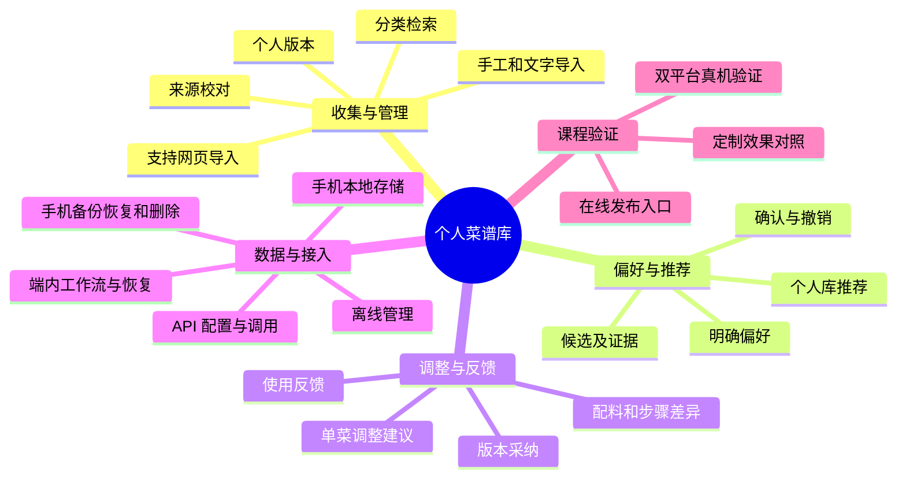
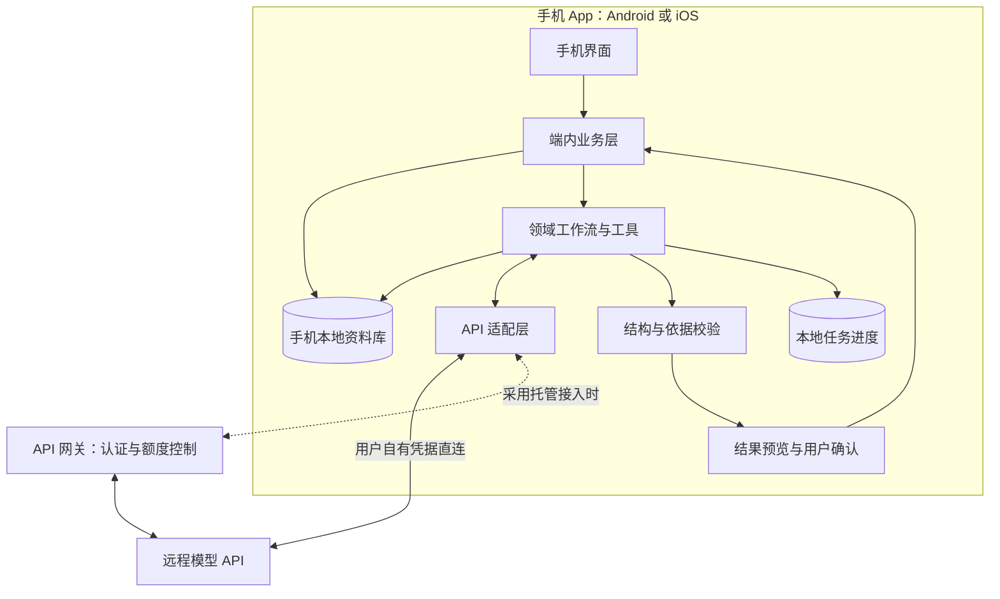
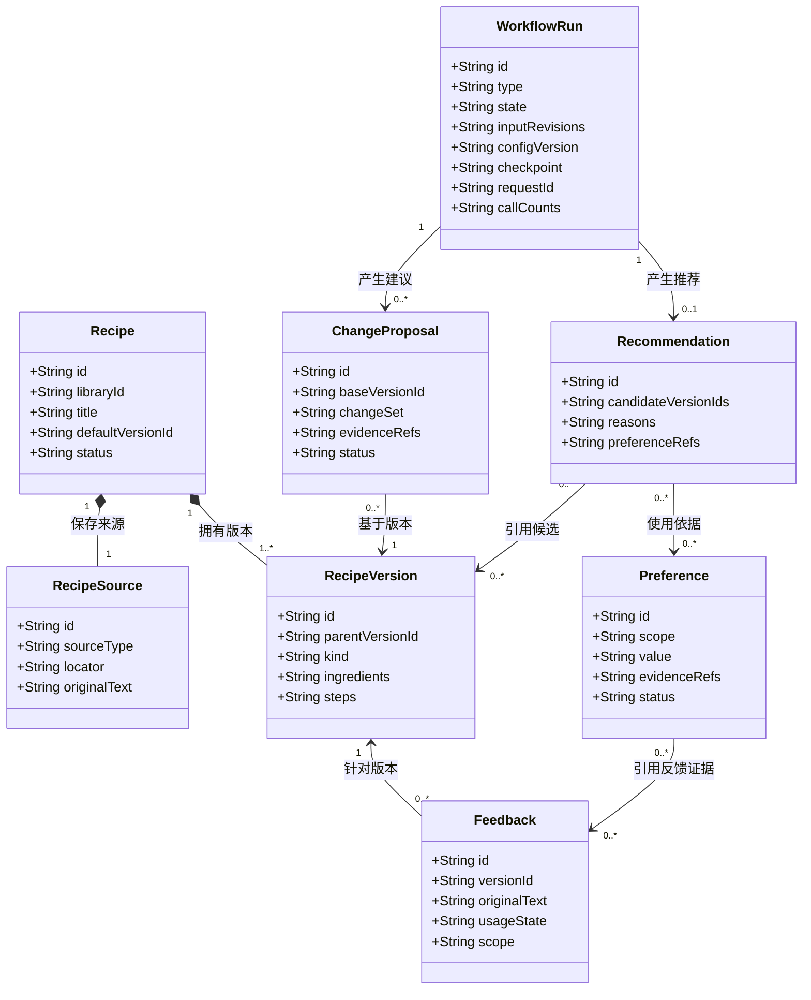

# 个性化本地菜单管理服务 · 产品需求文档

| 文档信息 | 内容 |
| --- | --- |
| 所属团队 | 你所热爱的就是软件工程 |
| 版本与日期 | v0.2 · 2026-10-23 |
| 文档状态 | 需求评审稿，作为首期开发、演示和验收的共同依据 |
| 需求来源 | [作业要求](../task-requirement.md)、[产品调研](research.md)、[团队定位记录](assets/research/qq-chat-2026-10-19.md) |
| 编写参考 | [GB/T 9385—2008《计算机软件需求规格说明规范》](https://openstd.samr.gov.cn/bzgk/std/newGbInfo?hcno=2790825C43AD0B69E3C38C140BFFCFE6)；[pm-skills：create-prd](https://github.com/phuryn/pm-skills/blob/07b34f64ee828df08953f505b7f747aef85ae7c6/pm-execution/skills/create-prd/SKILL.md)、[test-scenarios](https://github.com/phuryn/pm-skills/blob/07b34f64ee828df08953f505b7f747aef85ae7c6/pm-execution/skills/test-scenarios/SKILL.md) |

本文按“产品目标—用户价值—功能与规则—验收”组织需求，补充思维导图、类图和前后端说明。现有证据包括团队讨论与公开资料调研；用户访谈、竞品实测和原型测试将在开发中完成。下文的数量、耗时和效果指标均为拟定目标。

## 迭代记录

| 版本 | 日期 | 变更内容 | 依据与状态 |
| --- | --- | --- | --- |
| v0.1 | 2026-10-23 | 建立个人菜谱库、领域工作流、偏好与版本规则；明确本地使用、两端访问、在线演示和验收范围 | 基于 10 月 19 日更新的调研，供团队评审 |
| v0.2 | 2026-10-23 | 调整为移动端独立完成核心功能，手机本地存储、运行工作流并调用 API；PC 作为可选扩展；同步调整架构与验收，保留双平台原生和跨平台方案待选 | 基于移动端产品定位调整，开发方案待调研后选择 |

后续涉及功能范围、数据保存规则和验收标准的调整，应在本表记录原因及影响，并同步修改对应需求编号。

## 一、产品概述

本项目面向有收藏菜谱、实际做饭和反复修改做法习惯的用户，提供一个随手收集、查找和积累经验的手机菜谱库。用户在手机上完成导入、校对、分类、版本比较、偏好管理和反馈，资料保存在手机本地。App 在端内运行领域工作流，通过 API 调用模型，整理材料、分析口味、解释推荐，并针对选中的菜提供调整灵感。

核心过程是：**导入菜谱 → 整理与检索 → 确认偏好 → 按需推荐或调整 → 保存版本与反馈。** 每项能力都有独立入口，用户按当前需要使用。

### 1.1 术语

| 术语 | 本文含义 |
| --- | --- |
| 菜谱 | 一道菜的配料、步骤、份量、来源及相关说明 |
| 菜单库／个人菜谱库 | 用户选入的菜谱、分类、个人版本和反馈集合 |
| 原始资料 | 用户提交的文字、网页内容或自写记录，保留取得时间与来源 |
| 个人版本 | 用户校对、编辑或采纳建议后保存的做法，关联原菜谱和上一个版本 |
| 偏好候选 | Agent 从材料和反馈中提出、等待用户确认的口味判断 |
| 有效偏好 | 用户明确保存或确认的偏好，具有作用范围与有效状态 |
| 领域工作流 | 团队规定输入、资料、工具、确认节点和失败出口的任务流程 |
| 一餐菜单 | 一次用餐的菜品组合，属于后续排餐扩展 |

### 1.2 首期产品形态

**移动端独立完成所有核心功能，本地存储、运行工作流并调用 API。** 从首次配置到导入、管理、推荐、调整、反馈和备份恢复，用户都在手机内完成。Android 与 iOS 是目标平台；双平台分别原生开发、跨平台开发两种方案保留至技术调研后选择，评估标准见第 7.5 节。

菜谱、标签、偏好、版本、反馈与任务进度保存在手机本地。检索、规则计算、领域工具和确认写入由 App 执行；模型推理通过联网 API 完成，用户可查看本次发送的资料范围。离线时继续使用资料库管理功能，联网后按需发起或恢复智能任务。

PC 端作为后续可选扩展，用于有需要的批量整理或大屏查看。首期以手机上的完整流程验收。课程提供在线发布入口、移动端安装或测试方式及样例任务；在线演示和 API 网关的职责见第 7.5 节。

## 二、协作与需求维护

以下按[团队博客中的现有分工](homework.md)组织需求评审。具体开发任务在迭代计划中分配。

| 协作方向 | 成员 | 本文对应职责 |
| --- | --- | --- |
| 产品 | 王智壹、林金晶 | 访谈、需求优先级、流程确认和验收口径 |
| 设计 | 马晨曦 | 项目标志、页面布局、状态提示和交互原型 |
| 前端 | 陈柏睿、陈柯男 | 移动端界面、校对与差异展示、系统交互和任务状态 |
| 后端 | 郑嘉文、陈飞扬、周恪玄 | 端内业务与存储、版本规则、API 适配，以及采用网关时的云端服务 |
| 算法 | 张洋 | 领域资料、工作流、推荐与调整策略、对照实验 |
| 测试 | 林叶鑫、李宗欣 | 冻结样本、双平台真机与异常验证、备份恢复、效果及发布记录 |

产品与测试共同确认验收条件；开发成员在实现前指出接口和数据规则中的冲突。评审通过后，以带版本的文档作为开发基线。课程提交时可将同版内容同步到团队协作文档，并在博客中提供入口。

## 三、调研依据与问题判断

### 3.1 已有依据

| 依据 | 可以支持的判断 | 对需求的影响 |
| --- | --- | --- |
| 团队定位记录 Q02、Q12、Q14、Q15 | 主目标是个性化本地菜单管理；资料由用户导入，Agent 按团队工作流分析和沉淀数据 | 导入、管理、偏好和反馈构成首期主线 |
| [Samsung Food 官方介绍](https://samsungfood.com/) | 已提供菜谱保存、发现、计划和购物等相关入口 | 以菜谱库承接持续使用，推荐与调整设为用户主动选择的服务 |
| [Paprika 3 Windows 产品说明](https://www.paprikaapp.com/windows/) | 已提供分类检索、个人备注、份量调整、本地保存和离线查看 | 用成熟管理工具作为基线，检验个性化工作流带来的增量价值 |
| 调研中的 Recipe Keeper、ReciMe、Mealie 等资料 | 导入、管理和跨设备使用已有多种产品实现，来源与版本限制会影响实际效果 | 限定可验证的导入范围，记录校对和配置成本 |

完整产品比较、资料版本和访问日期见[调研来源索引](assets/research/recipe-research-sources.md)。上表依据官方功能说明整理，实际使用效果通过后续测试记录。

### 3.2 首期需要验证的机会

用户可能已经能收藏菜谱，却仍需反复寻找资料、解释口味和整理自己的改法。本项目希望把这些工作连接起来：找到一份菜谱时，也能找到它的来源、自己上次使用的版本和相关反馈；请求推荐时，可以复用已经确认的个人信息。

目前应优先验证三件事：手机上的收集和整理是否足够顺手；偏好与反馈是否能改善下一次选择；API 接入和备份恢复是否容易完成。团队讨论提供产品方向，真实用户行为将决定功能取舍。

## 四、目标与衡量

**产品目标：让用户更容易找回、选择和复用适合自己的做法，并把经验留在自己管理的资料库里。**

| 目标 | 首期衡量方式 | 拟定目标与检查时点 |
| --- | --- | --- |
| G1：在手机上完成可持续管理的菜谱库 | 检查导入、检索、版本、反馈、撤销、导出恢复、离线使用与任务恢复 | Android、iOS 发布候选版分别通过第 7.9 节全部功能场景与关键阻断项；应用重开与手机重启后数据一致 |
| G2：领域定制减少整理和判断成本 | B0 通用模型与 B1 领域工作流完成同一批任务，比较完成率、错误与人工纠正 | 冻结的 30 个任务中 B1 完成至少 27 个，关键错误为 0；人工纠正次数的中位数较 B0 降低至少 20%，且完成率不低于 B0 |
| G3：用户可以用手机独立完成后续复用 | 邀请 8 位目标用户在手机上试用，第一轮导入与反馈，第二轮找回版本并请求推荐；记录接入配置用时 | 至少 6 人能按说明完成接入及两轮任务；首次打开 App 至保存一份菜谱不超过 5 分钟，API 接入配置不超过 15 分钟 |

G2、G3 是首轮效果目标。测试时同时报告达标人数、失败原因、时间和成本；若目标未达到，按第 7.10 节调整方案。B0 的纠正次数中位数为 0 时，改报绝对差值与逐例结果。小样本用于发现问题，长期留存与生活收益留待持续使用验证。

## 五、目标用户与使用场景

| 用户群体 | 当前任务与困难 | 首期关注场景 | 使用条件 |
| --- | --- | --- | --- |
| 经常收藏并复做菜谱的个人，作为首要用户 | 资料分散，原做法和个人改动难以一起找回 | 导入收藏、按食材检索、保存改法、再次选择菜谱 | 有实际做饭与复做经历，愿意提供少量材料参与试用 |
| 负责家庭菜谱整理的人，作为次要用户 | 要整理多次使用经验，区分常用做法与临时要求 | 维护一个常用菜谱库，记录本次反馈和长期偏好 | 由一名管理者在自己的手机上维护资料库 |

首轮访谈按实际行为招募 8—12 人，请参与者展示最近一次保存、找回、修改和再次使用菜谱的过程。记录材料位置、耗时、原话和现有替代工具，再判断两类用户的需求是否需要分别处理。

以下为设计场景：用户刷手机时保存几份家常菜，补充“其中两道辣菜是替朋友收藏的”；下班后打开 App 选菜，做完顺手记下“这次偏咸，下次少放酱油”。下一次想换口味时，系统从个人库给出有理由的候选；复做原菜时，手机详情页能找回那条单菜反馈。

## 六、价值主张

| 要素 | 收藏并复做菜谱的个人 | 家庭菜谱整理者 |
| --- | --- | --- |
| 服务谁 | 有收藏、做饭和修改做法习惯的人 | 持续维护家庭常用做法的人 |
| 要完成什么 | 找到想做的菜，保留适合自己的改法 | 整理常用菜与经验，减少下一次选择时的重复说明 |
| 现在如何完成 | 在平台收藏夹、笔记和 AI 对话之间查找、复制 | 用聊天、备忘录和记忆记录不同场合的要求 |
| 产品如何帮助 | 在手机上将来源、版本、反馈连在一起，按有效偏好检索和解释候选 | 随手记录单菜经验、临时条件与长期偏好，复用已确认的信息 |
| 使用后的变化 | 能更快找回个人版本，并知道推荐为什么适合本次请求 | 临时评价与长期设置各有归属，常用做法能够稳定复用 |
| 替代方案与选择理由 | 继续使用收藏夹、Paprika、Recipe Keeper 或通用 AI；本项目需要以更少的重复整理和可纠正的推荐证明价值 | 继续使用共享笔记或现有菜谱软件；本项目需要证明偏好范围、反馈复用和本地数据管理值得迁移 |

用户保存原始做法，也留下自己做过、改过和愿意再次使用的经验。产品价值体现在这些经验能否减少下一次整理和选择的负担。

## 七、需求方案

### 7.1 项目功能结构

首期按 P0 实现 F01—F10（见下文“功能需求”部分）。示例菜谱服务于开始体验和课程演示；排餐等扩展见第八节。

### 7.2 页面与交互

主导航采用“菜谱库、推荐、我的偏好、设置”。导入入口常驻菜谱库；调整、版本和反馈围绕菜谱详情展开。界面中的待校对、待确认、连接失败与保存成功均显示明确状态。

| 页面 | 主要信息与动作 | 手机交互 |
| --- | --- | --- |
| 菜谱库 | 搜索、分类、菜谱卡片、导入、自写录入和示例列表 | 常用入口便于单手触达，支持粘贴文字或链接 |
| 导入校对 | 原始资料、结构化字段、缺项、来源位置、保存草稿 | 按字段展开对应原文，逐项校对并保存进度 |
| 菜谱详情 | 当前版本、配料、步骤、来源、历史版本、调整与反馈 | 按配料和步骤展示前后差异，在详情中完成比较与采纳 |
| 推荐 | 本次条件、候选、理由、使用的偏好、需核对项 | 默认展示 1—3 个候选，可继续修改条件 |
| 我的偏好 | 有效偏好、待确认候选、证据、范围、修改与撤销 | 先展示判断与范围，展开后查看依据并纠正 |
| 设置与任务记录 | 当前资料库、API 配置、数据导出恢复、任务进度与失败原因 | 手机内完成连接测试、文件选择、备份恢复和任务续接 |

空库提供“导入菜谱”“自己写一道”和“浏览示例”。用户可先使用手工管理，再配置智能功能。至少 5 份示例随 App 提供，由团队自写或取得使用授权，标注来源并由用户选择加入个人库。

### 7.3 功能需求

#### F01：建立手机资料库与配置 API

首次打开 App 时创建手机本地资料库，用户即可录入、检索和整理菜谱。设置页显示资料库名称、存储用量、最近备份时间与 API 连接状态，区分资料库可用状态和智能服务连接状态。

首期完成至少一种接入方式：用户填写自己的 API 凭据直连服务，或使用团队托管的 API 网关。M0 确定默认方式、支持的服务与认证流程，用户在手机内完成全部配置。测试连接采用示例输入，返回连接结果、能力检查和失败原因。接口应支持结构化结果及端内工具调用所需的往返过程，工作流调度和工具执行都在 App 内完成。

正式运行前展示服务提供方与本次发送的资料范围。用户自有凭据由手机系统安全存储机制保护，界面显示脱敏值；采用团队共享凭据时，由托管网关保存，App 使用受限访问凭据。网关承担认证、额度控制和请求转发，任务状态与资料库由手机维护。更换接入配置后，已保存资料继续可用。

#### F02：导入、校对与保存来源

手机内支持手工录入、粘贴文字和受支持网页，文字输入上限暂定 10,000 字符。网页由 App 联网获取，首期支持公开可访问、静态 HTML 中包含单个 Schema.org Recipe JSON-LD 对象的页面；上线时列出实测样例及已知限制，抓取响应上限 2 MiB。系统分享入口作为后续收集体验优化，首期以粘贴入口完成导入。

导入后先生成草稿，展示标题、配料、步骤、份量、时间、原始资料和缺项。字段区分“来源内容”“用户补充”“模型建议”，关键字段能够定位到原文片段。网页元数据与可见原文冲突时列出差异，由用户校对。

只有标题时可以保存待补充草稿；用户确认配料与步骤后转为已入库。用量、份量和时间缺失可保持“未知”，并标记资料完整度。“适量”“一把”等保留原始表达。重复链接或相同内容给出已有条目，用户可以打开已有菜谱或另存。

草稿和校对进度保存在手机本地。抓取失败、需要登录、一页多份菜谱或结构不支持时，保留链接和已输入内容，提供粘贴文字或手工录入入口。离线时可先保存文字和链接，联网后继续网页获取或模型整理。原始资料保留为来源快照，之后编辑产生个人版本。

#### F03：检索、分类与维护个人版本

用户可按名称、配料、标签和来源关键词搜索，并组合分类筛选。普通检索由本地程序完成。草稿与已入库菜谱分别显示；资料不完整的条目带缺项标记。

菜谱内容修改后新增版本，保留修改说明、时间和前一版本。用户可比较配料与步骤差异，并指定日常查看的默认版本。恢复旧做法通过将旧版本设为默认完成，后续版本仍可查阅。分类和标签属于菜谱的管理信息，可直接编辑。

App 关闭重开或手机重启后，菜谱、分类、标签、版本和默认版本保持一致。搜索结果进入具体菜谱时显示当前默认版本，历史反馈继续指向当时使用的版本。

#### F04：记录、分析与确认偏好

用户可以直接填写喜欢的口味、明确避开的食材和本次要求。点击保存即构成对直接输入的确认。长期偏好和本次条件使用独立字段。

用户主动发起分析时，选择可读取的菜谱与反馈范围。Agent 输出“判断、依据、适用范围、冲突或疑点”，生成待确认候选。用户可以确认、修改后确认或忽略。只有收藏记录时，结果先描述收藏特征；长期偏好经用户确认后生效。

每条偏好记录类型、范围、证据、确认时间和有效状态。范围包含“当前请求”“某道菜”“长期个人偏好”。同一范围内发生冲突时展示两条依据，由用户选择或修正。

撤销后立即使偏好退出后续分析、检索和推荐。用户忽略或撤销的候选，在依据没有变化时保持原决定。已有推荐保留历史记录，并标记对应依据已失效；再次请求时重新读取有效偏好。

#### F05：从个人库推荐菜谱

用户输入本次需求，选择检索范围，可补充食材、口味和已有时间信息。手机端业务层先检索菜谱、检查明确限制，再通过模型 API 生成排序解释与理由。每个候选显示菜谱版本、关联偏好、适合本次请求的原因和需核对项。

推荐默认提供 1—3 个候选，数量以实际可用资料为准。候选来自用户选择的资料范围；示例库只有在用户选择该范围时参与。候选不足时说明缺少哪些信息，提供补充条件或浏览个人库入口。

明确的食材限制优先于口味偏好。本次口味要求可覆盖长期口味倾向；与明确限制冲突时先请用户澄清。时间或配料信息未知的菜谱进入“需核对”区域，补齐信息后再判断是否满足条件。

“最近没做过”依据用户明确记录的做饭历史判断，缺少记录时显示“暂无做饭记录”。推荐记录保存所用版本和偏好依据；用户可以查看、纠正理由，也可以直接放弃本次结果。

#### F06：调整一道菜并比较版本

用户在菜谱详情中请求改口味、换材料或调整份量。系统读取选中版本、适用偏好和本次条件，返回配料变化、步骤变化、原因及待核对事项。涉及材料替换时，检查使用该材料的相关步骤。

确定的份量计算交给程序。例如原份量为 2 人、某配料 200 克，调整为 3 人时得到 300 克；“盐适量”仍保留原表达。只有单位与基准明确的数量参与换算，分数个数、未知份量和烹调时间单独提示用户核对。

用户可保留原版、保存为个人版本，或选择仅本次试做。试做也保存一个可追溯版本供反馈引用，默认版本保持原选择。采纳时校验建议所基于的版本和偏好状态；若已变化，展示冲突并要求重新比较。建议里的配料调整与步骤变化作为同一组保存。

#### F07：记录使用反馈并复用经验

反馈入口关联具体菜谱版本，支持记录是否实际做过、实际改动和体验。保存、浏览和选择菜谱分别记录为对应动作；做饭历史以用户主动标记为准。

“这道菜下次少放酱油”先归入单菜反馈；“今天想清淡一点”用于本次请求；可长期复用的口味判断进入偏好候选，由用户确认。后续查看或调整这道菜时展示相关反馈，推荐读取当前有效的长期偏好和明确使用记录。

用户可以编辑或删除反馈。删除作为唯一依据的反馈后，由它推导出的偏好转为待复核；仍有独立有效依据的记录保留，并更新证据列表。用户直接填写的偏好具有自身确认记录。

#### F08：导出、恢复与删除数据

用户通过手机系统文件入口导出或选择备份文件。备份采用带格式版本号的 JSON，包含来源、菜谱、个人版本、分类、标签、反馈与偏好，保留对象关系。密钥、访问凭据和临时模型上下文分别管理，备份只包含业务资料。

首期通过新建空资料库恢复，Android 与 iOS 使用同一备份格式。恢复前校验格式、引用关系和数量，展示预览；用户确认后整批写入，成功后切换资料库，失败时回滚。导入的有效长期偏好先标为待复核，经用户确认后启用，便于检查旧备份中的状态。用户取消文件选择、文件损坏或空间不足时，保留原资料库并给出处理入口。

设置页提供备份入口与最近成功时间。卸载应用、清除应用数据或设备损坏会影响本地资料，用户可将备份保存到应用之外的位置，在手机内完成恢复。备份完成状态以文件成功写出为准。

删除菜谱时展示将移除的来源、版本、反馈及受影响的偏好，确认后清理对应内容、检索条目与缓存。其他记录的引用显示“资料已删除”，历史运行日志同步移除相关原文与个人内容。整库删除清理该资料库及其衍生数据。用户自行导出的备份由用户管理，删除提示中说明这一范围。

#### F09：离线使用与本地状态一致性

资料库以手机本地已提交的数据为准。离线时，用户可查看来源和版本、搜索、手工录入、编辑、分类、记录反馈、管理偏好，以及用本机文件导出恢复。已保存的推荐和调整结果仍可查看，采纳时继续校验当前版本与依据。

网页获取和模型调用需要联网。网络中断时，保留输入与已生成内容，显示任务所处阶段；联网后由用户选择继续或重试。普通录入、编辑和检索直接操作本地数据，操作结果以本地事务提交为准。

同一 App 的页面、任务和待确认建议共享一套资料版本。提交时携带对象修订号；旧页面或旧建议发生冲突时，保留输入并展示最新内容。切换页面后读取当前状态，草稿按已保存进度恢复。

#### F10：任务状态、取消与失败恢复

工作流记录排队、运行、已暂停、等待补充、待确认、已完成、已取消、失败或结果过期。阶段进度、输入版本、草稿、请求标识和取消状态保存在手机本地，用户可查看已有结果并选择补充、继续、重试或取消。

切换应用、锁屏或系统终止进程时，以最近成功保存的检查点恢复。回到 App 后核对任务与请求状态，再继续未完成步骤。后台持续执行能力按目标系统实测，核心流程以“保存进度—重新打开—继续处理”验收。远程请求结果暂时无法确认时，先标明状态；接口支持查询则尝试取回结果，否则由用户决定是否重新调用，并提示可能重复计费。

初始运行上限为每次任务 3 次模型调用、8 次领域工具调用、120 秒累计执行时间，等待用户输入与任务暂停的时间另计。恢复沿用原任务的调用计数和预算；重新调用计入次数。上限在设置和任务记录中可见，测试前冻结。达到上限后返回已有结果与原因。

模型超时、结构错误、工具失败和用户取消均在草稿阶段结束；正式菜谱、版本和长期偏好通过用户确认后的本地事务写入。重复点击确认或重试同一保存请求，使用同一操作标识返回原结果。任务取消状态在 App 重开后继续生效，迟到结果按取消记录丢弃。

### 7.4 领域知识、工具与工作流

#### 领域知识来源

| 资料或规则 | 工作流中的用途 | 首期整理方式 |
| --- | --- | --- |
| 用户导入的菜谱、个人版本和反馈 | 提取字段、引用原做法、解释候选和调整建议 | 保存来源、文本位置、版本与用户确认状态 |
| [Schema.org Recipe](https://schema.org/Recipe) | 参照菜名、配料、步骤、份量与时间字段 | 冻结首期使用字段及内部结构，保留原始表达 |
| 团队整理的食材别名与单位表 | 支持检索、同名识别、明确单位的换算 | 每条规则注明依据及适用条件，测试成员复核；生熟、干湿等状态分别保留 |
| 口味与反馈标注示例 | 区分菜谱特征、单菜评价、临时条件和长期偏好 | 使用自写示例与获准访谈材料，标注来源和适用范围 |
| [SHARE 研究](https://aclanthology.org/2022.emnlp-main.761/)及调研中原料与步骤关联资料 | 设计材料变化后的步骤检查项 | 将其作为检查方法参考，实际建议通过来源核对和用户反馈验证 |

领域资料按版本维护。新增别名、替换或用量规则需要可核查依据；当前资料无法支持的判断保留未知项。明确食材限制用于已知成分筛查，包装配料与加工条件仍需用户核对。

#### 软件、Agent 与用户的分工

| 工作流 | 输入与触发 | Agent 处理 | 程序处理与确认结果 |
| --- | --- | --- | --- |
| 导入整理 | 用户提交文字或网页 | 理解不规则表述、识别缺项、提出分类 | 解析结构、校验字段和来源；用户校对后入库 |
| 偏好分析 | 用户选择材料并请求分析 | 提出有依据的候选、解释冲突 | 读取获准范围、关联证据；用户决定是否成为有效偏好 |
| 个性化推荐 | 本次条件与所选资料范围 | 解释候选、识别需要补充的条件 | 检索与限制过滤；保存推荐依据，用户选择菜谱 |
| 单菜调整 | 具体版本与调整意图 | 提出相关配料和步骤变化 | 执行明确换算、检查关联、生成差异；用户确认后新增版本 |
| 反馈整理 | 版本与用户反馈 | 建议反馈的适用范围 | 保存原话和关联；长期偏好另经确认 |

首期由 App 内的领域 Agent 工作流完成这些任务：手机程序决定可用资料、工具权限、数值计算、任务状态与写入，模型通过 API 提供语义判断和解释。模型提出工具调用时，App 校验参数并执行获准的端内工具，再将必要结果交给下一步。工作流与动态选路的区分参考 [Building effective agents](https://www.anthropic.com/research/building-effective-agents)，实际采用方式记录在测试报告中。

#### 工具与接入约定

| 工具 | 最小输入 | 输出与权限 |
| --- | --- | --- |
| `search_recipes` | 检索范围、关键词、筛选条件 | 本资料库内的候选 ID、版本和摘要 |
| `read_recipe` | 菜谱与版本 ID | 配料、步骤、来源片段和缺项 |
| `read_preferences` | 本次任务与作用范围 | 有效偏好及证据引用 |
| `read_feedback` | 菜谱／版本 ID | 用户明确保存的反馈与使用记录 |
| `check_constraints` | 候选与明确限制 | 满足、冲突、未知三类结果及原因 |
| `scale_portions` | 原份量、目标份量、确定数量 | 换算结果、原始表达和保留项 |
| `compare_versions` | 基准版本与建议内容 | 配料及步骤差异、关联冲突 |

读取工具由手机端业务层绑定当前资料库和获准数据范围。工具结果附对象 ID 与修订号；模型输出的引用应指向本次实际读取的资料。API 返回的结构化草稿、依据和待确认项由 App 校验，用户确认后通过端内业务接口事务保存。

首期接入清单须固定一个服务、接口协议和运行环境，并提供手机上“测试连接—读取本地示例—调用 API—执行领域工具—产生建议—确认写回—再次读取”的实测记录。CLI、MCP 或其他 Agent 适配在这条路径稳定后再评估。

### 7.5 系统架构与运行方式

| 层次 | 职责 | 实现约束 |
| --- | --- | --- |
| 移动端前端 | 展示菜谱、原文、差异、偏好证据和任务状态；收集确认与修改 | 手机内覆盖全部核心操作，保存结果以本地提交为准 |
| 端内业务层 | 资料范围检查、字段校验、版本检查、原子写入和数据管理 | 所有写入经过同一套业务规则，界面通过端内接口调用 |
| 端内工作流与工具 | 组织任务、检索资料、执行计算、调用模型、控制预算和恢复进度 | 任务绑定输入版本、领域资料版本和接入配置，检查点保存在本地 |
| API 适配层 | 转换消息、工具调用与结构化输出，处理连接及模型错误 | 用户凭据使用系统安全存储；每次发送当前任务需要的资料 |
| 手机本地存储 | 保存来源、菜谱、标签、版本、反馈、偏好与任务进度 | 使用支持事务和备份恢复的存储方案；业务数据写入应用私有空间 |
| 云端模型与可选网关 | 模型执行推理；网关按接入方案承担认证、额度控制和请求转发 | 团队共享密钥保存在网关，资料库与工作流状态由手机持有 |
| 在线发布与演示 | 提供安装或测试入口、样例任务、版本和服务状态 | 示例资料单独标识；辅助演示配合真机记录供课程检查 |

课程中的前端设计对应移动端界面，业务逻辑与数据管理在手机内实现；采用托管接入时，云端后端承担网关职责。

#### 移动端开发方案待选

以下两种方案均保留，待调研和原型验证后选择。当前 PRD 固定产品行为与数据规则，框架、语言及最低系统版本在 M0 决定。

| 候选方案 | 实现方式 | 重点调研与验证 |
| --- | --- | --- |
| 双平台原生开发 | Android、iOS 分别开发客户端，共用需求、数据格式、领域规则与 API 约定 | 两端实现和维护工作量，行为一致性，系统存储、凭据管理、文件访问与生命周期处理 |
| 跨平台开发 | 使用跨平台方案共享界面或业务代码，按需要接入平台能力 | 框架与插件成熟度，端内工作流、数据库事务和迁移、系统安全存储、文件导入导出及后台恢复 |

两种方案用同一条最小流程比较：手机保存菜谱与标签 → 调用 API 并执行端内工具 → 确认新版本 → 关闭重开 → 导出恢复。在 Android、iOS 真机上记录能力缺口、操作耗时、开发成本与维护成本，并核查构建环境、签名和测试分发条件。团队根据结果选型，补充决策依据与排期。

#### 端内业务接口与远程 API

下表描述端内调用的输入、结果和错误语义，具体模块名称由选定方案确定。远程 API 仅承接模型请求及所选接入方式的认证与额度控制。

| 接口组 | 界面或工作流提交 | 端内业务层返回与关键检查 |
| --- | --- | --- |
| 资料导入 | 来源类型、文字／URL | 草稿、来源片段、缺项；检查体积与支持范围 |
| 菜谱与版本 | 查询条件，或内容、基准修订号、操作标识 | 列表／新版本；校验权限、重复操作和版本冲突 |
| 偏好与反馈 | 原话、范围、证据 ID、确认／撤销动作 | 当前状态及受影响记录；校验依据有效性 |
| 工作流任务 | 任务类型、资料范围、具体版本和本次条件 | 任务 ID、阶段、结构化结果、依据、耗时与可用成本信息 |
| 采纳建议 | 任务 ID、建议 ID、基准版本和用户决定 | 新版本或冲突；核对所用偏好是否仍有效 |
| 导出与恢复 | 当前资料库或备份文件及确认动作 | 导出包、校验预览、恢复结果 |

错误统一包含原因、用户可执行的下一步和可重试状态。权限错误、版本冲突、输入不支持、上游失败与超时分别显示；前端保留用户已填写内容。

#### 移动端运行与课程演示

发布入口提供 Android、iOS 的安装或测试方式、版本、样例与使用说明。测试者在手机上建立自己的资料库，完成 API 配置和全流程操作；各设备使用各自的本地数据。API 请求使用加密连接，网关如采用测试凭据，应提供发放、额度限制与撤销方式。

课程访问地址指向可持续访问的发布或演示入口，并列出实际可用的服务与必要测试方式。辅助网页演示使用示例数据，双平台安装、持久化、离线和任务恢复由真机记录验收。云端模型或网关可独立托管，个人资料与任务进度继续保存在手机。

### 7.6 领域类图与状态规则

以下为领域对象类图，用于统一业务含义，具体数据库表可按实现调整。

这些领域对象及任务检查点保存在手机本地。菜谱的第一个版本可为待补充草稿。用户直接填写的偏好以自身确认事件作为证据；分析候选可以引用多个反馈和来源片段。所有业务对象归属具体资料库，引用校验同时检查归属与有效状态。

| 对象 | 状态与转换 | 保持的规则 |
| --- | --- | --- |
| 菜谱 | 草稿 → 校对后入库 → 用户删除 | 资料完整度单独记录，原始快照与个人版本可区分 |
| 偏好 | 候选 → 确认／忽略；有效 → 修改／撤销／待复核 | 推荐只读取当前有效项；证据变化同步影响状态 |
| 调整建议 | 待确认 → 采纳／放弃／过期 | 采纳只执行一次，内容和所用依据共同校验 |
| 工作流 | 排队 → 运行 → 暂停／等待补充／待确认／失败／取消；暂停后可继续，确认后完成 | 从已保存检查点恢复，沿用调用预算；失败和取消保留已有正式数据 |
| 版本 | 创建后保留，切换默认版本或随菜谱删除 | 反馈与历史推荐始终引用具体版本 |

已读资料被删除、修订或相关偏好被撤销后，尚未采纳的结果标为过期，重新运行或重新校对后再保存。删除请求优先清理个人内容；仅保留必要的无内容操作标识，用于防止旧请求重复写入。

### 7.7 非功能需求

| 编号 | 要求 | 验证口径 |
| --- | --- | --- |
| N01 可用性 | 手机独立完成核心流程；离线或模型不可用时继续本地管理 | 飞行模式下完成查看、录入、搜索、编辑、反馈、偏好管理和导出恢复；联网后继续智能任务 |
| N02 性能 | 在冻结的验收环境与 500 份菜谱、1,000 个版本规模下，本地普通查询和保存的 P95 响应时间 ≤1 秒 | Android、iOS 各选至少一台目标真机，分别执行 100 次查询及保存；记录机型、系统、数据量与网络条件，模型耗时单列 |
| N03 数据可靠性 | 本地写入具备原子性、重复请求可识别、版本冲突可恢复；草稿与任务进度持久保存 | 注入进程终止、存储空间不足与重复提交，重开后核对记录关系、数量、检查点和剩余预算 |
| N04 权限与隐私 | 本地数据保存在应用私有空间，用户凭据受系统安全存储保护；发送范围按任务授权 | 检查实际请求、导出包和日志；安装包中的团队共享密钥数量为 0；采用网关时验证访问凭据的范围与撤销 |
| N05 输入与工具安全 | 外部菜谱作为资料处理，工具权限由手机端业务层固定 | 测试含诱导指令的菜谱与越界对象 ID；网页抓取校验地址及重定向，拒绝访问本机、私网和云元数据地址 |
| N06 界面适配 | Android 360 dp、iOS 375 pt 宽度下核心操作完整；主要触控目标分别至少 48×48 dp、44×44 pt；状态配有文字说明 | 真机检查单手操作、原文校对、差异查看、字体放大、安全区域、软键盘遮挡和内容溢出 |
| N07 可观察性 | 本地记录任务类型、资料版本、工具调用、检查点、请求标识、耗时、模型标识与确认结果 | 按任务 ID 还原处理阶段；凭据脱敏；费用缺少上游数据时标为未知或估算，并说明口径 |
| N08 可维护性 | 移动端使用说明、备份格式、领域规则、提示词和适配配置均有版本 | 在新手机上按说明安装、配置、恢复样例并完成领域任务；开发构建与发布说明另行提供 |

领域任务日志默认在手机内保存对象引用、状态和必要诊断信息。完整菜谱与反馈保存在本地资料库，调试副本按用户选择开启，并随相关数据删除一起清理。接入说明列出远程服务实际接收的字段与数据处理规则，采用网关时默认仅记录请求标识、状态和用量。

### 7.8 定制效果评估

#### 比较方式

| 组别 | 配置 | 检验目标 |
| --- | --- | --- |
| B0 通用模型 | 相同模型、任务描述、等价来源、偏好和限制事实，采用普通问答 | 得到通用模型的即时结果基线 |
| B1 领域工作流 | 与 B0 使用相同事实，增加领域提示、结构、检索、规则和工具 | 检验领域定制对结果质量和人工纠正的影响 |
| B2 有限动态选路 | 实现后再加入；与 B1 共用数据、工具和预算，可根据结果补问、重检索或修订 | 检验动态判断相对固定工作流的额外收益 |

先完成 B0／B1。每组固定模型版本、可用事实、任务目标、输入输出预算、最多调用次数和停止条件。领域检索使用的候选及偏好事实也以等价形式提供给 B0，防止把多提供资料误计为能力提升。

即时结果测试要求各组交付等价的草稿、理由或差异，统一由评审人员判定。数据保存与跨次复用另做软件测试，记录用户在 B0 中复制和重新输入上下文的工作量。

#### 样本与判定

冻结 30 个验收任务：导入 10 个、偏好及反馈 8 个、推荐 6 个、调整 6 个。每类包含正常、缺失或歧义、冲突及失败情形。开发样本与验收样本分开；两名成员预先核对来源、关键字段和允许结果，分歧先处理再测试。

每个任务运行 3 次，以人工修正前的输出判断完成情况。三次均满足预设条件，该任务计为完成；全部关键错误纳入统计。交错运行，人工评分时隐藏组别，报告每组 30 个任务、90 次运行的结果。

人工纠正以“使结果符合要求所需的一次字段、依据、范围或步骤修改”为单位，并分别计时。先取每个任务三次运行的中位数，再比较两组在配对任务上的中位数。无法通过纠正完成的任务记为失败，单列其数量与耗时；纠正指标同时报告纳入比较的配对数。

关键错误包含：把来源未给出的确定用量标作原文；把已知冲突候选表述为满足限制；把收藏直接保存成有效偏好；未经确认写入长期偏好；引用已撤销或已删除依据；采纳建议时覆盖来源或写入错误版本。

报告同时给出完成率、关键字段遗漏、无依据新增、偏好范围错误、理由一致性、纠正次数、重复输入量、处理时间及调用成本。无法完成的任务按失败计入分母。推荐是否有用由用户实际选择和反馈补充，代码校验负责字段、约束、版本和写入规则。

#### 三个代表性对照案例

| 案例 | 统一输入与任务 | 定制后期望检查点 |
| --- | --- | --- |
| D01 缺少用量的导入 | 配料为“番茄 2 个、鸡蛋 3 个、盐适量”，步骤为“番茄切块、鸡蛋打散，炒蛋盛出，炒番茄后合炒”；份量与时间缺失 | 保留原始数量表达和步骤，将份量与时间标为未知；来源和建议分开 |
| D02 收藏与口味判断 | 两道辣菜收藏记录、一条“替朋友收藏”的备注，以及用户确认的酸甜偏好；请求分析并推荐 | 收藏特征与本人偏好分开，推荐理由引用酸甜偏好及实际候选 |
| D03 调整后复用 | 2 人份菜谱含某配料 200 克、盐适量；请求改为 3 人份并记录单菜反馈，之后撤销一项长期偏好 | 确定数量变为 300 克，盐保留原表达；反馈关联新版本，下次推荐使用更新后的有效偏好 |

答辩与最终报告展示输入、B0／B1 输出、差异、用户修改和日志证据。B1 记录手机端的资料读取、工具执行、API 往返与确认写入过程。实际运行后填写结果，保留失败案例。

### 7.9 功能验收场景

以下场景由资料库所有者在 Android、iOS 真机上分别操作；服务故障等异常通过测试环境注入。验收记录保存机型、系统与应用版本、接入服务、样本、步骤、结果和证据位置，注明各步在手机内或远程 API 执行。

| 编号／需求 | 起始条件 | 操作 | 预期结果 |
| --- | --- | --- | --- |
| A01／F01、F03 | 新安装 App，关闭网络，API 未配置 | 首次进入首页，手工录入一份菜谱并搜索，浏览内置示例 | 本地资料库可用，能录入和查找；API 配置有独立入口 |
| A02／F01、N04 | 可用测试服务及一组错误凭据 | 在手机内分别测试连接，保存有效配置后重开 App；检查已采用接入方式的凭据保存 | 有效配置可再次使用，失败原因明确；用户凭据受系统安全存储保护，共享密钥由网关管理 |
| A03／F02 | D01 菜谱文字 | 导入，查看来源与缺项，确认保存 | 原始表达完整，未知项可见；模型建议和原文分别标记 |
| A04／F02 | 一个支持网页、一个受限网页及同源重复输入 | 依次导入、尝试重复导入 | 支持样例得到可校对草稿；失败保留链接并可改用文字；重复项可打开已有记录 |
| A05／F03 | 菜谱含两个个人版本 | 搜索、修改分类和标签、切换默认版本，重开 App 并重启手机 | 检索和分类有效，标签、版本及默认选择持久保存，来源快照一致 |
| A06／F04 | D02 材料 | 分析口味，确认一条候选、忽略另一条 | 候选显示依据，只有确认项成为有效偏好；朋友的口味与本人分开 |
| A07／F04、F07 | 单菜反馈、本次要求和长期偏好同时存在 | 保存“今天清淡”，再发起新请求 | 临时条件只影响原请求，单菜反馈仍关联指定菜谱 |
| A08／F05 | 候选中含符合、冲突和信息未知的菜谱 | 带明确食材限制和时间要求推荐 | 正式候选满足可核验条件；冲突被过滤，未知项进入需核对区域 |
| A09／F05 | 空库，或筛选后无候选 | 请求推荐 | 显示无匹配及补充入口；若选用示例，明确示例来源 |
| A10／F05、F07 | 一道菜仅被浏览，另一道有做饭记录 | 请求“最近没做过”，展开理由 | 使用记录可核对，缺少记录的菜谱显示未知情况 |
| A11／F06 | D03 原始版本 | 预览 3 人份，采纳为新版本；重复点击确认 | 确定数量正确、语义用量保留，只有一个新版本，原版可查 |
| A12／F06、F07 | 一个调整建议 | 选择仅本次试做，保存反馈 | 试做版本可追溯，默认版本保持原选择，反馈指向试做版本 |
| A13／F04、F06 | 待采纳建议使用了一项有效偏好 | 撤销该偏好，再尝试采纳和重新推荐 | 原建议过期；重新运行与推荐采用撤销后的状态 |
| A14／F07、F08 | 一条偏好仅由某反馈推导 | 删除反馈，检查偏好及后续推荐 | 派生偏好转为待复核，失效证据退出推荐和分析 |
| A15／F08 | 含来源、标签、版本、反馈和偏好的资料库 | 从手机导出，在另一目标平台手机的空库预览恢复并确认偏好；再选择损坏备份或取消文件选择 | 两平台均可读写同一格式；有效数据及关系可恢复，偏好待复核；异常时原库保持完整，备份只含业务资料 |
| A16／F08、N04 | 菜谱被反馈、推荐和索引引用 | 删除菜谱，再检索、查看日志并运行推荐 | 个人内容及衍生索引清理，相关引用显示删除状态，后续任务停止使用这些资料 |
| A17／F09 | 一份编辑草稿或待采纳建议基于旧修订号 | 在其他页面更新同一菜谱，再提交旧内容 | 提交得到冲突，输入保留；页面读取最新版本，重新确认后才保存 |
| A18／F09、F10 | 智能任务已有本地检查点，API 请求处理中 | 分别切换应用、锁屏、断网和终止进程后重开，选择继续 | 读取已保存进度和预算；未确认的请求状态可见，重复调用由用户决定；已完成步骤和保存操作可识别 |
| A19／F10、N01、N03 | 配置超时、非法结构、工具失败和取消任务 | 分别运行，重试或取消；取消后重开 App 并注入迟到结果 | 正式数据保持一致，失败可解释；取消状态持久保存，迟到结果被丢弃，手工管理可继续 |
| A20／N04、N05 | 越出任务授权范围的对象 ID、含诱导指令的菜谱及私网 URL；采用网关时准备已撤销凭据 | 尝试越界读取、诱导工具调用、抓取受限地址；检查出站字段和已撤销凭据 | 工具与数据访问限定在授权范围；抓取返回拒绝原因，出站内容符合声明，已撤销凭据失效 |
| A21／F01—F10、N01 | 手机已安装 App，备有可用 API 凭据，PC 及局域网服务均关闭 | 仅用手机完成配置、导入、标签整理、偏好确认、推荐、版本调整、反馈与备份恢复 | 全部核心流程可完成；数据与工具操作在手机执行，模型调用经 API 完成 |
| A22／F03、F04、F07—F10、N01 | 手机已有菜谱、历史推荐和待确认建议 | 开启飞行模式，检索编辑、记录反馈、撤销偏好、用本机文件导出恢复并尝试智能任务；联网后继续 | 本地管理与历史结果可用，失效建议被识别；联网任务保存进度并提示网络状态，恢复后按用户操作继续 |
| A23／F02、F08、F10、N03 | 有可用资料库、编辑草稿和待保存结果 | 在保存、导出及恢复时分别注入空间不足或中断，再重开 App | 原库事务完整，恢复已有草稿和进度；导出完成提示与文件实际状态一致，失败原因及处理入口明确 |

**发布阻断项：** 核心操作依赖 PC 或局域网服务；本地数据丢失或越出授权范围访问；覆盖原始资料；重复写入；未经确认生效的长期偏好；撤销或删除后仍使用失效依据；已知限制冲突被当作满足；取消、失败或进程中断留下半写入状态。出现任一项，修复并复测相关流程后再进入发布（CI）。

### 7.10 关键假设与待决问题

| 问题 | 最小验证 | 决策条件 | 负责方向 |
| --- | --- | --- | --- |
| 用户愿意整理并复用个人库吗 | 8—12 次行为访谈，观察一份真实菜谱的收集与复做 | 若已有工具足够且缺少重复整理痛点，收缩推荐范围，优先改进管理与复用 | 产品 |
| 接入哪一种 API 服务与认证方式 | 手机使用候选接口完成读取、工具处理、确认写回及再次读取，比较自有凭据与托管接入成本 | 能按约定返回结构，成本可记录；冻结首期服务、默认接入方式和凭据规则 | 后端、算法 |
| 双平台原生开发还是跨平台开发 | 按第 7.5 节比较同一最小流程，验证存储、API、凭据、文件访问与生命周期 | 调研后依据真机结果、团队能力和维护成本选择，记录取舍与排期 | 前端、后端、测试 |
| 手机独立使用是否顺手 | 新用户在手机上完成首次保存、接入、校对、版本比较与备份恢复 | 检查 G3；根据失败步骤简化交互、安装和接入说明 | 产品、设计、测试 |
| 偏好分析是否节省劳动 | 用带冲突与撤销的样本测试，再观察用户确认和纠正 | 若分析增加负担，优先使用用户直接填写与明确反馈，压缩推断范围 | 产品、算法 |
| 推荐和调整是否有实际帮助 | 记录候选选择、放弃原因，以及一次真实复做反馈 | 按反馈调整理由与规则，保持可解释的推荐范围 | 产品、测试 |
| 运行环境和发布成本如何固定 | 记录目标系统版本、框架与数据库、API 服务、调用预算、构建签名和测试分发条件；采用网关时补充托管费用 | 两个平台均有可复现的构建与测试方式，课程期间持续提供可用入口 | 各开发方向 |

## 八、发布与后续迭代

### 8.1 阶段安排

以下按需求基线确认后的相对时间暂估，M0 完成开发方案选型和工作量评估后，再结合课程最终验收日期调整。

| 阶段 | 预计时间 | 交付与退出条件 |
| --- | --- | --- |
| M0：调研选型与接入验证 | 前 3 个工作日，按验证结果调整 | 开始行为访谈；比较两种开发方案，验证手机存储、API 往返、端内工具和备份恢复；选择方案并冻结系统范围与首期接入 |
| M1：完成可用资料库 | 第 1 周剩余时间至第 2 周前半 | F01—F03、F08、F09 主流程可用，手机内完成导入、编辑、离线管理和备份恢复 |
| M2：完成个性化闭环 | 第 2 周后半至第 3 周 | F04—F07、F10 可用，偏好确认、单菜调整、反馈与撤销连通，任务可从中断恢复 |
| M3：验证与发布 | 第 4 周 | 完成双平台真机验收、B0／B1 对照、8 人试用及问题修复；提供在线发布入口、移动端测试方式和实际结果 |

原型评审后按需求编号拆分任务，记录负责人、工作量估计与依赖。接入和持久化先于推荐效果优化；关键数据规则通过后，再扩大材料范围。

### 8.2 首期发布清单

1. 可访问的发布或演示地址、Android 与 iOS 安装或测试方式、实际版本和样例任务。
2. 手机使用说明，覆盖 API 配置、离线管理、任务恢复、备份恢复与故障排查；附开发构建与发布说明。
3. 至少 5 份自写或有权使用的演示菜谱，以及冻结的 30 个领域任务。
4. 双平台真机功能验收记录、B0／B1 对照输出、耗时成本、用户试用记录和已知问题。
5. 更新后的 PRD、项目标志、图示和核心流程原型；演示数据与私人数据处理说明。

### 8.3 范围与扩展顺序

| 优先级 | 内容 | 进入条件 |
| --- | --- | --- |
| P0：首期交付 | Android、iOS 上的 F01—F10，手机本地数据与工作流、API 接入、离线管理、在线发布入口及定制效果验证 | 通过本文核心验收；开发方案在 M0 调研后选择 |
| P1：改善收集与使用 | 系统分享入口、更多网页来源、图片导入、批量整理、更便捷的接入配置 | 核心稳定，用户反馈显示明确需要，并补充对应样本 |
| P2：可选 PC 与跨设备扩展 | PC 端批量整理、大屏查看、按需同步与冲突处理 | 手机核心流程稳定，用户需求得到验证后单独评审；扩展保持手机独立使用能力 |
| P2：扩展用餐流程 | 一餐／周计划、购物清单、厨房步骤模式、家庭多账号与语音 | 管理和反馈复用得到验证，再分别评审权限、状态和验收成本 |
| 后续研究 | 厨房显示、按钮、传感器与厨电接口 | 单独验证接口、授权、联动价值和失联处理 |

### 8.4 课程要求对照

| 要求 | 文档对应内容 |
| --- | --- |
| 迭代记录、介绍、调研、目标用户与场景 | 迭代记录表、第一至六节 |
| 项目标志、思维导图、类图 | 思维导图与类图见 7.1、7.6；项目标志随第 8.2 节设计材料提交 |
| 功能描述及前后端设计 | 7.2—7.7；移动端界面、端内业务与存储、API 适配及可选云端网关 |
| 领域知识来源、Agent 任务、定制方式及用户操作关系 | 7.3—7.5 |
| 代表性领域任务与定制效果检查 | 7.8—7.9 |
| 可实现的范围、上线地址和必要测试方式 | 7.10、第八节；实际地址与测试证据在发布时补入 |

调研与公开资料继续由[来源索引](assets/research/recipe-research-sources.md)维护。后续访谈、接入原型和对照实验应保留原始记录，并在迭代记录中说明它们如何改变需求。
