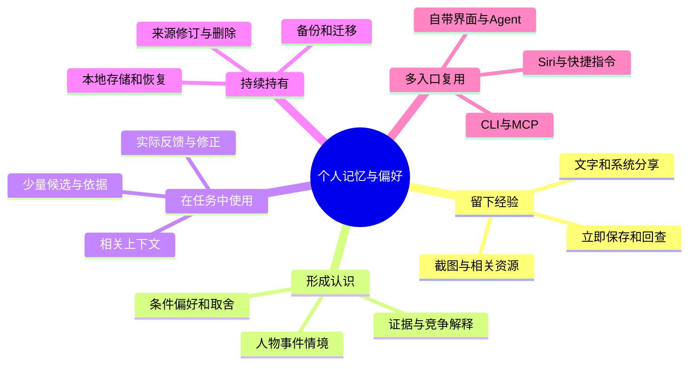
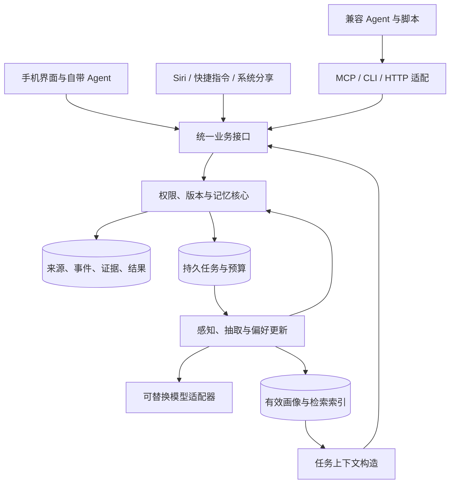
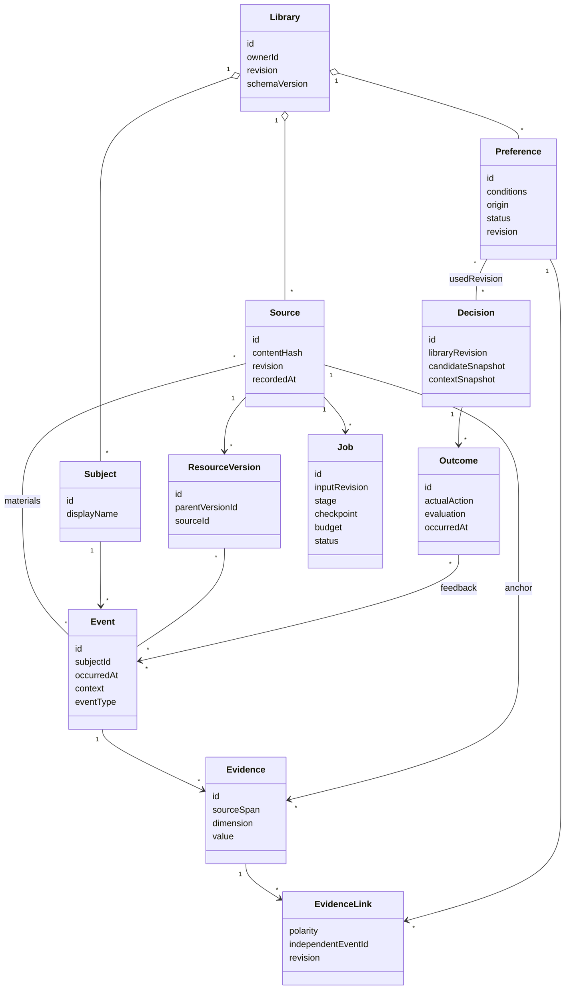

# 个人记忆与偏好服务 · 产品需求文档

| 文档信息 | 内容 |
| --- | --- |
| 所属团队 | 你所热爱的就是软件工程 |
| 版本与日期 | v1.0 · 2026-11-07 |
| 文档状态 | 需求评审稿，供开发、研究、测试与课程验收共同使用 |
| 思路来源 | [微信反思草稿及补充审阅](recipe/assets/research/wechat-draft-2026-11-06.md)，以 2026-11-07 的补充审阅确定产品主线 |
| 调研依据 | [本版产品与技术调研](research.md) |
| 课程依据 | [团队项目作业要求](../task-requirement.md) |
| 规范参考 | [GB/T 9385—2008《计算机软件需求规格说明规范》](https://openstd.samr.gov.cn/bzgk/std/newGbInfo?hcno=2790825C43AD0B69E3C38C140BFFCFE6) |

`recipe/` 与 `topic/` 保留此前探索。本文建立新的需求基线，按“用户与问题—产品价值—范围—交互与功能—领域机制—架构与数据—验收与发布”组织。公开调研已完成梳理，用户与性能结论待实测；本文的门槛和效果数值均为设计目标。

## 迭代记录

| 版本 | 日期 | 变更内容 | 依据与状态 |
| --- | --- | --- | --- |
| v1.0 | 2026-11-07 | 建立以个人偏好学习为中心的记忆循环，明确移动端、独立后端、系统入口、数据状态、预算与验收 | 依据补充审阅与本版 research，待选型、访谈和原型结果验证 |

## 一、介绍：让生活经验进入下一次帮助

### 1.1 产品定位与主线

**帮助用户从日常表达、相关材料和实际反馈中积累个人经验，形成可查看、可纠正的情境偏好，让自己使用的 Agent 在下一次任务中用得上。**

软件由开源的个人记忆与偏好核心、Android／iOS 移动端和独立工具接口组成。饮食是首个验证场景，菜谱、食物与做法是资源，经历、证据、偏好和结果是核心对象。

主线为：

**记录经历 → 理解情境与证据 → 更新个人偏好 → 按当前任务使用 → 留下实际结果 → 纠正和继续学习。**

用户既可使用自带界面与 Agent，也可通过兼容 Agent 调用同一业务能力。普通查看、保存、纠正与检索直接操作本地数据，智能处理按设备能力和预算执行。

### 1.2 用户与使用场景

| 用户 | 真实任务 | 首期关系 |
| --- | --- | --- |
| 自己安排饮食的人 | 记录一次体验，在时间、口味和精力变化时作选择 | 核心用户 |
| 帮家人安排饮食的人 | 区分不同人的评价，找回某次经历与做法 | 使用同一核心流程；人物作为资料对象管理 |
| 已有个人 Agent 的用户 | 继续使用原来的助手，读取和更新自己的经验 | 开放接口验证用户 |
| 自部署与集成使用者 | 配置服务、连接模型、维护与迁移资料 | 接入和部署验证用户 |

首轮招募至少 8 人，其中至少 6 人近一个月作过三次饮食选择或做饭安排，至少 2 人有持续使用 AI 的经历，两项可重合。每人提供至少一条获准行为记录。年龄和职业用于描述样本，入组以实际行为为准。

### 1.3 问题、原因与产品价值

| 待验证问题 | 需要追查的原因 | 对应价值与需求 |
| --- | --- | --- |
| 下次求助仍要解释旧背景 | 经验分散，缺少任务相关的个人上下文 | 保存来源与经历，按需组织上下文，F02—F06 |
| 画像说得丰富却用错场合 | 偏好、处境和临时要求混在一起 | 建立条件与取舍模型，F04—F06 |
| 纠正以后仍出现旧认识 | 原话、画像与索引更新脱节 | 依赖传播和版本一致性，F08—F09 |
| 记录之后整理受中断影响 | 模型条件、后台调度与持久状态耦合 | 先保存、分阶段处理、恢复进度，F01、F09 |
| 换入口或设备后经验难复用 | 接口与数据格式依附单一客户端 | 独立服务、MCP／CLI、可迁移备份，F10—F12 |

灵光、Gemini 等个人助手，以及 Honcho、Hindsight 等记忆方案进入比较；Siri 作为系统入口，Hermes、OpenClaw 作为运行与集成参照。具体公开依据、版本和比较设计见 [research](research.md)。

### 1.4 一次完整体验

用户记录“昨晚那碗面味道很好，就是洗锅麻烦”，系统立即保存，整理出一次饮食事件和两项评价。后续经历支持“加班晚间更在意清理成本”时，系统形成带来源的推断。

下一次求助时，用户只补充当前变化，得到少量候选与所用依据。实际选择和体验回写后继续更新模型。用户将偏好范围纠正为“加班晚间”，另一个接入的 Agent 查询到新版本；处理中退出应用，重开后能继续。

这是设计案例。验收使用冻结样本，用户试用使用获准真实材料。

## 二、产品范围与完成标准

### 2.1 首期范围

| 层次 | 本版范围 | 交付方式 |
| --- | --- | --- |
| 手机核心 | 文字／截图／链接记录、事件、证据、偏好、查询建议、反馈、纠正、删除与恢复 | Android、iOS 各至少一台目标真机完成核心流程 |
| 纯端内路径 | 模型准备完成后，文本输入到偏好更新及建议的完整流程在手机执行 | 飞行模式、进程中断和资源记录分别验收 |
| 系统入口 | iOS Siri／快捷指令的记录与查询动作，Android 系统分享 | 真机验证参数、回执与返回 |
| 独立后端 | 可单独启动，提供业务 API、CLI 与 MCP | 关闭自带前端后通过真实客户端完成查询、写入和纠正 |
| 数据管理 | 来源、资源版本、历史依据、备份迁移、访问范围与处理记录 | 同一数据语义、统一备份格式与故障测试 |
| 课程展示 | 在线示例实例、双平台测试方式、本地运行说明和效果对照 | 实际访问地址与可复现证据随发布提供 |
| 可选扩展 | 用户侧服务器协同、远程模型、商业平台专用连接器、更多媒体输入 | 另列兼容条件与数据路径，完成后追加验收 |
| 后续能力 | 复杂菜谱替换、周计划、购物、家庭多账号、跨领域画像与设备联动 | 根据研究结果安排 |

首期保留菜谱及做法的来源、编辑和版本，以及确定份量的基础换算。领域能力围绕记忆验证组织，复杂饮食规划按独立需求迭代。

### 2.2 交付门槛

| 编号 | 必达项 | 验收证据 |
| --- | --- | --- |
| C01 需求依据 | 至少 8 人访谈，满足 1.2 节构成，每人至少一条行为记录；形成需求与取舍 | 匿名样本、原话与获准材料、需求映射 |
| C02 手机闭环 | 双平台通过适用的 A01—A30，纯端内文本闭环可复现 | 机型、系统、模型、应用版本、逐项记录与录屏 |
| C03 开放复用 | 独立 CLI、真实 MCP 宿主、Siri／快捷指令和 Android 分享通过相应场景 | 启动说明、调用轨迹、输入输出和版本核对 |
| C04 数据与运行 | N01—N10 达标；保存、纠正、删除、恢复与权限类发布阻断项为 0 | 故障注入、备份恢复、性能和出站检查 |
| C05 领域任务 | B2 的 30 个冻结任务各运行 3 次，至少 27 个任务三次均通过；全部运行的关键错误为 0 | B0／B1／B2 配置、原始结果、双人评分和失败记录 |
| C06 使用与发布 | 至少 8 人两轮试用，间隔至少 24 小时，至少 4 人给出真实饮食体验；在线示例、安装测试和开源材料可检查 | 试用与成本记录、发布地址、构建和使用说明 |

C01—C06 全部通过，记为本版完成。平台、模型和阈值在 M0 冻结；后续调整通过迭代记录说明依据、影响和重测范围。

### 2.3 效果目标

| 编号 | 预设目标 | 判断意义 |
| --- | --- | --- |
| G01 定制收益 | B2 相对 B0 的人工纠正次数配对中位数降低至少 20%，任务完成率不低于 B0 | 条件与证据机制改善判断 |
| G02 轻量使用 | 至少 6／8 人独立完成两轮任务；记录一条简短经历 ≤1 分钟，第二轮找回相关经历 ≤1 分钟 | 自然输入和复用易于理解 |
| G03 经验复用 | 第二轮重复说明条目中位数降低至少 30%，操作时间中位数降低至少 20%，完成率不低于原有方法 | 持续记忆减少日常负担 |
| G04 资源回报 | 按三次均通过计算任务通过率，在 B2 达到 C05 且与 B1 相差不超过 5 个百分点的配置下，写入加查询的总模型 token 降低至少 20% | 找到有实际质量支撑的节省配置 |

G01—G04 单独报告实际结果与样本。G02 的任务操作计时从资料库可用开始，安装与模型准备另计；G04 同时报能耗、内存、延迟、内部模型差异与绝对调用量。目标未达时保留结果并调整收益表述。

## 三、功能结构与交互

### 3.1 项目标志与界面方向

项目使用“个人记忆与偏好服务”作为工作名称。标志草案采用 **◌ → ● ↺**：零散表达形成带依据的认识，再随反馈更新。正式名称、矢量标志和应用图标在 M1 设计交付中确定，围绕同一记忆循环表达。

界面采用温和清楚的视觉层次，保留用户原话。主要入口为“记一件事”“帮我选”“我的记忆”，设置承接数据与连接。任务阶段用文字表达，技术日志放在展开的诊断页。

### 3.2 思维导图

### 3.3 页面、状态与冷启动

| 页面 | 主要信息与动作 |
| --- | --- |
| 首页／对话 | 记一件事、帮我选、最近经历与处理状态；按当前意图完成一项任务 |
| 经历时间线 | 人物、发生时间、对象、原话、相关资源；搜索、编辑和查看来源 |
| 我的记忆 | 明确设置、系统推断、适用条件、证据与反例；确认、纠正、暂时停用 |
| 决策与反馈 | 当前条件、1—3 个候选、所用依据、实际选择与体验 |
| 数据与连接 | 模型准备、处理预算、外部授权、备份恢复、存储与任务诊断 |

空库可直接记一句话、建立明确设置或体验示例。至少提供 5 条自写饮食经历与 3 个候选资源，置于独立示例资料库，切换到个人库后仅使用个人资料。用户首次启用智能整理时了解处理位置与辅助推断方式，之后按已有设置处理。

状态统一为“已保存、正在整理、等待条件、需要核对、已更新”。对话与卡片操作作用于同一份数据，用户通过人物、时间和主题回查资料，无需按后台任务划分对话。

## 四、功能需求

### F01：建立本地资料库与准备模型

首次打开创建个人资料库，文字录入、编辑、检索和明确偏好管理即可使用。模型管理显示执行位置、版本、下载状态、大小与可用条件，提供准备、测试、替换和移除入口。

M0 冻结两平台的参考机型、最低系统版本、端侧模型与 OCR 路径。模型文件准备完成后，纯端内文本闭环可在飞行模式运行。模型缺失或暂不可用时保存材料与任务，手工管理继续可用。

外部服务作为独立可选配置，显示提供方、发送范围、用量和凭据状态。本地基础功能免费使用，代码与数据格式开放，第三方服务费用和模型许可在接入说明中列出。

### F02：自然记录与资源导入

| 输入 | 首期范围 | 保存与处理 |
| --- | --- | --- |
| 文字 | 单次最多 10,000 字符，可包含经历、反馈、当前条件或明确设置 | 原话先保存，长内容分段处理；缺失人物或时间按需核对 |
| 截图 | 单张 JPEG／PNG，最多 5 MiB，以清晰中文印刷文字为主 | 保存原图，OCR 片段对应原图位置；识别失败可手工补充 |
| 链接 | 保存用户提供的 URL；解析公开静态 HTML，响应最多 2 MiB，支持单个 Recipe JSON-LD 或普通文本摘录 | 原地址与已取得快照保留；登录、动态或超限内容改用用户分享的文字／截图 |
| 系统分享 | Android 接收文字、URL 和受支持图片；iOS 经快捷指令／应用入口交接材料 | 临时资源先取得持续读取能力，返回保存回执 |

原始资源、来源记录和任务引用提交成功后显示“已保存”。超限输入保留名称或链接及重选入口；空间不足时说明保存失败，已存在资料保持完整。

重复来源标识直接定位原记录，相同内容提示已有材料。用户选择另记一次时创建新的事件关联；证据计数以真实经历为单位。来源缺项、用户补充与模型推断分别展示。

### F03：经历、资源与版本管理

用户可按人物、时间、对象、关键词和标签查询，查看事件、原话与相关资源。发生时间和记录时间分别保存，模糊日期保留精度与原始表达；记录者、体验者和被转述者分别记录。

事件可关联食物、餐次或菜谱版本。资源编辑新增版本，原始来源与个人修改可比较；反馈仍指向当时采用的版本。别名服务于检索，生熟、干湿等状态保持可区分。

用户可补记、合并重复事件或调整人物归属。合并保留原来源映射，影响证据计数时按 F08 重算。普通搜索直接使用本地索引。

### F04：事件抽取与证据整理

处理链从材料抽取人物、对象、行为、评价维度、时间、情境与来源位置，保留缺项和候选解释。每条证据能打开相应文字片段或图片区域。

区分实际经历、计划、假设、转述、收藏及 Agent 生成内容。评价拆分为口味、准备、清理等具体维度，保留原话以便纠正。明确的用户设置由业务层识别其作用范围。

模型输出经过结构、引用、身份范围和版本校验，再形成观察记录。格式错误或无效引用进入待核对状态，原始材料继续可读。外部材料作为证据输入，工具权限由业务层执行。

### F05：情境偏好与取舍学习

偏好记录至少包含主体、对象或维度、倾向／权重、情境、有效时间、支持／反对证据、来源类型和修订状态。

用户直接保存的设置标为“本人明确”；系统概括标为“根据经历推断”。首次启用智能整理时，用户可开启“用推断辅助建议”，之后可随时停用。明确设置与已确认条件优先；辅助推断用于低风险候选排序，卡片显示依据和可纠正入口。

首期采用可检查的证据规则：同一条件下至少两次独立实际经历提供支持、来源有效且冲突已处理时，推断可转为辅助使用；一次明确的条件表达可形成本人设置。条件缺失、竞争解释或矛盾明显的项进入待核对。该规则作为工程起点在冻结样本上检验，阈值调整随版本记录。

取舍学习至少覆盖味道、准备时间和清理成本三个维度。比较规则计分与一种可增量更新的参数模型，输出当前权重、所用证据和未知项。数据较少时共享基础权重，情境修正保持简洁；数值置信度经过校准后展示为概率。

“今天清淡”进入当前任务状态，“加班时少洗锅”带条件使用。推断与硬性限制分别管理，后者来自本人明确设置。

### F06：提供任务上下文与饮食建议

用户可直接求助，已有资料自动按任务读取，本次只补变化。上下文包含当前要求、有效偏好、相关经历、资源版本、必要反例、未知项和处理进度，受内容预算与授权范围限制。

自带 Agent 根据上下文与候选给出 1—3 个建议。候选来自个人资源库或用户选择的示例范围，说明使用了哪条偏好、当时的适用条件和实际资料。已知条件先筛选；关键成分或时长未知时进入需核对区域。

查询可只返回上下文，供外部 Agent 使用。用户请求调整已有做法时，先展示修改建议与依据，再按确认保存个人版本。确定份量执行比例换算，“适量”等保留原表达；缺少单位转换依据时保留原单位。

每次决策记录候选、排序所用版本与依据。纠正或删除使旧依据失效后，待采纳建议更新为需重新核对；新请求使用当前有效状态。

### F07：记录实际结果并形成新证据

用户可记录“选了”“实际吃过／做过”和具体体验，逐项关联到决策、事件与资源版本。接受建议、实际尝试和满意程度分别保存；未选择与缺少反馈保持各自含义。

结果可离线保存。下一次相关任务带回对应经验，并按 F05 更新受影响维度。必要时只追问一个影响后续判断的问题，例如区分味道和清理成本。

### F08：纠正、撤销与删除

用户可用自然语言或卡片修正人物、时间、评价、条件和偏好。修改带基准修订号，版本冲突时保留输入并展示当前状态。明确纠正先停止受影响旧认识的使用，再按新来源增量处理。

删除预览显示来源、附件、派生证据与偏好的影响。确认后清理相关内容、索引、缓存和诊断中的个人片段，取消依赖任务；保留必要的无正文删除标记用于识别迟到写入。只有失效依据的推断转为无效，有独立有效依据的部分重新计算。

暂停使用与删除分别操作。恢复使用时重查证据版本；用户忽略的推断在证据未变化时保持其决定。用户自行保存的旧备份和外部宿主已有副本按相应管理路径处理，界面说明本次作用范围。

### F09：任务状态、预算与中断恢复

来源与处理任务原子保存；识别、抽取、关联、偏好更新和索引发布分别设置检查点。任务标识关联来源版本、处理阶段和算法版本，重复请求返回已有状态。

暂停、等待条件、失败和取消分别持久保存。切换应用、锁屏、系统回收或重启后，从已完成阶段继续；尚未提交的小段重做。取消状态和输入版本在提交前再次检查，迟到结果退出提交。

初始预算为每条文本记录最多 3 次模型调用、每次输入上下文最多 4,096 token、每次输出最多 1,024 token；单次记录整理或查询任务最多 8 次业务工具调用、120 秒累计活动执行时间。图片 OCR 单列调用与耗时。长记录按段建立子任务，父任务汇总各段预算并在批量开始前确认；达到预算保存进度和已有结果。查询任务沿用相同调用及上下文上限。等待用户、等待调度与暂停时间另计，恢复沿用已消耗预算。

默认优先处理当前查询、纠正和少量新记录。批量整理按设备电量、温度、模型条件与用户选择执行。后台受限时显示等待状态，回到前台检查队列。新结果准备好后发布一致版本，查询可回查近期尚未整理的相关原话。

### F10：系统入口与独立 Agent 接口

iOS 至少提供两个 App Intents／App Shortcuts 动作：“记一件事”和“找回经历”。记录动作完成持久保存后返回回执，后续整理交给任务队列；查询动作返回短结果与打开详情入口。锁屏、需要前台或权限缺失时按系统流程交接。

Android 支持系统分享文字、链接与受支持图片，并返回保存状态。两端系统入口调用相同业务规则。

独立服务提供 CLI 与 MCP：能够记录、查询、提交结果、纠正以及查看任务状态。CLI 支持结构化输出、退出码和连接配置；MCP 固定版本、工具结构、传输与认证。至少一个真实兼容宿主完成完整读写循环。

验证跨入口共享时，两者连接同一个权威库；通过导出导入完成的试验记为迁移。手机对外服务在明确开启、网络可达且生命周期允许时使用，状态页显示连接条件。独立进程持续性单独验收。

### F11：备份、恢复与迁移

通过系统文件入口导出带格式版本的备份，包含来源、附件、事件、证据、偏好、资源版本、结果、修订状态与校验清单。密钥、连接令牌和临时模型上下文排除在备份之外。

恢复到新资料库，先验证格式、校验和、附件、引用关系、路径与大小，显示预览，再原子切换。损坏、取消或空间不足时保留原库。Android 与 iOS 共用格式；算法版本不匹配时重建派生结果，明确设置与原始证据保持可回查。

索引可从有效数据重建。备份完成以文件实际写出为准。恢复旧快照清楚显示其时间与范围；恢复到已有库时采用替换前预览或后续支持的合并策略，用户了解旧快照可能包含后来删除的内容。

### F12：授权、部署配置与使用诊断

资料库所有者管理人物对象、来源范围、外部客户端的只读／写入权限和推断使用设置。外部 Agent 提议的认识保存为推断，本人设置与删除等敏感变更采用明确授权。工具参数中的人物名称与访问身份分别处理。

默认使用手机权威库。独立服务实例有自己的数据目录、配置、启动停止和备份方法。可选服务器协同模式确定一个权威库，手机离线输入进入待同步队列，重连后处理事件标识与版本冲突。

诊断显示处理位置、模型与算法版本、调用量、延迟、失败阶段和剩余预算。凭据使用系统安全存储或服务端密钥配置；普通日志记录对象引用与状态。外部处理模式展示选出的资料范围，撤销连接后拒绝后续调用。

## 五、领域 Agent、算法与程序的分工

### 5.1 领域资产与来源

| 资产 | 来源与整理 | 进入产品的方式 |
| --- | --- | --- |
| 事件与反馈标注 | 团队自写案例、获准访谈材料 | 人物、时间、情境、实际经历与转述的抽取样例 |
| 偏好维度与条件 | 用户表达、真实选择与结果 | 味道、准备时间、清理成本等维度，支持与冲突案例 |
| 食材与做法资源 | 用户主动提供的资料、团队授权示例 | 别名、状态、来源、配料和步骤，保留缺项 |
| 菜谱结构 | [Schema.org Recipe](https://schema.org/Recipe) | 相关资源字段与导入映射 |
| 记忆机制 | [research 第四、五节](research.md)中的论文与项目 | 结构化证据、条件模型、增量更新与对照实现 |
| 运行与接口规则 | [research 第六节](research.md)的官方文档 | 调度、恢复、MCP 与系统入口适配 |

每项资产记录版本、来源、适用条件、示例和复核人。领域定制产物包括字段定义、提示词、证据规则、偏好模型、工具契约和冻结测试集。

### 5.2 任务职责

| 阶段 | 模型／Agent | 确定性程序 | 用户 |
| --- | --- | --- | --- |
| 理解材料 | 提取对象、情境、评价和歧义 | 保存资源、校验结构及引用 | 补充或纠正必要信息 |
| 组织证据 | 提议关联、解释冲突 | 去重、关系维护、范围与版本检查 | 核对重要分歧 |
| 更新偏好 | 形成候选倾向与条件解释 | 按有效证据更新参数、状态和索引 | 设置偏好，选择推断使用方式 |
| 使用记忆 | 判断需要哪些信息，必要时补问，解释候选 | 检索、条件过滤、上下文预算和引用验证 | 作出选择 |
| 回收结果 | 理解体验及其作用范围 | 保存实际结果、触发增量处理 | 区分接受、尝试和实际评价 |

首期采用有检查点的阶段流程，模型在阶段内进行理解、有限补问和检索选择。权限、预算、状态转换与最终提交由程序控制。回答与执行结果分别记录，保存成功以业务层回执为准。

### 5.3 偏好模型与评价约定

模型至少维护明确设置、当前状态和带条件的推断三个层次。取舍参数采用共享基础权重与少量情境修正，候选特征和输出解释一致。规则计分作为可运行起点，在线逻辑回归或贝叶斯更新作为参数模型候选；M0 依据样本与端侧开销选定首期实现。

对同一人的一次选择，保留喜欢、时间、可得资源和同行者等竞争解释。缺少关键区分信息时，先用已知事实完成可完成的部分，再提出一个影响本次选择的问题。

保存被展示的候选和实际反馈，分别标记用户原话、模型概括与结果。独立证据按事件计数；新资料优先检查主体、条件和时间，再更新偏好。隐含倾向的质量以未来任务检验，模型自述的把握程度作为待校准信号。

上下文构造优先包含明确要求、适用偏好和直接证据，保留与决策相关的反例。超过预算时按任务相关性与证据质量取舍，返回省略范围和未知项。冷启动可用明确设置、当前条件和示例完成任务。

## 六、系统架构、部署与接口

### 6.1 逻辑架构

| 模块 | 职责与边界 |
| --- | --- |
| 手机前端与系统扩展 | 输入、来源对照、记忆检查、结果与状态展示；系统入口调用同一业务核心 |
| 业务核心 | 身份范围、去重、版本、证据依赖、偏好状态、事务和删除传播 |
| 感知与算法模块 | 资源识别、结构化观察、条件推断、参数更新；输出携带算法版本 |
| 调度器 | 持久队列、条件判断、检查点、重试、取消和预算 |
| 存储与检索 | SQLite 等事务存储、附件、全文与可选向量索引；按有效版本取材 |
| 上下文构造 | 在权限与预算内返回偏好、证据、分歧、未知项和新鲜度 |
| 接入适配 | 把业务能力映射为 API、CLI、MCP 与系统动作，统一错误和回执 |

### 6.2 运行方式与连接边界

| 模式 | 运行位置 | 首期验证 |
| --- | --- | --- |
| 手机嵌入式 | 核心、资料库与所选本地模型在手机，随系统生命周期执行 | 双平台端内闭环、断网与恢复 |
| 独立服务 | 同一核心作为独立进程运行，有自己的数据目录与本地模型配置 | 前端关闭后 CLI／MCP 可启动并完成读写；文件备份可迁移 |
| 手机对外调用窗口 | 用户开启连接，手机在生命周期允许时提供受控接口 | 同一手机权威库的外部读取、回写与纠正，关闭后状态可解释 |
| 可选服务器协同 | 用户自管主机为权威库，手机缓存与离线队列协作 | 另测容器、网络发现、同步与冲突 |
| 可选远程推理 | 所选资料发送到外部服务 | 独立配置、范围说明、成本与失败处理 |

手机嵌入式与独立服务共享业务契约和数据格式。独立进程可在 PC 上运行，PC 在此承担服务与验证宿主。服务器协同中的自动同步另有工程范围。

MCP 使用选定版本的 stdio 或 Streamable HTTP。[规范](https://modelcontextprotocol.io/specification/2026-07-28/basic/transports) 本地 CLI／stdio 适用于具备执行环境的宿主，HTTP 接入需要认证与网络可达路径。连接能力按具体宿主和传输验证。

### 6.3 拟定业务工具

| 工具 | 最小输入 | 返回与检查 |
| --- | --- | --- |
| `record_experience` | 原话／资源标识、主体、时间信息、操作标识 | 来源与事件 ID、持久保存状态、处理任务 ID |
| `query_context` | 当前任务、人物／领域范围、内容预算 | 偏好、证据、未知项、资料修订与处理进度 |
| `propose_preference` | 候选判断、条件、有效证据 ID | 推断状态、冲突和依据校验结果 |
| `record_outcome` | 决策／事件 ID、实际行为与评价 | 结果标识、关联事件和更新状态 |
| `revise_memory` | 对象 ID、基准修订、纠正、操作标识 | 新修订、影响范围或版本冲突 |
| `delete_memory` | 对象 ID、基准修订、授权确认 | 删除回执、依赖失效和清理状态 |
| `get_task`／`control_task` | 任务 ID、查询／继续／取消 | 阶段、预算、原因和下一步 |
| `export_data`／`restore_data` | 资料范围／备份、授权确认 | 导出状态／校验预览和恢复结果 |

工具身份与资料库范围从认证上下文确定。写入带操作标识和基准修订，重复请求返回同一结果；查询包含 `revision` 与 `processedThrough`，外部宿主可判断是否需要重新读取。

错误至少区分输入不支持、权限不足、版本冲突、模型不可用、预算耗尽、资源不足、处理失败和已取消，并返回可重试状态。前端将其转为用户能执行的动作，保留已输入内容。

### 6.4 平台实现与选型

iOS 通过 App Intents／App Shortcuts 暴露操作，Android 通过系统分享接收材料。平台扩展与主应用共享来源标识和提交协议。系统入口先完成短操作，长整理交给可恢复队列。

WorkManager、Apple 后台任务和推理接口各自有运行条件，详见 [research](research.md)。例如 ML Kit GenAI 当前限制后台推理，调度器应等待可执行状态；自带模型运行时也需测量系统条件。核心状态保存在数据库，系统回收后由最近检查点续接。

M0 比较双平台原生与跨平台方案，用同一最小链路验证：文字／截图保存 → 端侧抽取 → 偏好更新 → 中断恢复 → 系统入口 → 备份迁移。输出框架、共享核心边界、最低版本、模型、签名与测试分发方案。研究结论与需求范围共同记录。

## 七、数据模型与状态规则

### 7.1 核心对象

| 对象 | 核心字段与用途 |
| --- | --- |
| 资料库 Library | 所有者、修订号、权威实例、格式版本；限定全部查询与写入范围 |
| 人物 Subject | 显示名、关系与用户确认的归属；区分说话者、经历者和评价对象 |
| 来源 Source | 原文／附件、来源类型、记录时间、发生时间信息、内容哈希与版本 |
| 资源版本 ResourceVersion | 菜谱或做法的原始来源、配料步骤、份量、修改说明与父版本 |
| 经历 Event | 人物、时间、行为、对象、情境及实际／计划等类型；关联来源和资源版本 |
| 观察 Evidence | 维度、评价、来源片段、抽取方式与版本；连接可核对材料 |
| 偏好 Preference | 主体、条件、倾向／参数、起源、有效期、状态、修订与算法版本 |
| 证据关系 EvidenceLink | 观察与偏好的支持／反对关系、独立事件标识、相关性和处理版本 |
| 决策 Decision | 当前任务、展示候选、所用偏好与资源版本、依据快照和实际选择 |
| 结果 Outcome | 实际行为、体验、时间与关联决策；作为下一轮更新的输入 |
| 处理任务 Job | 输入版本、阶段、检查点、预算、运行条件、错误与重试信息 |

来源可以支持多个事件，事件可以有多份材料；资源也可独立保存。偏好与证据通过关系表连接，支持同一材料的多种解释及后续撤回。

### 7.2 类图

图中表示主要业务关系。所有实体携带资料库范围；决策保存当时版本及依据摘要，当前查询使用有效修订。

### 7.3 状态与一致性

| 对象 | 状态与转换 |
| --- | --- |
| 来源 | 保存后可立即回查；修订产生新版本；删除后只保留防止迟到写入所需的无正文标识 |
| 偏好 | 起源分为明确设置和系统推断；状态为待核对、有效、冲突、已取代、已撤回；停用单独控制参与查询 |
| 处理任务 | 排队 → 运行 → 完成；可转为等待条件、待核对、失败、取消或输入过期；继续执行沿用任务与预算 |
| 决策与结果 | 建议生成、用户选择、实际尝试与评价分别保存，后续修订保留对应时间与版本 |

来源、提交标识和首个任务原子保存，保存回执以事务成功为准。阶段结果先写入工作区，通过结构、依据、权限和版本校验后统一发布；查询读取一致的已发布版本，并显示新资料的处理进度。

同一阶段重复执行只提交一次。修订冲突返回当前版本与差异，由用户或调用方基于新版本重试。纠正、撤回和删除立即改变可用证据集合，旧索引即使尚未重建也要经过有效性过滤。

来源变化触发关联事件、证据、参数、索引与上下文缓存的失效或重算。仍有独立依据的偏好重新判断，失去全部依据的推断退出使用。历史决策保留“当时为何这样建议”的修订关系；删除内容同时清理其中的相关正文，显示依据已删除。

## 八、非功能需求

以下均为首期验收条件。设备、模型和资源预算在 M0 固定，测量报告注明冷启动、预热、前后台和数据规模。

| 编号 | 要求 | 验证口径 |
| --- | --- | --- |
| N01 本地可用 | 模型准备后，纯端内文本闭环可在飞行模式完成；模型缺失时仍能保存、查看、编辑和导出 | 两台目标真机分别执行，保留网络和模型位置记录 |
| N02 响应性能 | 在 1,000 条事件、200 条偏好、500 个资源版本下，普通保存回执与非模型查询的 p95 ≤1 秒 | 每台设备预热后各测 100 次；附件复制、模型等待与生成耗时分别报告 |
| N03 数据可靠 | 已确认保存的数据在中断、重启和取消后完整；重复提交、迟到写入与恢复后版本错误为 0 | 阶段边界故障注入、强制结束进程、并发与磁盘不足测试 |
| N04 资源预算 | 执行 F09 的调用、token、工具次数与时间上限；模型和批处理的内存、存储上限在 M0 按目标机冻结 | 记录峰值内存、能耗、温升和增长量；越限停止当前计算并保留已提交结果，重试沿用累计预算 |
| N05 隐私与权限 | 默认本地处理，资料保存在应用私有目录或受限服务目录；外发按范围授权，密钥使用安全存储，共享网络接口使用认证和加密传输 | 抓取出站请求、越权与撤销测试；日志默认记录标识和状态，正文诊断由用户主动开启并可清除 |
| N06 输入与工具安全 | 文件、URL、模型输出和工具参数均校验类型、大小、路径、引用与范围 | URL 获取限制公开 HTTP(S) 资源并复查重定向地址；附件与备份阻止越界路径；原始材料中的指令仅作为内容 |
| N07 易用与无障碍 | 主流程在 Android 360 dp、iOS 375 pt 宽度可用；主要触点分别至少 48 dp、44 pt；支持系统字号与读屏标签 | 检查文字放大、键盘遮挡、错误恢复和焦点顺序；状态同时用文字表达 |
| N08 可观测与复现 | 每次处理可定位输入修订、模型与算法版本、预算、阶段和失败原因 | 导出脱敏诊断；token 无精确计量时注明估算方法，实验保存配置和数据版本 |
| N09 兼容与迁移 | 统一备份在双平台恢复；独立核心与适配层有版本化契约 | 验证旧格式迁移、未知新格式安全退出、模型与代码许可证、CLI 退出码及 MCP 协议版本 |
| N10 可部署与维护 | 新设备和干净服务环境可按说明运行示例，构建、模型准备和测试路径完整 | 由非对应模块开发者复现；提供实际访问地址、版本、依赖和故障排查说明 |

公开 URL 获取与用户配对的局域网后端使用不同连接策略：前者只获取公开资源，后者按明确地址与授权连接。预期的数据访问范围随入口展示。

## 九、验证与验收

### 9.1 领域效果对照

采用 [research 第七节](research.md)的 B0／B1／B2：

- **B0：** 原始记录、关键词／向量检索、时间过滤与通用回答；历史可容纳时补充完整上下文。
- **B1：** 固定 Honcho 或 Hindsight 的一个版本与配置，作为已有推断型记忆基线。
- **B2：** 本项目的情境证据、增量偏好与任务上下文机制。

固定原始材料、时间顺序、候选、回答模型、允许信息与预算。机制对照固定硬件和运行环境；内部模型或部署环境不同的完整系统结果另列。成本包含写入、整理、检索和回答，并记录查询次数及摊销结果。

冻结 30 个时间线任务，每类 6 个：来源与事件抽取、人物与情境区分、条件偏好与取舍、变化与纠正、上下文供给及结果复用。至少 10 个来自获准真实材料，其余为边界案例。开发集与验收集分开；每组每题运行 3 次，保存提示、随机配置与输出，两位成员在隐藏组别后评分。

每题预先标注有效事实、条件、预期动作、允许的未知项和失败条件。通过要求完成该题目标、依据正确、状态更新正确；合理保留未知可通过，任务要求明确结果时仍需取得相应信息。

关键错误包括人物归属错误后当作本人明确设置、编造来源、绕过已知限制、使用已撤回证据、未提交却宣称保存成功，以及未经校准却把模型自评分包装成统计概率。关键错误单列，普通错误按任务条件计分。

C05 衡量整题在三次运行中的稳定性；G01—G04 衡量相对收益。报告每题结果、失败类型和全部配置。基线为零时报告绝对变化，未完成和放弃计入完成率分母；主观偏好由本人反馈与后续选择检验。

### 9.2 功能与异常验收场景

所有场景记录平台、设备、系统、模型、应用与数据版本、步骤、预期、实际结果和证据。Android／iOS 执行各自适用场景；A23 适用于 iOS，A24 适用于 Android，A25 在独立服务宿主执行，跨端场景同时核对两侧。

| 编号 | 操作与条件 | 通过条件 | 关联需求 |
| --- | --- | --- | --- |
| A01 | 新建空库，断网且未配置模型，保存和编辑一条经历 | 保存后可回查、搜索和导出，智能整理状态清楚，重开内容完整 | F01—F03、N01 |
| A02 | 模型缺失、下载中断、校验失败与设备不支持 | 显示真实原因和准备状态；已有数据可用，修复后可继续待处理任务 | F01、F09 |
| A03 | 输入完整、缺时间、超长文字及多事件材料 | 保留原话；可推定时间附依据，未知项可补充；超限提示分段范围与总预算 | F02—F04 |
| A04 | 导入清晰、模糊、超限截图，随后离开原应用 | 合规附件持久可读，抽取可定位来源；模糊处待核对，超限保留可执行处理提示 | F02、F04、N06 |
| A05 | 导入合规公开链接、登录页、重定向和私有地址 | 支持页保存来源与内容版本；其余说明原因，可转为用户提供的文字／截图；受限地址被阻止 | F02、N06 |
| A06 | 同一材料重复分享，再记录另一次相似的真实经历 | 重复请求与重复材料可识别，同一事件证据计一次；独立新事件可单独计入 | F02—F05 |
| A07 | 输入本人、朋友转述、计划、假设、收藏与实际体验混合材料 | 人物、行为和证据类型正确；收藏与系统建议保留各自来源类型 | F03—F05 |
| A08 | 编辑菜谱资源，再查看关联旧经历 | 新版本独立保存，旧经历指向实际使用版本；来源、差异和时间可回查 | F03 |
| A09 | 设置明确偏好，并补充“今晚”有效的临时要求 | 立即作用到对应范围；临时状态过期后，长期设置保持正确 | F05—F06 |
| A10 | 输入一条推断线索，再补独立事件，分别开关推断辅助 | 候选与有效推断按 F05 策略转换，展示依据和条件；使用范围符合用户设置 | F05 |
| A11 | 将“加班晚间”偏好用于周末与加班两种任务，加入反例 | 根据条件选择适用认识，反例可回查并触发相应更新 | F05—F06 |
| A12 | 当前要求与候选冲突，或全部候选缺少关键特征 | 已知冲突被筛除；未知条件单列，必要时补问或返回可处理缺项 | F06 |
| A13 | 给出味道、准备时间、清理成本不同的候选和后续反馈 | 条件与实际特征参与排序；更新可解释，冷启动可按明确设置完成任务 | F05—F07 |
| A14 | 查询同时包含有效画像、待处理新资料、反例和超预算内容 | 返回有效修订、相关依据、未知与进度；省略范围明确，引用均能定位 | F06、F09 |
| A15 | 先接受建议，再标记未尝试；另一次填写实际体验 | 选择、尝试和结果分别保存，只有对应类型的证据参与相应更新 | F07 |
| A16 | 调整确定份量，修改做法并记录结果 | 数值按比例计算，语义用量保留；确认后形成资源版本，反馈绑定所用版本 | F03、F06—F07 |
| A17 | 纠正偏好条件后立即从界面、CLI／MCP 再次查询 | 新范围立即生效，旧索引被过滤，各入口返回一致有效修订 | F08、F10 |
| A18 | 删除来源，检查只依赖它与另有独立依据的偏好 | 相关正文及派生缓存清理；推断撤回或重算；历史依据显示删除状态 | F08、N05 |
| A19 | 双击提交、两个入口并发修改，旧任务稍后返回 | 操作去重，修订冲突可处理；过期结果退出提交，正确新版本保留 | F08—F10 |
| A20 | 在每个处理阶段切后台、结束进程并重开 | 已确认保存内容完整，从检查点继续；重复执行只提交一次，预算沿用 | F09、N03 |
| A21 | 推理超时、结构校验失败、预算耗尽与用户取消 | 原因和可继续方式清楚；已提交内容保留，半成品与取消结果退出发布 | F04、F09 |
| A22 | 保存附件、发布阶段结果与恢复备份时模拟空间不足 | 回执反映实际结果，原资料完整；临时文件可清理，重试可恢复 | F02、F09、F11 |
| A23 | 通过 Siri／快捷指令记录并查询；覆盖缺参数、锁屏与权限条件 | 可用条件下完成同一业务操作；其他条件给出解锁、补充或打开应用的路径 | F10 |
| A24 | Android 分享文字、链接与临时文件 URI，结束来源应用后恢复 | 材料持久可读，保存回执明确，重复分享与处理恢复符合统一规则 | F02、F10 |
| A25 | 关闭前端，从干净环境启动后端，用 CLI 和真实 MCP 宿主操作 | 查询、写入、纠正和错误返回完整，身份范围与接口说明一致 | F10、F12、N10 |
| A26 | 外部宿主连接手机开启的接口窗口，与手机交替读写，再关闭连接 | 同一权威库修订一致；关闭、休眠或断网后返回可解释状态，重连按版本继续 | F10、F12 |
| A27 | 尝试越权读取、撤销凭据，检查默认与可选外部推理的数据流 | 未授权请求被拒；撤销生效；默认本地路径无业务正文外发，外发范围符合授权 | F12、N05 |
| A28 | Android／iOS 往返备份；测试校验失败、越界路径及较旧快照 | 合规备份恢复后关系、版本和撤回状态一致；异常保留原库；旧快照内容预览可辨 | F11、N06、N09 |
| A29 | 两台目标手机准备好模型后进入飞行模式，完成两轮文本任务 | 记录、抽取、偏好更新、建议、反馈和纠正全在手机完成；保存模型位置与资源测量 | F01、F04—F09、N01 |
| A30 | 新参与者按发布说明访问示例、安装客户端并运行服务 | 地址与步骤可用，示例与个人库清楚区分，版本、许可证、测试和限制说明齐全 | C06、N08—N10 |

### 9.3 体验、性能与发布判定

两轮用户试用间隔至少 24 小时，每轮记录任务完成、耗时、重复说明、纠正、求助与放弃。至少 4 人提交真实饮食体验。对原有方法与本产品平衡使用顺序，保留原有方法实际启用的记忆功能。

性能在相同规模与任务下测量，普通操作与模型处理分开；模型成本同时包含摄取和使用阶段。分别报告后台等待、实际执行、重试和用户手动恢复。

发布记录统一列出 C01—C06 的通过证据、G01—G04 的实测结果、A01—A30 和 N01—N10 的状态。未通过项说明影响与修复计划，范围调整写入新版本后重测。

## 十、实施、风险与交付

### 10.1 里程碑与待决策项

课程原 Task5 的答辩与博客节点为 10 月 24—25 日。11 月 3 日材料中的“约五周”是当时的剩余计划；按该估计，11 月 7 日约余四至五周。本版按依赖关系重新组织工作，具体日期依据课程后续安排和团队进度确定。

| 阶段 | 主要工作 | 完成条件 |
| --- | --- | --- |
| M0 验证关键条件 | 访谈启动，双平台最小链路，端侧模型与后台条件，独立服务和真实宿主试接 | 固定目标机、系统下限、框架与模型、资源预算、B1 配置、签名和测试分发路径 |
| M1 建立资料与交互 | 来源、事件、资源版本、持久队列、时间线、明确设置、备份与系统入口 | 基础数据流程和恢复场景通过；形成可试用界面、标志与示例库 |
| M2 形成记忆循环 | 条件证据、偏好更新、上下文构造、决策与反馈，CLI／MCP 全流程 | 纠正与跨入口使用一致；冻结测试集和算法配置，开展两轮试用 |
| M3 验证与发布 | 双平台异常测试、效果对照、资源测量、发布说明和在线示例 | C01—C06 有完整判定，效果与局限可追溯，课程材料与实际版本一致 |

M0 形成选型记录：候选方案、实测条件、结果、取舍与负责人。设备支持、纯端内推理或分发条件若影响核心交付，先明确影响并更新需求版本；后续验收依照经确认的基线执行。

### 10.2 团队协作

沿用[团队成员与现有分工](recipe/homework.md)，按本版主线组织产出。

| 方向与成员 | 本版职责 | 交接证据 |
| --- | --- | --- |
| 产品：王智壹、林金晶 | 访谈、情境任务、需求取舍、试用与课程材料 | 需求依据、范围、冻结场景和指标 |
| 设计：马晨曦 | 自然输入、记忆解释与纠正、状态反馈、标志与无障碍 | 页面与交互状态、组件和示例流程 |
| 前端：陈柏睿、陈柯男 | 双平台界面、系统入口、嵌入式核心适配、分发 | 真机流程、恢复与连接状态、安装步骤 |
| 后端：郑嘉文、陈飞扬、周恪玄 | 数据关系、任务与预算、修订删除、备份、API／CLI／MCP | 契约、状态规则、部署与故障记录 |
| 算法：张洋 | 抽取、证据与情境模型、基线、成本与消融 | 数据版本、模型配置、原始结果与分析 |
| 测试：林叶鑫、李宗欣 | 场景验收、性能、隐私检查与发布复现 | A／N 记录、缺陷、发布门槛判定 |

接口、数据语义和测试样本共同评审。每项需求由实现成员提供证据，测试复核，产品核对其是否完成用户任务。

### 10.3 主要风险与应对

| 风险 | 影响 | 处理与触发点 |
| --- | --- | --- |
| 端侧中文理解或设备资源不足 | 纯端内质量与覆盖受限 | M0 在目标机跑完整链路，先固定支持范围；压缩模型、上下文和批次后重测 |
| 证据稀疏、解释混淆 | 画像丰富但难以改善选择 | 明确设置支持冷启动，保留条件与竞争解释，以未来任务检验增益 |
| 修订传播遗漏 | 旧认识反复影响建议 | 版本过滤、依赖失效、原子发布与迟到写入检查共同覆盖 |
| 后台时间不可预测 | 整理延迟或被回收 | 先保存，小阶段提交，前台续接；处理等待与执行耗时分开展示 |
| 外部入口或模型接口变化 | 集成失效、维护成本增加 | 固定协议与宿主版本，保留 CLI 和统一业务接口，连接器单独回归 |
| 安装、模型准备或授权复杂 | 普通用户无法顺利开始 | 真机记录首次成本，采用示例库和明确状态，观察实际维护者 |
| 备份、许可或分发条件遗漏 | 迁移与课程交付受阻 | M0 核对格式、依赖和权重许可、签名及分发资格；M3 从干净环境复现 |

### 10.4 发布包与课程检查

首期交付包括：

1. 开源代码、许可证、构建与本地运行说明，注明模型权重的独立许可和获取方式。
2. Android 安装测试方式、iOS 可实际使用的测试分发路径，标注目标设备、系统、版本与模型准备步骤。
3. 独立后端、CLI／MCP 使用说明和真实宿主配置示例，覆盖启动、认证、查询、写回、纠正与关闭。
4. 可访问的在线示例实例及测试步骤，使用团队自写或获准材料；纯端内能力附独立真机证据。
5. 统一备份格式、恢复说明和兼容样例，支持检查来源、事件、偏好与版本关系。
6. 访谈记录、冻结任务、配置、原始结果、失败分析，以及验收与资源报告。
7. 与发布版本一致的 PRD、research、演示材料与项目标志。

线上地址、安装链接和运行证据在 M3 填入发布记录。本文件描述需求与检查方法，当前实现及实测状态以各项证据为准。

| 课程关注点 | 本版对应 |
| --- | --- |
| 用户调研、产品价值与功能原因 | 第一节、research 第二节与第七节 |
| 项目标志与思维导图 | 第三节 |
| 功能描述、前后端设计与类图 | 第四至第七节 |
| 领域知识、Agent 定制与工具 | 第五节、6.3 节 |
| 典型任务、定制前后效果 | 第二节、第九节、research 第七节 |
| 完整软件、上线与测试方式 | 第八节及本节发布包 |

## 十一、术语

| 术语 | 本文含义 |
| --- | --- |
| 个人记忆 | 来源、经历、观察、认识与结果组成的可更新资料 |
| 情境偏好 | 在一定人物、时间或处境下成立的倾向与取舍 |
| 证据 | 能定位到来源、事件及版本的观察，附支持或反对关系 |
| 权威资料库 | 当前部署模式中负责确认有效修订的一份资料库 |
| 纯端内 | 资料存储与该路径所需推理均在手机完成 |
| 任务上下文 | 为当前任务选取的要求、偏好、证据、未知项及处理进度 |
| 稳定通过 | 同一冻结任务的三次运行全部通过 |
