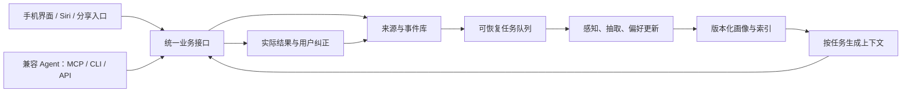

# 微信反思草稿

## 提问

可以帮我评估这样一件事吗：我目前在修习软件工程实践这门课程，老师的要求是要完成一个领域 agent，我们想做一个重点在：纯本地沉淀如喜欢的菜谱、日常的口味、每次做饭后用餐的时间地点和反馈等围绕做饭展开的个性化数据并进行个人偏好建模，借助时间线驱动的记事本和收藏的菜谱进行个性化推断和给出生活建议，**做一个真正懂你的菜谱小助手**。

但在我们组汇报之前，有另外一组的同学也做了一个菜谱 agent，他们组想做的是面向健康的热量计算和膳食规划 agent，这个内容完全包含在我们的前期调研和后续实现里，因为我们想做的是一个通用 agent 流程。但老师只看纸面内容，觉得我们的汇报跟他们有重合，并且希望我们做真正的创新。

我对他的意见进行了反驳和反思，我觉得我们的 agent 思路是很创新且很实际的，很符合软件工程这门课程的要求和目标，目前已有的部分可借鉴方案也足够我们在这门课要求的时间里复用并完善我们的产品。虽然我觉得做出来的话我有办法做得很好，但是我怕影响到我们组的打分，现在我还有另外一个思路是做一个用来全维度评估领域 agent 选题的 agent，但是这个的思路和工作流就很传统了，而且是通用 agent+skill 工程完全可以实现的东西，我怕现在换课题的分数会更低。

你能评估一下现状，指出我的关键疑问点，并告诉我是否该换方案、怎样评估自己真的该换方案呢？老师后续又说他给的意见只是指导性意见，不构成评分标准，是我太神经过敏了么？或者你能指出我话里没提供的、真正足以判断是否该换选题的核心信息吗？我可以尝试思考并提供一下。

## [来自deepseek的回答](https://chat.deepseek.com/share/pbzxkew451qh6qe6ci)

可以，我先给结论：**目前证据不足以支持你换课题。更合理的动作不是换方案，而是把原方案做“差异化重定位 + 向老师预审确认”，并设置止损条件。** 第二个“评估领域 agent 选题的 agent”听起来更像元工具/通用 agent+skill 工程，作为这门课的领域 agent 主课题，创新叙事和领域深度反而更弱，风险不小。

下面分点评估。

### 1. 现状判断：老师说的“重合”是表层重合，不一定是核心重合

另一组是“面向健康的热量计算和膳食规划”，你们是“纯本地沉淀个人做饭数据 + 时间线记事 + 偏好建模 + 生活建议”。二者的共同点主要是**菜谱/做饭场景**，但核心问题不同：

- 他们：健康目标、热量计算、膳食规划，偏营养学规则和计划生成。
- 你们：个人生活数据闭环、时间线事件、口味/反馈偏好建模、可解释建议，偏个性化记忆与推断。

老师说“纸面内容重合”，很可能是因为你们汇报里出现了“菜谱推荐、膳食建议、健康”等宽泛表述，或者你们说“通用 agent 流程完全包含他们”，这在答辩叙事上很危险：**你越说“我们都能包含”，老师越会觉得你们范围过大、焦点不清、与别人重合。**

所以第一关键疑问是：**老师认为重合的是“场景词”，还是“核心机制”？** 如果是场景词，改叙事即可；如果是核心机制被覆盖，才需要认真考虑换。

### 2. 你是否太神经过敏？

不完全是。老师前面说重合、希望创新，后面又说只是指导性意见、不构成评分标准，你担心打分是合理的。但**当前证据不足以支持“必须换题”**。更准确地说：老师是在提醒你“创新点要讲清楚”，而不是已经判你们不及格。

你要避免两个极端：

- 过度反应：一听到重合就换到一个更传统的方案；
- 完全无视：继续用“通用流程包含别人”的叙事，让老师觉得你们没有真正创新。

合理态度是：**把老师意见当作风险提示，用一次预审和汇报重构来消除风险。**

### 3. 是否该换方案：默认不换，先做差异化重定位

我建议：**暂不换主课题**。理由：

1. 原方案有明确的领域数据闭环：本地菜谱、口味、做饭时间地点、餐后反馈、时间线、偏好推断、建议。这是可演示、可工程化的。
2. 软件工程实践课通常不只考“算法首创”，也考需求分析、架构、迭代、测试、可用性、隐私和工程完整度。你们的“纯本地 + 隐私 + 时间线 + 反馈闭环”很适合做工程亮点。
3. 第二个方案“评估领域 agent 选题的 agent”偏元层工具，工作流传统，领域性弱，老师可能反问：这算哪个领域？创新在哪？很容易变成“通用 agent + skill 编排”，分数未必更高。
4. 换题成本高：重新调研、需求、架构、分工、演示都要重来，时间风险可能比“重合风险”更大。

但要注意：**“我们做的是通用 agent 流程”不能作为创新主张。** 创新要落到具体机制，例如：

- 时间线事件模型如何表达做饭情境；
- 餐后反馈如何转成偏好信号；
- 偏好冲突如何消解；
- 冷启动如何推断；
- 本地隐私架构如何保证数据不出端；
- 建议如何可解释、可追溯；
- 如何用评价指标验证“更懂你”。

组合创新、场景创新、工程创新都可以，但必须一句话说清。

### 4. 怎样判断自己真的该换方案：用止损清单

可以用下面 7 项打分，每项 0–2 分。若“换方案信号”累计明显高于“坚持信号”，再换。

**坚持原方案的正向信号：**

1. 你们能在 1 分钟内说清“我们不做健康膳食规划，我们做个人做饭生活数据闭环”。
2. 你们能列出 3 个另一组没有的核心机制：时间线、反馈偏好、本地隐私/可解释建议。
3. 两周内能做出可演示 MVP：记录事件→偏好推断→建议→反馈修正。
4. 组内对原方案有共识，技术栈可控。
5. 老师愿意预审你们的差异化表述。
6. 课程 rubric 中工程完整度、可用性、迭代过程占比不低。
7. 你们能定义评价指标，如建议采纳率、偏好命中率、冷启动效果、用户主观有用性。

**换/大改的强信号：**

1. 老师明确书面或口头说“这个方向不允许/必须换”。
2. 另一组已经实现“本地个人数据+时间线+偏好闭环”，不只是健康规划。
3. 你们在期限内无法完成本地数据闭环，只能做静态菜谱推荐。
4. 你们无法把创新点讲成非通用流程，答辩必然被认为重合。
5. 组内没有人能承担偏好建模/本地架构，项目会烂尾。
6. 课程评分明确重“原创算法/首创”，而你们只有组合创新。
7. 第二方案有独特领域价值且能快速验证，而不是“为了避开重合而换”。

一个实用止损规则：**先给原方案两周。如果两周内做不出“记录—推断—建议—反馈”的最小闭环 demo，或者老师预审后仍明确认为核心重合，再考虑调整。** 调整也不一定全换，可以缩窄为“做饭时间线记事 + 个人口味偏好助手”，去掉健康、膳食规划等易撞词。

### 5. 第二个方案的风险

“全维度评估领域 agent 选题的 agent”不是不能做，但作为课程主课题有几个问题：

- 领域性弱：它评估的是 agent 选题，不是某个生活/行业领域。
- 工作流传统：检索、评分、报告生成，容易被看作通用 agent+skill。
- 创新难讲：评价维度从哪来？如何验证评估有效？没有真实领域数据闭环。
- 演示效果弱：不如“懂你口味的菜谱助手”直观。
- 老师可能认为你们在回避原问题，而不是创新。

除非你们能把它改造成有领域深度的东西，比如“面向软件工程课程项目的 agent 选题评估与风险建模”，有 rubric 对齐、历史项目数据、可验证评分，否则我不建议换。

### 6. 老师后续说“指导性意见，不构成评分标准”，怎么理解

意思是：**不必把“重合”理解为扣分判决，但要吸收为叙事风险提示。** 你不需要神经过敏，但需要主动回应。最好的回应不是争论“我们不重合”，而是给老师看切割：

> 老师，我们复盘后会把课题收窄为“纯本地个人做饭生活数据的时间线记录与偏好建模助手”。我们明确不做健康热量计算和膳食规划，也不主张通用流程包含其他组。我们的创新点是本地隐私数据闭环、餐后反馈驱动的偏好推断、可解释生活建议。想请您预审这个边界是否清晰。

这比反驳更有效。

### 7. 你话里没提供、但真正影响判断的核心信息

你需要补充/思考这些：

1. **课程评分 rubric**：创新、工程完整度、演示、文档各占多少？老师对“创新”的定义是什么？
2. **老师具体说重合在哪一段**：是菜谱推荐、健康建议、用户画像，还是“通用流程”？
3. **另一组方案细节**：他们是否也做本地数据、时间线、反馈偏好？还是只做热量和膳食计划？
4. **你们汇报原文/PPT**：有没有“健康、膳食规划、通用流程都能做”这类宽泛表述？
5. **期限和人力**：还剩几周？几人？谁会做本地存储、偏好建模、前端演示？
6. **数据可得性**：能否拿到真实做饭记录/反馈做 demo？还是只能模拟数据？
7. **老师是否接受预审**：能否在正式评分前确认边界？
8. **组内共识**：大家是否愿意坚持原方案？换题是否有人力支持？
9. **第二方案的独特性**：除了“评估选题”，有没有领域数据、评价体系和可验证结果？
10. **你们对“创新”的底线**：必须算法首创，还是接受场景/组合/工程创新？

### 8. 我的建议行动

1. **不立刻换题。**
2. 重写一页“差异化定位”：用户、问题、数据、核心机制、明确不做什么、与另一组区别、创新点、MVP、评价指标。
3. 向老师预审一句话边界，争取指导性确认。
4. 汇报中不要说“通用流程包含他们”，改成“我们与其场景相邻但问题不同”。
5. 两周内做最小闭环 demo：记录做饭事件→生成偏好→给建议→反馈修正。
6. 设止损：若老师明确否定核心、或两周无闭环、或另一组已覆盖核心机制，再考虑缩窄/换题。

**总结：你现在的焦虑可以理解，但换到第二个方案大概率不是更优解。先把原方案从“菜谱 agent”重定位为“纯本地做饭生活数据的时间线与偏好建模助手”，用差异化叙事和可演示闭环降低评分风险；只有出现明确止损信号时再换。**

## 个人反思

是我自己的问题，我产品定位没思考清楚，这其实本该是 agent 对数据处理的比较革新的一步。

我课上回答不了的其实是一个很简单的问题：这么复杂的输入和数据处理，最后难道只为了微调菜谱吗？

谁会需要一个“懂自己”的产品？-- 缺乏陪伴、脆弱的人；时间有限、疲倦的人

重点不在菜谱，而在喜欢吃什么

专注于偏好建模：注重隐私的端侧信息采集与建模，而不局限于菜谱这一形式

温馨、清新、无障碍的前端设计、后端数据库设计、算法设计、本地性能优化

- 刚步入职场的年轻人 \- 希望搭配能无感减轻负担
- 人机恋群体 \- 希望“家机”更懂自己
- 希望传承或需要寄托的老年人 \- 希望有陪伴、有产出、对家里有用

---

## 补充审阅：面向移动端个人 Agent 的偏好学习与记忆机制

> 2026-11-07 重构。保留饮食选题，以个人偏好的形成、更新和复用作为产品主线。下文依据官方文档与论文梳理现有能力，算法、架构和实验部分为待验证设计；本轮完成资料核查，平台接入与性能结论留待实测。

### 一、先回答核心问题：我们究竟在研究什么

**课题可以确定为：面向移动端个人 Agent 的情境偏好学习与可恢复记忆机制——以日常饮食经验为验证场景。**

这个工作流确实来自个人 Agent 的新需求：用户已经能用自然语言求助、分享材料和交付任务，软件需要把这些交互中产生的经验持续组织起来，让下一次帮助建立在此前的了解上。产品价值贯穿获取、理解、记忆和行动。饮食提供高频、具体、能回访结果的验证场景。

核心循环据此确定：

**自然表达与生活材料 → 事件和偏好证据 → 可修订的个人模型 → 当前任务中的判断 → 实际结果与纠正 → 更新模型。**

这里有四个相连的判断：

1. **研究中心是记忆循环。** 菜谱、照片和餐后评价是材料；推荐和做法调整是检验记忆是否有用的任务。调研顺序应转为个人 Agent、记忆机制、移动端运行条件，再回到饮食任务。
2. **算法与后端机制承担主要差异。** 大模型可以从给定文本推断偏好；把推断保存为有依据、有适用范围、能随新证据变化的状态，需要整个记忆系统共同完成。研究投入应落在证据选择、条件推断、增量更新、冲突处理和任务收益上。
3. **移动端条件参与决定产品性质。** 可用的推理时机、内存、电量和联网条件，会决定哪些理解当场完成、哪些稍后整理，以及是否需要用户侧服务器协助。
4. **前端与开放接口共同承载价值。** 普通人通过手机记录和纠正，已有助手通过接口使用同一份记忆。后端保持独立，用户积累的数据可以随入口更换而继续使用。

软件的性质可以概括为：**一个开源、可本地运行的个人记忆与偏好引擎，配有移动端交互和 Agent 工具接口。** 研究目标是以更低的持续成本，形成更可靠、对实际选择更有帮助的个人理解。

首期用户优先选择需要反复作生活决策、已有零散经验、偶尔使用 AI 的人，例如自己安排饮食或照顾家人饮食的人。已有个人 Agent 的使用者用于验证跨入口复用；技术用户用于验证自部署与集成。访谈同时记录谁日常使用、谁安装维护，以及用户是否愿意增加一个独立入口。

### 二、市场调研应围绕哪些对象展开

调研采用同一组问题：**怎样获取经验，记住了什么，如何纠正，怎样在任务中使用，数据由谁持有，持续运行的成本由谁承担。**

| 对象 | 已公开的相关能力 | 对本项目的研究价值 |
| --- | --- | --- |
| iOS：Siri、Shortcuts、App Intents | App Intents 将应用动作和实体交给 Siri、快捷指令等系统入口；App Schemas 提供系统理解特定动作的语义。[App Intents](https://developer.apple.com/documentation/appintents) · [WWDC26](https://developer.apple.com/videos/play/wwdc2026/240/) | 直接试验“记下这次体验”“找回相关经历”两个动作，检查语音参数、锁屏、唤起和结果返回；评估适用的 schema |
| Android：灵光 | 小米商店开发者页面显示，11 月 5 日更新的 2.0 版本强调持续管理事务、记住偏好、连接服务，并列出饮食反馈与后续调整场景。[灵光应用介绍](https://app.mi.com/details?id=com.antgroup.leopard.android) | 作为直接竞品，比较连续任务、记忆纠正、资料获取和闪应用承载状态的方式 |
| 用户熟悉的豆包、Gemini | Gemini 已公开跨对话记忆、记忆摘要查看与管理能力。[历史记忆](https://support.google.com/gemini/answer/16598469?hl=en-UM) · [摘要管理](https://support.google.com/gemini/answer/18617127?co=GENIE.Platform%3DAndroid&hl=en) | 观察轻度用户真实用法，实测原生记忆能完成多少；豆包按参与者当前账号和版本记录同一组任务 |
| Grok Bot、Muse、dots | 官方资料分别展示持久计算环境、持续任务、个人上下文及工具连接。[Grok Bot](https://x.ai/bot/guides/grok-bot-101) · [Muse](https://muse.ai/blog/how-we-designed-muse) · [dots](https://learn.chatgpt.com/docs/dots) | 比较长期关系如何进入日常交互、什么时机主动取记忆，以及任务成果如何沉淀 |
| Hermes | 内建精简记忆、用户资料与历史会话检索，并支持外部记忆提供方。[内建记忆](https://hermes-agent.nousresearch.com/docs/user-guide/features/memory/) · [提供方接口](https://hermes-agent.nousresearch.com/docs/user-guide/features/memory-providers/) | 研究记忆分层、预算和插件边界，也可作为独立后端的接入验证宿主 |
| OpenClaw | 将用户模型、长期记忆与日记分层，提供后台整理；移动应用连接 Gateway，另有容器部署路径。[记忆](https://docs.openclaw.ai/concepts/memory) · [移动端](https://docs.openclaw.ai/platforms/ios) · [Docker](https://docs.openclaw.ai/install/docker) | 研究移动入口与常驻服务的分工、设备离线后的状态，以及自部署的维护成本 |

PC 侧研究的是运行环境、记忆后端和集成生态。手机仍是目标交互端。菜谱软件、日记和收藏工具作为任务基线，用于比较记录负担、找回经验和完成饮食决策的成本。

每项产品记录版本、账号条件、资料日期和实际测试路径。官方说明用于确认方向，连续使用记录用于判断效果。

### 三、当前记忆方案有哪些值得深入比较的机制

记忆调研应同时覆盖**保存形式、更新方法、使用方式**。现有综述已将 token、参数和潜在表示等形式，以及事实、经验、工作记忆等功能纳入同一研究框架。[Memory in the Age of AI Agents](https://arxiv.org/abs/2512.13564)

| 机制与代表 | 已有做法 | 本项目重点比较的变量 |
| --- | --- | --- |
| 文件与分层记忆：Hermes、OpenClaw | 精简用户资料、长期条目、历史记录分别保存，按预算进入上下文 | 小数据下的可靠性、编辑成本、压缩损失和维护频率 |
| 持久状态与整理：Letta | 当前 SDK 以记忆文件组织持久状态，区分常驻上下文、按需读取与 dreaming 整理。[Letta Memory](https://docs.letta.com/agent-sdk/memory) | 用户状态与 Agent 状态的边界，整理何时发生、占用多少预算 |
| 提取、合并和检索：Mem0 | 从对话提取显著信息、整合已有记忆，再供查询使用；论文另讨论图结构变体。[Mem0 论文](https://arxiv.org/abs/2504.19413) | 提取漏项、重复合并、冲突处理和每次写入的模型开销 |
| 时态关系：Graphiti | 关联实体、事实和原始事件，记录有效时间，采用语义、关键词与图遍历检索。[Graphiti](https://github.com/getzep/graphiti) | 人物归属、情境变化、历史版本及图维护成本 |
| 关联与演化：A-MEM | 为新记忆生成结构化笔记、建立关联，并更新相关旧记忆。[A-MEM](https://arxiv.org/abs/2502.12110) | 新证据能否改变已有认识，关联扩张带来的写入量与误差传播 |
| 用户推断：Honcho | 后台提取前提与结论，进一步归纳跨消息模式，持续维护用户表示。[推理机制](https://honcho.dev/docs/v3/documentation/core-concepts/reasoning) · [用户表示](https://honcho.dev/docs/v3/documentation/core-concepts/representation) | 隐含偏好、推断依据、更新节奏，以及推理深度带来的收益与成本 |
| 事实与信念：Hindsight | 区分世界事实、经历、观察与观点，提供保留、回忆和反思操作，维护会变化的观点及置信信息。[Hindsight](https://aclanthology.org/2026.acl-demo.27/) | 判断怎样随证据改变，置信信息是否校准，完整服务能否缩减为手机所需模块 |
| 记忆操作策略：AgeMem | 通过强化学习统一决定保存、检索、更新、压缩和遗忘。[AgeMem](https://arxiv.org/abs/2601.01885) | 学习策略相对规则策略的增益，以及训练和推理成本 |
| 预算内保留原文：FlexA-Mem | 原始历史保存一次，每次按预算组织时间线与相关细节，强调低开销的上下文构造。[FlexA-Mem](https://arxiv.org/abs/2610.33274) | 原文保真、压缩收益与查询成本，作为深度建模的强比较对象 |

其中，Honcho、Hindsight 最接近“从语料推导潜在偏好”的核心问题；Mem0、文件记忆和原文检索适合建立成本清楚的基线；Graphiti、A-MEM 用于研究关系和变化；AgeMem 提供调度策略的进一步方向。

检索负责取回相关证据，偏好模型负责概括条件与预测，更新机制负责维持有效状态。三者组成同一条处理链。项目要验证的是：**在哪些材料、情境和预算下，多做一步建模能减少下一次决策的错误与用户负担。**

### 四、数据流程的本质：从观测形成可修订的认识

用户原话、照片、收藏和实际选择，是关于生活的观测。系统要从这些观测中分离人物、事件、情境与评价，再估计哪些倾向会影响未来。**记忆是对经验的有选择压缩，偏好画像是随证据更新的用户模型，任务上下文是这份模型面向当前问题的投影。**

数据入口按可获得性分层：自带对话与实际反馈、用户主动分享的文字和资源、合作应用通过接口提交的记录、明确授权的数据连接。首期从前两层跑通。系统权限、来源应用接口和 Agent 工具能力分别决定后续扩展范围。

| 模块 | 输入与输出 | 必须保留的信息 |
| --- | --- | --- |
| 接收与保存 | 原话、文件或资源引用 → 来源记录和处理任务 | 来源标识、主体、提交时间、授权范围、内容版本 |
| 感知与预处理 | 图像、语音、网页 → 文本、片段与可用特征 | 原始资源对应位置、识别方式、错误或缺项 |
| 事件与语义整理 | 片段 → 人物、对象、行为、评价、条件 | 发生时间、记录时间，以及体验者和转述者的区别 |
| 证据整合 | 新观察与旧记录 → 支持、冲突、重复或范围变化 | 原始出处、独立事件数、处理版本和依赖关系 |
| 偏好更新 | 有效证据 → 条件倾向、状态与不确定性 | 支持和反对依据、适用条件、生效范围、修订号 |
| 任务供给 | 当前问题与预算 → 相关经历、有效偏好、未知项 | 引用、更新时间、尚待处理的相关材料 |
| 结果回收 | 展示的候选、实际选择、体验与纠正 → 新证据 | 当时有哪些选项、采用原因、是否真正尝试 |

深入感知首先意味着保留材料之间的关系。照片可以帮助识别对象，原话提供评价，实际选择提供取舍，时间和同行者提供情境。每种来源的解释权限要清楚：收藏表达兴趣，实际尝试与反馈表达体验；资料里的“清淡”是对象特征，用户喜欢这种口味则需要个人证据。

同一次经历的照片、转述和多个 Agent 回写共用来源关联，避免重复累计支持。同一句“省事”也应保留它具体指向准备、烹饪还是清理。新增模型可以重做特征和推断，原始证据仍能回查；用户修订或删除来源时，依赖它的画像和索引一并更新。

跨场景复用来源、事件、证据、条件和更新协议，各领域定义自己的对象特征与评价维度。饮食验证完成后，可用一个小型生活场景检查哪些机制能够直接复用、哪些需要重新学习。

### 五、偏好模型应深入到哪里，怎样带来回报

本文所说的潜变量，是口味倾向、投入意愿、探索意愿等需要从表达与行为估计的用户状态。它们可以用带条件的条目、概率参数或低维权重表达。表示形式由预测效果、可解释性和维护成本决定。

#### 5.1 深度与收益一起评估

| 深度 | 模型表达什么 | 数据要求 | 预期能力回报 |
| --- | --- | --- | --- |
| 明确偏好 | “我喜欢酸口”及用户主动设置 | 一次明确表达即可形成可编辑设置 | 减少重复说明，过滤明显不合适的候选 |
| 情境偏好 | “加班晚饭时更在意少洗锅” | 带条件的表达，或多次相关体验 | 同一个人在不同情境下得到合适的建议 |
| 决策取舍 | 味道、时间、清理、价格、新鲜感之间的相对权重 | 可比较的候选、选择理由和结果反馈 | 对没尝试过的选项作有依据的排序 |
| 跨情境倾向 | 对变化、投入、陪伴等更广泛的需求假设 | 较长时期、多个情境的独立证据 | 在新任务中提出更有用的问题和建议 |

首期重点验证中间两层：它们既能体现潜变量建模，也容易通过具体任务检验。人格等更广泛的描述作为长期假设，由本人反馈和跨时间、跨情境的预测检验支持。画像的深度可用“帮助了多少次实际选择”衡量，字段数量和描述丰富度作为辅助观察。

#### 5.2 一条偏好要能表达证据与条件

建议采用这样的状态结构：

**主体 + 对象／评价维度 + 倾向或权重 + 情境条件 + 时间范围 + 支持／反对证据 + 来源类型 + 不确定性 + 修订状态。**

例如，“加班晚间优先少清理”包含本人、清理成本、加班晚间这一条件，以及几次独立经历的依据。“今天只想吃清淡的”进入当前状态；“以后都少放糖”进入明确设置；系统概括出的倾向进入可修正的推断层。三种信息在检索和排序时采用各自的优先级与有效期。

一次选择可能有多种解释。用户选了面条，原因可能是喜欢、时间紧或手头只有这些食材。系统先保留这些候选解释，在后续证据中逐步区分；当前决策确实受影响时，再问一个能区分原因的问题，例如“主要想省准备时间，还是少洗锅？”

这就是需要研究的推断：从行为中分离偏好、处境和可选范围，给每个结论留下可验证的依据。

#### 5.3 可实现的算法路线

**第一步：把理解和状态更新拆开。** 小模型或大模型输出结构化观察与候选解释；后端验证主体、时间、引用和字段，再提交更新。模型版本、提示版本与证据版本随结果保存，便于复现误差。

**第二步：从简单的增量模型开始。** 明确表达直接形成设置，重复体验形成带权证据。对取舍问题，可以比较规则计分、带正则的在线逻辑回归，以及能表达不确定性的贝叶斯更新。每次只处理新增证据和受影响的偏好。置信信息结合来源可靠性、独立证据和历史预测误差估计，并在留出的样本上校准。

一个候选排序模型可写成：

`P(选 A 而非 B｜情境 c) = sigmoid(w_c · [特征(A) − 特征(B)])`

这里的特征可以是准备时长、清理成本、口味和新鲜感；`w_c` 表达该情境下的取舍。数据较少时共享基础权重，只增加少量情境修正。用户当前的明确要求先用于筛选，模型权重用于余下候选的排序。解释从实际采用的特征和证据生成。此式是待比较的实现起点，参数由后续样本估计。

**第三步：区分状态变化、条件差异与认识纠正。** 新旧记录冲突时，先核对人物、时间和情境。临时状态可设有效期，长期偏好依据新证据调整，用户纠正优先更新对应范围。被取代的认识保留修订关系，后续调用读取当前有效版本。

**第四步：把询问也当作有成本的动作。** 当多个解释会导致不同建议时，比较一次简短提问能减少多少不确定性。优先询问影响本次选择、用户容易回答的问题；其余分歧随新经历继续观察。

**第五步：防止模型从自己的建议中反复强化自己。** 保存当时展示过的候选、选择和真实结果。未展示选项的缺少反馈保留为未知；Agent 的概括标记为推断；用户接受建议与实际满意分别记录。需要研究探索策略时，可参考情境 bandit 对“当前收益与获取新信息”的处理，再用饮食任务验证。[情境 bandit 论文](https://arxiv.org/abs/1003.0146)

这里的学习首先体现在证据状态、参数与排序变化。全模型微调、适配器和潜在记忆表示可以进入后续比较，其引入条件是数据支持、额外收益明确、端侧开销可承受。

#### 5.4 省资源要落实为处理策略

- **先筛选再推理：** 去重、时间解析、已知对象匹配和明确设置优先走轻量路径。
- **增量处理：** 从相关事件和偏好中取小范围上下文，按需触发跨事件整理。
- **按价值分配深度：** 新冲突、反复出现的困难、即将影响决策的未知项优先；重复材料复用已有结果。
- **按任务组织上下文：** 在 token 预算内组合有效偏好与原始证据，保留与当前判断相关的反例和分歧。
- **按收益保留复杂度：** 用同一批数据比较精度、延迟、能耗和调用量，选择合适的效果与成本组合。

“高可靠”对应来源准确、范围正确、更新一致和失败可恢复；“高价值”对应少重复解释、少作无效选择、少花时间。三个目标应在同一组实验中一起报告。

### 六、移动端如何让这套记忆循环持续工作

移动端需要分别保证三件事：**输入及时落盘，处理能够恢复，查询能说明当前记忆更新到了哪里。** 后台调度是执行机会，数据库中的任务状态承担连续性。

#### 6.1 平台能力要逐层核对

iOS 的 App Intents 负责把“记录、查询、纠正”等动作暴露给 Siri 和快捷指令。建议先验证固定动作与参数，再加入连续对话体验。长处理采用合适的后台任务机制；Apple 的 BGContinuedProcessingTask 面向用户在前台发起、离开应用后继续的任务，要求进度报告，并处理到期或取消。系统安排的后台任务也应及时保存进度。[App Intents](https://developer.apple.com/documentation/appintents) · [Apple 后台任务说明](https://developer.apple.com/videos/play/wwdc2025/227/)

Android 的 WorkManager 支持持久调度、约束、重试和任务链。长任务可配合前台服务，但 Android 16 起相关 worker 仍可能耗尽任务配额。[持久任务](https://developer.android.com/develop/background-work/background-tasks/persistent) · [长任务与配额](https://developer.android.com/develop/background-work/background-tasks/persistent/how-to/long-running)

**推理接口还有自己的运行条件。** ML Kit 当前的 GenAI 接口只允许应用处于最前台时推理，使用前台服务也会受到后台调用限制；设备、模型版本、语言和调用配额各有差异。调研因此要同时记录“系统能否调度此任务”和“所选模型能否在该状态运行”。[ML Kit GenAI](https://developers.google.com/ml-kit/genai)

Apple Foundation Models、Android AICore 和自带端侧模型可作为不同推理适配器比较。Apple 当前框架还覆盖云端模型，选择具体模型时应明确处理位置；分别测试中文抽取质量、模型可用性、峰值内存、温度和响应时间。[Apple Foundation Models](https://developer.apple.com/foundation-models-framework/) 系统语音入口的处理路径也单独记录；纯端内模式采用已验证的离线输入和推理路径。

#### 6.2 把长流程拆成能重做的小任务

建议采用以下机制：

1. **先保存再回应。** 原始记录与待处理任务在同一事务中写入，界面随后显示“已保存”。分享来的文件取得可持续读取的副本或授权，任务只引用资源标识。
2. **每阶段独立提交。** OCR／转写、事件抽取、证据关联、偏好更新、索引更新各自记录输入版本和结果。任务标识包含来源版本、阶段和算法版本，重复提交复用已完成结果。
3. **中断后从阶段边界继续。** 已完成阶段直接复用，未完成的小段重做。系统回收、用户取消、断网和模型暂不可用分别记录原因，按条件重试或等待用户继续。
4. **以版本控制提交。** 写入前检查输入是否已修订或删除；过期任务退出，当前版本重新计算。同一偏好的并发更新经过串行化或版本冲突处理。
5. **一致地发布记忆。** 偏好状态、依据和相关索引准备好后发布同一修订版本。处理中查询使用上一版有效状态，并带上尚未整理的近期相关记录及处理进度。
6. **纠正与删除能传播。** 撤销来源同时取消相关任务、使依赖结果失效并清理索引；恢复备份时保留这些修订状态，防止旧推断重新进入有效记忆。

处理顺序由当前任务、数据新鲜度、电量、温度、网络和预算决定。查询与简短纠正优先；批量媒体处理和跨事件归纳放在允许的时间窗口。应用重新打开时主动检查队列，后台获得执行机会时处理有限批次。

界面只需表达“已保存、正在整理、等待条件、已更新、需要核对”几种状态，并让用户知道哪些记录已经参与本次建议。恢复质量用已确认保存的数据是否保留、重复结果是否产生、纠正是否生效来衡量。

### 七、后端怎样独立，部署怎样影响产品形态

逻辑上仍采用前后端架构：**交互入口 → 业务接口 → 记忆核心 → 存储与模型适配器。** 手机可将核心嵌入应用，独立服务部署则将同一核心包装成进程。业务独立性体现在相同规则可被不同入口调用，运行持续性由所在平台决定。

存储、检索、提取、偏好更新、调度和上下文构造分别定义输入输出。SQLite、全文检索、按需增加的向量索引可以组成端内起点；时态关系先通过可查询的数据关系表达，随着实测规模决定是否引入独立图服务。模型可以替换，证据和修订语义保持稳定。

后端优先提供四组能力：

| 能力 | 接口应返回的关键结果 |
| --- | --- |
| 记录经历与实际结果 | 来源／事件标识、提交状态、处理进度 |
| 查询任务上下文 | 有效偏好、相关证据、未知项、版本和更新进度 |
| 提议、纠正与删除记忆 | 变更范围、依据、当前版本和受影响任务 |
| 管理与迁移 | 数据导出、备份恢复、权限范围和处理预算 |

CLI、MCP、HTTP API 是同一业务能力的适配层。MCP 可采用本地 stdio 或 Streamable HTTP；发布兼容表时记录宿主、传输、认证和网络路径。[MCP 传输规范](https://modelcontextprotocol.io/specification/2026-07-28/basic/transports) 自带 Agent 与外部 Agent 共用状态变更规则，读取带出处，写入带版本，授权由后端执行。

部署需要区分两种本地方案：

| 方案 | 主资料库与计算位置 | 体验与研究重点 |
| --- | --- | --- |
| 纯端内 | 手机保存主资料，输入处理、检索和建模在端内完成 | 离线可用、设备覆盖、模型质量、耗电与后台机会；外部调用遵循手机实际可用状态 |
| 用户侧服务器 | 用户自管电脑或家庭服务器保存主资料并承接计算，手机保留离线缓存与待同步记录 | 手机负担、局域网发现与配对、离家访问、断连同步、服务器维护成本 |

每种安装选择一个权威资料库。服务器模式中，手机离线提交显示为待同步，恢复连接后按事件标识和基准版本处理冲突；查询说明缓存版本和时间。切换模式采用明确的数据迁移流程。

Docker 用于可重复部署和隔离依赖。调研还应覆盖持久卷、数据库与模型版本、备份恢复、重启、主机休眠，以及局域网地址变化。OpenClaw 已给出 Gateway 的容器部署与移动端连接实例，可用来拆解这些条件。[Docker 部署](https://docs.openclaw.ai/install/docker) · [Android 客户端](https://docs.openclaw.ai/android)

连接云端 Agent 时，发出的上下文会进入对方运行环境。这一模式单列为用户授权的外部使用，并记录返回范围、缓存与修订约定。默认纯端内闭环、可选用户侧部署、可选外部服务分别验证，成本和数据路径各自可见。

### 八、用一次连续体验呈现产品特色

用户说：“昨晚那碗面味道很好，就是洗锅麻烦。”软件立即保存原话，将味道评价和清理成本关联到这次经历。其他相关记录随后参与整理，形成“加班晚间更重视少清理”的暂定认识。

下一次用户通过自带界面或 Siri 求助，系统结合当下条件提供两个选项，简短说明用了哪段经验。用户选择并留下实际反馈，模型更新对应维度。周末用户愿意尝试复杂做法，系统按新情境调整权重；用户也可以直接把“工作日晚间”纠正为“加班晚间”。

换到已适配的 Agent 后，同一份偏好与依据继续可用。材料处理中退出应用，再次打开能看到保存记录、处理进度和当前有效画像。

前端围绕这条过程保留三个主要入口：**记一件事、帮我选、看看你怎样理解我。** 时间线展示经历，偏好卡片展示条件与依据，对话允许随口纠正。默认入口承接连续使用，后台按事件组织材料；用户通过人物、时间和主题回查。熟悉感来自准确的记忆、有效的修正，以及下一次确实少解释了一点。

### 九、research 怎样证明“更深入”值得投入

研究分三组推进，分别回答用户价值、算法收益和运行成本。

#### 9.1 观察真实经验怎样产生

先做约 8—12 人的探索性访谈，覆盖轻度 AI 用户、持续使用个人助手的人和少量自部署用户。请参与者还原近期一次真实饮食决策及 AI 使用过程，记录：

- 有哪些背景反复解释，哪些经历以后确实用得上；
- 原始材料在哪里，一次分享或记录增加多少操作；
- 哪种推断让本人觉得准确，哪种需要改情境或主体；
- 在已有助手与独立记忆工具之间，谁承担安装、维护和迁移；
- 手机型号、离线场景和可接受的耗电、等待时间。

随后安排短期连续试用，至少包含记录、再次决策和纠正。初次保存的即时收益、几天后的复用收益分别观察，结果按用户与使用情境报告。

#### 9.2 用相同证据比较记忆机制

| 对照组 | 回答的问题 |
| --- | --- |
| 原文与轻量检索：可容纳的历史原文、关键词／向量检索、时间过滤 | 仅改善取材和上下文组织能获得多少收益 |
| 提取型记忆：选取 Mem0 或结构化摘要方案 | 通用事实提取与合并已经解决了哪些问题 |
| 推断型记忆：选取 Honcho 或 Hindsight 的固定版本 | 更深的归纳和信念更新带来什么，以及成本落在哪里 |
| 本项目：条件模型、证据更新与移动端调度 | 领域与设备约束下的机制是否进一步改善结果 |

固定输入时间线、任务、候选范围、输出模型和预算；框架要求不同模型时，单列配置与差异。成本同时统计写入、整理和查询，并报告总量及摊到每次有效使用的开销。应用产品对照另测灵光、Gemini、豆包等真实入口，记录它们已有记忆功能和操作成本。

公开评测可参考 LongMemEval 的跨会话、时间与更新任务，以及 PersonaMem 对动态用户偏好的评估。2026 年的 PersonaMem-v3 进一步覆盖跨平台证据、推荐、工具任务和过度个性化问题，适合补充能力维度。[LongMemEval](https://arxiv.org/abs/2410.10813) · [PersonaMem](https://arxiv.org/abs/2504.14225) · [PersonaMem-v3](https://arxiv.org/abs/2608.21381)

本项目另建小型饮食时间线样本，覆盖冷启动、隐含偏好、相反情境、偏好变化、他人转述、重复材料和来源撤销。严格按时间输入，在后续任务上评价；本人提供体验和选择判断，人工标注原话与推断的对应关系。

用消融比较确定收益来源：依次去掉情境、原始依据、冲突更新、主动询问，观察效果和成本变化。首期选一个简单基线、一个强记忆基线和本项目完成可复现比较，再扩充其他机制。

#### 9.3 把关键变量与验收连起来

| 维度 | 应记录的指标 |
| --- | --- |
| 输入与感知 | 每条记录耗时、补填次数、人物与时间识别准确率、媒体识别误差 |
| 偏好质量 | 有依据推断比例、错误长期化比例、情境错用、未来选择预测、置信信息校准 |
| 更新可靠性 | 纠正与删除传播、重复提交、并发写入、恢复后的版本一致性 |
| 实际价值 | 重复解释次数、决策耗时、实际体验反馈、错误建议及连续使用情况 |
| 资源 | 每批材料的模型调用与 token、内存峰值、能耗、存储增长、查询与更新延迟 |
| 部署与接入 | 安装维护时间、离线可用范围、跨入口一致性、同步失败与恢复成本 |

画像深度、整理频率、检索预算和模型大小作为可调变量，画出收益与成本的关系。优先找到在目标设备上可持续使用的配置，再逐步增加深度。

运行验证覆盖前后台切换、系统回收、强制结束、重启、低电量、模型不可用、网络中断，以及处理中修订或删除资料。分别检查系统允许自动恢复的场景和需要重新打开应用的场景。所有“已保存”回执、处理版本与最终状态应能对应。

### 十、现有材料怎样沿这条主线重构

现有 [research](../../research.md)、[PRD](../../prd.md)、[作业说明](../../homework.md)与 [PPT](../../ppt/outline.md)主要围绕菜谱导入、个人版本、做饭反馈和复用组织。来源、版本、反馈与恢复机制可以继续复用；新的中心对象应是**经历、证据、条件偏好与修订状态**。

| 材料 | 下一版应形成的主线 |
| --- | --- |
| research.md | 用户经验与重复决策 → 个人 Agent 市场 → 记忆机制比较 → 移动端限制 → 偏好算法假设 → 对照实验 |
| prd.md | 输入与来源 → 事件和偏好状态 → 异步处理与恢复 → 上下文供给 → 纠正和删除 → 系统入口与开放接口 → 资源指标 |
| PPT 与讲稿 | 展示两次经历如何改变一次建议，再展示纠正、恢复和跨入口复用；用对照结果解释机制价值 |
| homework.md | 统一课题与用户，分工对应感知与数据、偏好算法、运行机制、交互接入和评估 |

课程交付可以集中为一个可复现的研究原型：手机上完成记忆循环，后端可独立调用，关键偏好更新有对照证据。先验证目标机上的保存、抽取、更新与恢复；随后接通 Siri／分享入口及一个兼容 Agent；最后用连续试用和算法对照确定收益。

下一版 PRD 需要据此重新估算双平台覆盖、输入类型、端侧模型与可选服务器的范围。验收样例优先覆盖条件推断、来源纠正、处理中断、跨入口一致性和资源预算，并将每项功能对应到它改善的记忆环节。
