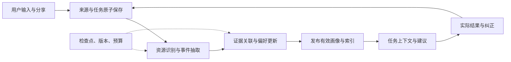

# 个人记忆与偏好服务 · 产品与技术调研

| 文档信息 | 内容 |
| --- | --- |
| 版本与日期 | v1.0 · 2026-11-07 |
| 研究课题 | 面向移动端个人 Agent 的情境偏好学习与可恢复记忆机制，以日常饮食经验为验证场景 |
| 思路来源 | [微信反思草稿及补充审阅](recipe/assets/research/wechat-draft-2026-11-06.md)，以其中 2026-11-07 的补充审阅为本版定位依据 |
| 需求文件 | [产品需求文档](prd.md) |
| 课程依据 | [团队项目作业要求](../task-requirement.md) |
| 证据状态 | 已完成公开资料与团队思路梳理；目标用户访谈、平台联调、真机性能和对照实验待开展 |

`recipe/` 与 `topic/` 保留此前探索。本版从补充审阅建立独立的研究主线，公开能力以所引官方文档和论文为依据，设计判断与效果假设在下文分别说明。公开资料核查日期为 2026-11-07。

## 一、研究结论与产品定位

### 1.1 核心问题

普通人在聊天、收藏、选择和实际体验中留下了大量个人信息。一次表达通常同时包含对象、情境、感受和临时要求。个人 Agent 要持续提供帮助，需要将这些表达组织为能查询、能纠正、能随生活变化的记忆。

本项目研究：

**怎样以较低的持续成本，从用户提供的生活材料中形成带证据的情境偏好，并在后续任务中可靠使用。**

产品形态为**开源、可本地运行的个人记忆与偏好服务，配有移动端界面、自带 Agent 和独立工具接口**。用户可直接使用手机，也可让兼容 Agent 查询与更新同一份记忆。

核心循环是：

**自然表达与生活材料 → 事件和证据 → 条件偏好与取舍模型 → 当前任务的上下文 → 实际结果与纠正 → 更新记忆。**

饮食是首个验证场景。菜谱和做法作为相关资源，吃过什么、当时为何选择、实际感受如何构成经验。是否更省事、更容易找到合适选择，由连续使用和实际反馈检验。

### 1.2 价值假设与研究问题

| 编号 | 研究问题 | 待验证的价值 |
| --- | --- | --- |
| R01 自然获取 | 一句话、分享材料和任务反馈怎样留下足够有用的证据 | 用户少填字段，材料能立即保存和找回 |
| R02 情境建模 | 怎样分清稳定偏好、当前状态、处境与他人表达 | 相同用户在不同情境下获得合适建议 |
| R03 增量更新 | 新证据、矛盾和用户纠正怎样改变已有认识 | 纠正能传到后续查询，重复材料保持同一来源 |
| R04 移动运行 | 处理时机、内存、电量和中断怎样影响记忆循环 | 已保存内容可靠保留，任务能继续完成 |
| R05 开放复用 | 不同入口怎样使用同一套资料与更新规则 | 换入口后少重复说明，用户保有数据迁移能力 |
| R06 收益与成本 | 更深的推断何时值得增加计算和询问 | 用可测收益决定建模深度与调度策略 |

大模型负责理解与推断，记忆系统负责证据累积、状态更新和按需供给。调研将检索、偏好学习和运行机制放在同一条处理链中比较。

## 二、用户、场景与需求证据

### 2.1 优先研究谁

| 用户 | 行为特征 | 首期验证重点 |
| --- | --- | --- |
| 自己安排饮食的人 | 经常选餐或做饭，能回忆具体体验，偶尔用 AI 求助 | 输入负担、情境偏好、再次决策 |
| 帮家人安排饮食的人 | 经常同时考虑自己与他人的喜好、时间和做法 | 人物归属、共同情境、经验交接 |
| 已有个人 Agent 的使用者 | 在同一助手中持续交谈，积累过个人背景 | 外部入口读取、回写和纠正的一致性 |
| 自部署与集成使用者 | 愿意配置本地工具、模型或服务器 | 安装、接口、维护和迁移成本 |

核心入组条件建议采用行为判断：近一个月作过至少三次饮食选择或做饭安排，并能提供一次真实经历及相关材料。先招募 8—12 人，其中至少 6 人符合核心条件，至少 2 人有持续使用 AI 的经历；同一人可以同时满足两项。技术使用者另记录其是否同时承担家庭成员的安装维护。

### 2.2 需要核实的问题链

| 观察方向 | 可能的原因 | 产品设计与验证 |
| --- | --- | --- |
| 反复向助手解释背景 | 经验分散，当前对话缺少合适的个人上下文 | 比较第二轮任务的重复说明条目与时间 |
| “懂我”的描述难以指导选择 | 画像缺少条件、证据或决策维度 | 用不同情境下的选择检验偏好模型 |
| 记忆纠正后仍被用错 | 原话、摘要、画像和检索结果更新脱节 | 跟踪修订是否传到下一次查询与不同入口 |
| 记录很快，整理迟迟没有完成 | 模型、后台时机与资源预算不匹配 | 同时测保存回执、处理延迟和恢复进度 |
| 新工具增加维护负担 | 安装、接入、迁移成本超过日常收益 | 单列首次成本与每次使用成本 |

这些是访谈与试用要验证的原因。参与者原话、展示的行为和团队解释分别记录。

### 2.3 代表性场景

设计案例：用户记录“昨晚那碗面味道很好，就是洗锅麻烦”，系统关联这次饮食事件、味道评价和清理成本。以后用户在加班晚间求助，系统带回相关经验；周末有空时，另一组条件可以得到不同建议。

用户可以把“工作日晚间”纠正为“加班晚间”，查看判断的来源，再通过另一个已接入的助手继续使用。案例覆盖自然记录、条件推断、任务供给、真实反馈和修正。它作为原型测试素材，真实试用使用参与者自己的经历。

## 三、市场与产品形态调研

### 3.1 个人 Agent 与移动入口

比较维度统一为：获取方式、持续状态、记忆管理、任务结果、开放接入、数据持有和维护成本。

| 对象 | 已公开能力与依据 | 对本项目的启发与实测问题 |
| --- | --- | --- |
| 灵光 | 开发者在小米商店发布的 2.0.60.8000 版本于 11 月 5 日更新，介绍持续管理事务、记住偏好、连接服务，并以饮食反馈和后续调整举例。[应用介绍](https://app.mi.com/details?id=com.antgroup.leopard.android) | 直接比较任务连续性、偏好纠正和记录管理，观察闪应用怎样承载持续状态 |
| Gemini | 官方帮助说明跨对话记忆及记忆摘要管理，适用条件随账号和设置变化。[历史记忆](https://support.google.com/gemini/answer/16598469?hl=en-UM) · [摘要管理](https://support.google.com/gemini/answer/18617127?co=GENIE.Platform%3DAndroid&hl=en) | 固定实际账号、版本与设置，比较已有记忆能完成的任务及用户纠正成本 |
| 豆包 | 作为用户熟悉的移动 AI 入口，纳入真实使用观察 | 记录参与者如何提问、延续对话、保存与更改个人信息；具体功能以所用版本实测登记 |
| Grok Bot、Muse、dots | 官方资料分别展示持久计算环境、持续任务、个人上下文与工具连接。[Grok Bot](https://x.ai/bot/guides/grok-bot-101) · [Muse](https://muse.ai/blog/how-we-designed-muse) · [dots](https://learn.chatgpt.com/docs/dots) | 比较从对话到持续帮助的交互方式，核对记忆的可见性、纠正方式和外部工具路径 |
| Siri、Shortcuts | App Intents 将应用动作与实体交给系统入口；App Schemas 提供相应语义。[App Intents](https://developer.apple.com/documentation/appintents) · [WWDC26](https://developer.apple.com/videos/play/wwdc2026/240/) | 验证“记一件事”和“找回经历”，记录语音参数、锁屏、唤起、返回和用户额外操作 |

Siri 是系统接入路径，灵光等是直接产品比较对象。用户原有的相册、收藏夹、笔记与 AI 对话组合也是体验基线。

### 3.2 自部署与技术生态

Hermes 将精简记忆、用户资料和历史会话检索分开，并通过提供方接口连接其他记忆系统。适合研究预算、记忆分层及插件边界，也可作为接入宿主。[内建记忆](https://hermes-agent.nousresearch.com/docs/user-guide/features/memory/) · [记忆提供方](https://hermes-agent.nousresearch.com/docs/user-guide/features/memory-providers/)

OpenClaw 将用户模型、长期条目和日记分层，提供整理机制，移动应用通过 Gateway 连接运行环境。其 Docker 文档提供自部署参照。[记忆](https://docs.openclaw.ai/concepts/memory) · [Android 客户端](https://docs.openclaw.ai/platforms/android) · [Docker](https://docs.openclaw.ai/install/docker)

PC 侧研究集中在服务进程、容器、局域网和本地模型。产品交互以手机为主，独立后端需要可启动、可调用、可备份的运行方式。每个候选组件记录代码版本、许可证、模型权重条件、依赖、存储位置与最低运行环境。

### 3.3 饮食任务基线

菜谱软件用于比较收藏、找回、修改做法和记录反馈。Samsung Food、Recipe Keeper、Paprika、ReciMe 等进入产品体验候选，Mealie 进入开源管理与 API 候选。具体能力和版本以测试前的官方资料与账号实测登记，先选一款任务相近的产品完成同材料对照。

本项目的差异假设集中在**条件偏好学习、可修订的证据关系、移动端运行成本和跨入口复用**。安装、记录、纠正与迁移共同计入采用成本。

## 四、Agent 记忆方案与机制比较

### 4.1 比较框架

调研同时考虑记忆的保存形式、承担的功能和更新过程。现有综述覆盖 token、参数、潜在表示，以及事实、经验和工作记忆等维度。[Memory in the Age of AI Agents](https://arxiv.org/abs/2512.13564)

| 机制 | 代表方案与公开做法 | 应比较的收益 | 主要成本与检查项 |
| --- | --- | --- | --- |
| 文件与分层记忆 | Hermes、OpenClaw 保存精简用户资料、长期记忆与历史记录 | 小数据下容易查看、编辑和复用 | 上下文占用、压缩损失、维护频率 |
| 持久状态与整理 | Letta 当前 SDK 组织记忆文件，区分常驻上下文、按需读取与 dreaming。[Letta](https://docs.letta.com/agent-sdk/memory) | 记忆维护与即时任务分工 | 后台整理成本、状态归属、版本一致性 |
| 提取与合并 | Mem0 从对话提取、整合、检索显著信息，并研究图结构变体。[论文](https://arxiv.org/abs/2504.19413) | 把原文变成可复用条目 | 漏项、冲突、每次写入的模型调用 |
| 时态关系 | Graphiti 关联实体、事实与原始事件，维护有效时间并采用混合检索。[项目说明](https://github.com/getzep/graphiti) | 人物、关系与历史状态可查询 | 图维护、实体误合并、部署依赖 |
| 关联与演化 | A-MEM 生成结构化笔记、建立链接，并更新相关旧记忆。[论文](https://arxiv.org/abs/2502.12110) | 新经历能改变已有组织方式 | 关联扩张、写放大、错误传播 |
| 用户推断 | Honcho 提取前提与结论、归纳跨消息模式、维护用户表示。[推理](https://honcho.dev/docs/v3/documentation/core-concepts/reasoning) · [表示](https://honcho.dev/docs/v3/documentation/core-concepts/representation) | 从表达中形成隐含偏好与变化认识 | 推理深度、证据质量、整理频率 |
| 事实与信念 | Hindsight 区分事实、经历、观察与观点，提供保留、回忆和反思操作。[论文](https://aclanthology.org/2026.acl-demo.27/) | 保存可演化的主观判断 | 置信信息校准、服务资源和模块裁剪 |
| 记忆操作策略 | AgeMem 通过强化学习统一管理保存、检索、更新、压缩和遗忘。[论文](https://arxiv.org/abs/2601.01885) | 学习何时执行记忆操作 | 训练数据、奖励设计、推理预算 |
| 预算内保留原文 | FlexA-Mem 按预算组织原始记录、时间线和相关细节。[论文](https://arxiv.org/abs/2610.33274) | 保真、低开销的上下文供给 | 检索范围、精确信息与摘要的取舍 |

这些资料证明相关机制已有研究与实现。论文结果对应各自的数据、模型和配置，本项目按统一任务重测。

首期优先选择文件／混合检索建立轻量基线，从 Honcho 或 Hindsight 中选择一个推断型强基线；Mem0 用于补充提取型对照。图结构、关联演化和学习调度作为可替换模块研究，依据实际瓶颈引入。

### 4.2 研究对象怎样拆开

- **观测层：** 用户表达了什么、做了什么、当时有哪些条件和选项。
- **记忆层：** 哪些事实与经历值得保留，怎样关联、压缩和检索。
- **偏好层：** 哪些条件会改变选择，证据支持哪些倾向与取舍。
- **决策层：** 当前需要哪些记忆，怎样筛选和解释候选。
- **运行层：** 每一步在哪里执行、如何安排预算、失败后怎样继续。

数据库和索引提供持久化与查找能力。用户模型保存当前认识及其证据，更新算法决定新经历怎样改变它。首期研究投入集中在后两者与移动运行条件的结合。

## 五、数据、领域知识与偏好模型

### 5.1 数据如何产生与组织

首期输入包括用户文字、主动分享的截图和链接、任务中的选择及实际反馈。照片、语音和来源应用连接按可访问性与端侧成本逐项扩展。每条记录保存来源、人物、时间、内容版本和用途范围。

| 对象 | 保存内容 | 关键关系 |
| --- | --- | --- |
| 来源 | 原话、资源引用或已保存附件、片段位置 | 同一原始经历的多种材料建立关联 |
| 事件 | 发生时间、参与者、食物或做法、行为和情境 | 事件可独立存在，按需关联菜谱版本 |
| 观察与证据 | 评价维度、倾向、来源类型与确定程度 | 连接原文和偏好，保留支持与反对关系 |
| 偏好 | 主体、维度、条件、倾向或权重、有效期和状态 | 版本化更新，保留依据与被取代关系 |
| 决策与结果 | 展示的候选、选择、采用理由与真实反馈 | 区分建议、接受建议和实际体验 |
| 处理任务 | 输入版本、阶段、算法版本、预算和检查点 | 中断后按阶段恢复，过期结果退出提交 |

感知过程采用“资源保存 → OCR／转写或文本解析 → 事件抽取 → 证据关联 → 偏好更新 → 索引发布”。同一事件的重复转述共用来源关系；来源修订或删除沿依赖关系传播。

### 5.2 饮食领域知识如何进入系统

| 知识与资料 | 整理方法 | 用途与检查 |
| --- | --- | --- |
| 饮食事件与反馈语义 | 用团队样例和获准材料标注人物、发生时间、行为、评价、条件 | 分清本人、转述、假设、计划和实际体验 |
| 口味与投入维度 | 建立味道、准备时间、烹饪难度、清理成本、价格、探索意愿等维度表 | 将“麻烦”“清爽”等表达落到可核对的具体含义 |
| 食物、食材与状态 | 维护带来源的别名和状态表，保留原始写法 | 检索与条件匹配时区分对象和状态 |
| 菜谱与做法 | 参考 [Schema.org Recipe](https://schema.org/Recipe)的来源、配料、步骤、份量和时间结构 | 保存相关资源与个人做法版本，缺项保持未知 |
| 数量与替换规则 | 确定份量按比例计算，语义用量保留原话；替换关联到涉及的步骤 | 用确定计算承接基础调整，复杂替换作为扩展 |
| 个人条件与纠正 | 用户明确设置、当前请求、带证据的推断分别记录 | 已知限制先筛选，偏好用于排序；新纠正作用到对应范围 |

领域资产须有版本、来源、适用条件、正反例和复核人。图片中的食物特征、收藏兴趣和实际喜好分别标注。课程领域定制体现在这些语义、工具、更新规则和任务对照中。

### 5.3 建模深度与能力回报

| 层级 | 表达与数据要求 | 可检验的收益 |
| --- | --- | --- |
| 明确偏好 | 用户直接设置，可一次形成 | 少重复说明，过滤明显冲突 |
| 情境偏好 | 条件表达或多次带情境的经历 | 加班与周末等不同处境下的建议更合适 |
| 决策取舍 | 候选特征、选择原因与结果 | 对新选项形成合理排序 |
| 跨情境倾向 | 较长时期、多种情境的独立证据 | 帮助新任务提出更有用的问题 |

首期重点检验情境偏好与决策取舍。更广泛的人格描述作为可修正的长期假设，以本人反馈和未来任务上的预测收益检验。

一次选择可能由喜好、可用食材、时间或同行者共同决定。系统保留竞争解释，在新证据中逐步区分；当前任务需要时提出一个容易回答的澄清问题。喜欢吃、愿意做、愿意再次尝试分别建模。

### 5.4 算法路线与实验变量

先让模型输出结构化观察及候选解释，由后端校验字段、来源和版本。明确设置直接保存；推断附证据、条件与状态，按用户选择的辅助策略参与排序。

取舍模型从规则计分、带正则的在线逻辑回归和贝叶斯更新中比较。一个候选形式是：

`P(A 优于 B｜情境 c) = sigmoid(w_c · [特征(A) − 特征(B)])`

基础权重与少量情境修正共同表达偏好。特征可以采用准备时间、清理成本、口味和新鲜感，缺少特征时标明未知。参数由比较样本估计；置信信息在留出的样本上校准，解释引用实际参与判断的特征与证据。

更新先核对主体、时间和情境，再判断属于新增、条件变化、过期还是纠正。临时状态设定有效范围，长期偏好按独立证据调整。同一经历的重复输入计为一个来源。

调度策略比较固定频率、事件触发与价值优先：重复材料复用结果，重要冲突和即将影响任务的未知项优先。主动询问按减少决策不确定性的收益和用户负担评估；情境 bandit 可作为进一步研究参照。[相关论文](https://arxiv.org/abs/1003.0146)

训练目标避免只追求画像描述丰富度。测试重点是后续选择、错误偏好、修正成本，以及写入加查询的总开销。模型微调和更复杂的潜在表示在样本与收益支持后再进入比较。

## 六、移动端运行与部署研究

### 6.1 把调度、推理与持久状态分别验证

iOS 的 App Intents 用于系统动作接入；后台任务承接允许延后的处理。BGContinuedProcessingTask 面向用户在前台发起、离开应用后继续的工作，需要报告进度并处理到期或取消。Apple 同时强调增量保存进度。[Apple 后台任务](https://developer.apple.com/videos/play/wwdc2025/227/)

Android WorkManager 提供持久调度、条件、重试和任务链；Android 16 起长时间 worker 可能耗尽任务配额。[持久任务](https://developer.android.com/develop/background-work/background-tasks/persistent) · [长任务](https://developer.android.com/develop/background-work/background-tasks/persistent/how-to/long-running)

模型接口还具有独立约束。例如 ML Kit 当前的 GenAI 推理要求应用处于最前台，前台服务同样受到限制，并有设备、语言与调用配额差异。[ML Kit](https://developers.google.com/ml-kit/genai) Apple Foundation Models 当前覆盖端内和云端模型，选型应记录实际执行位置。[Apple 框架](https://developer.apple.com/foundation-models-framework/)

据此，手机保存工作状态，调度器提供处理机会，模型适配器声明当前是否可执行。关闭应用后的核心保证是已保存数据与进度可恢复；具体后台能力按平台、模型和设备分别测试。

### 6.2 可恢复的处理链

每个阶段以来源版本、阶段和算法版本识别任务，保存已完成结果。中断后复用完成阶段，重做尚未提交的小段；重试沿用原预算。取消、来源删除与版本变化应使迟到结果失效。

查询读取已发布的一致版本，并标明相关资料的处理进度。新纠正先使受影响认识退出使用，再重算相关部分。媒体文件先取得持续访问能力，避免任务恢复时丢失资源。

### 6.3 两种本地部署与外部使用

| 形态 | 权威资料库与执行位置 | 研究与交付关系 |
| --- | --- | --- |
| 纯端内 | 手机保存资料，端内完成抽取、检索、更新和建议所需推理 | 首期核心验收路径；模型准备与下载单列 |
| 独立本地服务 | 同一业务核心作为进程运行，提供 CLI、API 和 MCP | 首期验证后端独立性；客户端与服务使用一致的数据语义 |
| 用户侧服务器与手机协同 | 用户自管服务器为权威库，手机保留缓存与待同步输入 | 可选扩展，研究容器、局域网、配对、离线队列与冲突 |
| 外部模型或云端 Agent | 经用户授权发送所选上下文或调用工具 | 可选接入模式，记录发送范围和处理位置 |

独立进程是后端的运行方式；手机协同还需要连接、缓存和同步协议。首期跨入口试验可以让真实 MCP 宿主在手机连接可用时读取同一库，也可连接独立服务实例完成全流程。数据迁移与实时共享分别验收。

MCP 标准传输包含本地 stdio 和 Streamable HTTP。协议、认证、网络可达性共同决定连接路径，系统权限用于具体系统资源访问。[MCP 规范](https://modelcontextprotocol.io/specification/2026-07-28/basic/transports) 消费端应用接入与调用其模型 API 分别登记。

容器研究覆盖持久卷、版本固定、备份、恢复、主机休眠和地址变化；局域网方案评估配对、断连与离家后的可用范围。一次安装确定一个权威库，模式切换采用明确迁移。外部取得的副本按宿主缓存规则管理，后续请求带回修订信息。

### 6.4 选型需要取得的证据

| 决策 | 比较条件与输出 |
| --- | --- |
| 原生或跨平台客户端 | 在 Android、iOS 真机完成保存、系统分享、模型处理、中断恢复和备份；记录维护量与发布条件 |
| OCR 与资源理解 | 同一批中文截图与模糊样本，比较定位准确性、补改次数、内存和耗时 |
| 端侧模型与运行时 | 固定抽取任务，测中文质量、结构化输出、模型大小、峰值内存、冷启动和前后台条件 |
| 记忆表示与检索 | 在同一时间线比较原文、摘要、结构化证据和条件模型；记录质量与总成本 |
| 任务调度 | 比较逐条、有限批次和冲突触发整理；记录等待、能耗、恢复与用户打断 |
| 开放接口 | 固定一个真实宿主，完整验证查询、写回、纠正、权限和失败状态 |

## 七、研究验证设计

### 7.1 真实用户研究

先完成至少 8 位参与者的探索性访谈，每人留下至少一条获准的行为记录。观察现有工具中的完整过程，记录哪些信息重复出现、哪些条件改变决策，以及用户能否理解和修正系统认识。

再安排至少 8 人完成两轮配对试用，间隔至少 24 小时；至少 4 人提交一次真实饮食选择及体验反馈。两种方法采用相近材料与任务，平衡使用顺序。原有方法保留其记忆功能和实际设置，安装与迁移成本单列。

用户研究检验输入负担、记忆可理解性、第二轮复用与持续使用意愿。样本规模用于课程探索，结论报告参与者与情境范围。

### 7.2 机制对照

| 组别 | 固定方案 | 主要作用 |
| --- | --- | --- |
| B0 轻量基线 | 原始记录、关键词／向量检索、时间过滤与通用回答；历史可容纳时另测完整上下文 | 测量取材与通用模型已经能完成的部分 |
| B1 强记忆基线 | 从 Honcho 或 Hindsight 中固定一个版本和配置 | 比较已有推断型记忆机制 |
| B2 本项目 | 情境证据、增量偏好更新、可恢复处理与任务上下文 | 验证所提机制的收益和成本 |
| 补充对照 | Mem0／结构化摘要、其他文件或图方案 | 定位提取、组织与推断各环节的差异 |

固定原始材料、时间顺序、候选、回答模型、允许信息和预算。机制对照固定硬件和运行环境；采用不同内部模型或部署环境的完整框架另测，单列配置。端侧结果注明目标机、可移植模块及推理位置。写入、整理、检索和回答的成本合计，按查询频率报告摊销值。

冻结 30 个时间线任务：来源与事件抽取 6 个、人物与情境区分 6 个、条件偏好与取舍 6 个、变化与纠正 6 个、上下文供给及结果复用 6 个。至少 10 个来自获准真实材料，其余为团队编写的边界案例。开发材料与验收材料分开，每组运行 3 次，评分隐藏组别。数据与运行异常另按 PRD 场景验收。

公开评测参考 LongMemEval 的跨会话、时间和更新能力，以及 PersonaMem 的动态用户建模。PersonaMem-v3 进一步覆盖跨平台证据、推荐和过度个性化，可补充测试维度。[LongMemEval](https://arxiv.org/abs/2410.10813) · [PersonaMem](https://arxiv.org/abs/2504.14225) · [PersonaMem-v3](https://arxiv.org/abs/2608.21381)

### 7.3 评价、消融与判定

| 方面 | 指标 |
| --- | --- |
| 获取与感知 | 记录耗时、补填次数、主体／时间／评价抽取错误、资源定位错误 |
| 偏好质量 | 有依据推断比例、情境错用、错误长期化、未来选择预测、置信校准 |
| 更新可靠性 | 纠正与删除传播、重复证据、并发冲突、恢复后的状态一致性 |
| 任务价值 | 完成率、人工纠正、重复说明、决策耗时、真实体验与放弃原因 |
| 资源成本 | 写入加查询的 token 与调用量、峰值内存、能耗、存储增长、处理延迟 |
| 使用门槛 | 安装配置、权限理解、迁移、维护与跨入口操作时间 |

依次移除情境、证据回查、冲突更新与主动询问，观察哪些模块影响结果。调节模型大小、上下文预算和整理频率，比较质量与成本的组合。

人物归属和来源对应由人工标注核对；主观喜好以本人反馈与后续选择判断。模型评分可辅助整理，关键错误由两位成员复核。未完成与放弃保留在任务完成率分母，节省时间指标同时报告有效配对人数；基线为零时报告绝对变化。

具体发布门槛 C01—C06、效果目标 G01—G04 与功能场景 A01—A30 统一写入 [PRD](prd.md)。本研究提供判断依据，数值目标属于待检验的设计目标。

## 八、范围、风险与课程交付

### 8.1 首期主线与后续研究

首期完成双平台手机上的记录、事件整理、条件偏好、查询建议、实际反馈、纠正删除和恢复；提供独立 CLI 与 MCP 接口、iOS Siri／快捷指令动作、Android 分享入口，以及备份迁移和可检查演示。

菜谱保存、来源与版本作为相关资源管理。复杂食材替换、精细用量知识、周计划、购物清单和家庭多账号在持续需求与资源允许后扩展。用户侧服务器协同、跨设备同步和更深的跨领域画像分别评估，研究资料继续保留。

### 8.2 关键变量与应对

| 变量 | 可能影响 | 应取得的证据与处理 |
| --- | --- | --- |
| 端侧模型质量与设备覆盖 | 影响纯端内闭环和处理时机 | M0 用双平台真机验证；固定支持清单与降级方式，范围变更进入 PRD 迭代 |
| 偏好证据稀疏 | 容易混淆喜欢与处境 | 保留未知与竞争解释，使用明确设置和必要澄清 |
| 推断错误持续累积 | 错误进入未来任务 | 来源版本、依赖失效、反例和用户纠正共同约束 |
| 后台机会有限 | 更新延后 | 即时保存、阶段检查点、前台续接与有限批次调度 |
| 商业入口接入条件变化 | 影响外部客户端选择 | 先验证真实兼容宿主，商业连接按版本和资格登记 |
| 新工具维护负担 | 影响采用意愿 | 安装、迁移和持续维护分别计时，观察谁承担这些工作 |

### 8.3 文档与交付关系

课程要求领域 Agent、完整软件、真实需求、前后端说明、典型任务对照和可访问的上线演示。[课程要求](../task-requirement.md) 本项目以饮食语义、偏好更新规则和工具调用体现领域定制，借助来源、状态和恢复机制形成可使用的软件。

在线演示采用团队自写或获准样例，提供访问地址和测试方式；安装包与真机记录用于检查端内能力。演示数据与个人资料分开，联网演示和纯端内运行分别保留证据。

[PRD](prd.md)承接范围、功能、接口、数据状态、非功能要求、验收与发布安排。访谈、实验和接入结果取得后，按对应 R 编号更新本调研，再同步受影响需求。历史探索继续留在原目录，本版形成新的需求依据。
