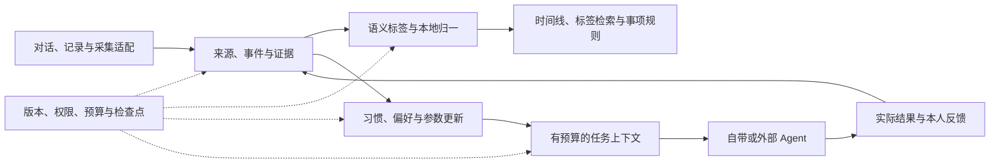

# 个人记忆与偏好服务 · 产品与技术调研

| 文档信息 | 内容 |
| --- | --- |
| 版本与日期 | v1.3 · 2026-11-09 |
| 研究课题 | 从生活材料中持续建构、更新和复用本地个人模型 |
| 思路来源 | [微信反思草稿及补充审阅](recipe/assets/research/wechat-draft-2026-11-06.md)，以及后续关于通用底层与实现借鉴的澄清 |
| 配套文件 | [PRD](prd.md) · [课程要求](../task-requirement.md) |
| 证据状态 | 既有资料核查于 11 月 7 日；参考项目与 Android 识屏接口核查于 11 月 8 日；移动入口与持续事项资料补核于 11 月 9 日。用户、真机和效果验证待开展 |

## 迭代记录

| 版本 | 日期 | 调整 |
| --- | --- | --- |
| v1.0 | 2026-11-07 | 从菜谱流程转向个人偏好的形成与复用 |
| v1.1 | 2026-11-08 | 建立通用事件、习惯、偏好、目标与场景协议 |
| v1.2 | 2026-11-08 | 围绕个人模型重组研究，补充跨工具上下文与 Android 识屏机制，将参考项目收束为模块设计依据 |
| v1.3 | 2026-11-09 | 澄清 Agent 语义标签与本地事件库；补充移动入口比较、标签算法对照、事项触发与信息架构验证 |

## 一、我们要研究什么

**用户留下生活片段，系统从中形成有依据的习惯与偏好，在下一次任务中发挥作用，并随结果和纠正继续更新。**

核心循环是：

**生活材料 → 事件、语义标签与证据 → 个人模型 → 事项上下文 → 实际反馈。**

研究重点在中间两步：怎样把零散材料内化为条件认识与取舍参数，以及怎样用较低成本持续修正。采集入口决定材料是否容易留下，宿主接口决定认识能否被不同 Agent 使用。二者服务于同一条循环。

本轮将日常入口收束为对话与记录、记录库和设置。记录本组织内容，时间线帮助回查，Agent 结合本地算法为记录生成语义标签，形成可检索、可纠正的事件数据库。标签承担内容组织；习惯与条件偏好承担个人建模，分别评价两者的收益。

“本地个人模型”由四部分组成：可追溯的证据、习惯统计、条件偏好与取舍参数、可复现的版本快照。通用语言／视觉模型负责理解材料；个人模型保存持续更新的用户状态。内化的结果应表现为下一次选择更合适、重复说明更少、纠正能够生效。

饮食是深入验证场景，出行、消费、学习／工作和作息／运动检验通用性。资源、字段与规则由场景包提供，底层围绕人物、事件、证据和版本组织。

**首期采用自带 App＋本地业务核心＋模型适配层。** 资料与个人状态在本地维护，推理选择经实测可用的端侧模型或远程 API；前台及时处理，后台按系统机会继续，进度持久保存。独立接口保留可复用的代码边界，MCP／HTTP 服务作为扩展验证。移动端可实现性的依据见 5.2—5.3 节。

| 研究问题 | 要得到的证据 |
| --- | --- |
| R01 自然获取：怎样降低记录负担 | 分享、简短表达与屏幕上下文的输入耗时及有效信息量 |
| R02 个人建模：怎样形成习惯与条件偏好 | 有来源的推断、未来选择质量、观察覆盖与例外 |
| R03 持续更新：怎样处理变化与纠正 | 受影响认识、参数、索引和下一次输出一致更新 |
| R04 移动运行：怎样安排有限资源 | 保存成功率、处理延迟、中断恢复、能耗与内存 |
| R05 跨工具复用：怎样共享有效认识 | 不同入口读取同一版本，修改和撤回传播一致 |
| R06 收益成本：建模深度是否值得 | 用户负担、任务完成与摄取加查询的总成本 |
| R07 场景泛化：哪些机制和认识能够复用 | 新场景接入改动、冷启动样本与错误迁移 |
| R08 反馈学习：怎样理解执行与体验 | 请求、动作回执、真实结果和本人评价分别可查 |
| R09 事件组织：语义标签能否改善找回与后续处理 | 标签分类与归一质量、检索命中、人工纠正成本、触发准确性与来源追溯 |

## 二、谁需要它，怎样判断有用

### 2.1 用户与问题

核心用户是反复处理生活选择、愿意留下少量体验的人。常见问题是背景反复说明、画像缺少情境、纠正后旧认识仍在使用。家庭安排者还需要区分人物；已有 Agent 的用户需要跨入口延续认识。自部署用户用于检验安装与维护成本。

这些是待验证的需求假设。先访谈 8—12 人，至少 8 人完成；入组条件是近一个月至少三次处理某类生活选择，并提供一条获准行为材料。样本至少包含 4 名饮食场景用户、4 名其他生活场景用户、2 名持续使用 AI 的用户，条件可重合。

观察一次完整过程：用户如何取得材料、解释条件、作出选择、得到结果、在下次任务中找回经验。记录原话、实际行为与团队解释，比较原有相册、笔记、收藏及 AI 对话组合的成本。

### 2.2 用同一机制处理不同场景

| 场景 | 应学习的内容 | 检验方式 |
| --- | --- | --- |
| 饮食 | 味道、准备和清理投入如何随精力变化 | 下一次选餐与真实体验 |
| 出行 | 价格、时间、换乘、同行者之间的取舍 | 新班次排序与行程调整 |
| 消费 | 预算倾向、购买条件与当次目标 | 带时间的报价、选择与购买反馈 |
| 学习／工作 | 任务类型、时段、耗时和中断模式 | 安排与实际完成情况 |
| 作息／运动 | 已观察节律、负担和例外 | 后续行为及计划调整 |

四类状态分别维护：事实记录发生了什么；习惯描述已观察的行为模式；偏好表达条件下的取舍；目标保存当次要求与期限。例如“工作日晚间常学习”是习惯，“赶时间时愿意加钱少换乘”是偏好，“周五前买到车票”是目标。

再安排至少 8 人完成两轮试用，间隔至少 24 小时。至少 4 人提交真实饮食体验、4 人提交其他场景结果，可重合。平衡本产品与原有方法的使用顺序，保留原有 AI 的记忆设置；安装与迁移成本单列。该样本用于探索性判断，报告具体参与者与情境。

## 三、个人模型怎样形成

### 3.1 从材料到认识

| 阶段 | 处理内容 | 产物 |
| --- | --- | --- |
| 获取 | 保存获准文字、图片、链接或宿主观察，标明人物、时间、来源与用途 | 来源及可回查位置 |
| 提取 | 识别事件、对象、情境、评价与缺项，区分经历、计划、转述和系统生成内容 | 通用事件与观察 |
| 标注 | Agent 提出语义候选，本地词表归一、去重并校验依据版本 | 可追溯的标签指派与检索字段 |
| 组织 | 合并同一事件的重复材料，整理支持、反例和竞争解释 | 有依赖关系的证据 |
| 更新 | 修改受影响的习惯统计、条件规则或参数，通过校验后发布 | 新的个人模型快照 |
| 使用 | 按任务、授权和预算选取认识、依据、未知项与当前进度 | 任务上下文 |
| 修正 | 取得实际结果或本人纠正，撤销旧依据并局部重算 | 下一轮更新 |

屏幕上的一张票、一次收藏或 Agent 的选择，各自保留观察类型。实际使用、喜欢程度和长期倾向需要对应证据。系统记录候选、展示次序、约束与行动发起者，控制由推荐和自动执行引入的反馈偏差。

习惯统计注明观察窗口和覆盖。例如只在周末留下记录，频率计算就限定在已观察的周末。缺失时段保留未知，近期例外、变化点和衰减参与更新。

### 3.2 表示与算法

首期从可解释、可纠正的表示起步，按收益逐步增加深度。

| 深度 | 方法 | 应带来的回报 |
| --- | --- | --- |
| 条件规则与统计 | 明确设置、事件频率、时间分布、反例与衰减 | 小样本可用，更新成本低 |
| 增量取舍模型 | 在线逻辑回归或贝叶斯更新 | 对新候选进行条件排序 |
| 分层个人表示 | 用户共享参数、领域修正、情境修正 | 在新场景减少冷启动，同时保留差异 |

候选比较可写为：

`P(A 优于 B｜u,d,c) = sigmoid(w[u,d,c] · [φ_d(A) − φ_d(B)])`

场景包定义特征 `φ_d` 的含义、单位和尺度；参数 `w` 表达用户在领域与情境中的取舍。共享限于语义对齐且经验证的维度，其余独立学习。观察选择时同时记录时间、预算、可得选项与同行者，保留竞争解释。以上是待验证方案。

更新保存证据依赖、充分统计或可重放样本。纠正先停用受影响认识，再重算参数并发布快照；模型自评分作为内部信号，概率经过留出校准后展示。微调通用模型、复杂潜在表示和长期训练进入后续比较，评价其收益、能耗、迁移与纠正成本。

### 3.3 现有记忆机制给出的参照

| 机制与来源 | 可借鉴部分 | 本项目需要检验 |
| --- | --- | --- |
| Hermes／OpenClaw 的文件与分层记忆；Letta 的记忆文件与 dreaming。[Hermes](https://hermes-agent.nousresearch.com/docs/user-guide/features/memory/) · [OpenClaw](https://docs.openclaw.ai/concepts/memory) · [Letta](https://docs.letta.com/agent-sdk/memory) | 少量常驻信息、按需检索、异步整理 | 上下文占用与维护成本 |
| Mem0 的提取合并、Graphiti 的时态关系、A-MEM 的关联演化。[Mem0](https://arxiv.org/abs/2504.19413) · [Graphiti](https://github.com/getzep/graphiti) · [A-MEM](https://arxiv.org/abs/2502.12110) | 从原文形成条目，维护时间与关联 | 冲突、写放大与纠正传播 |
| Honcho 的用户推断与表示，Hindsight 的事实、经历与信念。[Honcho](https://honcho.dev/docs/v3/documentation/core-concepts/reasoning) · [Hindsight](https://aclanthology.org/2026.acl-demo.27/) | 形成能随证据变化的主观认识 | 隐含偏好质量、证据与端侧成本 |
| AgeMem 的记忆操作策略，FlexA-Mem 的预算内原文组织。[AgeMem](https://arxiv.org/abs/2601.01885) · [FlexA-Mem](https://arxiv.org/abs/2610.33274) | 学习处理时机，保留必要细节 | 训练投入、调用预算与信息损失 |
| PowerContext 的来源、版本化产物、Profile 与有预算的上下文。[Profile](https://github.com/oceanbase/powercontext/blob/da03e70a6fe6ab5543d7fce55866214c1966a2e1/docs/en/docs/workflows/use-profiles.md) | 跨工具共享状态与来源窗口增量处理 | 工程复用效果，以及摘要画像与条件模型的差异 |

首期以原文加混合检索为轻量基线，固定 Honcho 或 Hindsight 的一个版本作为推断型强基线。PowerContext 用于核对跨工具链路和版本契约；其 Profile 可补充摘要画像对照。数据库、索引和上下文组装分别测量，算法收益按完整任务判断。综述的分类可用于检查遗漏。[Agent 记忆综述](https://arxiv.org/abs/2512.13564)

### 3.4 语义标签与本地事件库

这里的“Agent 标签”是内容标注结果：Agent 结合本地算法，为用户的对话和记录提取主题、场景、行为与情境。标签通过稳定定义和指派关系进入本地库，时间线、记录本和标签查询打开同一记录。

| 阶段 | 首期方案 | 需要验证 |
| --- | --- | --- |
| 候选提取 | 场景词表与确定性规则先处理明确表达，Agent 补充语义候选与依据位置 | 简短、含糊、多事件、否定与转述材料的覆盖 |
| 归一与去重 | 按命名空间、类别与规范名匹配，同义词映射到稳定标签；歧义保留候选 | 近义召回与误合并之间的取舍 |
| 指派与核对 | 保存 origin、依据版本、算法版本、置信度和状态，人工确认／排除覆盖自动结果 | 来源定位、低置信核对量与纠正成本 |
| 检索与关联 | 以有效标签结合人物、时间、观察类型和事项状态过滤，再回查原文 | 相比原文检索能否更快找回相关记录 |
| 触发与修订 | 已启用规则匹配有效标签；新增材料、反馈、纠正进入可恢复任务 | 重复触发、输入失效、人工排除与恢复一致性 |

标签指派使用待核对、有效、人工排除、已撤回四类状态。人工排除绑定稳定记录或事件与归一标签，后续重算继续尊重该决定。改词表、改来源与撤销人工覆盖分别记录；旧依赖失效后再发布新的指派和索引。

人物、发生时间、计划／实际等观察类型仍是结构化字段。语义标签为检索和规则匹配提供线索，事实、本人偏好与行动权限各自使用对应证据与校验。规则保存在版本化场景包中，本地设置管理启停、范围与预算。

这些是首期算法方案，收益由第六节的对照验证。本地库负责版本、归一、索引与事务；候选提取采用端侧或已配置的远程推理，处理位置沿用模型配置并如实显示。

## 四、参考项目怎样改善实现

三个项目分别补足**上下文服务、移动采集、宿主交互与执行**。下列结论来自指定提交的文档和源码；构建、真机与互操作效果留待原型验证。

### 4.1 PowerContext：让跨工具记忆成为稳定服务

核查提交 [`da03e70`](https://github.com/oceanbase/powercontext/commit/da03e70a6fe6ab5543d7fce55866214c1966a2e1)。

它将来源保存为 Source，记忆、经验、Profile 等保存为可寻址的 Artifact 修订；同一服务提供 HTTP、CLI、MCP 和宿主集成。Scope 选择数据范围，访问权限由独立身份与授权检查决定。[服务契约](https://github.com/oceanbase/powercontext/blob/da03e70a6fe6ab5543d7fce55866214c1966a2e1/docs/en/docs/develop/interfaces.md) · [范围与授权](https://github.com/oceanbase/powercontext/blob/da03e70a6fe6ab5543d7fce55866214c1966a2e1/docs/en/docs/workflows/scopes-and-access.md)

`PreparedContext` 在统一 UTF-8 字节预算内组装选定内容，返回 `ready/empty`、正文和大小；可选回执列出所用精确修订、遗漏与处理耗时。Profile 是从来源窗口生成的 Markdown 快照，支持候选审核、修订与游标推进。[上下文组装](https://github.com/oceanbase/powercontext/blob/da03e70a6fe6ab5543d7fce55866214c1966a2e1/docs/en/docs/workflows/prepare-context-text.md) · [组装源码](https://github.com/oceanbase/powercontext/blob/da03e70a6fe6ab5543d7fce55866214c1966a2e1/src/powercontext/builtin/runtime/prepared_context.py) · [Profile 更新](https://github.com/oceanbase/powercontext/blob/da03e70a6fe6ab5543d7fce55866214c1966a2e1/docs/en/docs/workflows/use-profiles.md)

跨工具自动复用还有宿主侧工作：其 DSH 插件在 `agent/pre-step` 中解析范围、准备历史上下文，再采集获准的用户输入。采集 ID 组合范围、会话、轮次与正文，处理游标单独跟踪；MCP 工具承担显式读写。自动注入依靠钩子／中间件接入。[插件入口](https://github.com/oceanbase/powercontext/blob/da03e70a6fe6ab5543d7fce55866214c1966a2e1/integrations/dsh/plugins/powercontext/src/index.ts) · [读取与采集顺序](https://github.com/oceanbase/powercontext/blob/da03e70a6fe6ab5543d7fce55866214c1966a2e1/integrations/dsh/plugins/powercontext/src/recall.ts) · [来源标识](https://github.com/oceanbase/powercontext/blob/da03e70a6fe6ab5543d7fce55866214c1966a2e1/integrations/dsh/plugins/powercontext/src/capture.ts)

本项目据此明确四项设计：

1. **一份权威个人状态。** 入口绑定资料库、人物与客户端身份，各自缓存相同修订。
2. **两个交付接口。** 采集返回持久保存回执；上下文返回所用快照、证据、预算与未处理进度。
3. **三种进度分别报告。** 材料已保存、模型已更新、宿主已使用，分别取得证据。
4. **钩子与业务核心分离。** 有钩子的宿主自动取用；其他宿主使用工具接口。两条路径共用授权、更新和纠正规则。

PowerContext 的 Profile 为摘要画像提供参照，本项目继续检验习惯统计和条件取舍参数的增益。其 Python 服务与存储适配可作为自管服务候选，移动端嵌入成本在选型时测量。[运行说明](https://github.com/oceanbase/powercontext/blob/da03e70a6fe6ab5543d7fce55866214c1966a2e1/README.md)

### 4.2 Eta：通过数字助理接口取得屏幕上下文

核查提交 [`c866a74`](https://github.com/Mangi-11/Eta/commit/c866a747ba89787d15beed5030aa8513960aea45)。“无需 ADB 识屏”对应一条明确路径：**将应用设为默认数字助理，允许使用屏幕与应用数据，在唤起时由 Android 交付快照。** 项目说明该路径可在普通设备运行，Root、无障碍和厂商 Hook 分别用于其他能力。[设备条件](https://github.com/Mangi-11/Eta/blob/c866a747ba89787d15beed5030aa8513960aea45/docs/ROOTLESS_SUPPORT.md)

源码链路为：

`VoiceInteractionService → showSession(flags) → VoiceInteractionSession → onHandleAssist / onHandleScreenshot → 当次上下文`

服务请求 Assist 与截图，Session 接收回调；`EtaAssistContentReader` 读取 `AssistStructure` 的界面文本，以及 `AssistContent` 的链接、结构化内容和应用提供文本。读取有节点、深度和文本上限，并跳过不可见及密码节点。取得图像与理解图像分别处理。[服务与 flags](https://github.com/Mangi-11/Eta/blob/c866a747ba89787d15beed5030aa8513960aea45/app/src/main/kotlin/io/github/mangi/eta/agent/voice/EtaVoiceInteractionService.kt) · [Session 回调](https://github.com/Mangi-11/Eta/blob/c866a747ba89787d15beed5030aa8513960aea45/app/src/main/kotlin/io/github/mangi/eta/agent/voice/EtaVoiceInteractionSession.kt) · [内容解析](https://github.com/Mangi-11/Eta/blob/c866a747ba89787d15beed5030aa8513960aea45/app/src/main/kotlin/io/github/mangi/eta/agent/voice/EtaAssistContentReader.kt)

`EtaAssistantScreenContext` 合并文本和截图，保存采集时间，最多等待 2 秒，只保留当前唤起；关闭或替换后拒收迟到结果。原始应用内容保留为本次运行的临时元数据，稳定会话编码省略该字段。[快照生命周期](https://github.com/Mangi-11/Eta/blob/c866a747ba89787d15beed5030aa8513960aea45/app/src/main/kotlin/io/github/mangi/eta/agent/voice/EtaAssistantScreenContext.kt) · [上下文投影](https://github.com/Mangi-11/Eta/blob/c866a747ba89787d15beed5030aa8513960aea45/app/src/main/kotlin/io/github/mangi/eta/agent/model/AssistantScreenContextProjection.kt)

Android 官方接口明确：截图可能因用户设置、策略或应用限制返回空值，Assist 结构也可能缺失。该快照反映唤起时刻；连续 GUI 观察另走无障碍服务。Eta 的逐窗口截图使用 Android 14+ 接口，与唤起快照分开。[VoiceInteractionSession](https://developer.android.com/reference/android/service/voice/VoiceInteractionSession#onHandleScreenshot(android.graphics.Bitmap)) · [逐窗口截图](https://developer.android.com/reference/android/accessibilityservice/AccessibilityService#takeScreenshotOfWindow(int,java.util.concurrent.Executor,android.accessibilityservice.AccessibilityService.TakeScreenshotCallback)) · [Eta 实现](https://github.com/Mangi-11/Eta/blob/c866a747ba89787d15beed5030aa8513960aea45/app/src/main/kotlin/io/github/mangi/eta/agent/accessibility/AgentAccessibilityService.kt)

本项目可做成“就着当前页面记一件事”：用户唤起入口，补一句体验，选择保留的片段，再交给统一摄取流程。采集适配器统一返回来源应用、时间、文本／图片、完整性与可用状态；有结构化内容时优先解析，需要时再调用 OCR／视觉模型。未取得内容时转为分享或手工补充。

当次问答使用临时快照，长期保存遵循记录意图或用户启用的采集规则。系统采集权限与外部模型处理分别设置。真机验证覆盖默认助理设置、多窗口、受保护页面、空回调、关闭及再次唤起。

### 4.3 dsh-go：借用宿主交互与执行能力

沿用已核查提交 [`9be93dd`](https://github.com/ccch1mneyyy/dsh-Go/commit/9be93dd96f365f55e59a19436d5dae09b9e8f0db)。它提供 Android 运行环境、DSH 工具插件、原生工具卡和手机观察／动作。插件可把记忆查询、依据和纠正做成卡片；执行层的观察号、过期检测、动作后回读及用户接管可用于规范结果回流。[插件](https://github.com/ccch1mneyyy/dsh-Go/blob/9be93dd96f365f55e59a19436d5dae09b9e8f0db/docs/plugins/quickstart.md) · [手机工具契约](https://github.com/ccch1mneyyy/dsh-Go/blob/9be93dd96f365f55e59a19436d5dae09b9e8f0db/app/android/app/src/main/kotlin/io/github/ccch1mneyyy/dsh_app/phone/PhoneContracts.kt)

首个宿主候选采用“独立后端＋插件”。长整理先返回任务 ID，再查询状态，适配其 8 KiB 工具卡及回调预算；手机桥接留在宿主权限边界。普通操作按指南保持亮屏解锁，实际条件随部署记录。[预算](https://github.com/ccch1mneyyy/dsh-Go/blob/9be93dd96f365f55e59a19436d5dae09b9e8f0db/docs/plugins/stability.md) · [手机操控](https://github.com/ccch1mneyyy/dsh-Go/blob/9be93dd96f365f55e59a19436d5dae09b9e8f0db/docs/guide/zh/04-phone-control.md)

应用二开作为需要修改采集或生命周期时的候选，比较开发节省、分支维护、分发和资源占用后决定。宿主运行位置与模型推理位置分别记录。

### 4.4 统一后的软件结构

自带 App 在进程内调用核心；场景包解释语义，平台适配器取得材料，模型适配器完成推理。跨工具服务封装沿用同一契约，随运行宿主单独验证。

| 本轮借鉴 | 落到软件中的变化 | 验证 |
| --- | --- | --- |
| PowerContext | 来源与派生状态分层、版本化上下文、宿主钩子与显式工具分开 | 换入口仍用同一状态，纠正后重新读取，保存与使用回执可核对 |
| Eta | 一次性屏幕上下文、结构化文本优先、采集生命周期与推理分离 | 空图／空结构可降级，过期或已关闭快照退出使用 |
| dsh-go | 插件呈现、短回调加持久任务、观察与行动回执 | 长任务可恢复，未知结果先核对，再继续执行 |

复用方式同时考虑许可：PowerContext 为 Apache-2.0；dsh-go 主体为 AGPL-3.0，SDK／示例另有 MIT 与素材范围；Eta 为 PolyForm Noncommercial，README 另述再分发限制。Eta 首期按 Android 公开 API 独立实现采集适配，直接复用代码前核清授权范围。依据：[PowerContext](https://github.com/oceanbase/powercontext/blob/da03e70a6fe6ab5543d7fce55866214c1966a2e1/LICENSE) · [dsh-go](https://github.com/ccch1mneyyy/dsh-Go/blob/9be93dd96f365f55e59a19436d5dae09b9e8f0db/LICENSE)／[素材](https://github.com/ccch1mneyyy/dsh-Go/blob/9be93dd96f365f55e59a19436d5dae09b9e8f0db/ASSETS.md) · [Eta 许可](https://github.com/Mangi-11/Eta/blob/c866a747ba89787d15beed5030aa8513960aea45/LICENSE)／[项目说明](https://github.com/Mangi-11/Eta/blob/c866a747ba89787d15beed5030aa8513960aea45/README.md)。

## 五、市场与平台条件

### 5.1 产品比较围绕同一任务

| 对象 | 已公开能力与依据 | 比较重点 |
| --- | --- | --- |
| Notion 移动端 | 页面和嵌套页面组织内容，同一数据库可打开不同视图；页面内工具栏完成编辑。[移动端说明](https://www.notion.com/help/workspaces-on-mobile) | 内容保持稳定归属，视图按任务组织，移动端编辑成本 |
| Notion Agents 独立应用 | 围绕对话与页面编辑组织交互，侧栏提供历史会话；官方明确其与主 Notion App 为不同应用。[官方说明](https://www.notion.com/help/notion-ai-app-for-ios) | 直接输入、历史回查与内容编辑的衔接 |
| dsh-go 移动交互 | 对话列表支持文件夹与运行中、待确认、未读筛选；补充、提问和授权在当前对话中处理。[对话指南](https://github.com/ccch1mneyyy/dsh-Go/blob/main/docs/guide/zh/01-chat.md) | 当前上下文连续处理，状态筛选能否减少独立入口 |
| 灵光 | 开发者发布的 2.0.60.8000 版介绍偏好记忆、持续事务、比价和机票降价提醒。[应用介绍](https://app.mi.com/details?id=com.antgroup.leopard.android) | 生活任务如何延续，用户如何纠正与查看结果 |
| Gemini、豆包 | Gemini 官方说明跨对话记忆及摘要管理；豆包纳入参与者实际使用观察。[Gemini](https://support.google.com/gemini/answer/16598469?hl=en-UM) · [摘要管理](https://support.google.com/gemini/answer/18617127?co=GENIE.Platform%3DAndroid&hl=en) | 同样材料下的重复说明、适用条件和纠正成本 |
| Grok Bot、Muse、dots | 官方资料涉及持续任务、个人上下文与工具连接。[Grok Bot](https://x.ai/bot/guides/grok-bot-101) · [Muse](https://muse.ai/blog/how-we-designed-muse) · [dots](https://learn.chatgpt.com/docs/dots) | 从对话到持续帮助的交互与状态管理 |
| Siri／Shortcuts | App Intents 暴露应用动作与实体。[Apple](https://developer.apple.com/documentation/appintents) | “记一件事”“找回经历”的语音、锁屏及返回流程 |
| 场景与原有工具 | 笔记、相册、收藏、AI 对话；饮食可选 Recipe Keeper、Paprika、Samsung Food 或 Mealie | 用同材料比较记录、找回、修正及维护负担 |

所有体验结论绑定版本、账号与实际设置。产品宣传进入待测清单，源码事实用于实现判断，用户收益由试用判断。

11 月 9 日的入口调整依据公开说明与用户对本项目的明确选择，尚未进行这三个产品的真机对照。Notion 的内容归属、dsh-go 的对话内处理和灵光的持续事项，共同支持本项目的设计假设：以记录承载上下文，以时间线和语义标签找回，以事项延续目标。记忆管理进入设置，回答旁保留依据与纠正。三者的界面形态是参考，语义标签算法仍需独立验证。

### 5.2 后台运行能支撑什么形态

“后台”需要拆成应用驻留、任务执行、网络可达和对方接入能力。手机上能启动一个服务，只说明其中一部分成立。

| 路径 | 官方条件 | 对本项目的判断 |
| --- | --- | --- |
| 普通 iOS App | 退后台完成收尾后通常挂起；延长运行时间用于完成有限工作。[UIKit](https://developer.apple.com/documentation/uikit/extending-your-app-s-background-execution-time) | 采用前台处理、即时保存和恢复队列；持续网络服务放到其他宿主 |
| iOS 持续后台任务 | `BGContinuedProcessingTask` 承接用户从前台发起的长任务，显示进度，可取消，也可因资源约束被终止。[Apple](https://developer.apple.com/documentation/backgroundtasks/bgcontinuedprocessingtask) | 适合一次导入或整理，按检查点完成与恢复 |
| Android 前台服务 | 承载用户可感知的工作，受类型和后台启动限制；目标 Android 15+ 的 `dataSync/mediaProcessing` 在后台各有 24 小时累计 6 小时预算，回前台重置计时。[概览](https://developer.android.com/develop/background-work/services/fgs) · [类型时限](https://developer.android.com/develop/background-work/services/fgs/timeout) | 可验证较长任务与显式服务窗口；按具体类型、系统和设备判断持续性 |
| Android 默认数字助理 | 系统维持用户选中的 `VoiceInteractionService` 运行，官方要求服务轻量，重操作放到实际交互的 Session 服务。[官方接口](https://developer.android.com/reference/android/service/voice/VoiceInteractionService) | Eta 路线有实际系统支撑，适合作为增强入口；角色切换、进程重建和重处理另测 |
| Android 空闲调度 | Doze 会延后 CPU、网络、JobScheduler／WorkManager，按维护窗口恢复。[Doze](https://developer.android.com/training/monitoring-device-state/doze-standby) | 已保存任务可等待，展示实际检查时间；周期调度按机会执行 |

因此，跨平台首期采用正常 App 与本地核心。Android 默认助理值得独立试验，它带来更深的入口与驻留能力，也增加默认应用设置、ROM 适配和维护成本。选择这一形态时，仍分别测量后台计算、耗电与网络服务能力。

系统入口提供另一种复用方式：Siri／App Intents 在系统允许的前后台窗口完成短动作，需要时转入应用；Android 助理或分享入口调用本机业务核心。[App Intents 运行模式](https://developer.apple.com/documentation/appintents/configuring-the-runtime-behavior-of-your-app-intents)

### 5.3 自带 App、模型 API 与外部 Agent 接口怎样取舍

| 层次 | 首期决定 | 扩展条件 |
| --- | --- | --- |
| 前端与业务核心 | 自带 App，进程内调用；CLI 用于独立测试、批处理与复用 | 核心稳定后封装服务 |
| 资料与个人模型 | 本地保存证据、习惯统计、偏好参数及修订 | 用户自管服务器模式另做迁移与同步 |
| 语言／视觉推理 | 统一适配端侧模型和远程 API，M0 固定可行路径及支持设备 | 端侧全流程通过断网、资源和质量测试后标为纯端内 |
| 外部 Agent | 保留工具契约与可移植数据 | 在可运行宿主上验证 MCP／HTTP；连续服务优先自管主机 |
| 连续监测与执行 | 保存目标、期限和最近有效结果 | 由具备持续运行条件的宿主承担调度 |

调用远程模型 API 与开放给其他 Agent 是两个独立选择。远程模型可以只承担抽取和回答，本地核心继续负责证据、参数更新、纠正与任务状态；这种运行方式标为“本地存储与个人状态＋远程推理”。API 请求仍需处理应用挂起、超时和迟到结果。

手机对外服务还要验证对方支持的协议、身份授权、地址可达和服务在线窗口。消费端 AI 应用的模型 API、系统应用权限及外部工具入口分别登记。MCP 支持 stdio 与 Streamable HTTP，实际连接取决于宿主环境。[MCP 规范](https://modelcontextprotocol.io/specification/2026-07-28/basic/transports)

纯端侧质量和后台条件随运行时变化：ML Kit GenAI 有前台与设备要求，Apple Foundation Models 的处理位置随接口选择，均需测所选配置。[ML Kit](https://developers.google.com/ml-kit/genai) · [Apple](https://developer.apple.com/foundation-models-framework/) 重处理划分为有限阶段，分段与重试共享预算，当前任务和纠正优先；比较逐条、有限批次和价值触发更新。[调度研究参考](https://arxiv.org/abs/1003.0146)

PC 继续作为服务与测试宿主。Hermes 的记忆提供方、OpenClaw 的 Gateway／容器用于比较启动、持久卷、网络、备份及维护成本。[Hermes](https://hermes-agent.nousresearch.com/docs/user-guide/features/memory-providers/) · [OpenClaw](https://docs.openclaw.ai/install/docker)

## 六、怎样验证研究主张

### 6.1 对照与数据

| 组别 | 固定方案 | 判断目的 |
| --- | --- | --- |
| B0 | 原文、关键词／向量检索、时间过滤与通用回答；可容纳时补充完整上下文 | 基础检索已经解决多少问题 |
| B1 | 固定 Honcho 或 Hindsight 的版本和配置 | 现有推断型记忆的质量与成本 |
| B2 | 本项目的证据、习惯、条件偏好、增量更新与上下文 | 新机制带来的实际收益 |

冻结 36 个时间线任务：来源与事件、习惯与覆盖、条件偏好与取舍、目标与结果、变化与纠正、跨场景迁移各 6 题，覆盖五类生活场景及跨场景边界。至少 12 题来自获准真实材料，开发集与验收集分开，每组每题运行 3 次，由两人隐藏组别评分。

固定原始材料、时间顺序、候选、允许信息、回答模型、预算与硬件。完整框架内部模型或部署不同的结果单列。成本合计写入、整理、检索和回答，再按查询频率摊销。判据和数值目标统一见 [PRD 第六节](prd.md)。

跨场景实验比较目标场景独立学习、直接共享、受条件约束共享，按时间加入新证据，记录前五次任务及后续学习曲线。通用性分别报告数据契约复用、更新机制复用、已有认识迁移的收益。

### 6.2 观察指标与消融

| 研究主张 | 主要指标 |
| --- | --- |
| 更容易留下有用材料 | 输入耗时、补填次数、主体／时间抽取、来源定位与采集覆盖 |
| 更容易组织与找回 | 标签分类与归一质量、误合并、检索召回、核对量、重复入口与寻找耗时 |
| 个人认识更有用 | 未来选择质量、情境错用、证据支持、习惯覆盖与置信校准 |
| 更新可靠 | 修订传播、重复证据、迟到写入、恢复一致性 |
| 跨入口与跨场景可复用 | 同库版本一致、新场景改动、冷启动样本、错误迁移 |
| 投入值得 | 任务完成、重复说明、人工纠正、token、能耗、内存和维护成本 |

依次移除情境、证据依赖、冲突更新、主动询问与领域隔离；再调节模型大小、上下文预算和整理频率。手机采集完整性、动作成功率与记忆收益分开统计。

主观偏好以本人反馈和后续选择检验；关键错误由两人复核。放弃与未完成计入完成率分母，零基线报告绝对变化。公开评测参考跨会话更新与动态用户建模的任务设计。[LongMemEval](https://arxiv.org/abs/2410.10813) · [PersonaMem](https://arxiv.org/abs/2504.14225) · [PersonaMem-v3](https://arxiv.org/abs/2608.21381)

### 6.3 标签、检索与入口验证

M0 从冻结任务的材料中抽取至少 60 个版本化片段，由两人标注事件类型、适用标签、同义关系和来源位置，覆盖五类场景、否定、计划、转述、歧义及生成内容。开发片段与验收片段分开，先冻结词表、匹配规则、查询和评分，再运行算法。数量为计划，实际数据与分歧处理随实验提交。

比较三组：T0 使用原文关键词与时间／人物过滤；T1 增加本地词表和规则标签；T2 增加 Agent 语义提取、归一与依据校验。固定材料、查询、预算和硬件，分别报告标签精确率、召回率、宏平均 F1、同义归一正确率、误合并率、人工纠正次数、检索 Recall@5、延迟与总调用量。模型自评分通过留出数据校准后再评价置信度，稀有标签与未知场景单列。

在 B2 内分别关闭语义标签检索和标签触发，检查它们对任务质量、用户操作和维护成本的贡献。标签更丰富是否带来检索噪声、错误关联或额外核对负担，均计入结果。触发用例覆盖规则启停、重复输入、来源修订、人工排除、取消与恢复，执行结果关联原事项。

入口试用沿用两轮参与者：直接记录、从时间线或标签找回、继续事项、就近纠正、进入设置管理记忆。记录首次成功率、误入页面次数、操作时间和求助次数。A37—A40 的功能通过条件见 [PRD](prd.md)；本轮文档与静态样张只验证命名、层级和映射，交互收益留待原型试用。

## 七、研究落地与下一步

首期先完成**获取—组织—建模—使用—纠正**的完整 App：双平台对话与记录、事件和语义标签、本地个人状态、事项跟进、选定模型接入、可恢复队列、备份和场景协议。饮食深入试用，其他场景检查复用。完整端侧推理、Android 默认助理、外部服务与手机操作各以小原型验证。

| 待决定项 | 最小证据 |
| --- | --- |
| 移动形态与推理 | 先用示例资料和模型 API 建立可用基线，再比较端侧路径；双平台测退后台、锁屏、回收与恢复，冻结支持范围 |
| 个人模型深度 | 规则与一种增量参数模型的未来任务效果及总成本 |
| 标签与事件组织 | 冻结标注片段与 T0／T1／T2 对照，人工纠正和检索收益；重复、修订与触发恢复用例 |
| Android 助理形态 | 取得一次有效上下文，测试助理切换与重建、空值及关闭；与分享入口比较收益、设置和维护成本 |
| 核心与接口复用 | 先验证 App／系统入口与独立 CLI；外部宿主再测协议、授权、可达和在线窗口 |
| 宿主复用 | 插件或公开 API 的维护量、运行成本、许可及分发；需要 App 层能力时再比较二开 |

主要风险是证据稀疏、错误迁移、后台延迟、安装维护负担与组件变化。对应处理是明确条件冷启动、保留竞争解释、局部重算、持久队列和版本化适配，均进入验证。

课程展示以具体生活任务中的领域语义、工具和定制前后效果为依据，提交完整软件与可访问示例。PRD 保存需求与验收；本文件保存研究依据和待验证判断。原补充审阅及 `recipe/`、`topic/` 继续保留探索过程。
