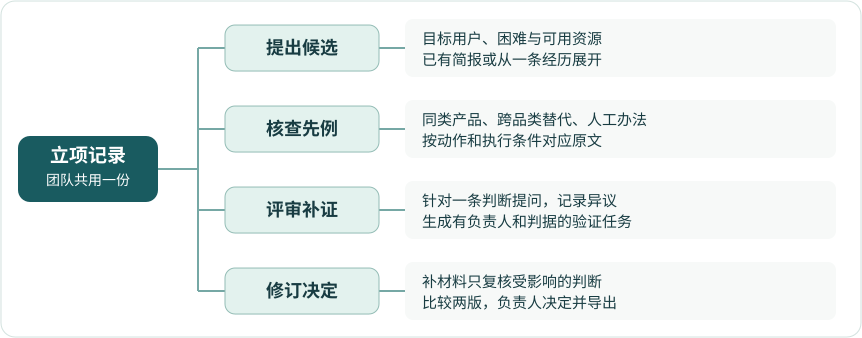
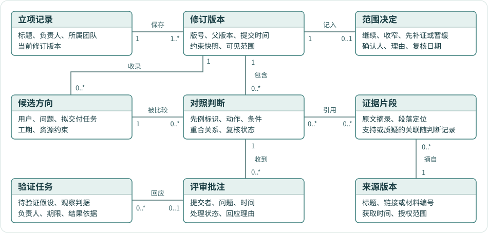

# 选题 Agent · 产品需求文档

**选题 Agent 帮学生团队和产品负责人查清已有方案究竟做过什么，再用证据决定自己的项目做到哪一步。**

老师看到两组都做“菜谱”，提醒团队留意重复。学生需要回答的是，去年的软件会推荐一顿饭，今年的方案要让人找回上次改过的做法，这两个任务到底重合多少？选题 Agent 把本组方案和先例的原文并排放好，标出相同的动作、不同的条件和缺少的证据。老师可以指着其中一行追问，团队补上材料后再决定继续、收窄还是换题。

**一次使用从写下候选开始，经查先例、逐项核对、评审补证，最后由负责人保存范围决定。** 下次打开的是同一份立项记录，能找回上次的依据和分歧。商业立项沿用这条主线，评审对象换成客户问题、现有产品和试点预算。

| 文档信息 | 内容 |
| --- | --- |
| 团队与版本 | 你所热爱的就是软件工程 · v0.1 · 2026-11-03 · 需求评审稿 |
| 项目标志 | 两张卡片代表待比较的材料，前页的标记落在被核对的那一行。本图为首版设计 |
| 时间基准 | 课程项目共八周。前两周用于选题，当时距结课还有六周。11 月 3 日起按剩余五周排期 |
| 编写依据 | [课程作业要求](../../task-requirement.md) · [本组选题调研](research.md) · [18 个竞品与替代方案评估](assets/competitor-research.md) · [GB/T 9385—2008《计算机软件需求规格说明规范》](https://openstd.samr.gov.cn/bzgk/std/newGbInfo?hcno=2790825C43AD0B69E3C38C140BFFCFE6) |

**迭代记录**

| 版本 | 日期 | 范围决定与依据 |
| --- | --- | --- |
| v0.1 | 2026-11-03 | 以课程选题、评审和改题为首条可上线流程，用一组商业售后材料检验同一流程的迁移。按剩余五周安排调研、实现、对照与发布 |

## 一、谁来用，依据是什么

| 用户与进入时刻 | 手上有什么、要做什么决定 | 本版如何服务 |
| --- | --- | --- |
| **学生团队负责人及参与选题的成员**。第一次立题、被指出相似，或收到需要缩范围的评语 | 一条亲历的困难，或一份简报、几份先例和剩余工期。团队要决定接下来做什么，以及结课能演示哪项任务 | 从困难展开两三个有依据的方向，或直接比较已有候选。把对照、评语、验证行动和最后取舍留在同一份记录 |
| **实际审过项目的教师或助教**。第一次评审或复查修改时 | 一组提交材料、课程标准和有限的评阅时间。老师要判断哪一处值得追问 | 进入团队提交的版本，从一条判断打开依据、留下问题，下轮查看团队怎样回应。范围由团队确认 |
| **小型产品团队或工作室的 PM、项目负责人**。收到客户简报，要决定是否投一个迭代 | 客户原话、现有产品说明、接入条件和工期。使用者整理材料，预算负责人决定试点 | 首期用同一工作台比较一条售后业务流程。是否愿意在下次真实立项继续使用，单独验证 |

**课程需求已有具体出处。** 本组旧稿围绕个人菜谱的收集、调整和再次使用。同期“海底小纵队”围绕营养目标计算和家常配餐，2024 年“银河护胃队”把健康食谱与附近可获得的餐食联系起来。三份选题说明支持“题材相近、部分任务重合”的判断，也提供了可追到原文的比较样例。[本组原方案](../recipe/prd.md) · [同期选题报告](https://www.cnblogs.com/myuani/p/23426509) · [往届选题报告](https://www.cnblogs.com/starryship/p/18496633)

**商业需求已有公开参照。** Service Express 的产品负责人公开描述了怎样用客户材料和竞品信息评估机会、解释投资取舍。已有企业平台能够承接这份工作。本项目要验证的是，资料量较小、频繁接新项目的团队是否也会为复核与交接投入时间。[Service Express 具名案例](https://www.productboard.com/customers/service-express/)

首轮按行为招募 3 位实际参与过选题或改题的学生负责人、2 位评过项目的教师或助教，以及 3 位近期作过立项取舍的商业负责人。请参与者带一份获准使用的材料，复原上一次选择，包括否决过的方向、改变决定的证据和花在核查上的时间。八人是招募目标。本版的证据是课程事件、公开资料和人工比较，访谈记录、试用结果与付费意愿待采集。

## 二、现有工具做到哪里，用户卡在哪里

| 用户遇到的困难 | 已有办法与问题原因 | 本产品的改进如何被看见 |
| --- | --- | --- |
| **搜到同类，仍答不上“哪一步重复”。** 相似标题可能对应两种交付，名称不同的工具也可能已完成同一任务 | 知网支持按配置筛查当年和历年课题。标题适合快速召回，本组案例还需要比较用户、动作、执行条件和结果 | 一行写清“谁在什么条件下做了什么”，两边各有原文。学生可以指出“推荐餐食”相近，而“保存个人修改并在下次复用”仍需另找先例。[教师操作手册中的题目排重](https://jwc.hntou.edu.cn/sjjx/bylw/202312/P020231226620205001228.pdf) |
| **已有带引用的报告，接手的人还要重新核对。** 来源可能只支持其中半句话 | 通用调研 Agent 能用上传文件和公开搜索生成报告，n8n 模板也能查竞品并写入资料库。待测的成本是找到支撑某个具体动作的原句，以及发现它遗漏的条件 | 点一条判断就能看到支持片段、反例和待查项。评审者可把“能退款”改判为“文档只证实受理申请”，并留下理由。[Gemini Deep Research](https://support.google.com/gemini/answer/15719111?hl=en) · [n8n 竞品调研模板](https://n8n.io/workflows/2354-automate-competitor-research-with-exaai-notion-and-ai-agents) |
| **上一轮有评语，下一轮还要重讲背景。** 具体问题、补交材料和新决定分散在不同地方 | Devpost 能组织评审，飞书表格可记录状态，Productboard Spark 已能结合企业信息评估机会。对少量散材料起步的团队，额外建表、维护关联和交接的成本需要实测 | 评语落到具体判断上，团队给它配一项可完成的验证。新证据进来后，评审者直接查看上次争议、这次改动与负责人的取舍。[Devpost 评审设置](https://help.devpost.team/article/230-how-to-set-up-judging) · [竞品逐项评估](assets/competitor-research.md) |

本版要交付的三个亮点可以当场检查。**重合能逐项对质，依据能点回原文，补证后的决定能与上一版比较。** 它们是否比“通用 Agent 加一张认真维护的表格”更省事，由第七节的同题对照回答。

## 三、用一次换题评审串起软件

下面是一条设计验收用例。公开选题材料来自第一节，人物操作和后续补证属于演示情境。

| 阶段 | 用户怎么操作 | 页面上应该发生什么 |
| --- | --- | --- |
| 建立立项记录 | 学生写下“帮做饭新手找回上次改过的菜谱”，填写用户、要交付的任务、可用资料和剩余五周 | 得到可编辑的简报。只有困难、还没题目的团队，可以先看两三个候选，选中一个再查 |
| 查最该看的先例 | 加入两届课程报告，启动调研。也可以直接导入同学已经整理好的资料 | 工作台列出最相关的先例及入选理由，包含解决同一问题的普通工具或人工做法。每条来源能展开到段落 |
| 比较实际任务 | 学生选中“个人版本复用”，同时检查“饮食推荐”“营养计算”等相近动作 | 对照行分别显示共同点、成立条件和待证项。看到“生成食谱”的材料，还得另找依据才能判断是否支持版本复用 |
| 提交并收到质询 | 学生确认要共享的片段，提交第一版。教师在某一行问“下次做菜时，用户能否找到自己上次的改动？” | 教师看到该行和支撑它的材料。团队将问题转成验证任务，约定找谁、观察什么行为、何时复核 |
| 补证并作决定 | 成员补入获准使用的观察记录，重新核对受影响的判断。负责人选择收窄、继续、先补证或暂缓，写明理由 | 第一版保留原判断，第二版显示新增依据、处理过的评语和最后取舍。另一位同学可以据此接手或导出给评审 |

**商业迁移只换材料和评价标准。** 小型电商软件团队拿到“做退款 Agent”的客户简报，可以用同一张对照表区分“受理退货申请”和“经授权实际退款”。Shopify 有商家审核退货的流程，Gorgias 的订单动作则描述了未履约订单取消后的全额退款。项目负责人由此可以比较配置现成工具与处理例外工单两种方向，把“客服在哪一步仍需人工找材料”列为下一次访谈要验证的假设。演示的交付物仍是立项记录。[Shopify 退货申请管理](https://help.shopify.com/en/manual/fulfillment/managing-orders/returns/self-serve-returns/management) · [Gorgias 订单动作说明](https://docs.gorgias.com/en-US/ai-agent-actions-make-changes-to-shopify-orders-757792)

## 四、五周首期的范围与界面

首期采用**电脑浏览器优先的 Web 工作台**，适合并排读两份材料，也方便老师从链接进入检查。提供“从困难找候选”和“带已有候选直接比较”两个入口，复用同一套材料、判断和版本。上线提供一套课程样例、一套商业样例和独立的测试空间。用户能粘贴简报、原文摘录或受支持的公开链接，在有来源记录的限定资料库中检索。

| 页面 | 主要动作 | 用户带走的结果 |
| --- | --- | --- |
| 工作台与简报 | 新建记录、使用样例、继续上次工作。补充用户、目标、期限、可取得的材料，选定候选 | 有负责人和边界的立项简报 |
| 先例对照 | 查看先例为何入选，按动作比较，点开原文，补充材料或修正判断 | 每条判断都有依据或具体缺项的比较表 |
| 提交与评审 | 团队预览共享范围并提交。教师从获授权的提交列表进入，可按同一课程条目并排查看两组关键任务，对所评版本的一行提问 | 可复核的提交版本，每组收到与自己判断相关的评语 |
| 修订与决定 | 回填验证结果、复核关联行、查看两版差异，保存决定并导出 Markdown | 含出处、取舍、责任人及下次复核日期的立项记录 |

后续行业调研可以沿用“业务动作、执行权限、证据日期、人工接管”这些字段，按版本观察某个领域的 Agent 化进度。五周内用商业样例验证这套字段能否迁移。跨企业系统直连和持续行业监测的投入，待第二个行业出现真实复用需求后评估。

## 五、功能、领域知识与系统分工

### 5.1 功能需求

| 编号 | 触发、处理与可见结果 | 验收 |
| --- | --- | --- |
| F01 建立候选 | 创建人填写困难或已有简报，确认目标用户、关键任务与工期。从困难起步时，Agent 提出不同解法，解释各自依据，允许保留现成工具或人工优化选项。成员选择、改写或自行新增候选 | A01 |
| F02 登记资料 | 保存标题、公开链接或授权材料编号、取得时间、来源版本及段落定位。相同来源和内容提示复用。读取失败可补原文摘录并标记“人工录入”。提交前可逐项确认共享范围 | A02、A07 |
| F03 寻找先例 | Agent 先按产品名检索，再按用户任务和交付物寻找异名替代。软件保留查询和入选理由，允许人工添加、排除并写明原因。候选或材料稀少时保留实际结果和检索范围 | A01、A03 |
| F04 核对判断 | 对一个候选和一个先例逐行动作比较，显示触发条件、执行者、输入、结果及支持或质疑的片段。依据缺失或冲突时指出待证事项。用户可修正关系并保存理由 | A03、A04 |
| F05 提交与补证 | 提交前列出将共享的判断与片段。仅由私有材料支撑的判断，须取得共享授权或从该次提交移除。提交生成有版号的快照。受邀评审按同一口径查看提交并对具体判断提问。团队把问题转为验证任务，填写假设、观察方法、判据、负责人和期限，再回填结果依据 | A05、A07 |
| F06 保存决定与交接 | 从已提交版派生修订稿，新材料关联到受影响的判断，由团队复核。负责人确认本版决定、理由和复核日期。导出包含版号、候选、已授权原文定位、已回应或仍开放的质询 | A05、A06、A08 |

### 5.2 领域 Agent 作哪些判断

专业化放在三个地方。**查什么**由用户任务决定，**怎样比**由同一动作的条件和产物决定，**何时停下来补证**由当前材料能支持的结论决定。各环节共用候选编号、来源版本、片段定位和判断状态。已有报告可从对照环节接入，资料检索也可改用另一份授权清单。

| 领域知识及来源 | Agent 如何使用 | 软件或人把住的条件 |
| --- | --- | --- |
| 真实需求、课程代表任务和团队约束。课程采用作业条目，商业试点由负责人给出时间、客户影响与可取得的数据 | 从经历中区分用户困难和解法，提出可比较的方向，找出影响选题的缺项。借用机会解决方案树组织候选 | 团队确认用户、约束与候选。商业影响缺少数据时，记录假设与验证动作。[作业要求](../../task-requirement.md) · [机会解决方案树](https://www.producttalk.org/opportunity-solution-trees/) |
| 同题材、实质重合和范围包含。借用逐特征映射先例的方法，将特征换成业务动作、权限和结果 | 建议“核心任务重合、局部重合、仅题材相近、待证”，说明依据。如果声称甲覆盖乙，逐项检查乙的代表任务能否在相同条件下由甲完成 | 程序校验引用存在且落在当前资料范围内。评审人核对引文是否支持语义判断，缺一项就在该行保留待证。[特征与先例映射方法](https://eureka.patsnap.com/novelty-search) |
| 证据的用途与强度。产品文档支持“公开描述了某项能力”，观察或试用可支持“在给定条件下完成”，用户是否愿意采用还需行为材料 | 并列支持项与反例。发现关键条件缺失时补查一次，仍缺证就提出一个能改变判断的问题 | 程序负责版本、定位与工具限额。判断被纠正后记录修改人和理由，决定由人确认 |
| 评审与验证。把关键未知写成假设、方法、指标和预设判据 | 针对评语生成可执行的验证任务草稿，补入材料后标出需要复核的行 | 团队指派负责人、确认判据并回填真实观察。评审者在下一版查看回应。[Strategyzer Test Card](https://strategyzr.s3.amazonaws.com/assets/vpd/resources/the-test-card.pdf) |

### 5.3 前后端、接口与数据

| 部分 | 职责和接口约定 |
| --- | --- |
| Web 前端 | 提交简报，展示执行进度、可点击的引文和比较表，接收批注、提交、修订和导出操作。页面分别标出 Agent 建议、人工修正和负责人决定 |
| 应用后端 | 按团队和版本处理读写，保存原文片段、授权、运行记录、批注及决定。向前端返回具体判断和可打开的定位。提交时固定快照，修订时校验父版号，同时提交的旧草稿提示重新确认 |
| Agent 与工具 | 后端经 API 或 SDK 调用模型。Agent 在当前授权材料内选择检索词、提出候选和结构化比较。工具提供检索先例、读取来源片段、查询评审口径。每次建议携带已有的片段标识，有缺口就返回待证。更换检索模块仍交回同样的来源及定位 |
| 运行与失败处理 | 模型密钥保存在服务端。记录模型、规则版本、耗时、调用量和可取得的费用。每次调研最多执行首查与一次补查，超时、额度用完或外部来源失效时保留输入和已核实材料，允许人工补录或重试。重复请求沿用同一运行标识 |
| 访问与交付 | 团队编辑自己的草稿。受邀评审可查看提交版获准共享的片段、添加批注。公开演示从个人样例副本启动。服务器对查看、定位、模型取材和导出采用同一套可见范围 |

一份**立项记录**贯穿整个过程。修订版本保存当时的候选和约束，对照判断指向候选与具体先例，同一条证据可以支持或质疑多条判断。提交后固定该版正文，批注追加在相应判断上。回填验证、修正判断和确认决定均在新的工作稿完成后保存，历史提交版可按原版号查看。服务端只将当前访问者获准查看的摘录交给页面或导出文件。

### 5.4 非功能要求

| 要求 | 检查方法 |
| --- | --- |
| 易核查 | 点选判断可直接展开对应的原文段落和版本。待证、已修正、已提交均有文字状态。由第一次使用的评审者按 A03、A05 独立完成核查 |
| 有限等待与可恢复 | 启动调研后先显示运行编号和进度。演示环境单次调研时限为 120 秒，到限转入可补录或重试的状态。刷新、重试和并发保存按 A08 检查 |
| 访问隔离与可追溯 | 校验资料读取、评审视图和导出的身份与版号，服务端日志能把一条建议追到当次模型、规则和来源版本。以两个演示身份按 A06、A07 检查 |

## 六、老师怎样检查成品

**结课交付按下列场景逐项验收。** 测试包提供线上地址、两种演示身份、可用的模型接入、两份来源材料包、执行说明和发布版本号。检查人可以从头建一份记录，也可以用已提交的样例直接检查复评。表中为待实现的通过条件。

| 场景 | 检查人的操作 | 通过条件 |
| --- | --- | --- |
| A01 从困难或已有题目开始 | 用课程样例分别走两个入口，调整期限，选定一个候选并查先例 | 发散入口给出至少两个有差别的可选办法。已有候选可直接比较。样例中的两份先例可定位，每个入选理由能展开 |
| A02 人工材料与来源失败 | 登记一个失效链接，补入有标题和段落号的授权摘录，再次导入相同材料 | 首次保留读取失败状态，补录后可用于判断并显示录入方式，重复导入可复用原来源版本 |
| A03 关系判定与模块替换 | 分别提交“同一题材但动作不同”和“不同产品名但动作相同”的题包。将一份先例从课程资料库切换为有定位的授权导入件 | 前者指出差异，后者找回实质替代。两种来源都能在同一比较表中打开原文。提出包含关系时能逐项出示条件和结果 |
| A04 缺证与人工纠错 | 在售后样例中只给“受理退货申请”的片段，询问是否能完成退款，再加入一份带执行条件的材料 | 第一轮标明缺少执行证据。第二轮定位新增条件，允许人工改判并保存理由。旁边保留来源版本 |
| A05 两轮评审 | 教师在第一版一条判断上提问，团队建立验证任务，补一份材料、改一条判断并提交第二版 | 能沿批注找到验证行动、结果和新判断。版本比较显示发生变化的行，第一版仍可打开 |
| A06 决定与交接 | 负责人选择与 Agent 建议不同的取舍，保存理由并导出。另一人打开文件找回依据 | 记录与导出采用人的决定，列明版号、理由、开放问题和可核查的来源定位。接手者能复述为什么改范围 |
| A07 权限与隔离 | 让一名评审获准查看两份提交并按同一条目比较，在其中一份留言。再尝试打开团队私有片段和另一组草稿。用两个身份分别查看或导出 | 评语只进入所评版本。服务端拒绝越权读取，页面及导出只含获准材料。不同演示副本相互隔离 |
| A08 中断与并发 | 让一次模型调用超时后重试，刷新页面。两人先后提交基于同一父版的修改 | 已保存输入、批注和提交版本可恢复。失败可见且可重试，同一次提交只保存一份。持有旧草稿的成员得到版本提示，载入新版复核后再保存 |

A01—A08 全部通过、线上可独立复核、完成第七节对照并提供原始记录，作为本版交付条件。虚构来源或引文、越权披露材料、把模型建议写成已确认决定，任一项出现在验收中均须修正并复测。教师最终按课程公布的标准评定作品。

## 七、怎样证明定制和独立软件各自值得做

**先检验判断质量。** 冻结 16 个题包，课程与商业各 8 个。其中 12 包有应当找回的关键先例，4 包故意缺少决定性材料。覆盖同名异题、跨品类替代、方向性包含、普通软件已足够、资料过期和来源冲突。演示题用于开发，留出题在评价规则冻结后使用。两名评审先独立标记关键先例、原文位置、可接受关系与追问，再记录分歧和裁定依据。

| 对照 | 固定条件与做法 | 记录什么 |
| --- | --- | --- |
| 人工评审表 | 从留出题中选 6 包，人可检索同一批材料、写表和批注 | 命中哪些先例、手工复核时间、改判原因 |
| 通用 Agent 与选题模块 | 两方使用同一模型、题包、搜索权限、评审标准、输出模板、预算和时间。前者自行安排调研，后者按第五节调用判断模块。随机展示匿名输出 | 12 包的前三项命中数、关系混淆、错引、4 个缺证案例的处理、人工修正和调用费用 |
| 完整软件与既有工作方式 | 把**相同的模块产物**交给新评审者，分别在本 Web 工作台和表格或通用客户端里查原文、纠正一行、交接第二版。采用配对案例，交叉安排先后顺序 | 从打开提交材料，到找到依据并保存可交接修订的用时、完成率和遗漏数 |

**效果目标与交付门槛分别记录。** 前三项命中目标为至少 10/12 包。抽核 40 条决定性断言，目标至少 36 条能由所引片段支持。4 个缺证题包均应提出具体缺项和补证动作。在相同模块产物的交接对照中，试定目标为复核用时中位数降低 20%，同时关键误判不增加。报告写出两组原始计数、逐例时间、失败样例和成本。商业需求与复用意愿以参与者下一次真实立项为依据。

## 八、剩余五周的发布安排

| 自 11 月 3 日调整起 | 团队要完成的事 | 当周检查物 |
| --- | --- | --- |
| 剩余第 1 周 | 产品与测试成员访谈目标用户，用表格实际评一次题。整理授权来源、调试样例和留出题，冻结判断口径 | 匿名观察、人工基线、来源清单、评审分歧及范围修订 |
| 剩余第 2 周 | 接通前台、资料库与模型 API 或 SDK，实现 F01—F04 的最短路径 | 一份能从候选点回原文的比较结果和可复查运行记录 |
| 剩余第 3 周 | 完成 F05—F06，跑通两轮课程评审和商业退货样例，换一份资料来源验证模块交接 | 一对可比较的提交版、人工意见、验证记录及导出件 |
| 剩余第 4 周 | 按冻结条件运行留出评测，做交接试用和权限、失败场景检查 | 匿名原始结果、问题清单、实际用时与费用 |
| 剩余第 5 周 | 修复关键错误，复测 A01—A08，上线演示版本并完成独立检查 | 访问地址、公开样例、测试身份、操作路径、复测结果及答辩用例 |

发布时把需求版本、领域规则版本、测试包和结课演示对应起来。老师从访问地址打开样例，先核对一行“究竟重合在哪里”，再留下一条意见，最后打开第二版查看团队如何作了决定。
