# 2026秋软工实践 你所热爱的就是软件工程——项目原型设计+概要设计

| 项目 | 内容 |
| --- | --- |
| 作业所属课程 | [2026 秋福州大学软件工程](https://edu.cnblogs.com/campus/fzu/202601SofwareEngineering) |
| 作业要求 | [第二次团队作业（原型设计+概要设计）](https://edu.cnblogs.com/campus/fzu/202601SofwareEngineering/homework/16773) |
| 作业的目标 | 提炼并迭代需求，做成可体验的原型，明确智能体、业务模块和数据的分工，为后续开发定下接口与验收场景 |
| 团队名称 | 你所热爱的就是软件工程 |
| 团队成员学号-名字 | 052403137-王智壹、052402132-郑嘉文、182400320-林叶鑫、072408137-张洋、102402118-陈飞扬、022403140-周恪玄、102401507-李宗欣、072408101-陈柏睿、102401504-马晨曦、102401505-林金晶、072308130-陈柯男 |

## 从菜谱助手到叠石

10 月 25 日提交的 [prd v0.3](https://github.com/155TuT/2601-fzu-SoftwareEngineering-YuezhongWu/blob/main/homework/team/task5/ans/recipe/prd.md) 这份作业，我们想给刚开始独立做饭的人做一个更懂自己的菜谱助手。用户可以把截图里的做法收进手机，按人数和口味改成自己的版本，做完记一句，下次接着用。那时我们已经把原始材料、个人版本和餐后反馈写进方案，流程的重点是怎么把菜谱整理成适合自己的做法。

但答辩时老师问：用户为什么要用你们的软件，为什么不直接问大模型？

课上回复时，我们先想的是领域 Agent 的专业性从哪里来：底层模型和运行时可以复用，团队的工作是把领域规则、工具和流程做成能解决具体问题的软件，再用实际任务看效果。

但回过头看自己的方案，其实还有一个核心问题需要回答：我们花了这么多力气收集和整理材料，用户下次除了找回这道菜，还能用上什么？

反思时，我们重新尝试把问题放回一顿晚饭。用户说“洗锅太麻烦”，先记下的是那次经历。把几次加班后留下的相似反馈放在一起，才有依据推测用户在这种时候更看重少收拾。周末愿意慢慢做饭也是有用的证据，它帮我们看清这条偏好在什么情况下成立。我们想留下的是这样一条能找到原话、说清适用条件、可以随本人纠正而更新的认识。它随用户积累，将来接入同一资料库的其他 Agent 也可以按授权复用。

于是，[调研](https://github.com/155TuT/2601-fzu-SoftwareEngineering-YuezhongWu/blob/main/homework/team/task5/ans/research.md)从比较菜谱导入、调整和推荐，转向研究**经历怎样成为证据、偏好怎样随反馈更新**，以及手机断网或退出后怎样接着处理。prd 也从 v1.0 开始围绕记忆循环组织需求，随后把经历、习惯和条件偏好抽成可供不同场景复用的结构。我们仍用饮食做首轮验证，因为一顿饭的条件、选择和实际体验都容易讲清楚，也有机会在下一次选餐时检验这些认识有没有用。

到当前的 [prd v1.3](https://github.com/155TuT/2601-fzu-SoftwareEngineering-YuezhongWu/blob/main/homework/team/task5/ans/prd.md)，我们把这套想法放进了原型。首页承接对话和随手记录，记录库用时间线和标签帮人找回经历，设置里能查看和纠正记忆。标签负责找回相关材料，偏好则要沿着证据判断是否适用于当下。用户从建议旁的“依据”可以回到原记录，也能决定纠正只影响这一次，还是以后都按新条件处理。

**叠石**（PebblePile）是一个面向手机的本地优先个人记忆工具。平时留下的对话和记录，经智能体（Agent）和本地算法整理后，可以用来找回经历，也可以在下一次遇到类似情况时作为建议的依据。而做饭将只成为这个生活领域Agent的一个验证场景：如本次我们采取了加班晚餐这一场景，演示了从记录、获得建议到补记结果和纠正偏好的过程。

## 原型设计

### 原型展示

- [Paper 在线原型](https://app.paper.design/file/01M41JA45T3KFWNYX3GFW8SB5Q/p-5-0)有 20 个移动端状态画板和一张主流程图，已用未登录浏览器核验画板可见。
- 想实际点一遍，可以[下载仓库 ZIP](https://github.com/155TuT/PebblePile/archive/refs/heads/main.zip)，解压后打开 `assets/prototype/index.html`。点击导览使用虚构数据模拟输入、整理、反馈和纠正。

首页打开就能输入。“对话”和“记录”切换时保留草稿，提交分别触发对话和保存。记录库通过时间线、记录本和标签找回同一条记录。管理操作放在设置中，原型展示了模型与连接、记忆与偏好、备份与恢复，处理状态也能从原记录查看。

[界面](https://github.com/155TuT/PebblePile/blob/main/assets/vi/system-components.png)采用浅砂底色与苔绿强调色，凸起表示普通按钮，内凹表示输入或选中状态。正文用霞鹜文楷，英文和数字用 Leftist Mono Serif，功能图标用 Iconoir Regular。

### 用加班晚餐走一遍

1. **记录和建议。** 在对话页输入“今天加班，晚饭想省事一点，预算二十元。”系统先保存原话，再整理并给出建议。等待网络、正在整理和暂停分别显示，用户可以回查原文或继续处理。
2. **补记实际结果。** 用户吃完后，在原事项里写下“最后吃了热汤面，速度够快，也很舒服。”建议、用户选择和实际体验分开保存，后续更新偏好时可查到这次体验。
3. **找回并纠正。** 在记录库组合人物、时间和标签，打开记录核对“省事”的原话和算法版本。也可以从建议旁的“依据”打开偏好详情，把“加班时晚饭优先省事”改成“只在工作日加班时优先省事”。选“仅本次”会修改当前事项，选“以后按此条件”会保存明确偏好并停用受影响的旧推断。

仓库的[原型说明与验证记录](https://github.com/155TuT/PebblePile/blob/main/docs/prototype-design.md)覆盖 20 个页面状态和 125 个动作。模型推理、持久化、系统听写和进程恢复留到应用阶段验证。

## 概要设计

### 系统分层与 Agent

应用、系统分享和快捷动作共用本地业务核心。入口负责接收材料和显示回执，核心负责权限、记录、标签和个人模型，适配层接入场景包、推理服务与存储。远程模型收到的是授权范围内的材料，写入与版本发布由本地核心统一处理。

以加班晚餐为例，Agent 用饮食场景包理解预算与情境，调用 `query_context` 取得适用偏好、证据和快照。用户补记实际体验时，`record_outcome` 把结果写回原事项。纠正认识后，`revise_memory` 返回生效范围和重算任务。

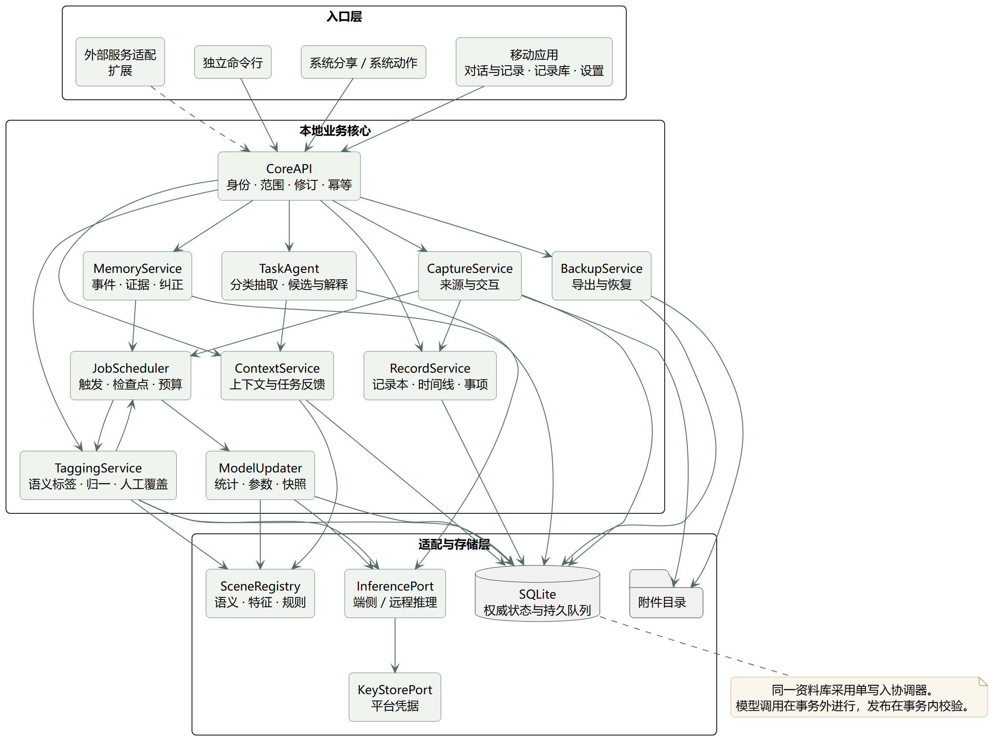

### 统一建模语言（UML）

#### 用例图 · 谁能做什么

资料库所有者可以记录、查找、管理偏好、恢复备份和配置授权。系统入口代为转交请求，外部 Agent 只能使用获授权的工具，模型服务负责推理。保存记录先返回回执，整理由后续任务接手。

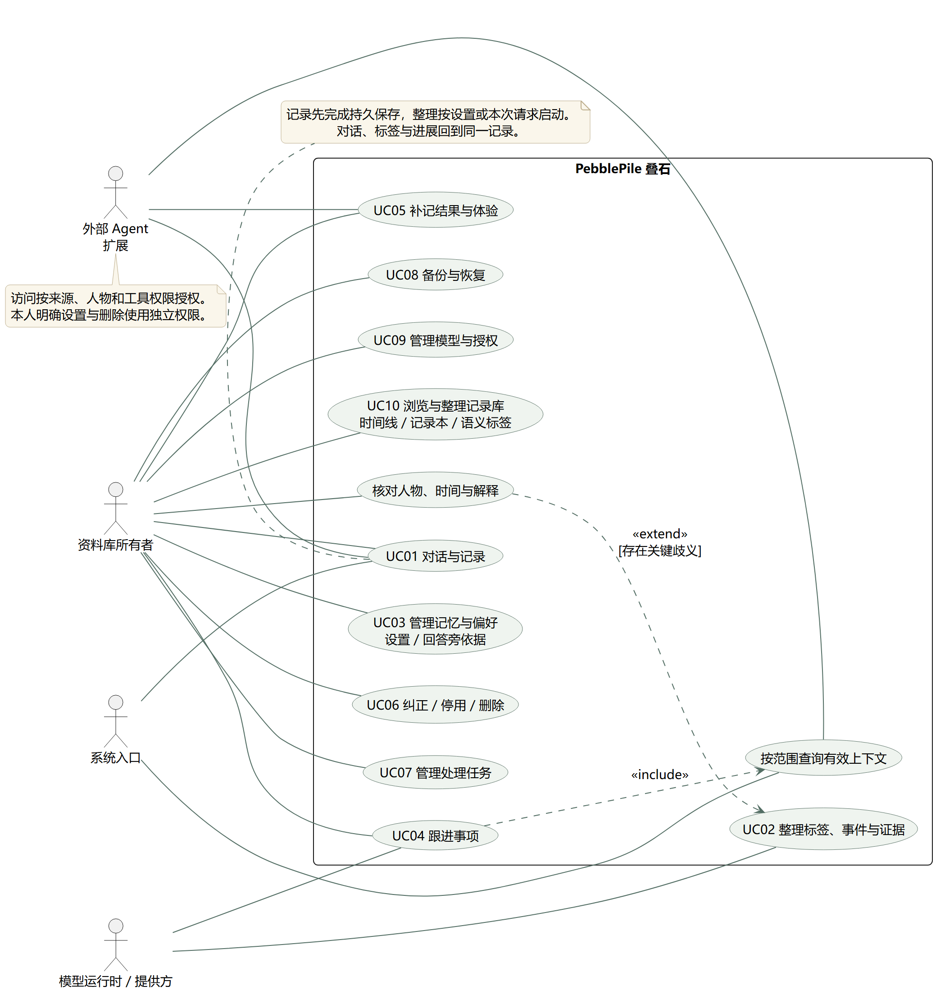

#### 活动图 · 从材料到个人模型

图分成三条泳道，分别是用户与入口、本地业务核心、任务与模型。原话先入库，任务随后抽取标签、事件和证据。证据通过校验后形成新的模型快照，供下一次建议使用。用户补记结果或纠正内容时，相关记录重新进入整理流程。

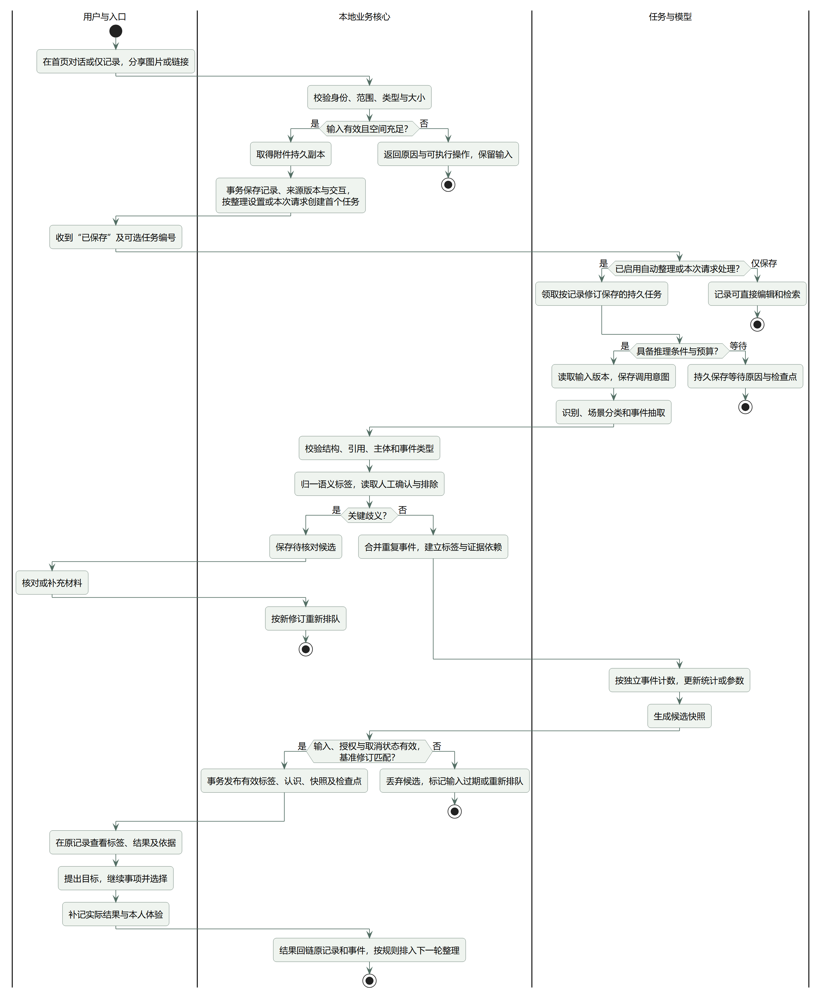

#### 类图 · 来源、事件与证据

`SourceVersion` 保存材料的某一版本，`EventVersion` 表示对一次经历的某次解释。`EventSource` 把两边连起来，一段原话可以提取出多个事件，同一经历也能关联多份材料。`Evidence` 记录人物、观察类型和原文位置。

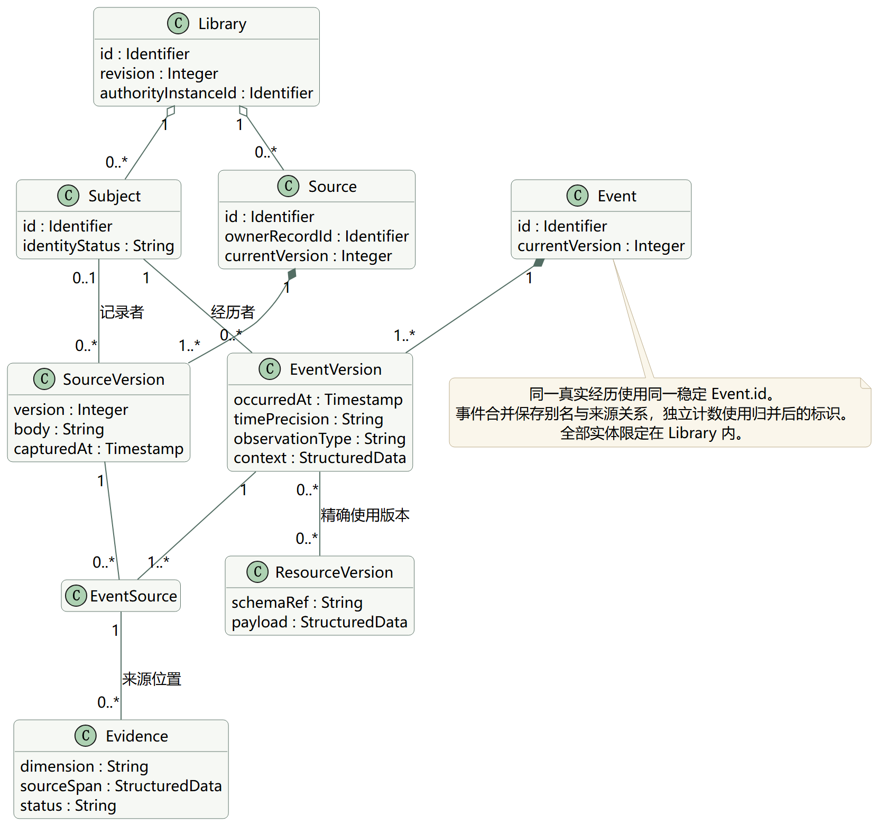

#### 类图 · 记录、会话与语义标签

`Record` 汇集正文、会话、来源和事件，可归入 `Notebook`。`TagAssignment` 把标签关联到记录或事件版本，并保留生成依据、算法版本和核对状态。用户排除某个标签时，后续自动整理沿用这个决定。

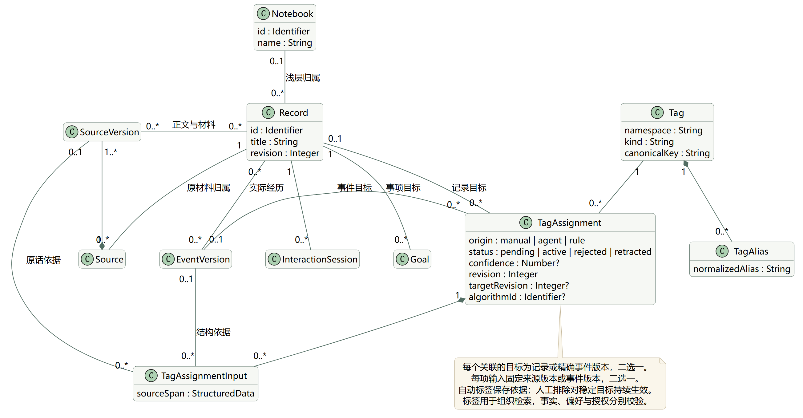

#### 类图 · 个人模型与事项

`Habit` 和 `Preference` 共用认识的版本与证据关系。`ModelSnapshot` 固定当时使用的认识和算法版本，`Decision` 保存候选及所用快照。`Outcome` 可以关联决策，也能单独记录一次实际经历。

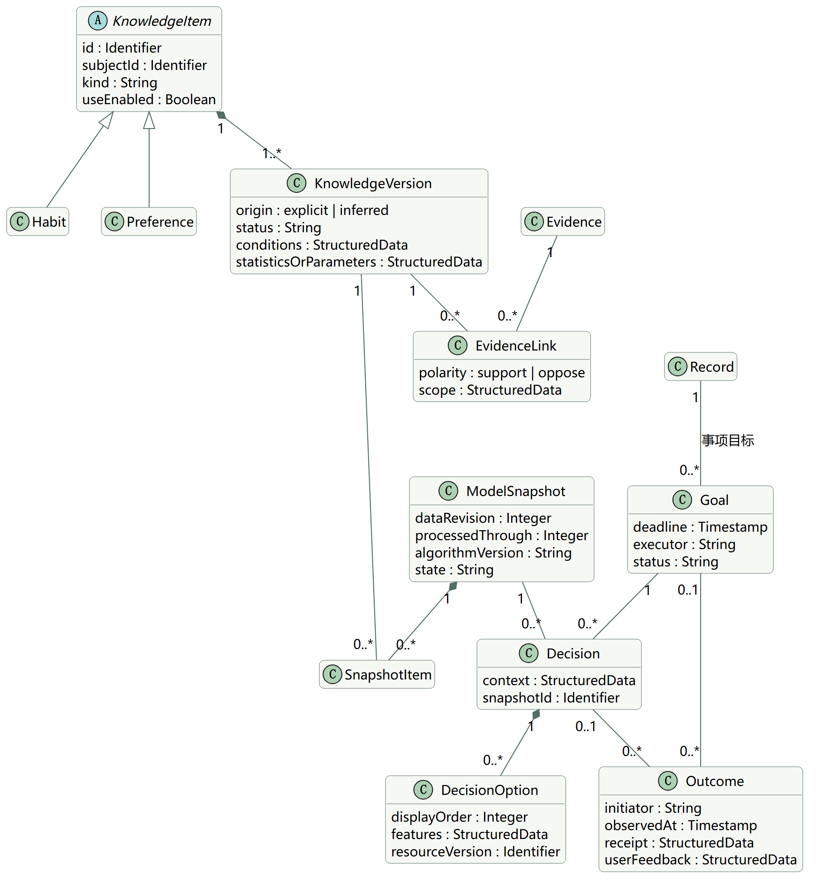

#### 时序图 · 更新与发布

任务拿到固定输入后，在写事务外调用模型。核心整理候选标签与事件，提交前再查输入版本、授权和任务状态。通过检查后才发布快照，重复提交沿用同一阶段的结果。

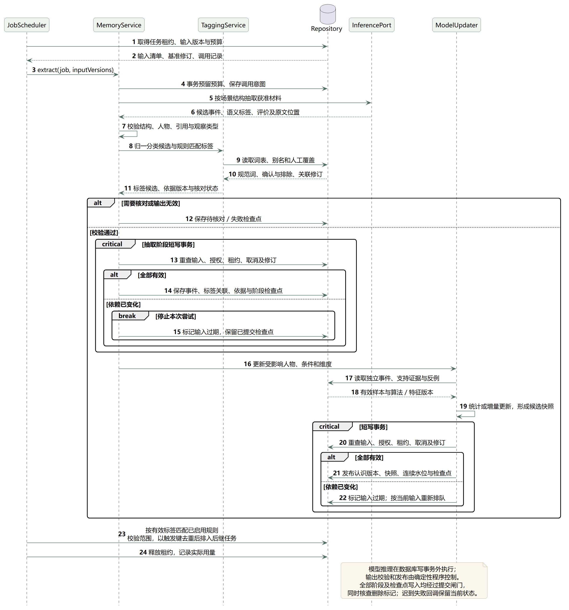

#### 时序图 · 纠正与失效

用户确认纠正后，核心检查基准修订并写入新版本。受影响的旧认识和查询缓存先退出使用，后台再用有效证据局部重算。期间完成的旧任务也要检查输入版本，避免把旧结果写回来。

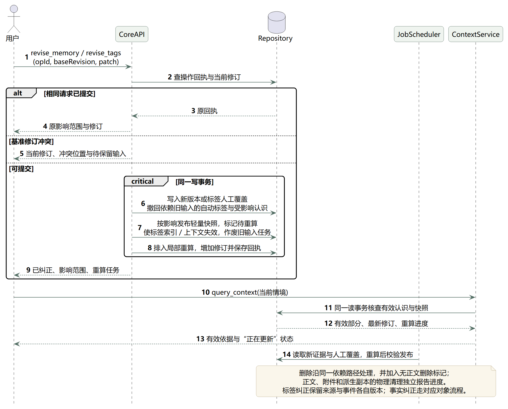

#### 协作图 · 建议如何收到反馈

编号 `1.x` 对应当次建议。Agent 向上下文服务取适用认识和证据，保存候选及依据，再回复用户。编号 `2.x` 对应之后的反馈。结果服务把实际体验关联到原事项，并安排个人模型更新。

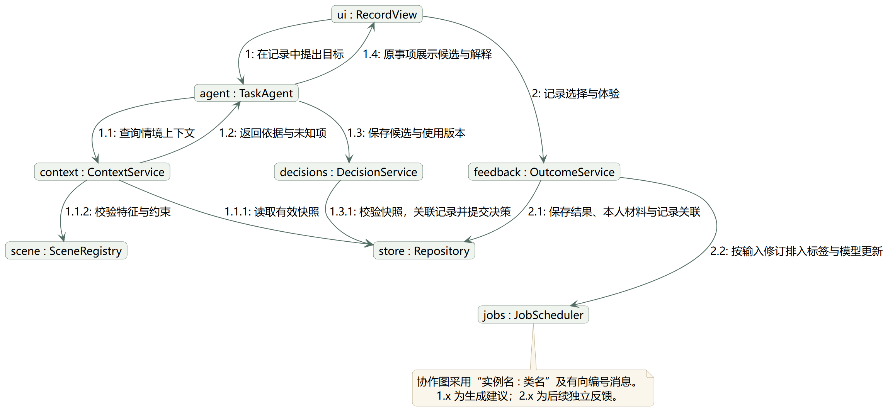

#### 状态图 · 任务如何恢复

任务领取后分阶段保存检查点。用户暂停、网络不可用或预算耗尽时，任务进入等待并保留原因。恢复时核对输入和剩余预算，再从有效检查点继续。取消或失效的任务停止发布结果。

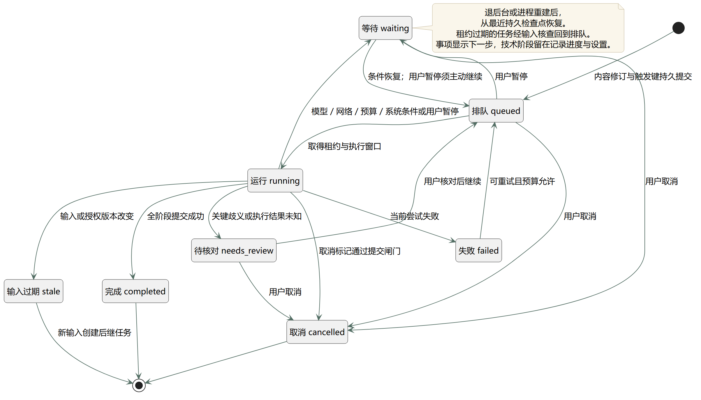

### 数据库设计

设计采用 SQLite 事务库、应用私有附件目录和可重建的全文索引。下面六张实体关系（ER）图分别展开各组表和连接关系，正文结合对象关系映射（ORM）说明数据如何入库。完整字段、主外键和索引见文末说明书。

#### 材料、事件与证据

每份来源归属一条原记录，可以保留多个版本。`event_sources` 把事件版本和来源版本连起来，一次经历可以有多份来源。`evidence` 沿这条关系定位具体段落或图片区域。正文和附件修改后，旧证据仍可定位到原版本。

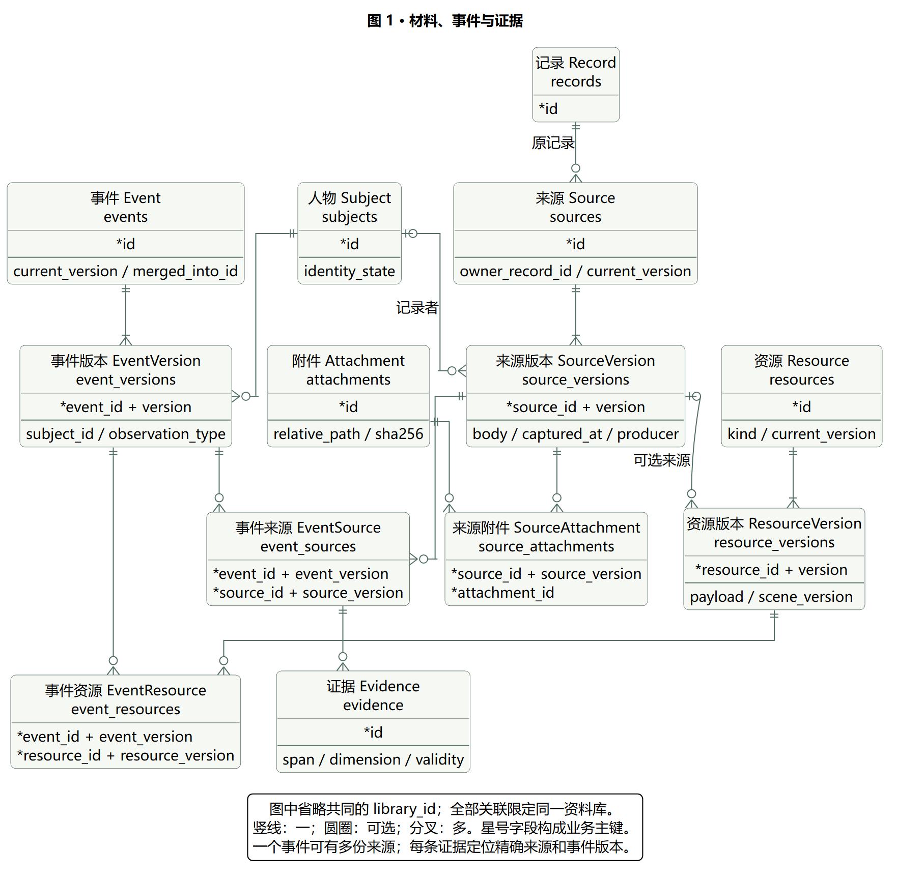

#### 认识与模型快照

习惯和偏好在领域层是两个对象，入库时共用 `knowledge_items` 和 `knowledge_versions`，按类型区分。`evidence_links` 关联认识与证据，`snapshot_evidence` 记录模型参数依赖的证据。纠正来源时，两条关系都可用于定位影响范围。

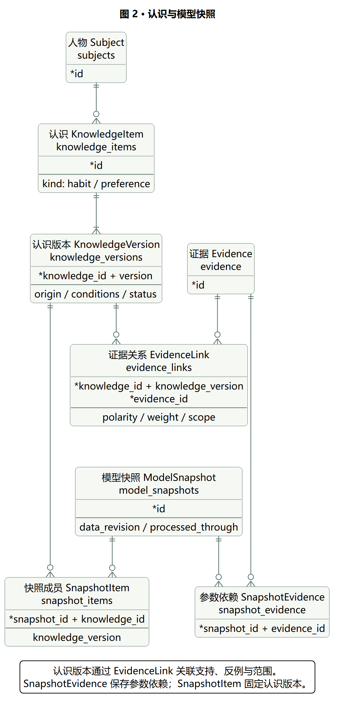

#### 目标、决策与实际结果

`goals` 保存事项目标，`decisions` 固定所用快照、当次上下文和选中项，`decision_options` 保留候选及顺序。执行回执与实际体验分开写入 `outcomes`，再由 `outcome_events` 关联到具体事件版本。

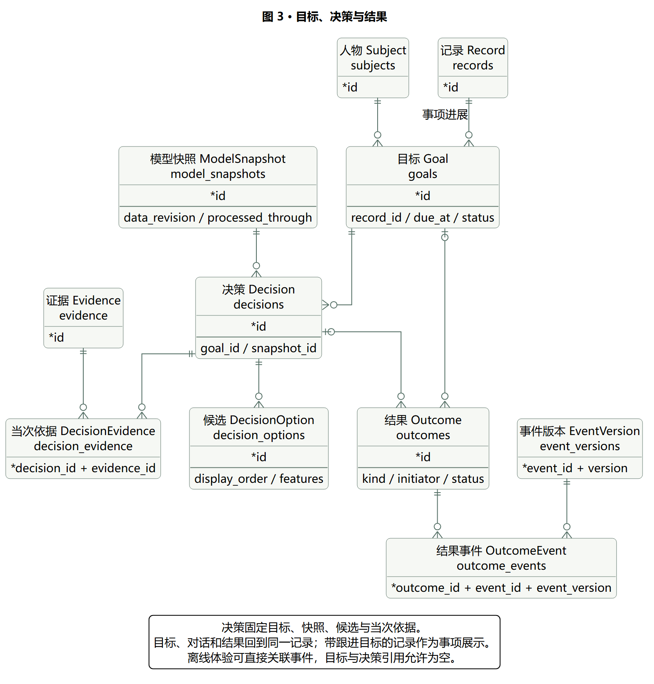

#### 处理任务与算法版本

任务关联输入版本、执行步骤和调用记录，恢复时可以核对已经完成的阶段和剩余预算。算法清单通过 `algorithm_scenes` 固定场景包版本，保留当时使用的词表、字段和规则。

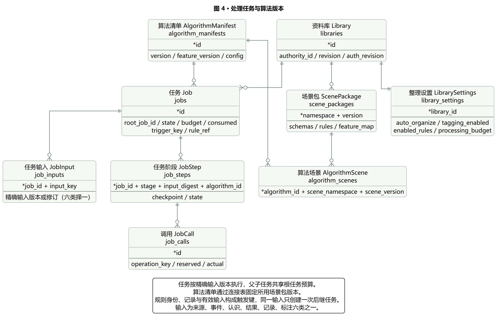

#### 用户交互与访问管理

`interaction_sessions` 将会话归到原记录，`interactions` 按顺序保存用户、助手和工具消息，正文回链 `source_versions`。访问授权绑定客户端和资料库，外部调用按授权范围读写。

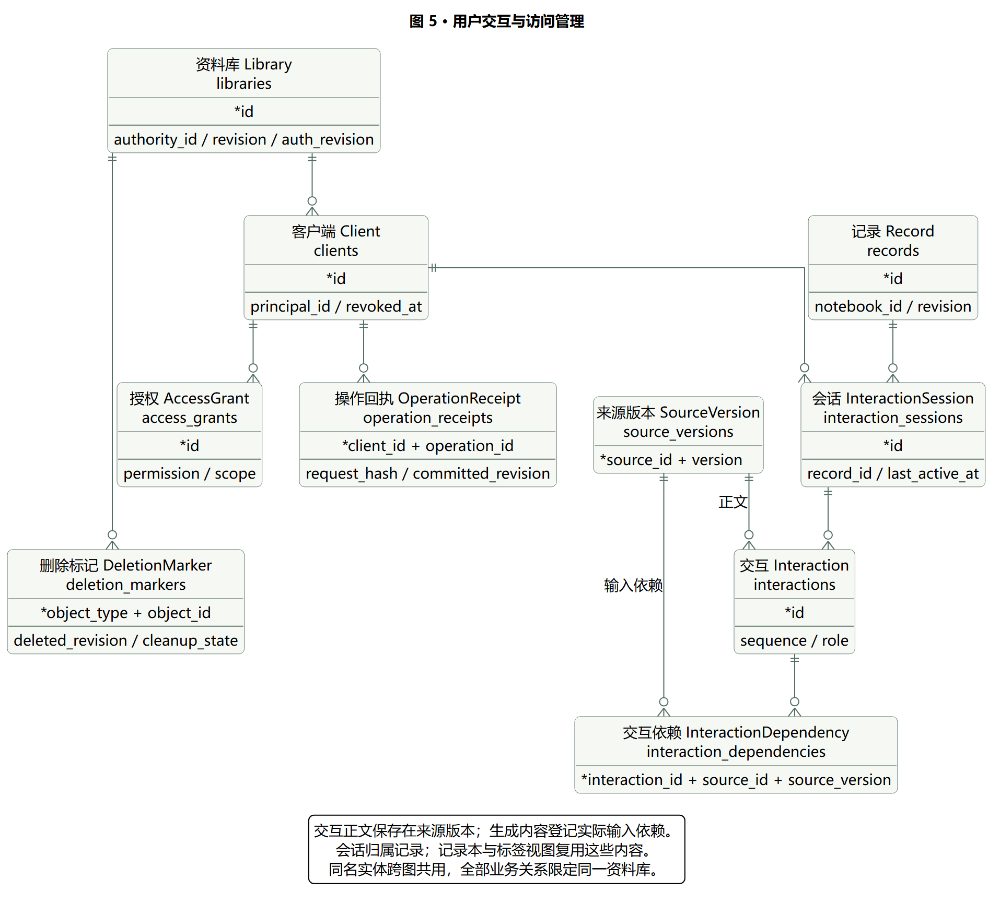

#### 记录组织与语义标签

`record_sources` 和 `record_events` 把记录关联到具体来源和事件版本。`tags` 保存规范词，`tag_assignments` 连接标签与记录或事件版本，`tag_assignment_inputs` 记录生成标签所用的材料与依据位置。人工核对和自动标注使用同一套关系。

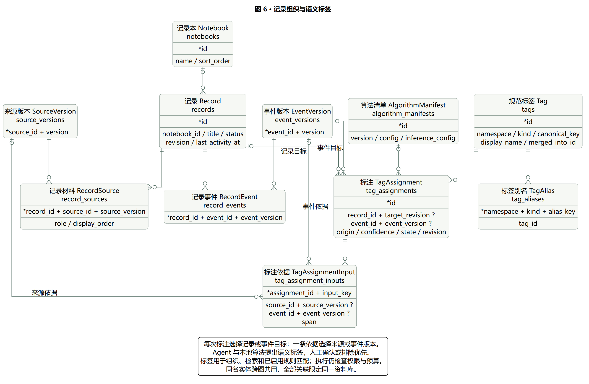

## 团队协作记录

本轮围绕首页、记录库和设置更新需求与信息架构，分别归档视觉样式、系统与数据库设计、Paper 画板和本地导览。

| 阶段 | 本轮产出与记录 |
| --- | --- |
| 需求与视觉 | [更新记录库与标签设计](https://github.com/155TuT/PebblePile/commit/73dbe59)、[归档视觉规范与组件](https://github.com/155TuT/PebblePile/commit/75bf73e) |
| 概要设计 | [提交系统与数据库说明、图源和渲染图](https://github.com/155TuT/PebblePile/commit/fde0c79) |
| 原型与交接 | [提交点击导览、Paper 导出和动作映射](https://github.com/155TuT/PebblePile/commit/06e8782)、[整理仓库入口和协作约定](https://github.com/155TuT/PebblePile/commit/6652e16) |

### 每周开发计划

| 周次 | 里程碑 | 预期产出 |
| --- | --- | --- |
| 11 月 9 日至 15 日 | 确定首期技术方案 | 启动访谈，比较端侧与远程推理，确定首测机型、模型和数据契约，记录挂起恢复验证结果 |
| 11 月 16 日至 22 日 | 做出可用资料库 | 贯通输入、持久化、时间线、标签检索和任务回执，跑通系统入口与备份 |
| 11 月 23 日至 29 日 | 接通个人模型 | 用固定案例跑通证据、条件偏好、建议、实际反馈和纠正，完成两轮试用并记录问题 |
| 11 月 30 日至 12 月 6 日 | 双平台验证与交付 | 汇总中断、权限、备份恢复和跨场景对照结果，准备测试包、安装说明和演示材料 |

### 逐人分工

按[产品需求文档的团队分工](https://github.com/155TuT/PebblePile/blob/main/docs/prd.md#72-团队分工)拆到个人，作为后续开发计划。

| 成员 | 角色 | 负责内容 |
| --- | --- | --- |
| 王智壹 | 产品 | 确定首期范围、需求优先级和验收标准，汇总课程交付 |
| 林金晶 | 产品 | 组织访谈和试用，整理反馈，维护验收案例 |
| 马晨曦 | 设计 | 完善对话、时间线和记忆纠正页面，交接组件、异常状态和无障碍标注 |
| 陈柏睿 | 前端 | 实现首页输入、记录库和记录详情，接入本地核心与保存回执 |
| 陈柯男 | 前端 | 实现设置、记忆依据与纠正页面，接入双平台系统分享和快捷入口 |
| 郑嘉文 | 后端 | 定义核心接口与事务边界，实现记录、来源和版本校验 |
| 陈飞扬 | 后端 | 实现持久任务、预算、幂等提交及中断恢复 |
| 周恪玄 | 后端 | 实现备份恢复与命令行工具，验证外部 Agent 的授权和调用 |
| 张洋 | 算法 | 实现事件抽取、标签归一和偏好更新，比较规则与增量模型 |
| 林叶鑫 | 测试 | 验证记录到反馈的主流程，覆盖断网、重试和迟到结果 |
| 李宗欣 | 测试 | 验证双平台性能、权限、备份迁移和干净环境复现 |

## 仓库与设计说明书

- [GitHub 团队仓库 · PebblePile](https://github.com/155TuT/PebblePile)
- [系统设计说明书PDF](https://github.com/155TuT/2601-fzu-SoftwareEngineering-YuezhongWu/blob/main/homework/team/task6/assets/homework/%E4%BD%A0%E6%89%80%E7%83%AD%E7%88%B1%E7%9A%84%E5%B0%B1%E6%98%AF%E8%BD%AF%E4%BB%B6%E5%B7%A5%E7%A8%8B_%E7%B3%BB%E7%BB%9F%E8%AE%BE%E8%AE%A1%E8%AF%B4%E6%98%8E%E4%B9%A6.pdf)
- [数据库设计说明书PDF](https://github.com/155TuT/2601-fzu-SoftwareEngineering-YuezhongWu/blob/main/homework/team/task6/assets/homework/%E4%BD%A0%E6%89%80%E7%83%AD%E7%88%B1%E7%9A%84%E5%B0%B1%E6%98%AF%E8%BD%AF%E4%BB%B6%E5%B7%A5%E7%A8%8B_%E6%95%B0%E6%8D%AE%E5%BA%93%E8%AE%BE%E8%AE%A1%E8%AF%B4%E6%98%8E%E4%B9%A6.pdf)
