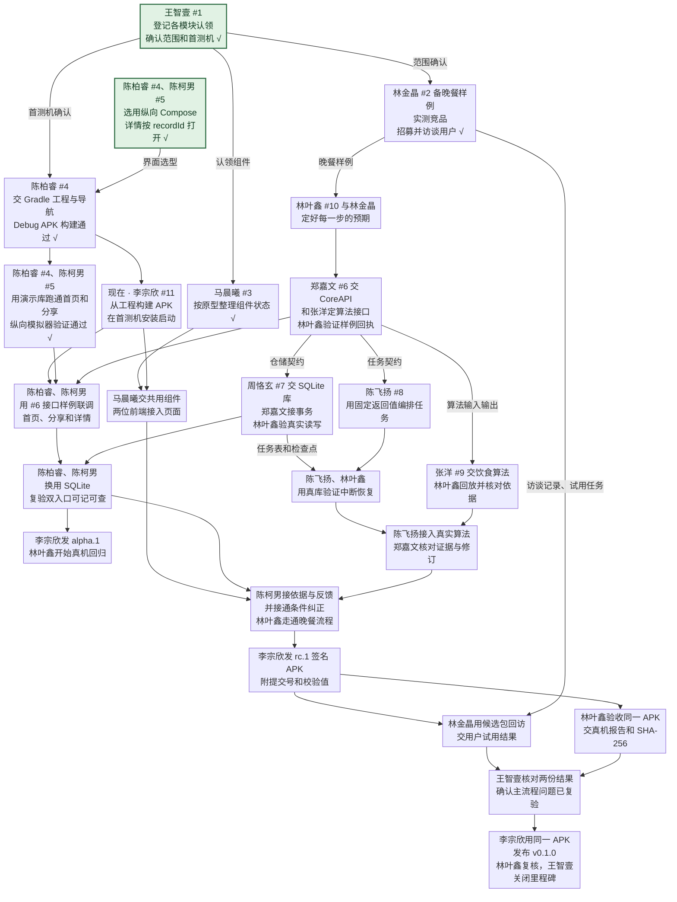

# PebblePile Android 0.1.0 冲刺计划

| 项目 | 内容 |
| --- | --- |
| 这个作业属于哪个课程 | [福州大学 2026 秋软件工程](https://edu.cnblogs.com/campus/fzu/202601SofwareEngineering) |
| 这个作业要求在哪里 | [第三次团队作业 · Alpha 冲刺](https://edu.cnblogs.com/campus/fzu/202601SofwareEngineering/homework/16792) |
| 团队名称 | 你所热爱的就是软件工程 |
| 团队成员-学号 | 王智壹-052403137、郑嘉文-052402132、林叶鑫-182400320、张洋-072408137、陈飞扬-102402118、周恪玄-022403140、李宗欣-102401507、陈柏睿-072408101、马晨曦-102401504、林金晶-102401505、陈柯男-072308130 |
| 这个作业的目标 | 在 Android 手机上跑通记录、找回、建议、反馈和纠正，从团队仓库发布可直接安装的 PebblePile `v0.1.0`。 |

## 这次要做出什么

做菜谱助手时，我们遇到过一个问题。直接问大模型就能得到一道菜谱，用户为什么还会打开我们的应用？回头看，值得留下的是吃完这顿饭的感受，以及它怎样影响下一次选择。同一个人加班后想少洗几个碗，周末却愿意慢慢做饭。叠石要记得这两种情况，还要能让本人看见依据、改正我们的理解。饮食是这次跑通产品的第一个场景。[选题反思](https://github.com/155TuT/PebblePile/blob/main/docs/recipe/reply.md) · [项目改向与需求](https://github.com/155TuT/PebblePile/blob/main/docs/prd.md)

本轮从团队仓库的 `033eb39` 开始。我们已经有系统和数据库设计、视觉规范、20 个移动端页面状态和 125 个导览动作。上次用示例数据走查了页面，这次要建起 Android 工程，让前端、存储和算法拿同一份晚餐材料联调，在真机上看一条原话怎样保存、怎样影响下一次建议。[仓库基线](https://github.com/155TuT/PebblePile/tree/033eb39b1a1462efb89df41aa00911831ae9e1f9) · [原型与验证记录](https://github.com/155TuT/PebblePile/blob/main/docs/prototype-design.md)

**`0.1.0` 只交付 Android APK。** 一位新用户装好后，可以走完下面这条流程。

1. 在首页记一条实际经历，或从 Android 分享菜单送入一段文字，确认保存。退出重开，能按时间和标签在记录库找到同一条原话。
2. 分两次记下加班晚餐，再问“今天加班，预算二十元，晚饭吃什么？”叠石从饮食场景的候选里给出建议。点开“依据”，能看到用到哪两次经历、原话在哪里。换成周末条件，再看候选如何变化。
3. 把“最后吃了热汤面，省时也省事”补到原事项。用户可以排除一个打错的标签，也可以把“加班时优先省事”改成“只在工作日加班时优先省事”。保存后再次提问，按新条件取依据。

首版支持单人、本机、文字输入，随包提供可离线使用的饮食规则和候选。空库可以直接记自己的内容。图片识别、完整备份恢复、外部 Agent 接口和其他客户端排入后续版本。

## 按模块发任务

每行开一张 Issue，第一列作标题。负责人评估选型、交付模块，并跟进到下游验收。工作量按本次软件交付估算，包含产品调研、设计、开发、联调、测试和发布。

| 模块任务 | 负责人（GitHub） | 要交付什么，交给谁 | 预计工作量占比 |
| --- | --- | --- | ---: |
| 模块派单、接口对接与发布验收 | 王智壹 `155TuT` | 建 `v0.1.0` 里程碑，确认范围和各模块接手人。遇到跨模块分歧时协调双方定案，依据真机结果确认正式发布。 | 5% |
| 竞品实测与目标用户试用 | 林金晶 `StarrLin7` | 给林叶鑫晚餐验收脚本，把可复现的用户问题交给设计、前端或算法负责人，再用候选 APK 回访。 | 10% |
| Android 组件与视觉验收 | 马晨曦 `Machenxii` | 复用浅砂与苔绿配色、Iconoir 图标，交付两位前端共用的输入框、标签、依据卡片和反馈状态。按字体授权打包，在小屏核对回退字形、长文字与触点。 | 6% |
| Android 工程、首页与记录库 | 陈柏睿 `baiyi060404` | 建工程、接导航和模块装配，实现对话／记录切换、草稿、时间线与标签筛选。把可构建的工程交给李宗欣，按 `recordId` 对接详情。 | 11% |
| Android 分享、详情与纠正 | 陈柯男 `Rophocale-KBlue` | 接收系统分享文字，在详情展示原文、建议依据和实际反馈。实现标签排除、偏好纠正及返回原事项，与陈柏睿验证两个入口打开同一条记录。 | 9% |
| 本地业务核心与公共接口 | 郑嘉文 `LYanl7` | 维护 `CoreAPI`、仓储接口与回执样例，负责保存、查询、反馈、修订和候选发布的事务规则。向前端提供可调用的样例实现，向存储、调度交付读写约定。 | 12% |
| SQLite 存储与查询 | 周恪玄 `34zkx` | 实现仓储接口，把记录、来源版本、标签、证据、决策、反馈和任务落库。向郑嘉文交付事务读写，向陈飞扬交付任务与检查点的读写实现。 | 10% |
| 持久任务与 Agent 调度 | 陈飞扬 `Feion-Chen` | 编排保存后的抽取、上下文查询、建议生成与提交。记录阶段、检查点和重试，接入张洋的算法，向页面提供可查的处理进度。 | 9% |
| 饮食场景、证据与偏好算法 | 张洋 `hydrazZYT` | 把饮食词表、候选和三个算法函数交给陈飞扬，标明版本。结果附原话位置，同一组输入的基线输出和耗时交给林叶鑫做回归。 | 11% |
| 契约、算法回归与流程测试 | 林叶鑫 `Mukyng` | 和林金晶固定验收输入与预期，覆盖重复保存、进程中断、纠正遇到旧任务和完整晚餐流程。向王智壹、李宗欣交与候选 APK 对应的验收结果。 | 9% |
| 构建、签名与真机发布 | 李宗欣 `Ki-K4` | 维护 Gradle 构建与 CI，产出签名 APK。组织干净安装，把实测机型、校验值和安装说明随通过验收的包发到团队仓库。 | 8% |
| **合计** | | | **100%** |

## 开发依赖与交接

### 现在谁可以开工

11 张模块 Issue 已归入 `v0.1.0`。陈柏睿和陈柯男已交出纵向 Compose 工程，首页、记录库和系统分享按 `recordId` 打开详情。李宗欣现在可以从该提交构建 APK，在首测手机上安装启动。安装通过、郑嘉文交出接口样例后，两位前端接着联调保存、查询和修订回执。[PR #14](https://github.com/155TuT/PebblePile/pull/14) · [已验提交 b31404d](https://github.com/155TuT/PebblePile/pull/14/commits/b31404dad1f27798994120bf3278f3138dd0375e) · [模块总单 #1](https://github.com/155TuT/PebblePile/issues/1) · [v0.1.0 里程碑](https://github.com/155TuT/PebblePile/milestone/1)

“√”表示该节点的产物已经交付，箭头从交付人指向接手人。林金晶交出晚餐样例，林叶鑫就能定预期，竞品实测和访谈可以继续。多条箭头汇入同一步时，接手人等各项产物齐备后开始。

### 每项交付怎样验收

| 完成标志 | 前置交付 | 谁交出什么 | 接下来谁可以做什么 |
| --- | --- | --- | --- |
| 验收样例确定 | 模块已认领 | 林金晶给出两次加班经历、一次周末例外和一次纠正，林叶鑫补上预期标签、依据和纠正后的结果，提交同一份样例。 | 郑嘉文据此定接口，张洋开始验证饮食规则。 |
| Android 工程可安装 | 模块已认领 | 陈柏睿提交能从首页打开记录库和详情的工程。李宗欣在干净环境检出该提交、构建 APK，在首测手机上安装并启动。 | 马晨曦可以在工程中交付组件，两位前端接页面，李宗欣接 CI 和签名。 |
| 竞品与访谈记录可查 | 模块已认领 | 林金晶用相同材料实际操作两款竞品，整理用户原有做法、完成情况和匿名原话，给出对应的试用任务。 | 马晨曦和陈柯男据此调整入口，张洋核对条件判断，林叶鑫把可复现的问题补进回归用例。 |
| 接口样例可调用 | 验收样例确定 | 郑嘉文交出业务与仓储接口，和张洋约定算法的输入输出。林叶鑫用成功、重复、冲突三个请求验证回执。 | 两位前端用返回样例数据的 `CoreAPI` 接页面。周恪玄写 SQLite，陈飞扬接调度，张洋按约定格式返回候选，三项可并行。 |
| 共用组件可接入 | Android 工程可安装 | 马晨曦在选定的 UI 框架中交输入框、标签、依据卡片及状态样例，在首测手机上核对小屏布局。 | 陈柏睿把组件接入首页和记录库，陈柯男用同一套组件完成详情和纠正。 |
| 本地读写通过 | 接口样例可调用 | 周恪玄交付真实仓储，郑嘉文把原文、回执和待办任务放进同一事务。林叶鑫确认重开能读原文，重发能拿到同一 `recordId`。 | 陈柏睿、陈柯男可以用真实资料库联调，陈飞扬可以用真实任务表验证恢复。 |
| 算法回放通过 | 接口样例可调用 | 张洋用固定样例跑出标签、原话位置、候选顺序和算法版本。林叶鑫核对重复经历的计数和纠正后的条件。 | 陈飞扬可以把任务中的样例算法换成张洋的实现。 |
| 两个入口可记可查 | Android 工程可安装、本地读写通过 | 陈柏睿接首页和记录库，陈柯男接分享和详情。两人验证两个入口写入同一库，重开后都能定位原文。 | 李宗欣发布 `v0.1.0-alpha.1` 预发布 APK，林叶鑫开始真机回归。 |
| 中断任务可恢复 | 本地读写通过 | 陈飞扬用固定返回值跑通领取、检查点和重试。林叶鑫在整理中结束进程，重开后核对结果条数，再验证旧任务遇到新修订时转为 `stale`。 | 陈飞扬和郑嘉文可以在这条恢复路径上联调真实算法与结果提交。 |
| 候选 APK 可试用 | 两个入口可记可查、共用组件可接入、算法回放通过、中断任务可恢复 | 陈飞扬接入算法，郑嘉文核对证据和修订，陈柯男接通建议、反馈和纠正。林叶鑫走完晚餐流程，李宗欣从该提交发布 `v0.1.0-rc.1`。 | 林叶鑫开展完整真机验收，林金晶用同一候选包回访用户，两项并行。 |
| 试用反馈已回传 | 竞品与访谈记录可查、候选 APK 可试用 | 林金晶请参与者用候选包重做原任务，记录实际完成情况、对应版本和复现步骤。 | 模块负责人修影响主流程的问题，交林叶鑫复验。其余建议进入后续版本清单。 |
| 候选包通过真机验收 | 候选 APK 可试用 | 林叶鑫按文末清单检查安装、保存、建议、纠正和恢复，给出通过验收的 APK 校验值及测试记录。发生修复时，对新包重新验收。 | 王智壹可以用该记录核对发布范围和候选包。 |
| 正式版已发布 | 试用反馈已回传、候选包通过真机验收 | 王智壹确认影响主流程的缺陷已在该包复验通过，李宗欣将同一份 APK 发布为 `v0.1.0`，附 SHA-256、安装说明和已知问题。 | 林叶鑫从正式 Release 下载并核对校验值，王智壹关闭里程碑。 |

## 产品调研与反馈

**同一个人下次再选晚饭，哪种工具能让他少交代一遍，又能看懂建议为什么变了？** 林金晶从前序调研里选两款产品，在 Android 上实测，再用叠石复走一遍。[前序调研](https://github.com/155TuT/PebblePile/blob/main/docs/research.md)

- **横向体验。** 用豆包或灵光做对话组，用 Notion 移动端或常用手机便签做记录组。各组都录入两次加班经历和一个周末例外，隔一次会话找回依据，改完条件再做一次选择。对话组重新提问，笔记组由使用者翻查、改记并作决定。留下应用版本、记忆设置、实际步骤、耗时、补充背景的次数、纠正结果和关键画面。
- **目标用户。** 计划访谈 8 位近一个月至少三次遇到同类生活选择的人，覆盖 4 位饮食用户、4 位通勤或学习等其他场景用户，其中至少 2 位常用 AI，身份可重合。请每人演示最近一次怎样找旧记录、当时又解释了什么，征得同意后留一条匿名原话或操作记录。约其中 4 位在候选 APK 上重做相同任务，记录独立完成、卡住的位置和本人想改的一点。
- **让反馈进入开发。** 一旦能用同一份材料复现问题，林金晶就在对应模块的 Issue 留下操作、原话和预期。依据入口难找交给陈柯男和马晨曦，建议用错条件交给张洋，保存或回查异常交给郑嘉文。负责人交出修复包后，林金晶请参与者重走原步骤，在对照表里记实际人数、完成数和仍卡住的位置。

## 模块边界与接口

后端随 APK 在手机进程内运行。首页、详情和系统分享只调用 `CoreAPI`。核心决定哪些数据有效、何时提交，通过仓储接口读写资料库。调度器从任务表领取工作，调用算法后把候选交回核心。应用入口负责装配。公共接口只传普通数据，Android 生命周期、SQLite 表结构和模型 SDK 分别留在各自模块里。[系统设计](https://github.com/155TuT/PebblePile/blob/main/docs/system-design.md) · [数据库设计](https://github.com/155TuT/PebblePile/blob/main/docs/database-design.md)

### 业务接口与回执

郑嘉文维护接口版本和以下样例。写请求带 `operationId`，改已有对象再带 `baseRevision`。同一资料库、同一客户端重发同一操作，返回原回执。同键异文时报冲突，修订过期返回 `REVISION_CONFLICT` 和当前修订。错误回执带 `retryable` 和 `nextAction`，页面保留草稿。身份与资料库范围由核心注入。

| 调用 | 输入 | 调用方拿到什么 |
| --- | --- | --- |
| `record_experience` | 文字、时间、采集方式、对话／记录模式，可带已有 `recordId` | 原文、操作回执和待办任务在同一事务提交后，返回 `recordId`、来源及版本、`revision` 和可选 `jobId`。页面此时显示“已保存”。 |
| `query_records`、`get_record` | 时间、标签、分页游标，或详情的 `recordId` | 列表返回稳定记录编号和下一页游标。详情返回原文、有效标签、建议和实际反馈。`get_record` 是本轮补充的按编号读取接口。 |
| `query_context` → 建议 | 对话保存后，`TaskAgent` 传入事项、人物、当前约束和预算 | 核心返回 `ready / empty / unavailable`、`snapshotId` 和精确证据。Agent 按饮食规则筛选、排序，由核心保存 `decisionId`、候选顺序和所用快照。依据不足时提示需补充的条件。 |
| `record_outcome` | 原事项或 `decisionId`、本人选择和实际体验 | 返回 `outcomeId` 和更新任务。详情分别展示当时的建议与后来的实际结果。 |
| `revise_tags`、`update_goal`、`revise_memory` | 目标编号、基准修订、修改内容与范围 | 排除标签后更新筛选。选“仅本次”修改当前事项，选“以后按此条件”保存明确偏好并停用旧推断。回执给出新修订、影响范围与重算任务。 |
| `get_task`、`control_task` | `jobId`，以及继续或取消动作 | 返回阶段、等待原因、检查点和 `nextAction`。重开应用从最近一次已提交的检查点继续。 |

### 算法怎样单独迭代

张洋交付三个可独立替换、单独测试的函数。饮食词表、餐价和清理投入等特征放在 `ScenePackage`。各函数的实现、配置和场景包版本记入 `AlgorithmManifest`，模型通过 `InferencePort` 接入。

- `extract(来源版本, 原文, 场景包)` 返回事件、观察类型、标签候选和对应原话区间。
- `update(有效证据, 人工修订, 当前快照)` 按本人和独立实际经历归并，返回条件偏好候选及支持、反例的证据编号。
- `rank(当前约束, 有效偏好, 候选清单)` 返回排好序的候选编号，以及每项采用的条件与证据编号。

本版至少用两次独立实际经历支持一条推断偏好，本人明确设置优先。证据带 `sourceId`、`sourceVersion` 和按 Unicode 码点计数的原文区间 `[start,end)`。算法在写事务外计算，核心在提交时复查输入修订、任务状态和人工排除，再一并发布结果与检查点。用户在整理途中纠正了条件，旧任务转为 `stale`，新查询立即使用有效条件。

以后换抽取模型或排序方法，先用相同材料重放新旧实现，比较标签命中、引用正确性、建议顺序、耗时和调用量。测试保留两次独立经历、一次重复分享、一次转述和一次纠正。通过后在装配入口切换版本，若出现回归，可切回上一版并用有效证据重算。

## 技术选型怎么定

每项由负责同学评估推荐与备选，用最后一列的样例验证关键行为，和调用方确认后实现选定方案。把选择、理由、适用设备或版本及样例结果写到对应 Issue，交给接入该模块的同学。

| 选型 / 负责人 | 推荐方案 | 备选方案 | 用什么决定 |
| --- | --- | --- | --- |
| Android 界面 / 陈柏睿、陈柯男 | Kotlin + Jetpack Compose，页面和系统分享直接调用本地核心 | React Native 只构建 Android，复用 React 经验，用一层原生桥接 `CoreAPI` | 在团队手机上从分享文字进入编辑页、保存并返回，比较桥接成本和两人接手成本。 |
| 本地存储 / 周恪玄、郑嘉文 | Room + SQLite，用 DAO 管查询与迁移 | `SQLiteOpenHelper` + 显式 SQL | 在同一事务保存原文与任务，连续提交两次、重开查询，核对记录数、来源版本和回执。 |
| 任务执行 / 陈飞扬 | 业务任务表存进度，WorkManager 按系统窗口调度 | 同一张任务表配前台协程，启动和回前台时续跑 | 真机中途结束进程再打开，核对检查点、结果条数与等待原因，在发布说明写明执行时机。 |
| 语义抽取 / 张洋 | 本地词表、别名与句式规则，先覆盖饮食文本 | 通过 `InferencePort` 接获准的模型 API，返回同样的结构化候选 | 用同一组原话比来源定位、转述识别、耗时与调用量。启用远程增强时由用户选择发送片段，离线使用随包规则。 |
| 偏好与候选排序 / 张洋、林叶鑫 | 按条件计分，显式要求先筛选，再按有效证据排序 | 特征和权重版本化的在线逻辑回归 | 重放重复经历和周末例外，比较候选顺序、解释依据及一次纠正的重算成本。 |
| 测试与构建 / 林叶鑫、李宗欣 | JUnit 测算法和契约，AndroidX Test 测设备端读写，GitHub Actions 调 Gradle Wrapper 构建 | 在发布机运行相同检查和签名构建，真机按验收脚本回归 | 另一位同学能从同一提交复现检查，并从 Release 安装通过验收的 APK。 |

Android 实现可从官方文档起步。[Compose](https://developer.android.com/compose) · [接收系统分享](https://developer.android.com/training/sharing/receive) · [Room](https://developer.android.com/training/data-storage/room) · [WorkManager](https://developer.android.com/develop/background-work/background-tasks/persistent)

## Issue 与 PR 怎样交接

- **开单。** 在 `v0.1.0` 里程碑写明模块负责人、依赖的 Issue、完成标志和下游接手人。同一模块分批交付时，分别列出可接手的产物。例如郑嘉文可以先交接口样例，真实事务实现另列一项。
- **交接。** 上游把 PR、样例或 APK 链接贴到 Issue，注明版本并通知下游。接手人跑通约定样例后回写结果。遇到阻塞就附触发输入、实际回执和关联 Issue，由王智壹协调相关负责人。
- **合并。** 一个 PR 交一项可验收改动，从功能分支或 Fork 提交，关联 Issue 并附检查结果。公共接口优先新增可选字段。需要修改字段含义时，郑嘉文同步版本和样例，请受影响的调用方评审，检查通过后合并。[仓库协作约定](https://github.com/155TuT/PebblePile/blob/main/CONTRIBUTING.md)

## 怎样验收和发版

| 真机检查 | 通过条件 |
| --- | --- |
| 安装与第一次使用 | 一位模块作者以外的同学从候选 Release 下载签名 APK，在干净 Android 环境安装。空库离线记一条自选文字，退出重开可读，分享入口也能保存。记下机型、Android 版本和安装包校验值。 |
| 建议、依据与反馈 | 输入两次独立经历，按标签找回原话。换一项预算或工作日条件再问，核对候选和引用。补记的实际选择回到同一事项。 |
| 纠正与恢复 | 同一操作重试只生成一条记录。排除标签、收窄偏好，再让旧任务返回，检查当前查询和建议使用新条件。整理中结束进程，重开后从检查点恢复。 |
| 小屏与交付 | 360 dp 宽的页面能输入、点开依据、完成纠正，主要操作触点至少 48 dp。非打包同学按 README 复现构建，核对测试通过的提交、签名 APK 与 Release 标签。 |

安装失败、已确认保存的记录丢失、建议引用失效、纠正后继续使用旧条件，均列为发布阻断。模块负责人修复后，李宗欣递增候选版本并重新打包，林叶鑫用新包复验，记录对应的 SHA-256。

李宗欣用 `versionName=0.1.0` 构建最终候选，把验收过的同一份签名 APK 和 SHA-256 附到正式 Release。说明写明最低 Android 版本、实测机型、安装步骤、晚餐样例、测试记录和已知问题。签名材料由发布负责人保管。[团队 Releases](https://github.com/155TuT/PebblePile/releases) · [Android 签名说明](https://developer.android.com/studio/publish/app-signing)
