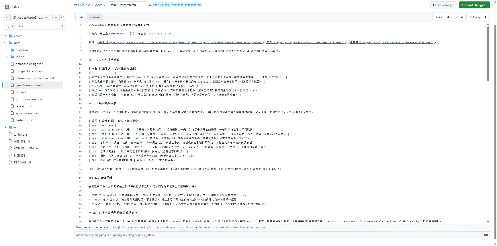
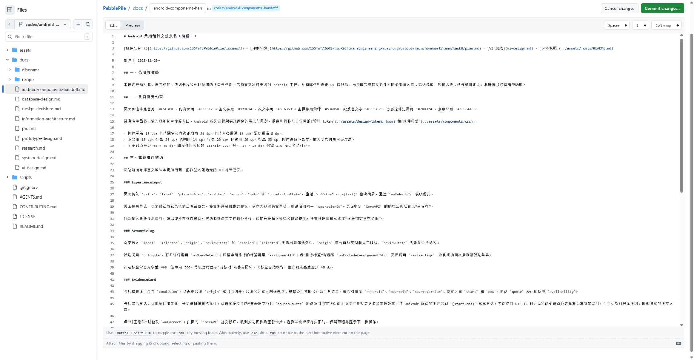

<!-- _class: cover -->

叠石 PebblePile · Android v0.1.0 冲刺手记

# 下一位同学拿到什么？

你所热爱的就是软件工程

<!--
0:00–0:20　王智壹旁白
大家好，我是王智壹。叠石这一版只做安卓。我们想让人记下一顿晚饭，隔几天还能找到当时的原话。接下来我代读大家做完各自那一段后留下的话。

画面　片名出现就开始讲。
-->

---

<!-- _class: scene -->

## 先把一顿晚饭写清楚

11 月 19 日发出任务单，11 月 20 日有了晚餐样例。林金晶交出输入，林叶鑫补上预期。

- **林金晶**　我把“重复”写成“把周一那顿饭再分享一次”，这一步就能直接拿来测了。

> 
>
> 11 月 20 日 · 林金晶提交的晚餐样例稿

<!--
0:20–0:55　王智壹旁白
十一月十九日，我把安卓这一版拆成十一张任务单。第二天，林金晶的样例里有道题。同一顿饭从分享菜单再发一次，算几顿？林叶鑫写下预期，郑嘉文拿去试接口。
林金晶说，“我把‘重复’写成‘把周一那顿饭再分享一次’，这一步就能直接拿来测了。”

画面　放会议截图 A，林金晶共享样例，林叶鑫指出预期。本页也可穿插 19 日的 4–6 秒当日原片。
换图时，用下一行替换右栏第一段，再把第二段改成实际日期、全名和交接动作。
> 
-->

---

<!-- _class: scene -->

## 先交一个能装的工程

陈柏睿与陈柯男约好详情怎么打开，李宗欣接工程做首装，两个入口再接同一套组件。

- **陈柏睿**　下回我还会先交一个能装的工程，让其他人早点在自己的手机上跑。
- **马晨曦**　我后来把“什么时候显示”也写在提示语边上，两边都能照着接。

> 
>
> 11 月 20 日 · 马晨曦提交的组件交接稿

<!--
0:55–1:24　王智壹旁白
陈柏睿和陈柯男先约好按编号开详情。李宗欣拿工程做首装，马晨曦把同一组保存提示交给两位前端。
陈柏睿说，“下回我还会先交一个能装的工程，让其他人早点在自己的手机上跑。”
马晨曦说，“我后来把‘什么时候显示’也写在提示语边上，两边都能照着接。”

画面　放会议截图 B，马晨曦共享提示语，陈柏睿指回触发条件。今晚的 6 秒操作片可放在本页。
换图时，用下一行替换右栏第一段，再把第二段改成实际日期、全名和交接动作。
> 
-->

---

<!-- _class: scene -->

## 重试一次，还能拿回原编号吗？

郑嘉文交回执样例。周恪玄把真实读写交还核心，把任务表交给陈飞扬。

- **郑嘉文**　同一次操作重试会拿回什么，我现在会把那份回执也附上。
- **周恪玄**　现在交数据库，我会请接手的人关掉应用，再用原编号找一遍。

> 同一条记录，关掉再打开
>
> 接手时再照对方的步骤做一遍

<!--
1:24–1:55　王智壹旁白
郑嘉文把回执给前端，和张洋约好输入输出。周恪玄照读写约定存下原话、回执和待办，再请林叶鑫重开回查。
郑嘉文说，“同一次操作重试会拿回什么，我现在会把那份回执也附上。”
周恪玄说，“现在交数据库，我会请接手的人关掉应用，再用原编号找一遍。”

画面　可换成郑嘉文与周恪玄对原编号的批注，保留接手人补写的那一行。
换图时，用下一行替换右栏第一段，再把第二段改成实际日期、全名和交接动作。
> 
-->

---

<!-- _class: scene -->

## 这次中断，别人能再做一遍吗？

张洋交算法回放，陈飞扬交中断恢复记录。林叶鑫分别复核，两路接通后由郑嘉文核对结果。

- **张洋**　我留着建议用到的那句原话。以后改了排序，还能回头比。
- **陈飞扬**　我现在会写清上一次停在哪一步，接手的人也能把那次中断重做一遍。

> 从中断到重开
>
> 陈飞扬交停下的位置，林叶鑫从同一步重试

<!--
1:55–2:27　王智壹旁白
张洋把依据交给林叶鑫回放。同时，陈飞扬用周恪玄的任务表验证中断恢复。两边都对上后，陈飞扬接入真实算法，郑嘉文复核结果。
张洋说，“我留着建议用到的那句原话。以后改了排序，还能回头比。”
陈飞扬说，“我现在会写清上一次停在哪一步，接手的人也能把那次中断重做一遍。”

画面　挑一小段回放或一张有两人批注的图，由陈飞扬或张洋标明自己后来补记了什么。
换图时，用下一行替换右栏第一段，再把第二段改成实际日期、全名和交接动作。
> 
-->

---

<!-- _class: scene -->

## 请另一个人从分享入口点回来

两个入口接到真库后交出 alpha.1。组件和建议接齐，再走一遍反馈和纠正。

- **陈柯男**　下回交详情页，我会请人从另一个入口点进来，再找一次原话。

> 两个入口，同一条原话
>
> 陈柏睿交首页，陈柯男从分享入口接回来

<!--
2:27–2:55　王智壹旁白
首页和分享接了真库，李宗欣就交出第一份测试包。等后台和组件也接好，陈柯男把反馈和纠正接回原事项。林叶鑫换成周末条件，再找一次原话。
陈柯男说，“下回交详情页，我会请人从另一个入口点进来，再找一次原话。”

画面　可以放两位前端交接时圈出的同一个编号，或林叶鑫写给陈柯男的一条复测意见。
换图时，用下一行替换右栏第一段，再把第二段改成实际日期、全名和交接动作。
> 
-->

---

<!-- _class: scene -->

## 最后，大家验的是同一个包

候选包分给林金晶回访、林叶鑫真机复测。王智壹核对两份结果，李宗欣发布同一份 APK。

- **林叶鑫**　我现在先把包的校验值写进报告，再记那次复测的结果。
- **李宗欣**　我把验过的那个文件留下来，发布时还能拿它和报告核对。

> 试用记录和复测报告放在一起
>
> 找到两份记录对应的那一个文件

<!--
2:55–3:31　王智壹旁白
晚餐流程走通，李宗欣交出候选包。林金晶拿它回访，林叶鑫拿它验收。我核对两份结果和复验记录后，李宗欣用同一份包发布了 0.1.0。林叶鑫从发布页下载复核，我才关掉里程碑。
林叶鑫说，“我现在先把包的校验值写进报告，再记那次复测的结果。”
李宗欣说，“我把验过的那个文件留下来，发布时还能拿它和报告核对。”

画面　可把候选包版本、报告里同一段校验值和接手人的确认放在一张图。发布后对着实际版本读本页。
换图时，用下一行替换右栏第一段，再把第二段改成实际日期、全名和交接动作。
> 
-->

---

<!-- _class: closing -->

## 下次派单，我会先问谁来接

- **王智壹**　下次派单，我会请接手的人也写一句，他拿到这份东西要做什么。

<!--
3:31–3:50　王智壹旁白
我原来会问，这张单做完了吗？往后跟了一遍，我更想知道接手的人还要补问哪一句。
我给自己留的一句是，“下次派单，我会请接手的人也写一句，他拿到这份东西要做什么。”

画面　读完王智壹的署名感想，停两秒收片。
-->
