<!-- _class: opening -->

# 下一位同学拿到什么？

叠石 PebblePile · Android 0.1.0 冲刺手记

你所热爱的就是软件工程　／　旁白 王智壹

> 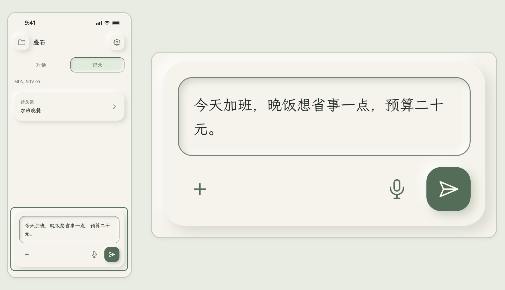
>
> 在首页记下晚餐原话

<!--
0:00–0:13　王智壹旁白
大家好，我是王智壹。我们这次做的是叠石的安卓版。我们期望的场景是今天在首页记下吃了一顿晚饭，过几天再问，还得能翻出当时那句原话。

画面　首页原型，右侧放大了晚餐原话。
翻页提示　让大家读完右边的输入框。说“十一月十九号”前，翻到 Issue #1。
原型　https://app.paper.design/file/01M41JA45T3KFWNYX3GFW8SB5Q/p-5-0
-->

---

<!-- _class: dispatch -->
<!-- _paginate: hold -->

## 十一张任务单，谁接哪一项？

11 月 19 日，一张总单列出十个模块和各自的负责人。

- **#1　王智壹**
  汇总模块认领，跟进接口交接和发布验收。
- **#2　林金晶**
  负责竞品实测和目标用户试用，把候选包的试用结果交回总单。

> 
>
> GitHub Issue #1「模块派单、接口对接与发布验收」

<!--
0:13–0:23　王智壹旁白
十一月十九号，我把工作拆成了十一张任务单。一号是总单，二号交给林金晶。就从她那碗热汤面说起。

画面　Issue #1 里的“模块任务”，第一行是林金晶接的 #2。
翻页提示　说完“热汤面”这句，翻到原型里的两条晚餐经历。
派单记录　https://github.com/155TuT/PebblePile/issues/1
-->

---

<!-- _class: scene -->

## 同一顿饭再分享一次，算几顿？

五号吃了热汤面，七号选了楼下简餐。这里记的是两顿饭。

> 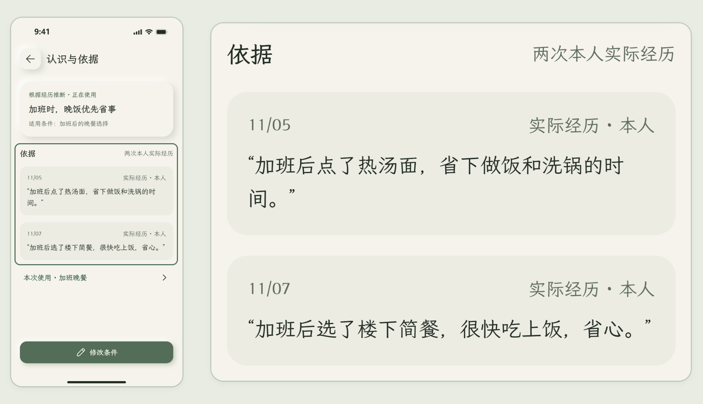
>
> 11 月 5 日和 7 日的两次晚餐经历

<!--
0:23–0:29　王智壹旁白
这是11月5日和7日的两次晚餐经历。五号吃了热汤面，七号选了楼下简餐。这里记的是两顿饭。

画面　原型里的两条晚餐经历。
-->

---

<!-- _class: scene -->
<!-- _paginate: hold -->

## 同一顿饭再分享一次，算几顿？

同一条热汤面记录从手机上再分享一遍，系统会算几顿？

- **林金晶**
  在 PR #13 写了两次晚餐经历。周一是热汤面，周三是盖饭。
- **林叶鑫、郑嘉文**
  林叶鑫写测试，郑嘉文试接口。两人都按同一个预期核对，热汤面发两遍只算一次，加上盖饭一共两顿。

> 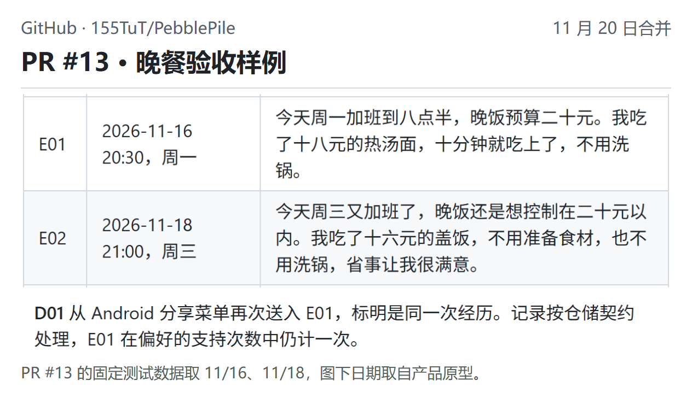
>
> PR #13 · 两次晚餐经历与一次重复分享

<!--
0:29–0:52　王智壹旁白
十一月二十号，林金晶在十三号 PR 里写了个测试样例。用户周一加班吃了碗热汤面，周三加班吃了份盖饭，两次都图省事。如果把周一那条记录又从手机上分享给叠石，系统会不会以为他又吃了一顿？林金晶写晚餐样例，林叶鑫据此定预期，郑嘉文按同一份输入准备接口，用的都是这组数据。他们要核对的结果也一样：周一那碗面发了两遍，只算一次；加上周三的盖饭，一共是两次经历。

画面　PR #13 的另一组晚餐样例和重复分享预期。
样例记录　https://github.com/155TuT/PebblePile/pull/13/files
-->

---

<!-- _class: scene -->

## 什么时候能显示“已保存”？

点了保存，标签还显示“正在整理”，那我刚记的晚饭存好了没有？

- **马晨曦**
  收到核心的成功回执，页面才显示“已保存”。

> 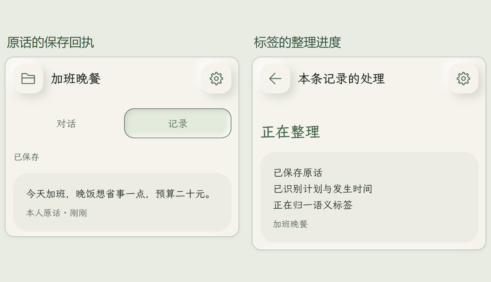
>
> 原话已保存，标签仍在整理

<!--
0:52–1:00　王智壹旁白
同一天，马晨曦的十二号 PR 里有个细节。点了保存，标签还显示“正在整理”，那我刚记的晚饭存好了没有？收到核心的成功回执，页面才显示“已保存”。

画面　原型里的“已保存”和“正在整理”，对应马晨曦写下的提示条件。
组件规格　https://github.com/155TuT/PebblePile/pull/12/files
-->

---

<!-- _class: scene -->
<!-- _paginate: hold -->

## 什么时候能显示“已保存”？

- **马晨曦**
  写明保存和整理的提示条件。标签整理出了错，单独重试这一步就行。
- **陈柏睿、陈柯男**
  陈柏睿做首页，陈柯男做分享入口，两个入口给的提示得一样。

> 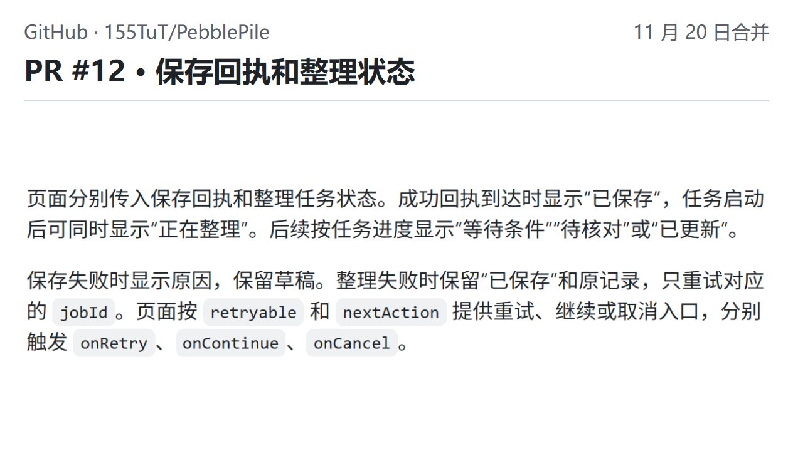
>
> PR #12 · 保存回执与整理失败后的重试规则

<!--
1:00–1:18　王智壹旁白
标签整理出了错，单独重试这一步就行。

马晨曦写明提示出现的条件，陈柏睿做首页，陈柯男做分享入口，两个入口给的提示得一样。

画面　PR #12 的组件规格。陈柏睿负责的首页和陈柯男负责的分享入口要共用同一套提示。
组件规格　https://github.com/155TuT/PebblePile/pull/12/files
-->

---

<!-- _class: scene -->

## 重开应用，还能找到原来的编号吗？

郑嘉文管保存回执，周恪玄管真实读写。两个人要对上的是同一个记录编号。

- **郑嘉文**
  同一次保存原样再发一遍，拿到的还得是头一次那个编号。
- **周恪玄、陈飞扬**
  周恪玄要把原话、回执和待办任务一起存好，还得把进度留给陈飞扬，好让他知道任务上回停在哪儿。

> 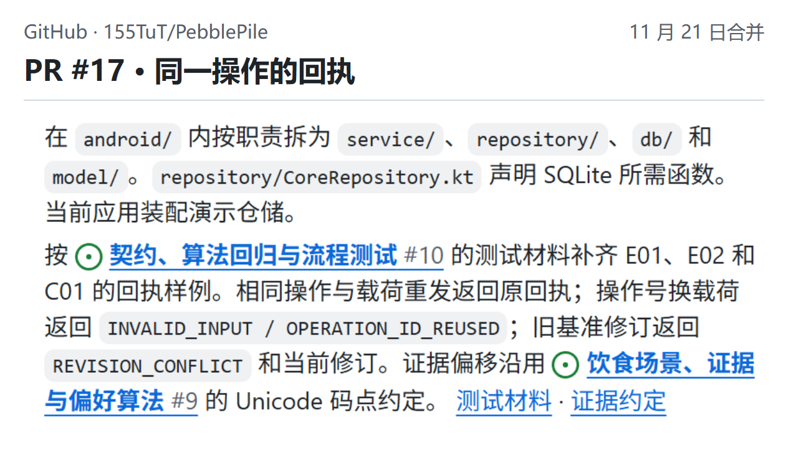
>
> PR #17 · 同一次保存重发时返回首次回执

<!--
1:18–1:42　王智壹旁白
回执上有个记录编号。郑嘉文管保存回执，周恪玄管真实读写。两个人要对上的是同一个记录编号。要是同一次保存请求发了两遍，郑嘉文得说清楚，第二次该回哪个号。

同一次保存原样再发一遍，拿到的还得是头一次那个编号。

周恪玄要把原话、回执和待办任务一起存好，还得把进度留给陈飞扬，好让他知道任务上回停在哪儿。

画面　PR #17 里同一次保存重发时的回执约定。
保存回执　https://github.com/155TuT/PebblePile/pull/17
-->

---

<!-- _class: scene -->
<!-- _paginate: hold -->

## 重开应用，还能找到原来的编号吗？

- **按原编号核对**
  验的时候关掉应用再打开，按这个编号找周一那碗热汤面，看当时那句话能不能一字不差地找回来。

> 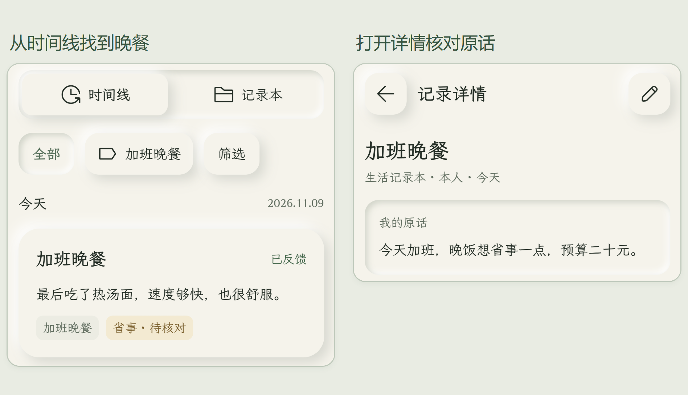
>
> 从记录库找回「我的原话」

<!--
1:42–1:51　王智壹旁白
验的时候关掉应用再打开，按这个编号找周一那碗热汤面，看当时那句话能不能一字不差地找回来。

画面　记录库时间线和详情里的“我的原话”。
画面对照　原型左边是记录库列表，右边的详情里有“我的原话”。
验收用例　A01 用首页保存的晚餐样例 E01 验证重开后的读回。11 月 21 日，真机验收表将这项列为“待实测”。
用例记录　https://github.com/155TuT/PebblePile/blob/main/docs/issue10-testing.md#L172-L176
-->

---

<!-- _class: scene -->

## 算法回放和任务恢复怎样接上？

建议要能指回原话，暂停的任务也要能接着跑。

- **张洋、林叶鑫**
  张洋留下建议引用的原话。林叶鑫用同一组输入再跑一遍，核对能否找回“今天加班，晚饭想省事一点，预算二十元”。
- **陈飞扬**
  负责中断恢复。两边接齐，再联调真实算法。

> 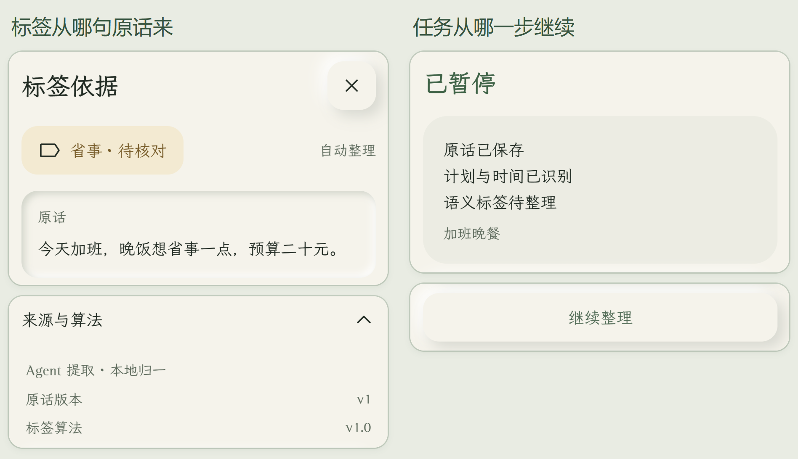
>
> 查标签的依据，从暂停处继续整理

<!--
1:51–2:05　王智壹旁白
流程图分了两路。建议要能指回原话，暂停的任务也要能接着跑。张洋管原话依据，陈飞扬管中断恢复。两边接齐，再联调真实算法。这条建议用的是哪句原话，张洋得把依据留给林叶鑫，好让他拿同一组输入再跑一遍。

顺着这条建议找回去，应该能看到“今天加班，晚饭想省事一点，预算二十元”这句原话。

画面　原型左边是标签依据，右边是暂停时的进度。
调度约定　https://github.com/155TuT/PebblePile/issues/8
-->

---

<!-- _class: scene -->
<!-- _paginate: hold -->

## 算法回放和任务恢复怎样接上？

陈飞扬先用固定结果把流程接起来。

- **周恪玄、陈飞扬**
  周恪玄提供任务表和检查点，陈飞扬再验证中断后能否从上一次提交的检查点接着跑。
- **陈飞扬、郑嘉文**
  两边都跑通后，陈飞扬接入真实算法，请郑嘉文核对。

> 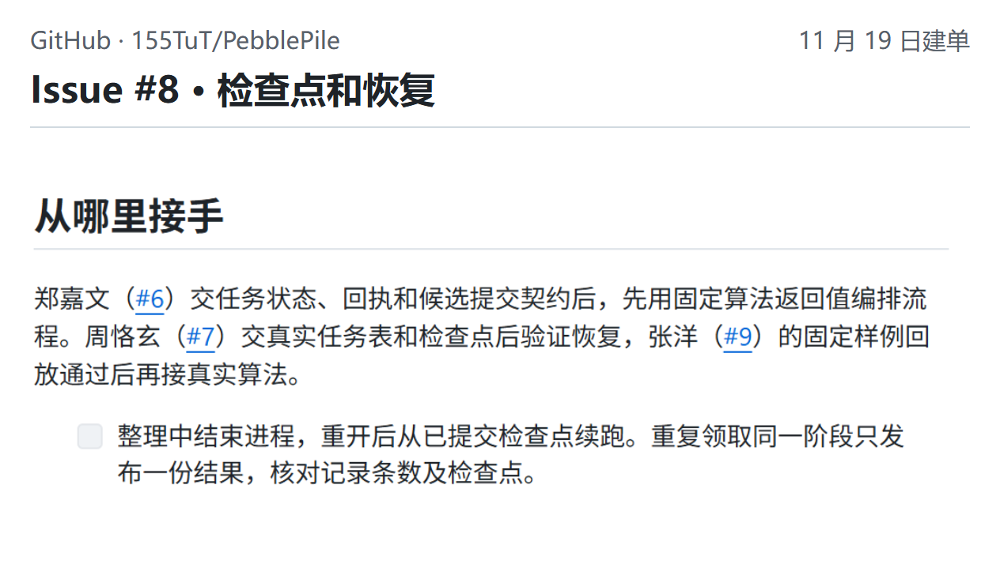
>
> Issue #8 · 任务表、检查点与中断恢复

<!--
2:05–2:23　王智壹旁白
陈飞扬先用固定结果把流程接起来，拿到周恪玄的任务表和检查点，再试中断恢复。等两边都跑通，他再接入真实算法，请郑嘉文核对。

整理到一半就结束进程。再打开应用，看任务能不能从上一个已提交的检查点接着跑。

画面　Issue #8 的交接顺序和检查点验收项。
画面对照　Issue #8 也提到张洋，他提供固定算法样例。这一页讲陈飞扬怎样接周恪玄的检查点，再请郑嘉文核对。
调度约定　https://github.com/155TuT/PebblePile/issues/8
-->

---

<!-- _class: scene -->

## 两个入口，怎么找回同一条原话？

PR #14 把首页、记录库、系统分享和详情放在同一次安卓联调里。

- **陈柏睿、陈柯男**
  陈柏睿把自己做的首页和陈柯男做的分享入口放在一起测了。从首页点“查看记录”，就能看到刚存的原话。

> 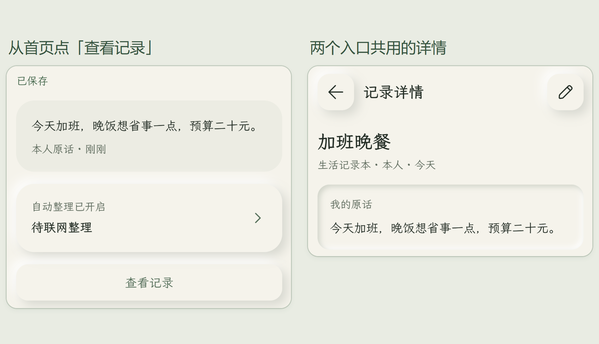
>
> 从「查看记录」回到同一句原话

<!--
2:23–2:33　王智壹旁白
十四号 PR 里，陈柏睿把自己做的首页和陈柯男做的分享入口放在一起测了。从首页点“查看记录”，就能看到刚存的原话。

画面　首页上的“查看记录”和打开后的详情。
双入口联调　https://github.com/155TuT/PebblePile/pull/14
-->

---

<!-- _class: scene -->
<!-- _paginate: hold -->

## 两个入口，怎么找回同一条原话？

这次自测用的是 Pixel 7 模拟器，接的是演示仓储。

- **首页入口**
  从首页存下“FinalIssue4Home”，按回执上的编号点开，读到的就是这行字。
- **系统分享入口**
  系统分享传进去的是“FinalIssue4Shared”。打开这条记录的详情，还是刚发的那行字。

> 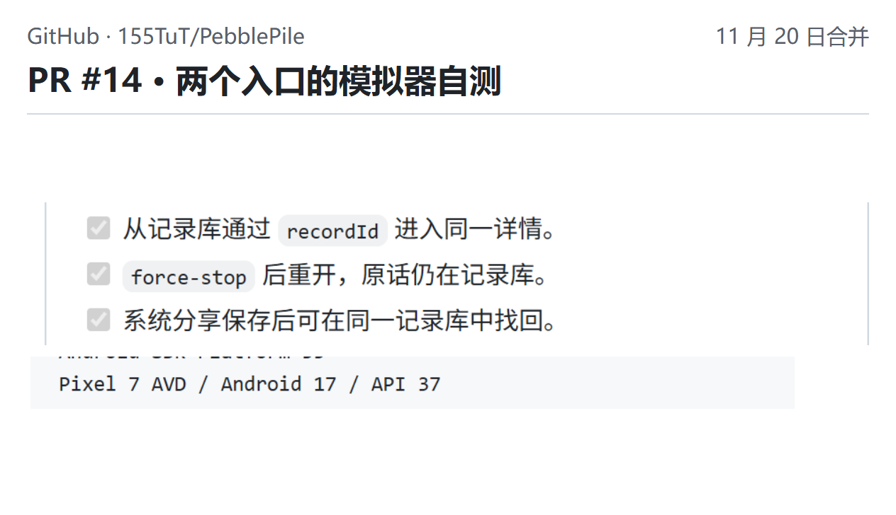
>
> PR #14 · Pixel 7 模拟器上的双入口自测

<!--
2:33–2:54　王智壹旁白
这次自测用的是 Pixel 7 模拟器，接的是演示仓储。两个入口各存一行不同的字，再按各自的编号打开详情。

从首页存下“FinalIssue4Home”，按回执上的编号点开，读到的就是这行字。

系统分享传进去的是“FinalIssue4Shared”。打开这条记录的详情，还是刚发的那行字。

画面　PR #14 的双入口自测和 Pixel 7 模拟器环境。
双入口联调　https://github.com/155TuT/PebblePile/pull/14
模拟器测试原文　https://github.com/155TuT/PebblePile/blob/main/android/ISSUE4_VERIFICATION.md#L33-L44
-->

---

<!-- _class: commit-graph -->
<!-- _paginate: hold -->

## 保存重试、写入回滚，测过了吗？

> 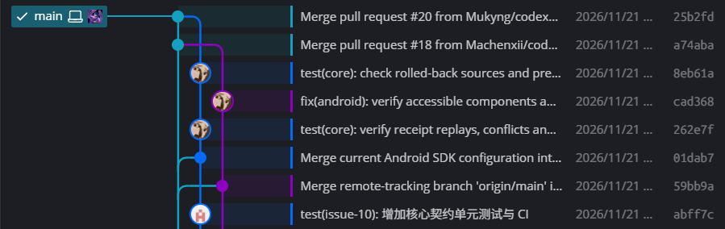
>
> 11 月 21 日 · PR #20 · 林叶鑫用内存仓储跑通 20 项契约测试。待周恪玄接入 SQLite，林叶鑫再复验。

<!--
2:54–3:08　王智壹旁白
二十一号，林叶鑫用内存仓储做了测试。保存请求重发，回执一样。写入失败，新记录和任务都没留下。二十项测试全过了，改动也合进了主线。

画面　11 月 21 日的 GitKraken 提交图。沿 PR #20 的分支从下往上看，最后停在合入主线的那一行。
画面对照　底行 `abff7c` 加入测试。讲重复保存时看 `262e7f`，两次返回的回执一致。讲写入失败时看 `8eb61a`，确认这次写入的原话来源也随记录一起撤回。最后停在顶行 `25b2fd`，PR #20 合入主线。该行的 Mukyng 是林叶鑫的 GitHub 账号。
复验说明　[PR #20 的测试结果和复验安排](https://github.com/155TuT/PebblePile/pull/20)
翻页提示　说完“合进了主线”，翻到候选包试用场景。
测试结果　https://github.com/155TuT/PebblePile/pull/20
合并提交　https://github.com/155TuT/PebblePile/commit/25b2fd60bfe8f18423931511ecd90ef706d9bed6
-->

---

<!-- _class: scene -->

## 最后验的是哪一个安装包？

按发布约定，回访和真机复测用同一份候选包。

- **林金晶、林叶鑫**
  林金晶回访，林叶鑫做真机复测。回访时可以填一句晚餐反馈，保存以后再对一遍原话。
- **王智壹、李宗欣**
  王智壹核对两份结果，再由李宗欣发布验过的包。

> 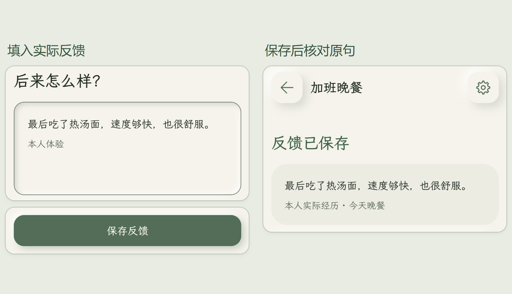
>
> 试用时核对保存前后的晚餐反馈

<!--
3:08–3:14　王智壹旁白
按发布约定，林金晶回访，林叶鑫做真机复测。我核对两份结果，李宗欣发布验过的包。回访时可以这样试，填一句晚餐反馈，保存以后再对一遍原话。

画面　回访示例，先填写反馈，再核对保存后的原句。
发布约定　https://github.com/155TuT/PebblePile/issues/11
-->

---

<!-- _class: scene -->
<!-- _paginate: hold -->

## 最后验的是哪一个安装包？

按 #11 的约定，李宗欣先交签名候选包。王智壹核对回访和真机记录用的是不是同一份包。

- **林金晶、林叶鑫**
  林金晶拿这份包回访。林叶鑫要在真机上断网保存，重开后按原编号找回原话。
- **李宗欣**
  用测试密钥签的包已经在模拟器上跑到首页了。接下来要交候选包，做回访和真机复测。

> 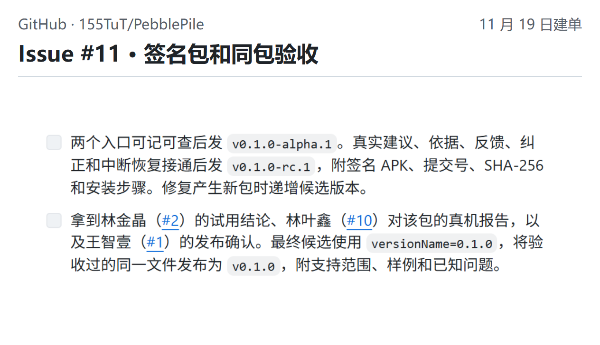
>
> Issue #11 · 同一份签名候选包的回访和真机记录

<!--
3:14–3:41　王智壹旁白
十一号任务单里约好了，李宗欣先交签名候选包，林金晶拿去回访，林叶鑫拿去做真机验收。我拿到两份记录，得确认他们验的是同一份包。等正式发布，还要从仓库把包下载回来，对一遍校验值。

真机上要断网存一句话，重开应用，看能不能用原编号把它找回来。

用测试密钥签的包已经在模拟器上跑到首页了。接下来要交候选包，做回访和真机复测。

画面　Issue #11 对同一份签名候选包的验收要求。
画面对照　右图继续停在 Issue #11。模拟器启动结果见 [PR #16](https://github.com/155TuT/PebblePile/pull/16)。
进展记录　11 月 21 日，Android release 工作流显示 0 次运行。真机验收表把离线保存后重开这一项列为“待实测”。PR #16 记录了测试密钥签名的包在模拟器上冷启动到首页。
签名与启动　https://github.com/155TuT/PebblePile/pull/16
真机验收表　https://github.com/155TuT/PebblePile/blob/main/docs/issue10-testing.md#L156-L176
发布工作流　https://github.com/155TuT/PebblePile/actions/workflows/android-release.yml
发布约定　https://github.com/155TuT/PebblePile/issues/11
-->

---

<!-- _class: closing -->

## 下次派单，我会补上哪一句？

改偏好，要选清“仅本次”还是“以后按此条件”。

- **王智壹**
  我想从一次实际交接里，找出下次派单时要写清的一句话。

> 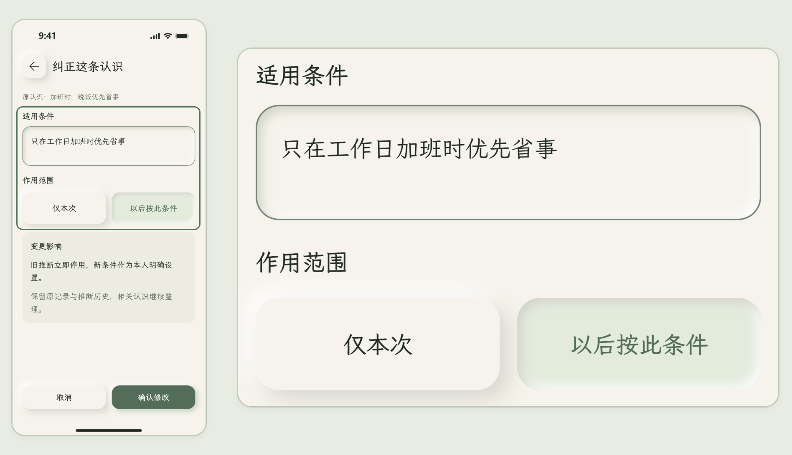
>
> 「仅本次」和「以后按此条件」

<!--
3:41–3:46　王智壹旁白
我想从一次实际交接里，找出下次派单时要写清的一句话。改偏好，要选清“仅本次”还是“以后按此条件”。派单也有一句得写清楚。

画面　纠正一条偏好时可以选的两种作用范围。
-->

---

<!-- _class: closing -->
<!-- _paginate: hold -->

## 下次派单，我会补上哪一句？

我想从一次实际交接里，找出下次派单时要写清的一句话。

- **王智壹**
  下次派单，我会写清楚复测该用哪张回执上的编号。

> 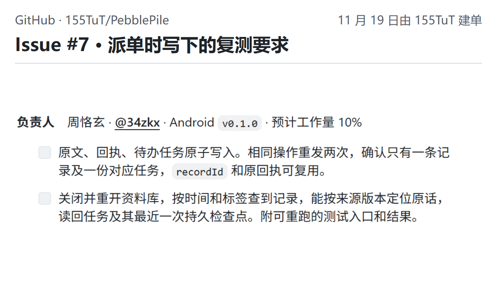
>
> Issue #7 · 王智壹写下的记录编号复测要求

<!--
3:46–4:04　王智壹旁白
回头看这十一张单子，我最想改的是重开应用这一项。换我来验，我知道要找周一那碗热汤面，也知道得把应用关了再开。可打开记录库，我该点哪一条？

下次派单，我会写清楚复测该用哪张回执上的编号。

画面　Issue #7 里按记录编号复测的要求。
画面对照　右图的建单人 155TuT 是王智壹，正文“负责人”一栏的周恪玄接手存储任务。这里由王智壹回看自己当时写的验收要求。
收片　读完最后一句，停两秒。
派单记录　https://github.com/155TuT/PebblePile/issues/7
复盘材料　这句按追问记录编号的情形写。录制时对照自己参与过的交接，把最想改的一句写在姓名下。
-->
