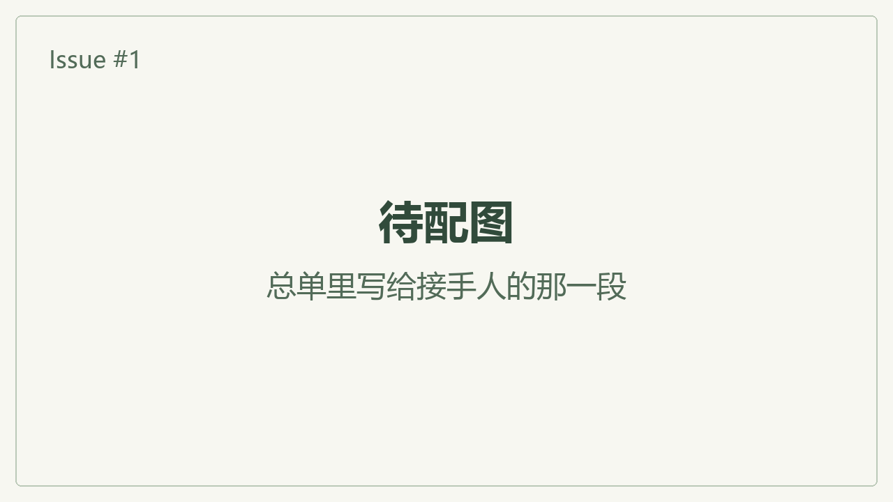
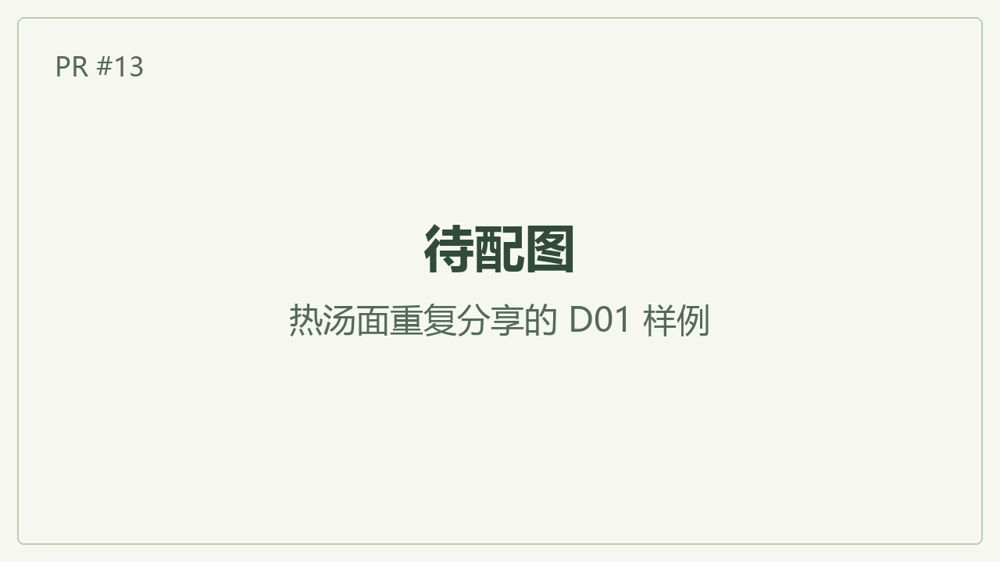
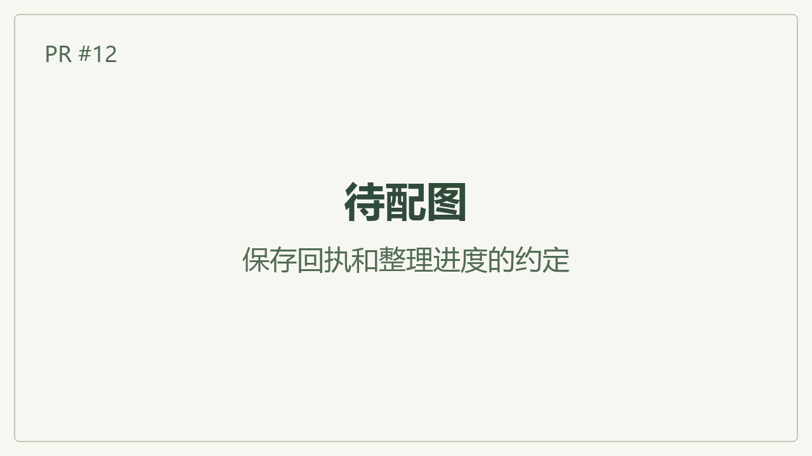
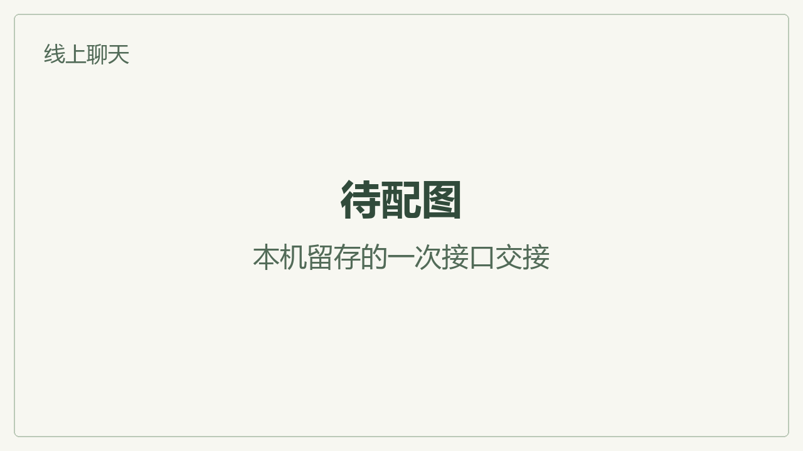
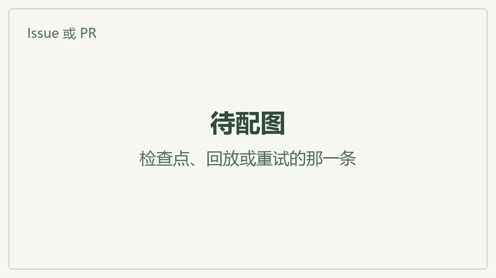
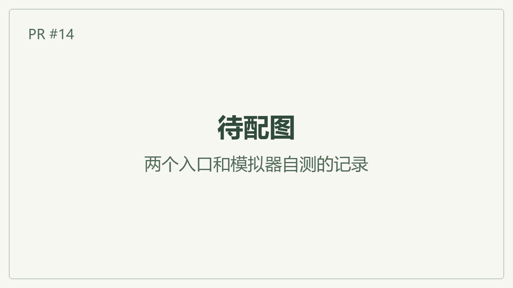
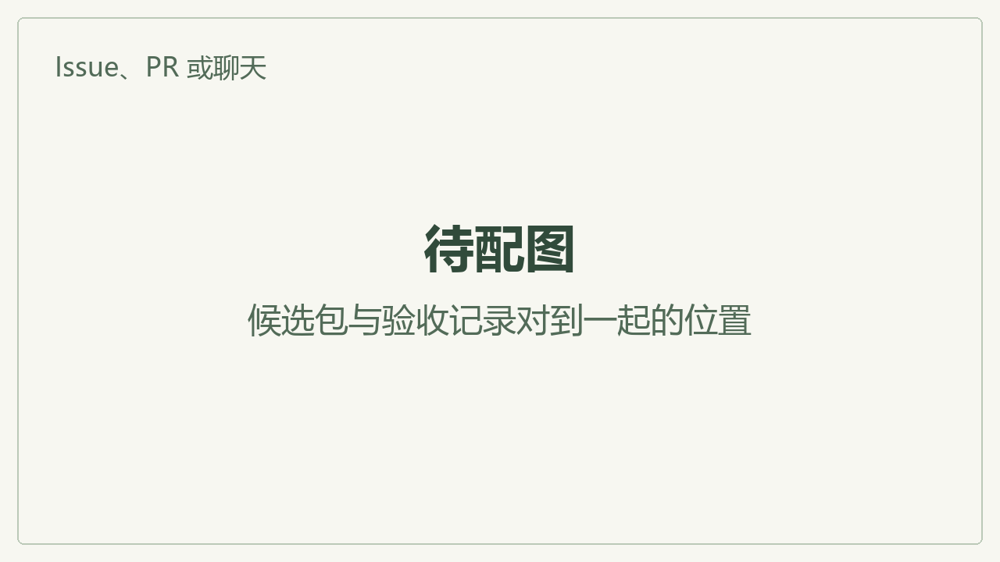
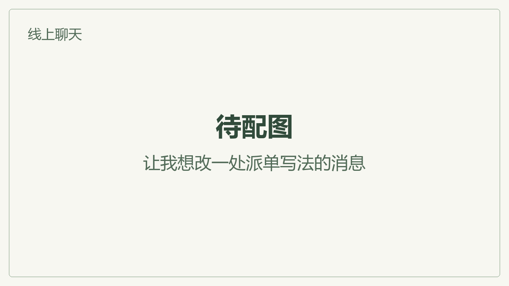

<!-- _class: opening -->

# 下一位同学拿到什么？

叠石 PebblePile · Android 0.1.0 冲刺手记

你所热爱的就是软件工程　／　旁白 王智壹

> 
>
> 11 月 19 日 · Issue #1 · 派单与接手

<!--
0:00–0:23　王智壹旁白
大家好，我是王智壹。叠石这一版只做安卓。记过一顿晚饭，过几天再问，还应该能找到当时那句原话。十一月十九日，我把工作拆成十一张任务单。回头看这些单子，我想讲讲每份东西交出去以后，谁接着用。

翻页提示　说到“十一张任务单”时，停一下，让大家看清总单。
取图　Issue #1。截标题、日期和“从哪里接手”或“交给谁”。
来源　https://github.com/155TuT/PebblePile/issues/1
-->

---

<!-- _class: scene -->

## 同一顿饭再分享一次，算几顿？

林金晶写晚餐样例，林叶鑫据此定预期，郑嘉文按同一份输入准备接口。

- **林金晶**　【待填｜样例中的哪一处，让下一位知道怎么验】

> 
>
> 11 月 20 日 · PR #13 · 重复分享的预期

<!--
0:23–0:52　王智壹旁白
十一月二十日，林金晶在十三号 PR 里放了个样例。周一记过一碗十八元的热汤面，从分享菜单再发一遍，还是同一顿。周三的盖饭才是第二次经历。林叶鑫和郑嘉文可以拿同一组输入，分别定预期、试接口。

翻页提示　接着念屏幕上林金晶名下那一句。
取图　PR #13。在 Files changed 找 D01，截重复分享 E01 后仍计一次的那一行。
来源　https://github.com/155TuT/PebblePile/pull/13/files
-->

---

<!-- _class: scene -->

## 什么时候能显示“已保存”？

马晨曦写明提示出现的条件，陈柏睿和陈柯男分别接首页与分享入口。

- **马晨曦**　【待填｜规格里哪一句帮前端分清了保存和整理】

> 
>
> 11 月 20 日 · PR #12 · 保存反馈的组件规格

<!--
0:52–1:18　王智壹旁白
同一天，马晨曦在十二号 PR 里把两种状态分开写。核心返回保存成功，页面再显示“已保存”。标签还在处理，就另写“正在整理”。陈柏睿负责首页，陈柯男负责分享，两边需要看懂的是同一个判断。

翻页提示　接着念屏幕上马晨曦名下那一句。
取图　PR #12。在 Files changed 搜“已保存”，截回执条件和对应的提示语。
来源　https://github.com/155TuT/PebblePile/pull/12/files
-->

---

<!-- _class: scene -->

## 重开应用，还能找到原来的编号吗？

郑嘉文管保存回执，周恪玄管真实读写。两个人要对上的是同一个记录编号。

- **郑嘉文**　【待填｜我在聊天或任务单里看到的回执约定】
- **周恪玄**　【待填｜重开后实际查到什么，或这一步还等什么】

> 
>
> 线上聊天 · 保存回执与记录编号

<!--
1:18–1:51　王智壹旁白
沿着保存按钮再往下看，郑嘉文负责写清同一次操作重试会拿到什么。周恪玄负责把原话、回执和待办任务一起存下，也要让陈飞扬读到任务停下的位置。这段交接可以问得很具体。关掉应用，再拿原编号去找，还能不能找到那句话？

翻页提示　依次念屏幕上郑嘉文、周恪玄名下的两句。
取图　线上聊天。从已有聊天选一次派单、追问或回复。截日期和相邻的一两句。只有发出的要求时，就讲你交代了什么。
-->

---

<!-- _class: scene -->

## 算法回放和任务恢复怎样接上？

流程图分了两路。张洋管原话依据，陈飞扬管中断恢复。两边接齐，再联调真实算法。

- **张洋**　【待填｜现有记录里可核对的一句原话或交付进展】
- **陈飞扬**　【待填｜实际停在哪一步、从哪里恢复，或还在等什么】

> 
>
> 后台交接 · 依据与检查点

<!--
1:51–2:23　王智壹旁白
流程图在这里分成两路。张洋负责让建议能指回原话，交给林叶鑫回放。陈飞扬先用固定结果试中断恢复，再接周恪玄的检查点。等回放和恢复两边都走通，陈飞扬才能接入真实算法，请郑嘉文复核结果。

翻页提示　依次念屏幕上张洋、陈飞扬名下的两句。
取图　Issue 或 PR。先看 #8 的恢复约定或 #9 的依据要求。有实际回放的 PR 或评论时，优先截带输入与结果的一小段。
来源　https://github.com/155TuT/PebblePile/issues/8
-->

---

<!-- _class: scene -->

## 两个入口，怎么找回同一条原话？

PR #14 把首页、记录库、系统分享和详情放在同一次安卓联调里。

- **陈柏睿**　【待填｜从首页保存到详情，我在记录里核到哪一步】
- **陈柯男**　【待填｜从系统分享回到同一条原话，记录里有什么结果】

> 
>
> 11 月 20 日 · PR #14 · 首页与系统分享联调

<!--
2:23–2:54　王智壹旁白
陈柏睿的十四号 PR，把他负责的首页和陈柯男负责的分享入口放进了同一次联调。两个入口都按记录编号开详情。PR 里写明，这次是在 Pixel 7 模拟器上用演示仓储做的自测。

翻页提示　依次念屏幕上陈柏睿、陈柯男名下的两句。
取图　PR #14。截 PR 的导航约定、验证结果或验证环境，保留能看出记录编号或模拟器的文字。
来源　https://github.com/155TuT/PebblePile/pull/14
-->

---

<!-- _class: scene -->

## 最后验的是哪一个安装包？

按发布约定，林金晶回访，林叶鑫做真机复测。王智壹核对两份结果，李宗欣发布验过的包。

- **林叶鑫**　【待填｜包的版本和真机复测结果，与试用记录怎样对应】
- **李宗欣**　【待填｜实际版本、同包复核或正式发布进度】

> 
>
> 构建与验收 · 候选包版本和交接记录

<!--
2:54–3:27　王智壹旁白
发布这一段，十一号任务单约定的是同一个文件。李宗欣负责交出签名候选包，林金晶拿它回访，林叶鑫拿它做真机验收。到我这里，要把两份记录对回那一份包。正式发布时还要从仓库重新下载，核一次校验值。

翻页提示　依次念屏幕上林叶鑫、李宗欣名下的两句，版本和发布进展照记录读。
取图　Issue、PR 或聊天。优先截 #11、相关 PR 或已有聊天里能看见版本及复核结果的一处。只有发布约定时，截任务单的验收项。
来源　https://github.com/155TuT/PebblePile/issues/11
-->

---

<!-- _class: closing -->

## 下次派单，我会补上哪一句？

我想留住这条消息，以及下次派单时准备改的一处写法。

- **王智壹**　【待填｜这段交接让我看清了什么，下次我会怎样写】

> 
>
> 线上聊天 · 王智壹的交接记录

<!--
3:27–3:50　王智壹旁白
我最后想留的是一段自己参与过的交接。任务单里是一项工作，聊天里往往是一个更小的问题。对照当时发出去的那句话，我给下一次派单留一条具体的改法。

翻页提示　念屏幕上王智壹名下那一句，停两秒收片。
取图　线上聊天。选自己参与的一次派单、澄清或补充。保留与感想直接有关的原消息和日期。
-->
